# Circularity UI: what changed

For the product overview (what Circularity does, every screen and every role) read [`README.md`](README.md). This file is the reviewer walk-through, one section per update, newest first.

Open `index.html`. The app opens on a **sign-in form** (Update 9): type `exec` or `ops` and any password, and it opens on that person's home page. With `ops`, pick a returned asset and follow its ten journey steps (Update 10). Update 8 adds the **Executive** and **Warehouse Manager** accounts, the guided treatment page and **Process orchestration**. Updates 1 and 2 live under **Integration** in the left menu, on the tabs along the top.

**Quick links:** [Update 12: Agent-first workbench](#update-12-agent-first-workbench-in-progress-branch-feature-agent-first) · [Update 11: Command Center by section, Asset Intelligence restructure](#update-11-command-center-by-section-asset-intelligence-restructure-redeploy-and-cost-wording-edge-cases) · [Update 10: Journey-led flow, line-item learning](#update-10-journey-led-flow-step-guidance-value-that-builds-line-item-learning) · [Update 9: Sign-in, demo path, retrieved vs predicted](#update-9-sign-in-form-one-asset-demo-path-retrieved-vs-predicted) · [Update 8: Guided flow and senior views](#update-8-guided-decision-flow-senior-and-operational-views-enterprise-handoffs) · [Update 7: Role-based views](#update-7-role-based-views-sign-in-as-a-role) · [Update 6: Treatment intelligence](#update-6-treatment-intelligence) · [Update 5: Asset intelligence](#update-5-asset--product-intelligence) · [Update 4: Sidebar sections](#update-4-sidebar-with-sections) · [Update 3: Command Center](#update-3-command-center-new-home-page) · [Update 1](#update-1-separate-systems-and-crud) · [Update 2](#update-2-live-connections-workflow-states-tables-and-health) · [Demo script](#two-minute-demo-script) · [Good to know](#good-to-know)

---

## Update 12: Agent-first workbench (in progress, branch `feature/agent-first`)

**Why:** the PR *Agent-First Circularity Decision Workbench (Product-Wide)* ([`docs/PR_AGENT_FIRST_WORKBENCH.md`](docs/PR_AGENT_FIRST_WORKBENCH.md)). The build plan, the gaps found in the code and the open decisions are in [`docs/PLAN_AGENT_FIRST_WORKBENCH.md`](docs/PLAN_AGENT_FIRST_WORKBENCH.md). Every open decision is built on the PR default and marked **(assumed)**. Add `?agent=0` to the address to get the 22 Oct demo build back (remembered on the device; `?agent=1` turns the new product on again).

> **Legal review.** This update adds autonomy settings, approval limits, attribution of agent-prepared work, audit and evidence-pack wording, personal-data flags and local persistence of what people did. Kinective's Legal team should review that wording and those defaults before they are relied on or shown to clients. All data stays synthetic.

### Phase 0 and 1: one actions layer, state that survives a refresh

| What | Where | What you see |
|---|---|---|
| **Actions registry** | `ACTIONS`, `defAction`, `invoke()` (`/*AF-START*/` block) | 50+ named actions (`decision.approve`, `evidence.request`, `source.update`, `workflow.publish` …), each with a risk tier (read, draft, act, commit, system), the permission it needs, an idempotency key and an agent-readable description. Every state-changing button now calls `invoke()`, which checks role, tenant and warehouse, state, and repeats before anything changes. Nothing looks different on screen |
| **Handlers never read the page** | `ACT.confirmApprove` and 40 other buttons | Each button reads its own form and passes typed input; the change itself happens in a pure handler. The approval modal, decline, notify, tenant request, MCP proposal, source drawer, tables, workflows and identity all work this way |
| **Repeats are no-ops** | Stage keys `<case>:<stage>:<step>` | A double click, Back then Next, or a replayed acknowledgement creates no second approval, instruction, event, request or notification. The second try says *Already done* |
| **References are stable** | `approvalRef`, `ackRef` | Approval and work-order numbers come from the case and step, not from counters, so the same decision keeps the same reference after a refresh |
| **A refresh keeps everything** | `circ-af-v1` in local storage | Approvals, acknowledgements, outcomes, evidence requests and results, declines, notifications, comments, access requests and decisions, delegations, source and table changes and workflows are written to one journal and replayed on load. Two open tabs stay in step. Resetting clears it |
| **Agent rules from day one** | `invoke()` | An action prepared by an agent can never run a `commit` action (approve, override, decline, confirm outcome, publish, change sources or access). Excluded routes cannot be approved, so a failed gate is never waived |
| **Honest simulation** | Source map, MCP client, handoff steps, events | *Simulated feed*, *Simulated live*, *connected (simulated)*, *Acknowledged (simulated)*, *Approve and hand off (simulated)*; simulated events carry the tag in the event stream |
| **Inventory and checks** | `ACT_INVENTORY`, Demo data checks | Every one of the 252 button handlers is classified (adapter, dialog, draft, simulation, view). New checks: every state-changing button calls `invoke()`; every action is pure and fully described; no stage key is written twice |

---

## Update 11: Command Center by section, Asset Intelligence restructure, redeploy and cost wording, edge cases

**Why:** the Product Owner's review of the Command Center and Asset Intelligence, and the recorded *Circularity Deck Finalization* call, both on 19 Oct 2026, ahead of the demo video (20–21 Oct) and the presentation (22 Oct). The plan, its check of the call notes and the open decisions are in [`docs/feature-demo-refactor-iter-three.md`](docs/feature-demo-refactor-iter-three.md). Points marked **(assumed)** follow the plan's defaults (J1–J10) until the Product Owner confirms them.

> **Legal review.** This update changes wording about redeployment under customer contracts, who certifies equipment (the EAM and quality systems, not Circularity), where costs come from, and what the Command Center figures mean. The Legal team should review that wording before it is relied on or used with clients. All data stays synthetic.

### What changed, where

| Area | Where | What you see |
|---|---|---|
| **Uplift hidden** (U1, J1) | Command Center, Asset Intelligence | *Uplift vs baseline* is gone from the home screen for Finance, Executive and Admin, and *Uplift vs sell as-is or scrap* from the Commercial value card. Plain alternatives to choose from: **Extra value recovered** (*$652k more than selling as-is or scrapping*), **Value recovered** (already *Net recovery*), **New purchases avoided** (already *Avoided spend*). Analytics is unchanged. One flag brings it back (`FEAT.uplift`) |
| **Command Center by section** (U2, T8, J2) | Sidebar → Command Center | Each sidebar entry opens its own page: Key figures, Exceptions, Actions on me, Handed off, Approvals inbox, Outcomes to confirm, Actions to prioritise, Signals and capacity, Integration health. **Portfolio charts** and **Value realisation** are not separate entries: they sit on the **Key figures** landing page, under the figures. A role sees only the sections its view has (the Executive: Key figures, Exceptions). `#/command` opens **Key figures**, with **What these figures mean** at the bottom: a plain definition for each figure (*Value at risk* = predicted recovery value lost in the next 30 days if nobody acts, by reason). Each page says in one line what it shows. Tiles that used to scroll now open their section; filtering tiles open *Actions to prioritise* |
| **Pool optimizer hidden** (U3) | Everywhere in the UI | No sidebar entry, no `#/product/pools` route, no *Portfolio Optimization Mode* switch, no pool block in the full analysis, no *Pool efficiency* in Analytics; Process orchestration says *Optimise plan*. The code and data stay; one flag brings it back (`FEAT.pools`). The MCP tool catalogue still lists `optimize_pool` (hiding it would break the seeded agent call log) |
| **Product menu** (U4, J3) | Sidebar → Product | **Asset intelligence** first, then Returned assets and Expected returns. The *Product* heading still opens Returned assets, where the journey starts (assumed, J3) |
| **Asset Intelligence layout** (U5, J4) | Asset Intelligence | Two pages: **Retrieved data** (`?zone=known`, journey step 1) and **Predictions** (`?zone=predicted`, steps 2–3). Each is its own page; they never share a scroll. There is **no left menu**: the guide bar at the bottom (*Continue to step 2*, *Back*) moves between them, as the Product Owner asked. The detail views (Lifecycle, Condition, Product & Components, Economic Analysis, Eligibility & Compliance, Data & Evidence, Related Assets) open from each card's *View details* under their page, with a link back (*Predictions › Economic Analysis*). *Compare similar assets* moved to the **Actions** menu. On a phone the menu becomes a row |
| **Cost inputs** (T3, J9) | Asset Intelligence, retrieved section; Economic intelligence | *How do you get the cost?* A **Cost inputs** card: catalogue value (PLM / ERP), **return authorisation RMA-…** (Order Management) and the WMS receipt, the repair scope (EAM diagnostics), and **contracted part prices** (procurement, supplier contract SC-…). On the predicted side, **How the preparation cost is built**: contracted parts + labour and transfer (prep-cost-time) = the preparation line (RT-1048: $1,000 + $800 = $1,800). The header adds *Return authorisation* |
| **Certification** (T5) | Certified period, Matched demand | *Certified in QMS by the EAM diagnostic and quality process after inspection and any part replacement*, and *Circularity reads this certificate; it does not certify equipment*. Matched demand compares the life the contract needs with the certified life (*24 months needed · 24 certified · Covered*) |
| **Redeploy to the customer** (T2, J5) | RT-1048 everywhere | Redeploy goes **to Customer A (Site 3)** against **contract replacement order SO-48102**, which **accepts a certified refurbished unit**; orders that need a new unit are never matched. Decision card *Redeploy RT-1048 to Customer A (Site 3)*; instruction preview, step 2, the guide and the header (*Contract demand*) use the same words. Route names and values do not change |
| **Channel opportunity** | Command Center, Key figures | The *Treatment opportunity* chart (predicted volume in units by route) is renamed **Channel opportunity** |
| **Journey steps 2–4 on Treatment Intelligence** | Journey strip and guide | **Step 2** opens Treatment Intelligence on **All pathways** (every possible outcome), **step 3** the **recommended path** just below it, **step 4** *Why this outcome* and the *what-if*; steps 5–10 are unchanged. Asset Intelligence's Predictions page is no longer a journey stop: it is one link away from Retrieved data (*See what Circularity predicts for this asset*) and links back |
| **Possible outcomes first** | Treatment Intelligence, step 2 | Step 2 is now **Possible outcomes and the recommended one**: the *All pathways* table (every route, eligible or withheld with its reason) comes first, then the recommended outcome and the what-we-know / what-we-predict card. The rest of the flow is unchanged |
| **Edge cases** (T4, J6) | Treatment Intelligence, step 4 | Two new buttons: **Critical part unavailable** withholds redeploy, re-lease and whole-unit sale (*critical component failed; no replacement in supplier contracts, so EAM and QMS cannot re-certify its life*): for RT-1048, *Recover parts* ranks first. **Customer requires a new unit** withholds redeploy. Each reason shows in the eligibility list and the what-if chips |
| **Signals** (T6, J10) | Returned assets, Status column | Under each status, four signals (received, diagnostics, certification, economic path) and the next one awaited: *4/4 · ready*, *1/4 · awaiting EAM*. Assets without a route say *Not priced yet* instead of a dash |
| **Region menu** (T7, J7, J8) | Top bar, globe | **Language** (English; Japanese, German, French and Finnish as a *preview* of the menu, the journey steps and the guide; not reviewed by a native speaker), **time zone** (shown on the *As of* pill and the Command Center clock), **local currency** (₹, ¥, €; illustrative rates) for Asset Intelligence's local-currency view. Saved per browser |
| **Flow diagram** (T1) | [`docs/demo/user-flow.svg`](docs/demo/user-flow.svg), [`.png`](docs/demo/user-flow.png), [`.md`](docs/demo/user-flow.md) | The top row is *Planner · Sign in → Planner · Returned assets*; the Exceptions box is gone. Box texts use the new cost and contract wording |
| **Scripts** (T9) | [`docs/demo/DEMO_SCRIPT.md`](docs/demo/DEMO_SCRIPT.md), new [`docs/demo/VOICEOVER_SCRIPT.md`](docs/demo/VOICEOVER_SCRIPT.md) | Happy path first, then edge cases, integration (Source map, manual import), the Command Center; Q&A for cost, certification, Value at risk and uplift. A 13-scene, four-minute narration for the AI voiceover |

### Changed behaviour (and changed test expectations)

- `#/command` no longer shows every section. The role, guided-flow and demo suites now open the section they check (`#/command/exceptions`, `/aome`, `/approvals`, `/outcomes`); the role suite checks every section page for each role. Finance and Admin have four key figures (uplift hidden).
- Asset Intelligence has two pages instead of one Overview: suites open `?zone=known` or `?zone=predicted` for what they check, and the step-1 collapse (iteration two) is replaced by the separate Predictions page. Asset tab selectors moved from `.astabbar` to `.asside`. The role suite turns `FEAT.pools` on, so the hidden pool code stays covered.
- Wording checks for RT-1048's demand (*Customer A, Site 3*, *contract demand*) were updated in the iteration-two suite.

### Screenshots

| Command Center: key figures and definitions | Command Center: Exceptions page | Admin: Actions to prioritise |
|---|---|---|
| [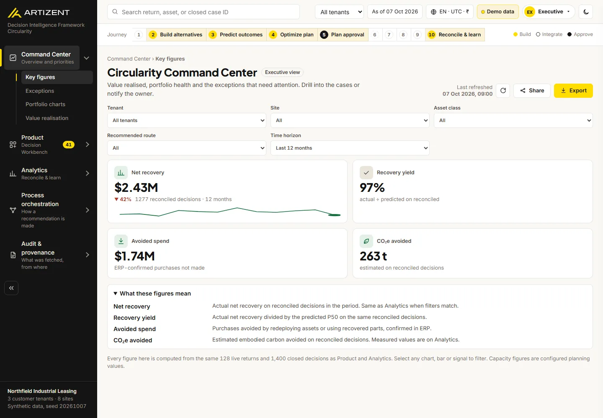](docs/screenshots/iter3-command-overview.webp) | [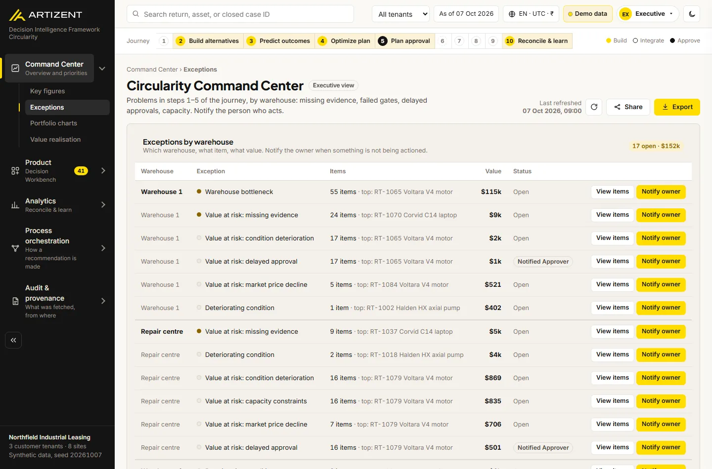](docs/screenshots/iter3-command-exceptions.webp) | [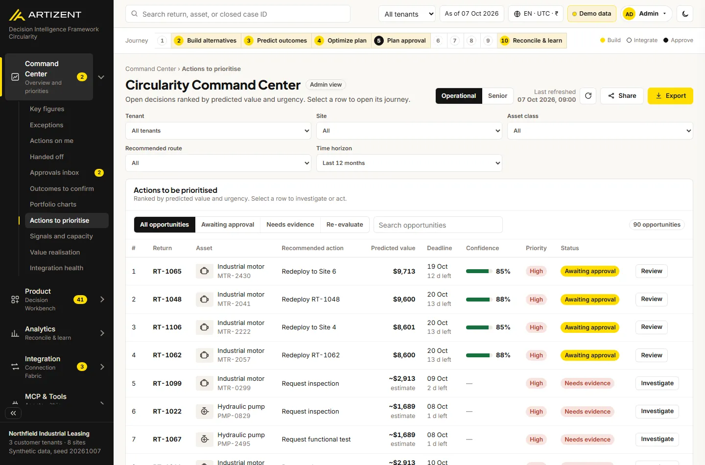](docs/screenshots/iter3-command-admin-actions.webp) |
| **Asset Intelligence: menu, retrieved first, cost inputs** | **Predictions: eligibility, demand, certified life** | **Edge case: critical part unavailable** |
| [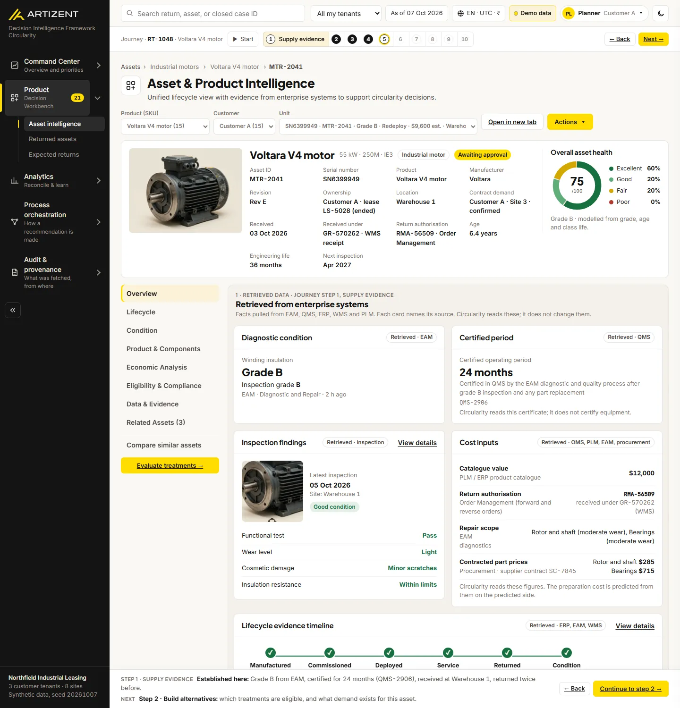](docs/screenshots/iter3-asset-layout.webp) | [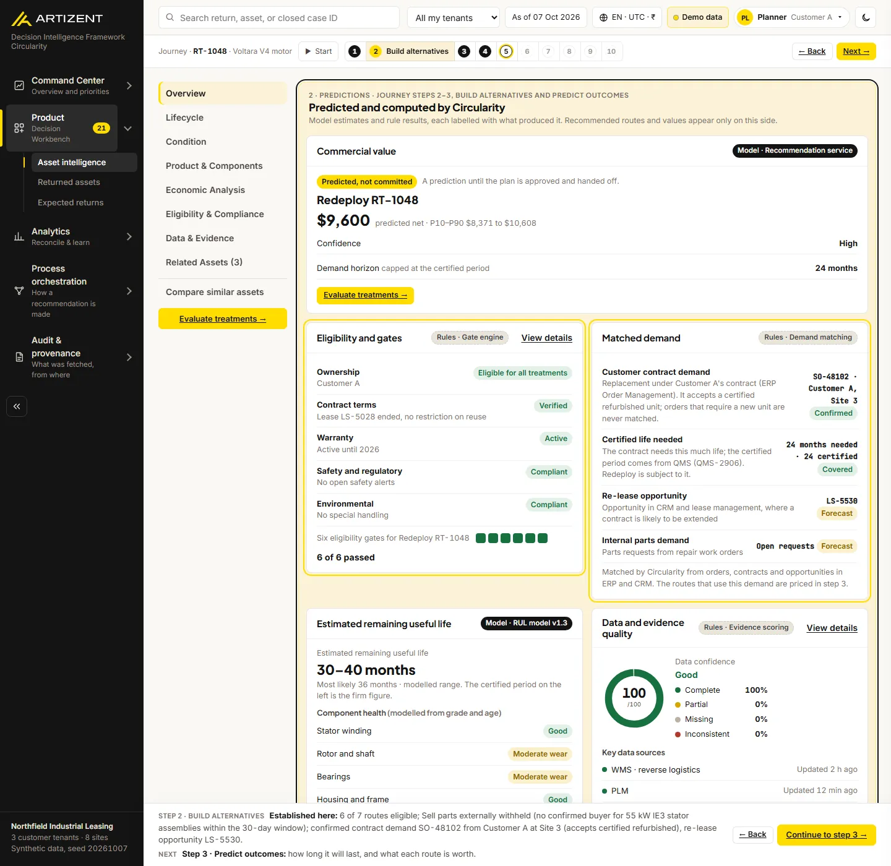](docs/screenshots/iter3-asset-predictions.webp) | [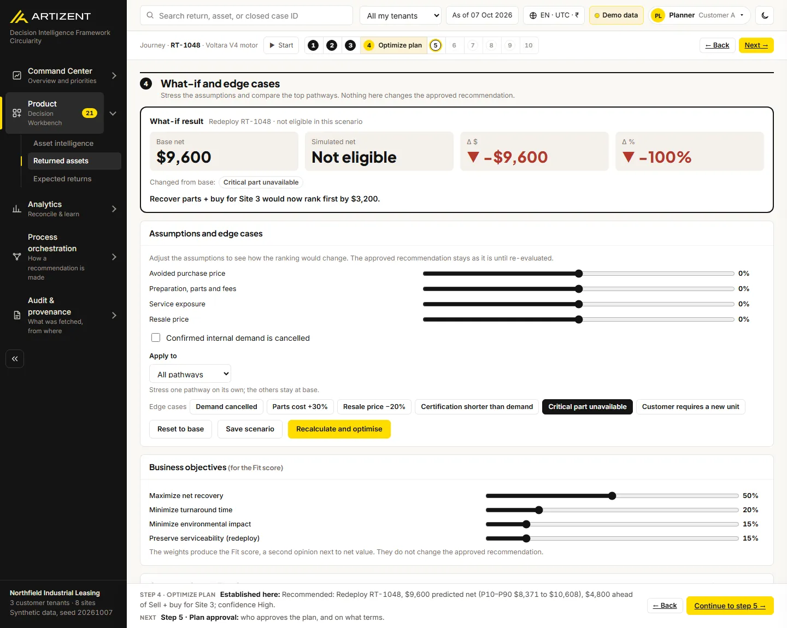](docs/screenshots/iter3-edge-critical-part.webp) |
| **Returned assets: signals** | **Region menu, Japanese preview** | **Dark mode · Phone** |
| [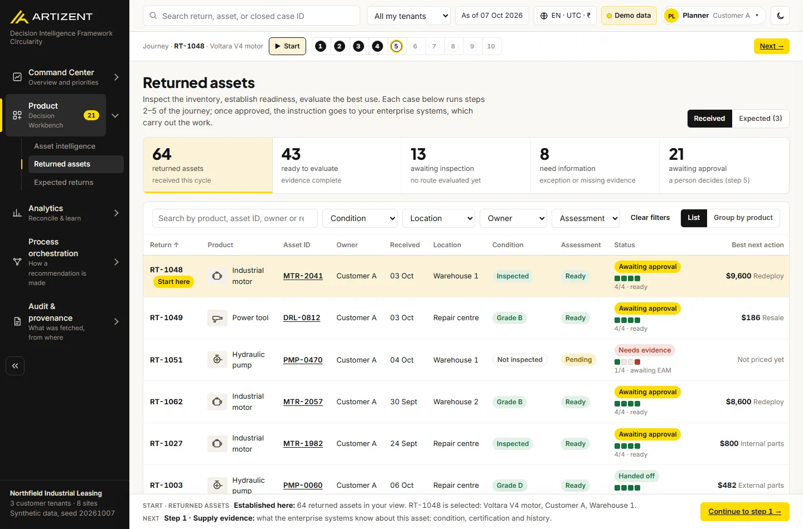](docs/screenshots/iter3-returned-signals.webp) | [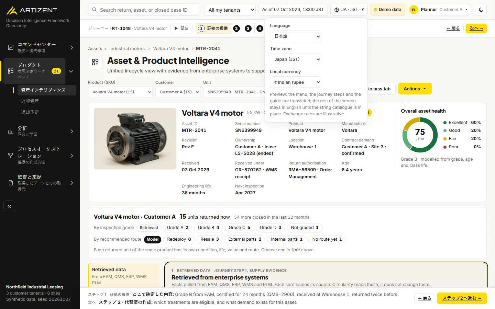](docs/screenshots/iter3-region-ja.webp) | [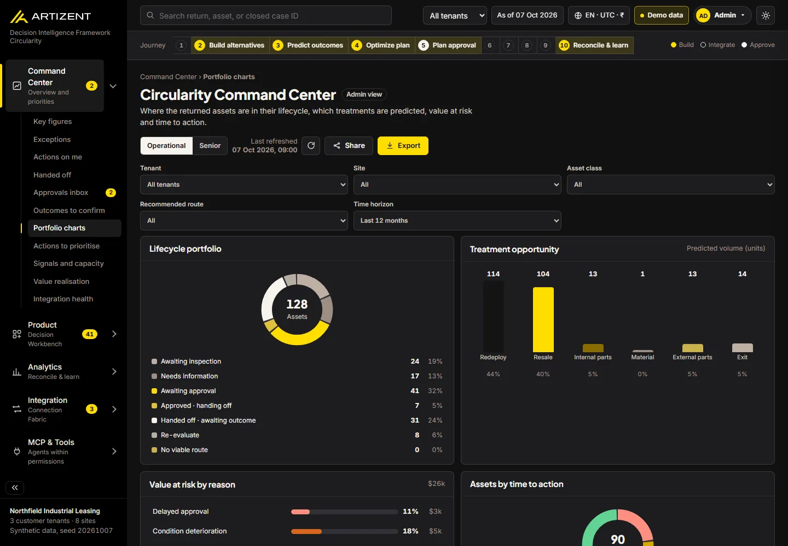](docs/screenshots/iter3-dark-command.webp) [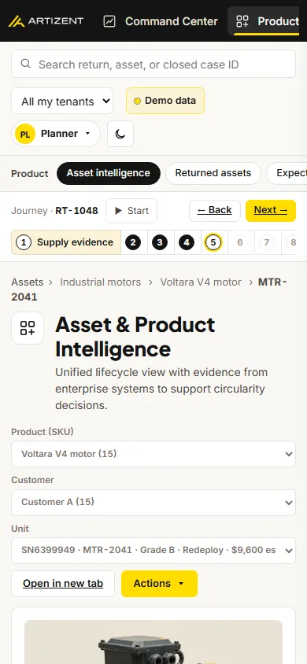](docs/screenshots/iter3-phone-asset.webp) |

### Try it (three minutes)

1. Sign in with `exec`. The Command Center opens on **Key figures**, with the portfolio charts and value realisation below the figures; open *What these figures mean*. Click **Exceptions** in the sidebar: only that section is on the page. No *Uplift* anywhere.
2. Sign out, sign in with `ops`. **Returned assets**: each status has its signals. The Product menu starts with **Asset intelligence**; there is no Pool optimizer.
3. Open RT-1048 in Asset Intelligence: **Retrieved data** (with **Cost inputs**) opens first; **Continue to step 2** at the bottom opens **Predictions**. Read the Matched demand card: contract, refurbished accepted, 24 months needed and certified.
4. Treatment Intelligence, step 4: press **Critical part unavailable**, then **Customer requires a new unit**.
5. Globe menu: Japanese, Japan time, yen. Back to English · UTC · ₹.

### Checks

- Role suite **208 of 208**, guided-flow suite **110 of 110**, demo suite **91 of 91**, iteration-two suite **50 of 50** (expectation changes above).
- New iteration-three suite, **55 of 55**: flags off by default and on again; no Uplift on any Command Center; no pool entry, route, switch, block, Analytics section or orchestration stage; every Command Center section on its own page for eight accounts, with its title and nothing else; definitions for every figure; tiles open their section; Product menu order; the left section menu; retrieved before predictions; Cost inputs and the cost build-up; RMA and contract demand in the header; certification and demand wording; all 128 cases render with no route or value on the retrieved side and parts never above the preparation cost; RT-1048 wording on the decision card, the instruction and step 2; both edge cases with their reasons; signals on every row and consistent with the evidence; the Region menu in Japanese and German, time zone and currency, then back to English; invariants; numbers unchanged (128 live, 1,400 closed, $9,600); no console errors.
- Phone width (390 px): **27 of 27**, including every Executive and Approver Command Center section, the asset page and the reconciled case.
- Flow diagram: Planner labels, no Exceptions box, PNG re-exported.

### Still assumed or open

J1–J10 are built on the plan's defaults (section 4 of the plan). Not code, for people: tailor the first two deck slides per prospect; tell the Reconcile module owner to drop the IEEPA refund use case and look at normal customs invoice matching; send the updated flow PNG to the Product Owner; record the video and voiceover. Nothing has been pushed or merged.

---

## Update 10: Journey-led flow, step guidance, value that builds, line-item learning

**Why:** the follow-up review call with the Product Owner on 16 Oct 2026, ahead of the in-person review on Monday 19 Oct. The asks: do not land the asset journey on Exceptions; make every one of the ten steps clickable and guiding ("after looking at this, where do I go next?"); show **every** option at step 4; let Asset Intelligence fill in its commercial value step by step, tied to the Sales Order or Work Order; and learn from **each cost line**, not only the net. The plan, its check of the first-draft notes and the open decisions are in [`docs/feature-demo-refractor-iter-two.md`](docs/feature-demo-refractor-iter-two.md). Points marked **(assumed)** follow the plan's default (H1–H10) until the Product Owner confirms them.

> **Legal review.** This update adds wording about which model learns from which cost line, and about what the enterprise systems decide and return. The Legal team should review that wording before it is relied on or used with clients. All data stays synthetic.

### What changed, where

| Area | Where | What you see |
|---|---|---|
| **Flow diagram v2** (G1, H10) | [`docs/demo/user-flow.svg`](docs/demo/user-flow.svg), [`.png`](docs/demo/user-flow.png), [`user-flow.md`](docs/demo/user-flow.md) | **Sign in → Returned assets → steps 1 to 10**, numbered and named exactly like the Product Owner's diagram (7 and 8 separate). The **Exceptions dashboard** is a dashed side callout ("problems in steps 1–5 surface here; Notify owner sends them to the person who acts"), not a box in the sequence. A second callout shows how Asset Intelligence fills in. PNG copies of this and the journey slide, for previewers that do not draw SVG text. The Executive still lands on the Command Center (assumed, H1) |
| **Ten clickable steps** (G2, H2, H3) | Strip under the top bar on Returned assets, Asset Intelligence and Treatment Intelligence | The journey strip is now the navigation: **▶ Start** plus the ten boxes, each a link to its own screen for the case in view, with **Back** and **Next**. The current step shows its name; the others show their number and a tooltip. Each box also shows where the *case* is: **filled** = done, **ringed** = the case is here now, **dimmed** = not reached yet. It works for any returned asset, not only RT-1048. The separate demo rail with merged pills (2–3, 6–9) is gone (assumed, H2). Other pages keep the static journey indicator |
| **Step links** (H3) | `?jstep=N`, added to the earlier links | 1 Asset Intelligence, retrieved side · 2 eligibility and **Matched demand** · 3 remaining life and economic intelligence · 4 Treatment Intelligence step 2, **All pathways** · 5 the decision card · 6 the instruction preview · 7 handoff rows 1–2 · 8 row 2 · 9 rows 3–4 · 10 the new **Reconcile and learn** block. The step's cards are outlined in yellow and scrolled into view. Earlier links (`?focus`, `?zone`, `?step`, `?at=handoff`, `analytics/predicted?dp=`) still work |
| **What-next guide** (G3) | Bar at the bottom of each journey screen | **Established here:** one line built from the case's own data (step 1 for RT-1048: *Grade B from EAM, certified for 24 months (QMS-2906), received at Warehouse 1, returned twice before.*). **Next:** what the next step answers. **Continue to step N →** and **Back**. A step the case has not reached says what has to happen first (*This happens after approval (step 5). RT-1048 is at step 5, plan approval.*). Presenter hints (continue as Approver or Finance) moved here |
| **All pathways at step 4** (G4) | Treatment Intelligence, step 2 | Under the recommended outcome, one table with **every route** for the case, sorted by net: P10–P90 and **Recommended**, **Eligible** or **Withheld** with the gate's reason. RT-1048: 7 routes, 6 eligible, *Sell parts externally* withheld (no confirmed buyer within the 30-day window). The top-3 comparison in step 4 stays |
| **Commercial value in stages** (G5, H4) | Asset Intelligence, predicted side | The *Recommended outcome* card is now **Commercial value**, with a state chip: **Pending evaluation** (no recommendation) → **Predicted, not committed** (awaiting approval) → **Committed** against the order (approved and handed off) → **Predicted vs actual** (Finance confirmed), with a link to step 10. Opened from **step 1**, the predicted side is collapsed: *Not evaluated yet: steps 2–4 add eligible treatments, life and value*, with **Continue to step 2** and **Show the predictions now** (assumed, H4). Opened any other way, the page behaves as before. The predicted side now reads in journey order: value, eligibility, matched demand, life, economics, data quality |
| **Matched demand** (step 2) | Asset Intelligence, predicted side | New card: internal demand **SO-48102 · Site 3, confirmed**, re-lease opportunity **LS-5530, forecast**, internal parts demand. No values; those come in step 3 |
| **Orders on the handoff** (G6, G8, H6) | Step 5, *Enterprise handoff* | Each acknowledgement shows the reference its system returned: ERP redeployment order → **Sales order SO-48102** (the matched order), EAM → **Work order WO-…**, WMS → **Transfer TR-…**, outcome → **Fulfilment FUL-…** (a sales order, lease contract or invoice for other routes). The EAM row says *repaired, tested and certified; QMS record updated* (no new QMS row, assumed H6). References also appear in the toast and in the audit event. The wording stays: Circularity sends the approved instruction; the enterprise systems carry out the work |
| **Asset header** (H5) | Asset Intelligence | **Received under GR-… · WMS receipt** (no intake work order, assumed H5). **Ownership** shows the lease the unit came back from (*lease LS-5028 (ended)*); LS-5530 now appears only as the re-lease opportunity. The same fix applies to the contract-terms row and the lifecycle timeline |
| **Line-item learning** (G7, H7, H8, H9) | Step 5, new **Reconcile and learn** block (step 10) | When Finance confirms, each cost line of the chosen route gets an actual, and the actual net is their sum. A table shows **Cost line · Predicted · Actual · Δ · Learns**: preparation and fees → *prep-cost-time*; sale, parts, material, lease and residual value → *resale-price*; service → *service-exposure*; avoided purchase → *No model · ERP price (retrieved)* (assumed, H7). A sentence names the largest difference and the model that learns most from it. For RT-1048: predicted **$9,600** against SO-48102, actual **$9,230**, variance **−$370**, mostly preparation and transfer ($270 over estimate, assumed H8). Before confirmation the block says what it is waiting for. Case level only; Analytics is unchanged and linked (assumed, H9) |

### Changed behaviour (and changed test expectations)

- **The actual outcome is deterministic.** It used to be the predicted net with random noise, different on every run. Each line is now within ±25% of its prediction, derived from the case and the line; RT-1048's preparation line is pinned 15% over estimate so the story matches the call. A new data check confirms the lines are deterministic, within range and add up to the actual net.
- **Handoff references changed prefix.** Acknowledgements used to read *RSV-, WO-, MV-, CF-* by row position; they now follow the system and the action (SO, WO, TR, RSV, SHP, PA, REL, LS, COL, FUL, INV). Seeded handoffs use the same scheme.
- The demo suite's rail checks were rewritten for the strip: Start and steps 1–10 with Next and Back for four accounts; every case in view gets its own strip; the Command Center keeps the static indicator.

### Screenshots

| Step 1: retrieved side, predictions waiting | Step 2: eligibility and matched demand | Step 4: all pathways |
|---|---|---|
| [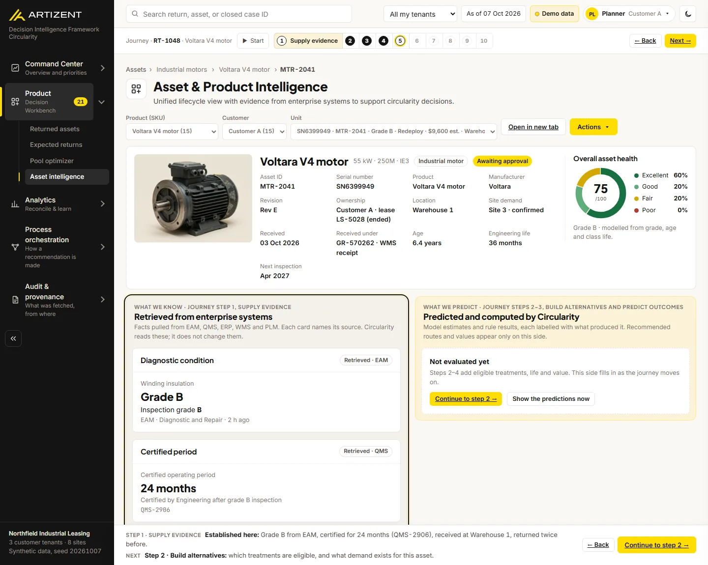](docs/screenshots/iter2-step1.webp) | [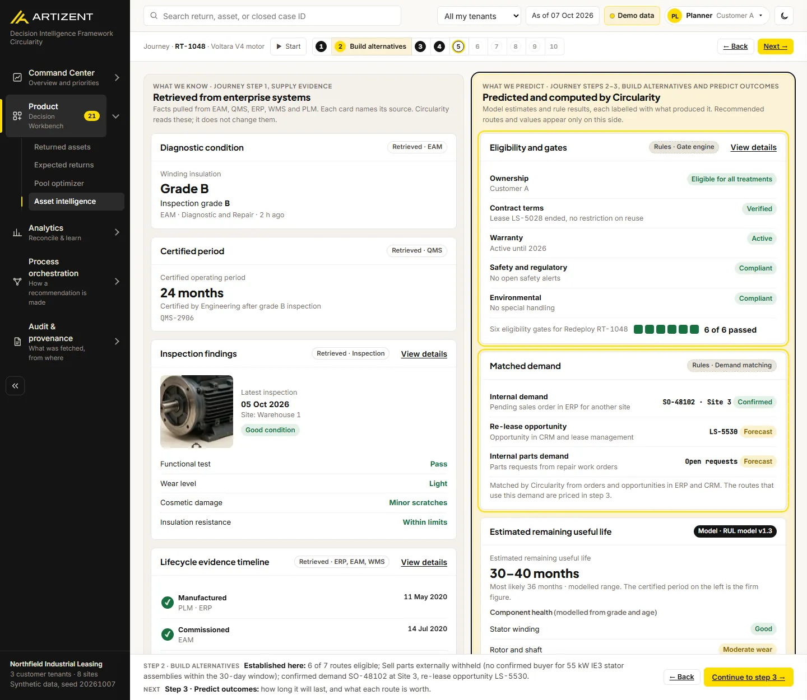](docs/screenshots/iter2-step2.webp) |  |
| **Step 8: references on the handoff** | **Step 10: reconcile by cost line** | **Asset Intelligence: predicted vs actual** |
| [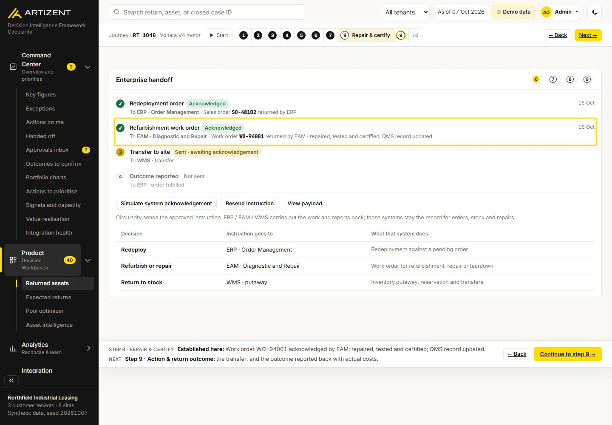](docs/screenshots/iter2-handoff-refs.webp) | [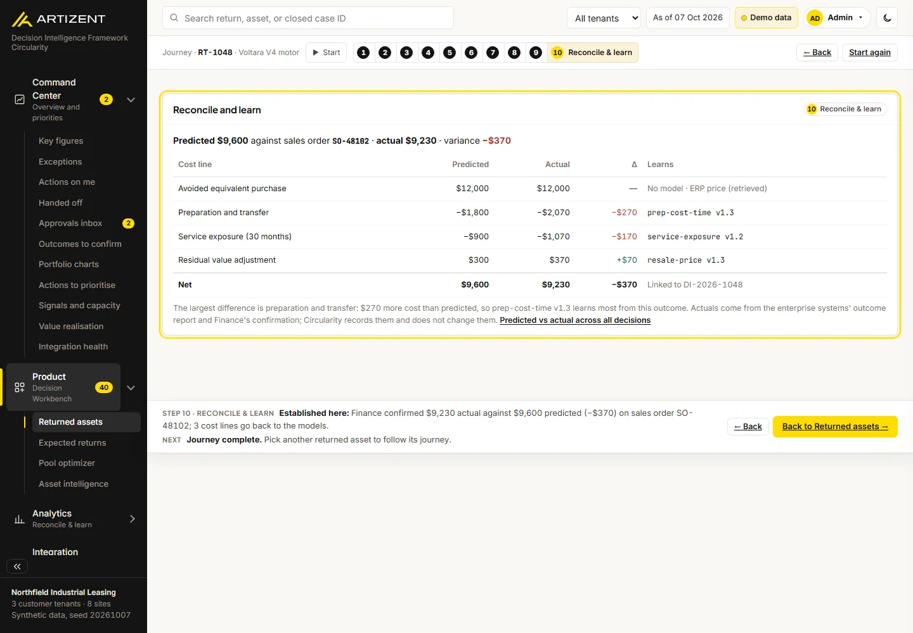](docs/screenshots/iter2-reconcile.webp) | [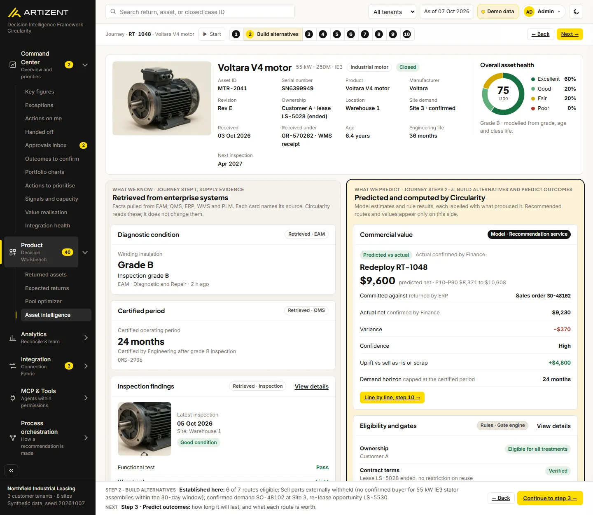](docs/screenshots/iter2-asset-actual.webp) |
| **Start: Returned assets** | **Dark mode, step 4** | **Phone, step 2** |
| [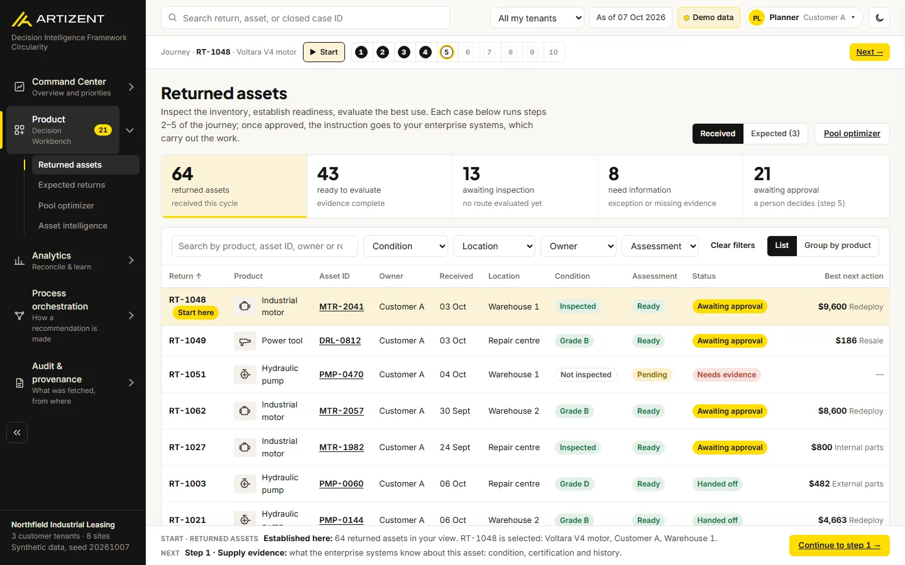](docs/screenshots/iter2-returned.webp) | [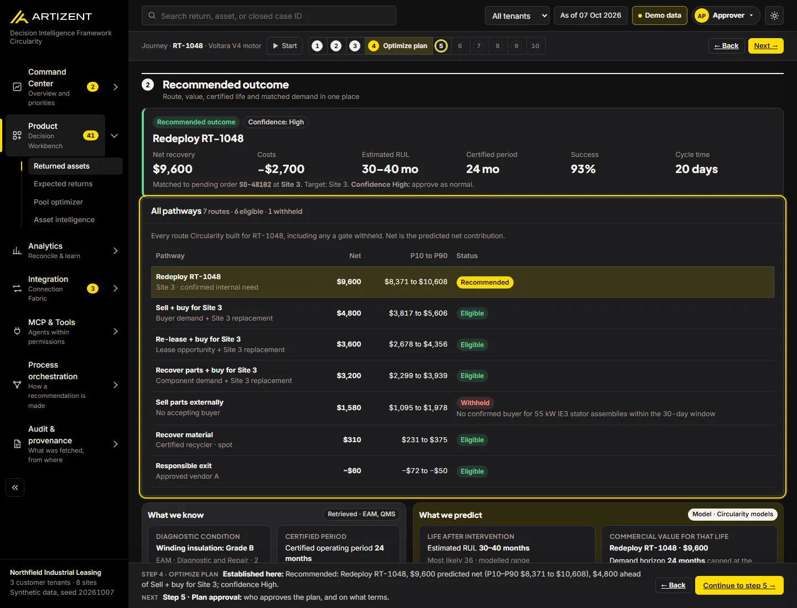](docs/screenshots/iter2-dark-step4.webp) | [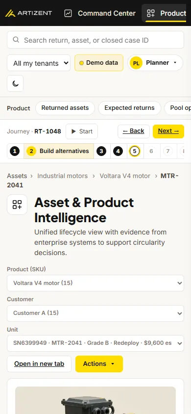](docs/screenshots/iter2-phone-step2.webp) |

### Try it (three minutes)

1. Sign in with `ops` and any password. On **Returned assets**, RT-1048 is marked **Start here**; the strip reads *Journey · RT-1048* and the bar at the bottom says what is next. Press **Continue to step 1**.
2. Step 1 shows only what the enterprise systems supplied; the predicted side waits. Press **Continue** through steps 2 and 3 (eligibility and demand, then life and value), then step 4: every route, including the withheld one.
3. At step 5, presenter mode (`index.html?presenter=1`) offers *continue as Approver*: approve. Click box **7**, then press **Simulate system acknowledgement**: the ERP row returns **SO-48102**. Again: the EAM row returns a **WO** and says *repaired, tested and certified*.
4. Acknowledge the last two rows, continue as **Finance**, confirm the outcome, and open box **10**: predicted against actual, line by line. Open **Asset Intelligence**: the commercial value now reads *Predicted vs actual* against SO-48102.
5. Click any box at any time: a step not reached yet still opens and says what has to happen first.

### Checks

- Role suite **208 of 208**, guided-flow suite **110 of 110**, demo suite **91 of 91** (rail checks rewritten, see above).
- New iteration-two suite, **50 of 50**: for the Planner, Approver, Admin and Executive, Start and each of the ten steps opens its link, highlights its targets and lights only its box; Warehouse Manager and Engineer variants; earlier links still work; status per box; **all 128 cases × 10 steps** have a guide line with no `undefined`, `NaN` or `null`; the guide's Continue goes to the next step; the all-pathways table has one row per route for every case, withheld rows with their reason and one Recommended mark; one case per value state; the step-1 collapse; matched demand; the header fixes; no route or value on the retrieved side for any case; references only after their acknowledgement (SO-48102, WO-, TR-, FUL-) and in the audit event; after Finance confirms RT-1048, lines add up to the actual net, recompute identically, name their model, the preparation line is over estimate, and Asset Intelligence shows predicted vs actual; all data checks; no console errors.
- Flow diagram: ten numbered boxes with the diagram's names; Exceptions only as a side callout; PNG exports exist.
- Phone width (390 px): no sideways scroll on the new step links, step 4, the handoff at step 8, and the reconciled step 10 and Asset Intelligence.

### Still assumed or open

H1–H10 are built on the plan's defaults (section 4 of the plan; answers go in its section 10). Nothing has been pushed or merged; hosting before Monday is still waiting for a go-ahead.

---

## Update 9: Sign-in form, one-asset demo path, retrieved vs predicted

**Why:** the review call of 16 Oct 2026, ahead of the stakeholder demo on Monday 19 Oct. The Product Owner did not want a role picker on entry, wanted two perspectives (senior management and end user), one record shown from start to finish in line with the business journey, and the data *retrieved* from enterprise systems kept visibly apart from what Circularity *predicts*. The plan, the decisions and what is still assumed are in [`docs/PLAN_DEMO_SIGNIN_SINGLE_ASSET.md`](docs/PLAN_DEMO_SIGNIN_SINGLE_ASSET.md); it refines the first draft in `docs/Refactor Guided Flow.md`. Points marked **(assumed)** follow the plan's default until the Product Owner confirms them.

> **Legal review.** This update changes the sign-in experience (simulated credentials and single sign-on wording) and how predictions are labelled against source data. The Legal team should review that wording before it is relied on or used with clients.

### What changed, where

| Area | Where | What you see |
|---|---|---|
| **Sign-in form** (F1, F2) | Opening the app | A standard form: **Work email or user ID**, **Password**, **Sign in**, **Continue with single sign-on**, and a footer saying the environment is a demo with synthetic data and simulated single sign-on. No role list. `exec` lands on the **Executive Command Center**; `ops` lands on **Returned assets** for Customer A with **RT-1048** ready (assumed, E1, E2). Every account has an ID at `northfield.example` (assumed, E5; list in README section 4). Unknown IDs show an inline error. **Switch account** and **Sign out** return to the form, and the next account lands on its own home |
| **Presenter mode** (E4) | `index.html?presenter=1` | Two quiet shortcuts under the form (**Senior management**, **End user**), a quick switch in the account menu, and at the approval and outcome stops a button to continue as the Approver or Finance. Off by default, so an audience never sees role shortcuts (assumed). The build team's role list is at `#/signin?roles` (assumed, E3) |
| **Demo path** (F3, F4) | Bar under the top bar for RT-1048 | Follows the Product Owner's **Typical User Journey** diagram box by box: **▶ Returned assets → 1 Supply evidence → 2–3 Build alternatives · Predict outcomes → 4 Optimize plan → 5 Plan approval → 6–9 Send instruction → Return outcome → 10 Reconcile & learn**, with **Back** and **Next**. Each stop shows its box numbers, and the journey strip below lights exactly those boxes. Stops are links: `#/product/received?focus=RT-1048`, `#/product/asset/RT-1048?zone=known`, `…?zone=predicted`, `#/product/RT-1048?step=2`, `…?step=5`, `…?step=5&at=handoff`, `#/analytics/predicted?dp=RT-1048` (the last stop is skipped for roles without Analytics) |
| **Journey strip** (F4) | Every page | The ten steps now use the diagram's wording: *Plan approval*, *Create execution work*, *Action & return outcome*, with the diagram's descriptions in the tooltips |
| **Exceptions by warehouse** (F5) | Executive Command Center | One row per warehouse and exception type: **Warehouse · Exception · Items** (count and top item, e.g. *RT-1065 Voltara V4 motor*) **· Value · Status**, with **Notify owner** on every row. Severity is a small marker, the trend is in the tooltip. A row opens a drawer with three columns only: **Warehouse · Item · Value**. Totals equal the ranked list (a new data check) (assumed, E8). Notifications also appear at the top of the recipient's Returned assets, with a link to the item |
| **One SKU, many units** (F6) | Asset intelligence | **Product (SKU) → Customer → Unit** instead of one flat list of 128 returns. A unit reads *SN6399949 · MTR-2041 · Grade B · Redeploy · $9,600 est. · Warehouse 1*. A strip counts this customer's units by grade and by recommended route (**15 Voltara V4 motors** back from Customer A now, plus the closed ones in the last 12 months); click a count to filter the Unit list. Real counts, not an invented "100 units" (assumed, E9) |
| **Return history** (F6) | Asset intelligence, left side | Earlier returns of the same physical unit: when, by whom, grade and what was done. From closed decisions where they exist, otherwise derived from the lease history and labelled *synthetic* |
| **Group by product** (F6) | Returned assets | A **List / Group by product** switch: one row per product and customer with unit count, grade range and predicted value, expanding to its units |
| **Retrieved vs predicted** (F7, F8) | Asset intelligence → Overview | Two labelled sides. **What we know · Retrieved from enterprise systems**: diagnostic condition (EAM), certified period (QMS), inspection findings, lifecycle timeline, return history, product specs, related assets. **What we predict · Predicted and computed by Circularity**: recommended outcome (route, value, P10–P90, confidence, uplift vs sell as-is or scrap, matched order), estimated remaining useful life with component health, economic intelligence with predicted value by route, eligibility gates, data quality. Every card has one badge: **Retrieved · system**, **Model · name** or **Rules · name** (assumed, E10). The old *Condition, life and commercial value* card is gone, so *Refurbish, then sell* or *Redeploy* never appears under an EAM source |
| **Step 2 split** (F7) | Treatment Intelligence, step 2 | The A/B/C card is now **What we know** (diagnostic condition, certified operating period) beside **What we predict** (estimated RUL, commercial value for that life). Estimated and certified life are still shown as separate figures |
| **Renames** (F9) | Asset intelligence | *Product intelligence* → **Product specs**; *Condition intelligence* → **Inspection findings** (assumed, E11). *Predicted remaining life* moved out of the inspection card to the prediction side |

### Screenshots

| Sign-in | Returned assets, demo path | Asset Overview: retrieved and predicted |
|---|---|---|
|  | [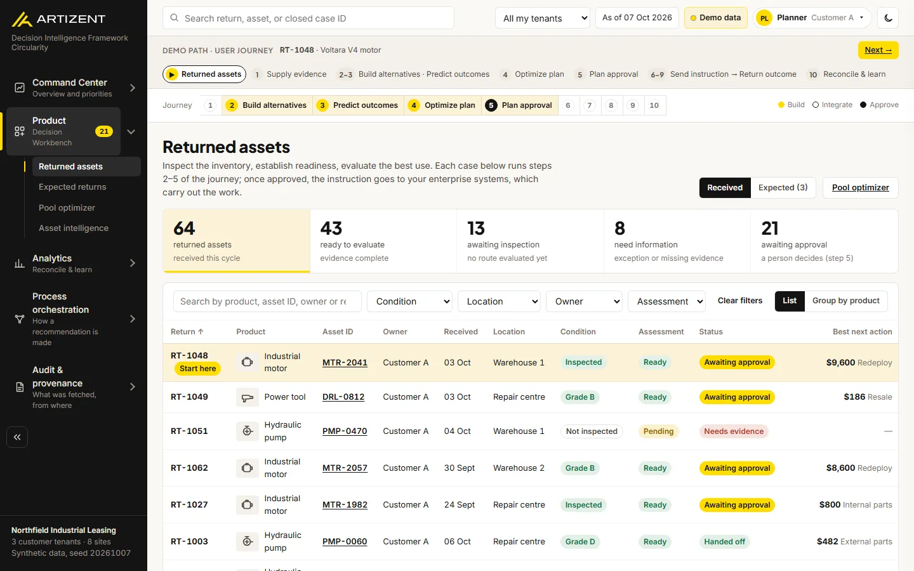](docs/screenshots/demo-returned.webp) |  |
| **Step 2: what we know, what we predict** | **Exceptions by warehouse** | **Drill-down: warehouse, item, value** |
| [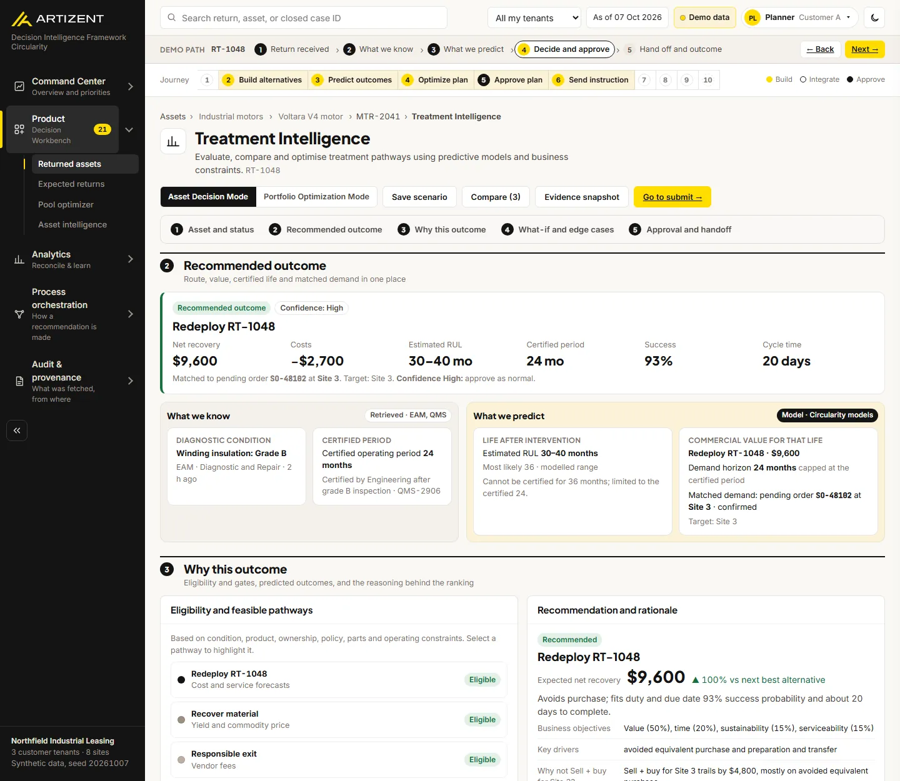](docs/screenshots/demo-step2.webp) | [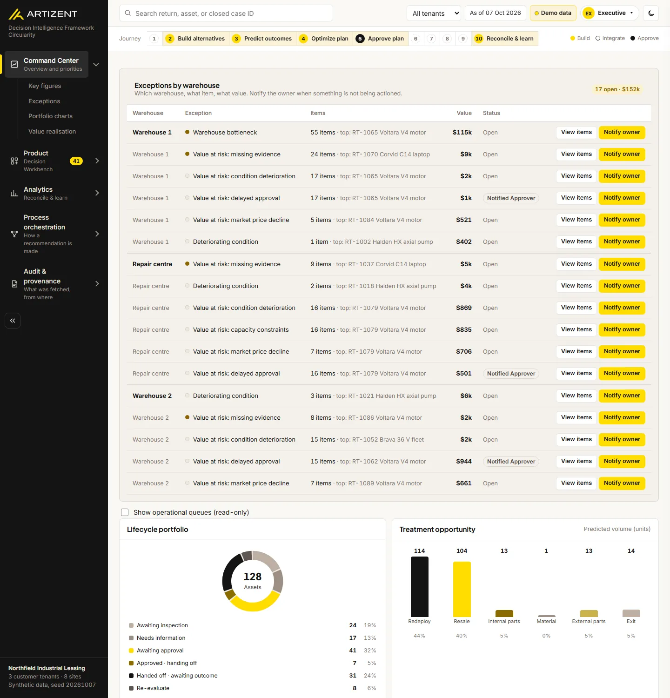](docs/screenshots/demo-exec-exceptions.webp) | [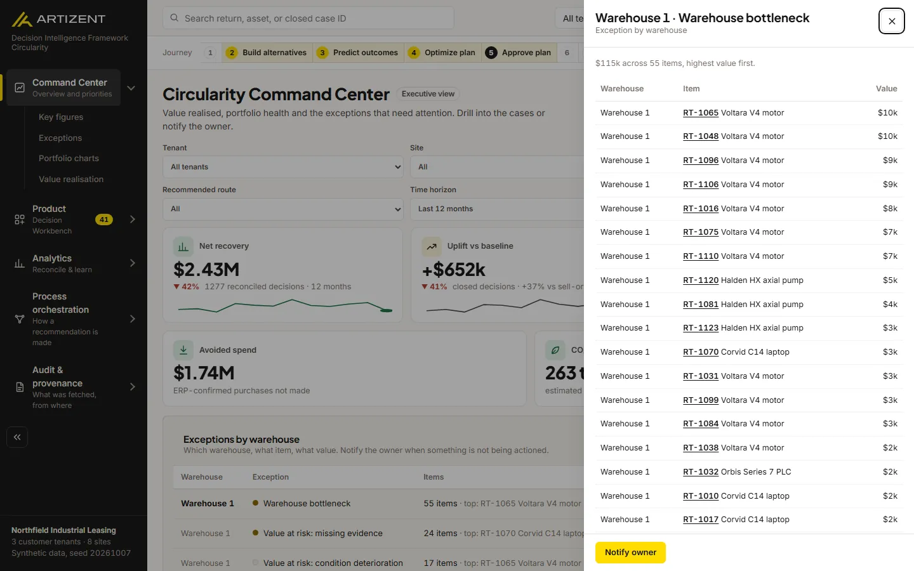](docs/screenshots/demo-exec-drawer.webp) |
| **Demo path at boxes 6–9 (handoff)** | **Demo path at box 10** | |
| [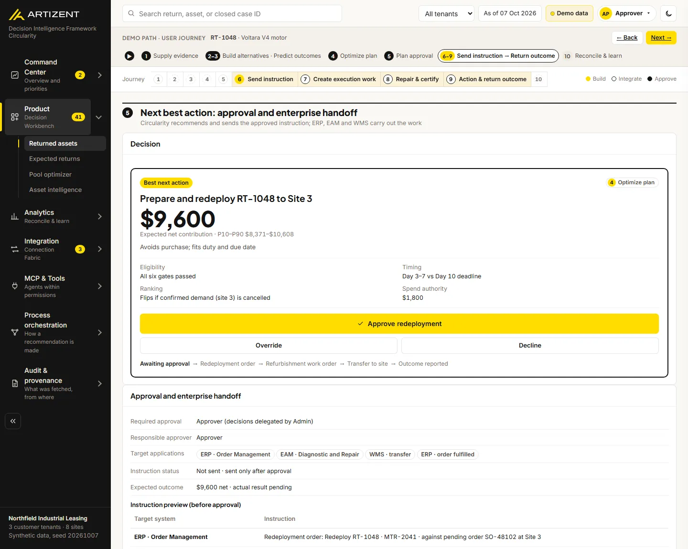](docs/screenshots/demo-path-handoff.webp) | [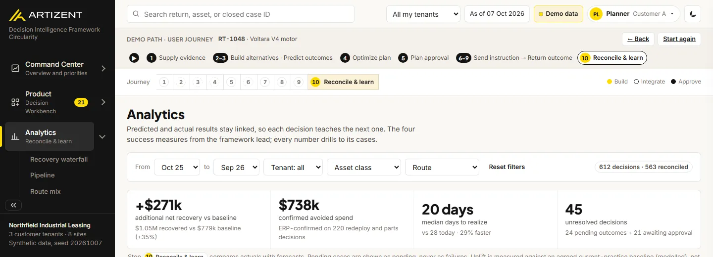](docs/screenshots/demo-path-learn.webp) | |
| **Group by product** | **Dark mode** | **Phone** |
|  | [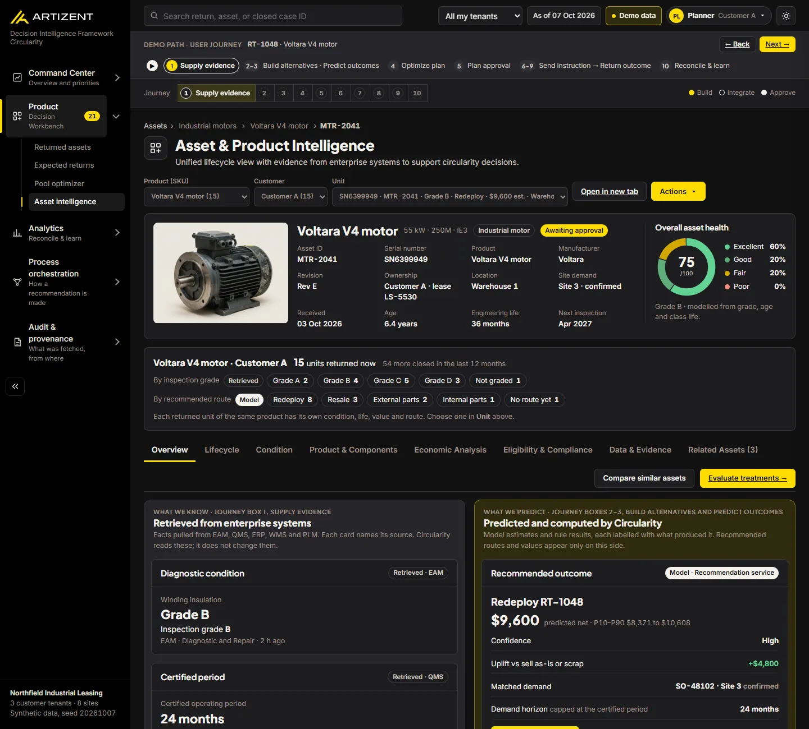](docs/screenshots/demo-dark-asset.webp) | [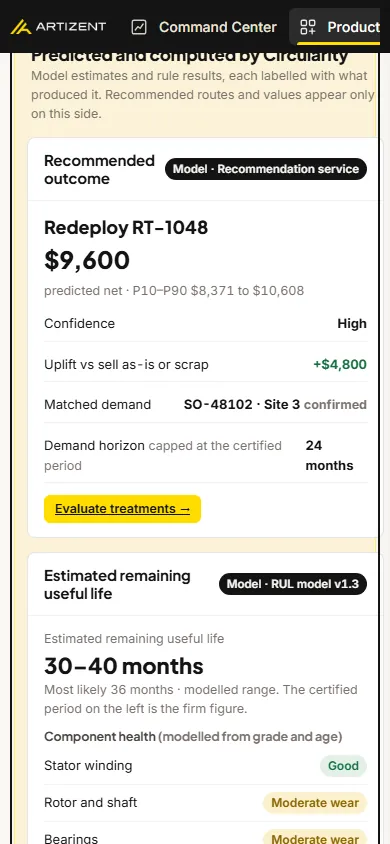](docs/screenshots/demo-phone-asset.webp) |

### Try it (three minutes)

1. Open the app and sign in with `exec` and any password. In **Exceptions by warehouse**, click a **Warehouse 1** row that lists RT-1048: the drawer shows only warehouse, item and value. Press **Notify owner**, choose *Planner · Customer A*, send.
2. **Sign out** and sign in with `ops`. The notification is at the top of **Returned assets**; RT-1048 is marked **Start here**.
3. Press **Next** on the demo path and watch the box numbers: 1 on the left side of Asset intelligence (retrieved from EAM, QMS, ERP, WMS), 2–3 on the right side (predicted), 4 on the decision page, 5 the approval, 6–9 the handoff, 10 Analytics.
4. On Asset intelligence, change **Unit** to another Voltara V4 motor: grade, life, value and route change with it. Click *Grade C* in the strip to narrow the list.
5. On Returned assets, press **Group by product**.

### Checks

- Role suite: **208 of 208** pass. Changed expectations: Planner accounts now land on Returned assets; the sign-in check looks for the form instead of the role cards.
- Guided-flow suite: **110 of 110** pass. Changed expectations: the exception drill-down lists items by warehouse; the sign-in note now reads "In production you sign in with your company account."
- New demo suite: **91 of 91** pass: the form, errors, every sign-in ID landing on its home, single sign-on, the hidden role list and presenter mode, sign-out; the seven stops in journey order with Next and Back for four accounts, the journey strip lighting the stop's boxes, boxes 1–10 each covered once, the diagram's box names, no rail off the path or for another tenant; zones, badges and renames, and **no route name or route value on the retrieved side for any of the 128 cases**; exception totals by warehouse, the three-column drawer, Notify → Returned assets → Actions on me → In hand, Warehouse Manager scope; the Product → Customer → Unit selects (15 units), switching units, filters, tenant and warehouse scope, grouping; the whole RT-1048 journey in presenter mode (submit, approve, four acknowledgements, Finance confirms); all data checks; no console errors.
- Phone width (390 px): no sideways scroll on the sign-in form, the Executive Command Center with the drawer open, all seven demo stops, grouped Returned assets and the Warehouse Manager views.

### Still assumed or open

E1–E6 and E8–E12 are built on the plan's defaults (see the plan, section 10). E7 is answered: the Product Owner's diagram is in [`docs/demo/user-journey-diagram.png`](docs/demo/user-journey-diagram.png) and the demo path follows it. Hosting before Monday (E13) is waiting for a go-ahead: nothing has been merged or pushed. A recorded video for the sales meeting is still to be made after the dry run.

---

## Update 8: Guided decision flow, senior and operational views, enterprise handoffs

**Why:** the Product Owner asked to *structure the flow*, so a viewer sees where a user starts, how they move and what outcome they get. The plan, the decisions taken and what is still assumed are in [`docs/PLAN_GUIDED_FLOW_AND_EXEC_VIEWS.md`](docs/PLAN_GUIDED_FLOW_AND_EXEC_VIEWS.md). Points marked **(assumed)** follow the plan's default until the Product Owner confirms them.

> **Legal review.** This update adds roles, site scoping, identity-provider settings and positioning wording ("decision intelligence, not an execution system"). The Legal team should review the role matrix and that wording before it is used with clients.

### What changed, where

| Area | Where | What you see |
|---|---|---|
| **Wording and handoffs** (R8) | Everywhere | Circularity **recommends and sends approved instructions**; ERP, EAM and WMS **carry out the work** and report back. "Executing" is now **Handed off**, "Execution timeline" is **Enterprise handoff**, "Execution readiness" is **Handoff readiness**, the agent is the **Handoff Coordinator**. Every handoff step names its target system: Redeploy → **ERP · Order Management**, Refurbish or repair → **EAM · Diagnostic and Repair**, Return to stock → **WMS putaway** (legend under each handoff and on Process orchestration). Buttons: **Simulate system acknowledgement**, **Resend instruction**. Seeded approver names are now account labels |
| **Expected returns** (R2) | Product → Expected returns | Derived from contract and lease expiry in the **Contract Management** application: Contract ID, Customer, Asset, Lease period, Contract expiry, **Likely outcome** with probability (assumed, D19), return window, Site, Planning range (also weighted by the chance of return), Source application. A row opens the contract and a lease timeline |
| **Guided treatment page** (R6) | Any case, e.g. `#/product/RT-1048` | Five steps top to bottom with a sticky step bar: **1** asset and status (why, and what is outstanding), **2** recommended outcome, **3** why this outcome, **4** what-if and edge cases, **5** approval and enterprise handoff. The decision buttons now live only in step 5. Links such as `#/product/RT-1048?step=4` open a step |
| **Condition → life → value** (R5) | Step 2 and Asset intelligence → Overview | A. diagnostic condition (e.g. *Winding insulation: Grade B*), B. **estimated RUL 30–40 months** next to the **certified operating period 24 months**, C. commercial value for that life with the matched order (*SO-48102 at Site 3*). The demand horizon is capped at the certified period; if demand needs longer, **Needs re-certification** and the route becomes Conditional (assumed, D10) |
| **What-if result** (R3) | Step 4 | A large card: **Base net · Simulated net · Δ $ · Δ %**, ▲ ▼ with signs, the assumptions changed, and one sentence on the ranking. It updates on every slider move. **Apply to** one pathway; presets **Demand cancelled**, **Parts cost +30%**, **Resale price −20%**, **Certification shorter than demand** |
| **Tie-breaker and comparison** (R4) | Steps 2–4 | When the top two are within 5% or $250, a **Close call** box names the deciding factor in order: risk/confidence, demand certainty, cycle time, RUL, carbon (assumed, D8). The rules are on screen. The **top pathways side by side** (base, simulated, Δ, the factors, rank) open by themselves on a close call or Low confidence. Confidence shows as **High / Medium / Low**, each saying what to do. Seeded recommendations are unchanged |
| **Instruction preview** | Step 5 | Before approval the Approver sees what each target system will receive, plus **View raw payload**; after approval the sent payload matches it |
| **Senior view** (R1) | New **Executive** account; Admin → *Senior* switch | Value figures on top (same as Finance), portfolio health, ranked **Exceptions** (value at risk by reason, warehouse bottlenecks, declining metrics, deteriorating condition) with **View cases** and **Notify owner**. *Show operational queues* reveals them read-only |
| **Operational view** (R1) | Planner, Engineer, new **Warehouse Manager** | **Actions on me** first, then **Waiting for approval** (status only) and **Handed off · awaiting outcome** with target system, external reference and age. Planner and Engineer default to their home site and can widen it; the Warehouse Manager is locked to one warehouse everywhere |
| **Notify** (D7) | Exceptions | Recipient prefilled by exception type (changeable). Creates an *Actions on me* item and an audit entry, nothing leaves the app (simulated). When the recipient acknowledges, the exception shows **In hand by …** |
| **Process orchestration** (R7) | New menu item | Ten stages, each with agent or service, source systems, status, start, end and duration, for any case you can see; **Replay**, **Simulate failure at stage**, a run trace from the audit trail and call log with redacted values, and links to Audit, the event stream and (Developer, Admin) the live call log |
| **Identity and users** (M1) | Access → Identity and users (Admin) | Identity provider card (Microsoft Entra ID as an example, simulated), SSO → SCIM → role mapping, **Sync from directory**, App Roles or groups mapped to role and site (editable; membership read-only), directory users with `example.com` addresses, a simulated leaver, escalation path and **out-of-office delegation** to an eligible Approver. The sign-in screen explains SSO in production |

### Screenshots

| Executive (senior view) | Warehouse Manager (operational) | Treatment page, steps 1–2 |
|---|---|---|
|  |  |  |
| **What-if** | **Close call (RT-1094)** | **Approval and handoff** |
|  |  |  |
| **Process orchestration** | **Expected returns** | **Identity and users** |
|  |  |  |
| **Dark mode** | **Phone** | **Planner (operational)** |
| [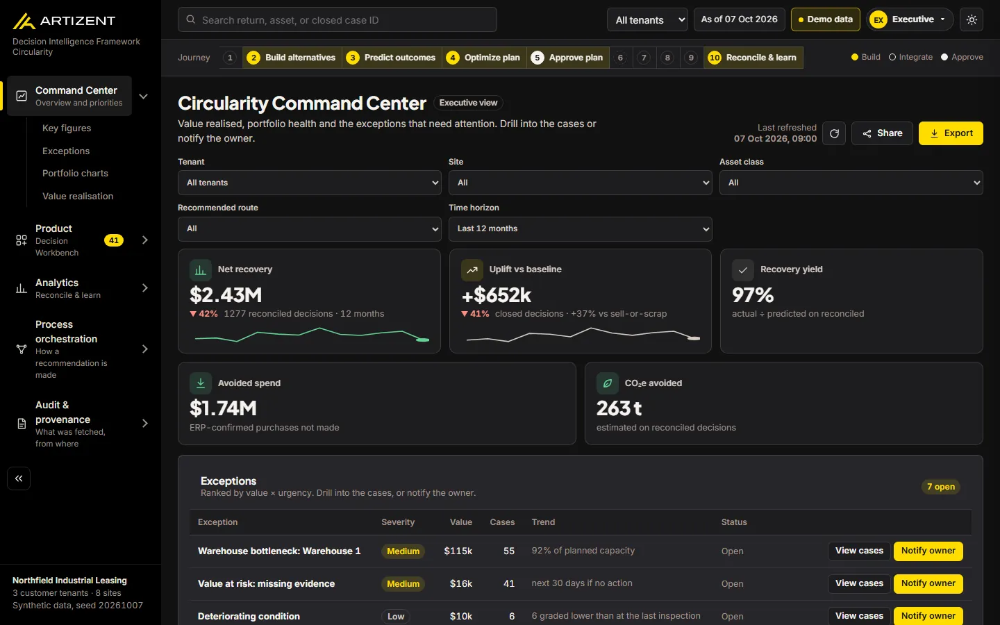](docs/screenshots/flow-dark-executive.webp) |  | [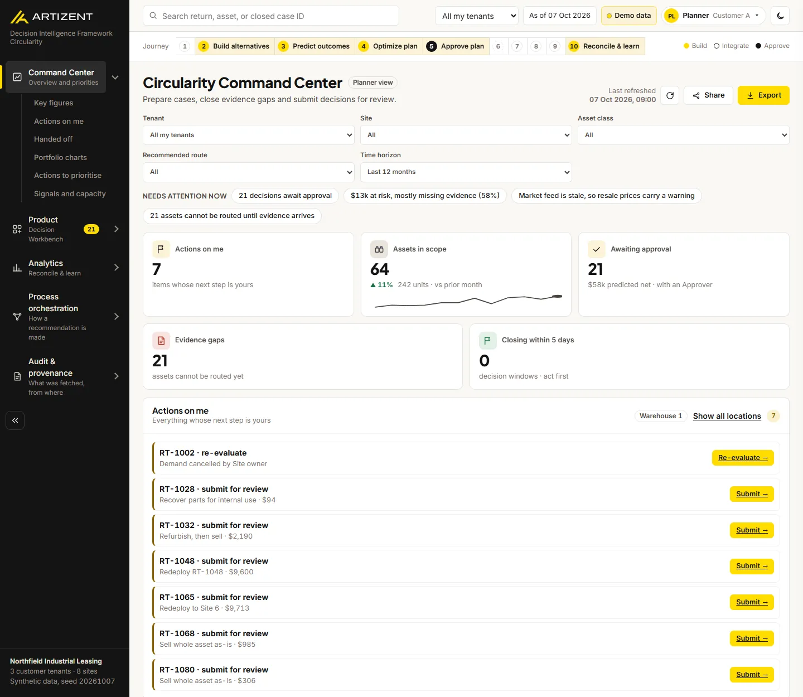](docs/screenshots/flow-planner-command.webp) |

### Try it (three minutes)

1. Sign in as **Executive**. The value figures match Finance. In **Exceptions**, press **View cases** on *Warehouse bottleneck: Warehouse 1*, then **Notify owner** and send it to *Warehouse Manager · Warehouse 1*.
2. **Switch account** to *Warehouse Manager · Warehouse 1*. The notification is first in **Actions on me**; press **Acknowledge**. Only Warehouse 1 cases appear anywhere. Switch back to Executive: the exception says *In hand by Warehouse Manager · Warehouse 1*.
3. Sign in as **Approver** and open **RT-1048**. Read down: status and what is outstanding → *Redeploy · $9,600*, RUL 30–40 months against 24 certified, order SO-48102 at Site 3 → why → what-if. Drag **Preparation, parts and fees**: the card shows ▼ and the new net as you drag.
4. Open **RT-1094**: the **Close call** box explains which factor decides, and the comparison is already open.
5. In step 5 of RT-1048, read the **instruction preview** (ERP · Order Management first), then **Approve redeployment**. The **Enterprise handoff** names each target system.
6. Open **Process orchestration**: RT-1048's stages, then **Replay** and **Simulate failure at stage 4**.
7. As **Admin**, open **Access → Identity and users**: change a site mapping, press **Sync from directory**, and see both in the audit log. Use the **Senior / Operational** switch on the Command Center.

### Checks

- Existing role suite: **208 of 208** pass (the 178 earlier checks, updated only where this plan changes a label or adds a menu group, plus the two new roles in every loop).
- New guided-flow suite: **110 of 110** pass: wording scan on every page for every account, expected-return columns and scope, five steps in order and decision buttons only in step 5 for every case, RUL range and certified period, what-if card maths and signs (under 16 ms), tie-breaker and comparison rules, all 128 recommendations unchanged, Executive KPIs equal Finance, Notify → Actions on me → In hand, handed-off count equals the lifecycle legend (38), Warehouse Manager scope in pages, search and audit, orchestration for every account, failure propagation and redaction, identity rules, instruction preview equals the sent payload, data invariants, no console errors.
- Phone width (390 px): no sideways scroll on the new and changed screens.

### Still assumed or open

D2 and D5–D20 in the plan are still waiting for the Product Owner and are built on the defaults. The user journey diagram (D15) is not in the repo yet, and the "increase the count of the rows… with the same button" point (D12) is not built until it is clarified.

---

## Update 7: Role-based views (sign in as a role)

**Where:** the app now opens on a **sign-in screen**. Pick a demo account. Each role then sees only the pages, panels, figures and buttons that belong to its job. Controls a role can never use are **not shown at all**, rather than greyed out. The account menu (top right) has **Switch account** and **Sign out**.

| Sign-in | Phone |
|---|---|
| [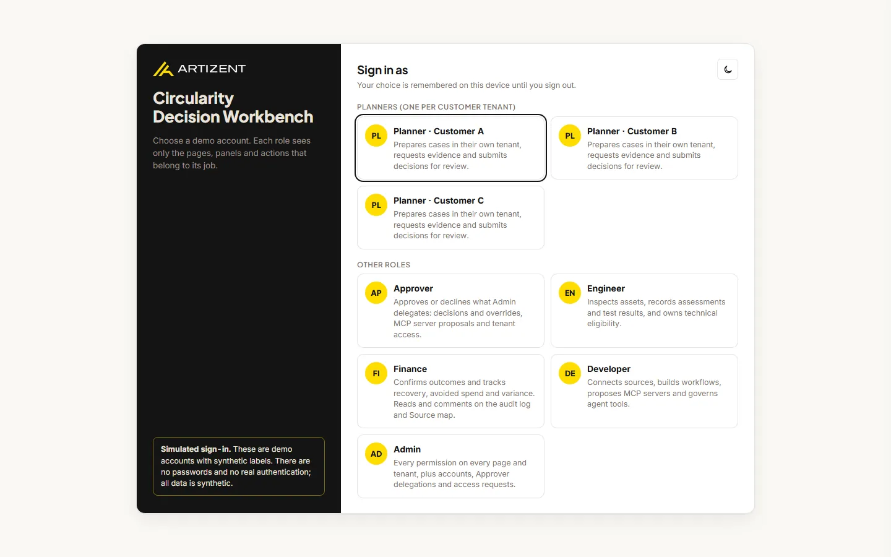](docs/screenshots/rbac-signin.webp) | [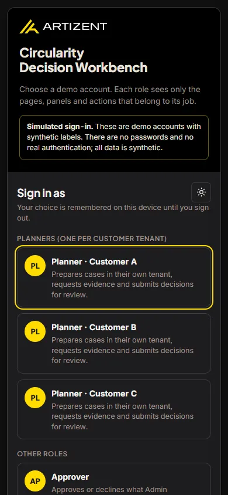](docs/screenshots/rbac-phone-signin.webp) |

**Simulated sign-in.** There are eight demo accounts: three Planners (one per customer tenant), Approver, Engineer, Finance, Developer and Admin. There are no passwords and no real authentication. Labels are synthetic. The choice is remembered on this device until you sign out. An old saved role from earlier versions is carried over automatically.

> Access control is close to compliance. The role matrix below, and any wording about access, should be reviewed by the Legal team before it is relied on.

### What each role sees

| Role | Lands on | Left menu | Can do | Does not see |
|---|---|---|---|---|
| **Planner** (Customer A, B or C) | Command Center | Command Center, Product, Analytics (read-only), Audit (own tenant) | Request evidence, **Submit for review**, scenarios, re-evaluate, **request access to another tenant** | Integration, MCP, other tenants' cases (until access is granted) |
| **Approver** | Command Center, with the **Approvals inbox** | Command Center, Product, Analytics, Integration (Event stream and Conflict queue, read-only), MCP (read-only), Audit | **Approve, Override, Decline** decisions; approve or decline **MCP server proposals** and **tenant access requests**, each only if Admin delegated it | Workflow studio, Source map, Manual import, MCP playground |
| **Engineer** | Asset intelligence | Command Center, Product (no Pool optimizer), Analytics (engineering economics and sustainability), Integration (Source map, tables, models, read-only), MCP (read-only), Audit | Request inspection, **Record assessment result** | Economic tab, approval, Finance actions |
| **Finance** | Analytics | Command Center, Product (read-only), Analytics, Integration (Source map, read-only), Audit | **Confirm outcome**, **comment** on audit entries and Source map sources | Approval, evidence requests, MCP, workflows |
| **Developer** | Integration, Source map | Command Center (integration health), Integration, MCP and Tools, Audit | Everything in Integration, MCP playground, **Propose MCP server**, comment | Product and Analytics (no case data) |
| **Admin** | Command Center | Everything, plus **Access** | Everything, plus Approver delegations and every request | Nothing hidden |

Opening a page your role cannot see (for example from an old bookmark) takes you to your home page with a short message saying why. A link to another tenant's case says that the record belongs to another tenant.

### Command Center for each role

Each role gets its own key figures and panels, computed from the same data, so numbers still match Product and Analytics.

| Role | Key figures | Panels |
|---|---|---|
| Planner | Assets in scope, Awaiting approval, Evidence gaps, Closing within 5 days | Lifecycle portfolio, time to action, actions to prioritise, signals |
| Approver | Awaiting approval (value), Potential recovery, Value at risk, Closing within 5 days, Requests waiting | **Approvals inbox**, value at risk by reason, time to action, actions, capacity, value realisation |
| Engineer | Inspection queue, Failed gates, Graded A or B, Parts on backorder (illustrative) | Lifecycle portfolio, treatment opportunity, actions, signals, capacity |
| Finance | Net recovery, Uplift vs baseline, Recovery yield, Avoided spend, CO₂e avoided | **Outcomes to confirm**, treatment opportunity, value realisation |
| Developer | Integration health, Sources needing attention, Failing workflows, Open conflicts, My MCP proposals | Integration health, mapping exceptions, recent events (live) |
| Admin | Requests waiting, Potential recovery, Value at risk, Integration health, Uplift | Everything above |

| Planner | Approver | Finance | Developer |
|---|---|---|---|
|  |  |  |  |

### Treatment Intelligence and Asset intelligence

| Moment | Planner | Approver | Engineer | Finance |
|---|---|---|---|---|
| Decision waiting | **Submit for review** | **Approve**, **Override**, **Decline** | Status only | Status only |
| Evidence missing | Request evidence | Request evidence | Request inspection, then **Record assessment result** | Status only |
| Outcome reported | Status only | Status only | Status only | **Confirm outcome** |
| Scenarios | Save, load, delete | Save, load, delete | Preview only | Preview only |

- **Submit for review** records who submitted and when; the Approver sees it on the decision card.
- **Decline** needs a reason. The case goes back to re-evaluation and the Planner sees the reason.
- **Asset intelligence** shows the tabs of the role: the Engineer has no Economic tab; Finance gets an economic view (Overview, Lifecycle, Economic, Data, Related). The overview reflows, so there are no empty gaps.

| Planner: Submit for review | Approver: Approve, Override, Decline | Engineer: asset page |
|---|---|---|
|  |  |  |

### Approvals, requests and the Access page

- **Approvals inbox** (Approver and Admin, on the Command Center, with a count in the left menu): tenant access requests and MCP server proposals. **Approve** adds an optional note; **Decline** needs a reason.
- **Tenant access:** a Planner picks **Request access…** in the tenant menu (or **Request tenant access** in the account menu), chooses a tenant and gives a reason. Once approved, that tenant appears in the Planner's menu for the rest of the session.
- **MCP server proposals:** the Developer uses **Propose MCP server** under **MCP and Tools → Server proposals** (name, owner, purpose, tools, read or write, data it touches). An approved server joins the MCP client list as "approved, not yet connected".
- **Access** page (Admin only): accounts and roles, **Approver delegations** (decisions, MCP proposals, tenant access) and all requests. Untick a delegation and its buttons, inbox items and key figure disappear for the Approver straight away.
- Every request, decision and delegation change is written to the event stream and audit log with the account that made it.

### Read-only views and comments

- Integration and MCP pages say **Read-only view** for roles that may look but not change. A source opens with every field read-only.
- **Comments:** Finance, Developer and Admin can comment on an **audit entry** (open it from the audit log) and on a **Source map source** (open it, then the **Comments** tab). Everyone who can see the item can read the comments. Do not enter personal data.

### Try it (three minutes)

1. Sign in as **Planner · Customer A**. Open **RT-1048** and press **Submit for review**.
2. Account menu → **Switch account** → **Approver**. In the **Approvals inbox**, approve **REQ-304** (tenant access for Planner · Customer B). Open **RT-1048**, see who submitted it, and press **Decline** with a reason.
3. Switch to **Planner · Customer A**: RT-1048 shows your reason. Press **Run re-evaluation**.
4. Switch to **Planner · Customer B**: the tenant menu now includes Customer A.
5. Switch to **Admin** → **Access** → untick **MCP server proposals**. Switch to **Approver**: the proposal has left the inbox.
6. Switch to **Developer** → **MCP and Tools → Server proposals** → **Propose MCP server**.
7. Switch to **Finance** → **Integration → Source map** → open **ERP** → **Comments**. Post a comment.

 

### Also fixed

- **Five key figures on a laptop screen:** the Approver, Finance, Developer and Admin Command Centers have five key figures. On laptop-size windows (roughly 1,050 to 1,500 px wide) they sat three on one row and two on the next, leaving an empty slot. The second row now stretches to fill the width.
- **Phone layout:** Analytics and MCP and Tools no longer scroll sideways at phone width. Some rows stayed in two columns on small screens, and two tables and the engineering heat map now scroll inside their panels.

### Still assumed (please confirm)

These points were not covered by the Product Owner's answers, so the app follows the draft plan:
- Approver and Engineer access to the Integration sections and the audit log stays as in the draft matrix.
- Roles other than Planner see all tenants.
- Developer and Admin can reply to Finance comments.
- The Access page lists the demo accounts but does not create new ones.

### How it was checked

An automated headless-browser suite runs 178 checks. It covers:
- sign-in, migration of the old saved role, and recovery from a broken saved value
- every route for every account (allowed pages render; forbidden ones send you home with a reason)
- no forbidden control anywhere on any page, drawer or modal, and no link to a page the role cannot open
- the Command Center figures and panels per role, with no gaps
- all visible cases rendering for every role
- the tenant lock
- inbox, approve and decline, delegations and proposals
- comments, including escaped text
- numbers that match across Command Center, Product and Analytics
- the existing data integrity checks

A second run opens every page each role can reach at 390 px and finds no sideways scrolling. Every colour added in this update comes from the existing palette; no new colour values were added.

---

## Update 6: Treatment Intelligence

**Where:** open any returned asset (click a row in Returned assets, or **Evaluate treatments →** on the asset page). This is the old "Decision analysis" page, rebuilt into five connected panels. The address is unchanged, so every existing link still works.

| Screenshot (desktop, top) | Bottom half | Phone |
|---|---|---|
|  |  |  |

**Header buttons**
- **Asset Decision Mode / Portfolio Optimization Mode:** the second one opens the Pool optimizer, which allocates assets that compete for the same demand.
- **Save scenario**, **Compare (n)**, **Evidence snapshot**, and **Submit for review →**.

> **Since Update 7** the decision buttons depend on the role: the Planner sees **Submit for review**; the Approver sees **Approve**, **Override** and **Decline** (with a reason); the Engineer sees **Record assessment result**; Finance sees **Confirm outcome**. Scenario saving is for Planner, Approver and Admin. See the Treatment Intelligence table in Update 7.
- Below it, a card with the product photo, key facts, a link back to **Asset Intelligence**, and four **business objective sliders** (net recovery, turnaround time, environmental impact, serviceability).

**The five panels**

| Panel | What it does |
|---|---|
| **1. Treatment eligibility and feasible pathways** | Every pathway with an **Eligible**, **Conditional** or **Restricted** tag and the reason. Click one to highlight it in the table and chart |
| **2. Predicted outcomes and comparison** | A table per pathway: recovery value, cost, net recovery bar, cycle time, success probability, useful life, CO₂e avoided, and an objective **Fit** score. Tick up to three to compare, and see a net recovery vs cycle time chart |
| **3. Recommendation and rationale** | The recommended pathway with its net and how much better it is than the next best, why, the key drivers, why the runner-up lost, binding constraints, and the two next-best alternatives. The existing **Approve** and **Review alternatives / override** buttons sit at the bottom |
| **4. Scenario simulation (what-if)** | Four sliders (purchase price, prep and fees, service exposure, resale and lease income) and a cancelled-demand switch. The impact line updates as you drag. **Save scenario** keeps it for the asset, with **Load** and **Delete**. The approved recommendation never changes until it is re-evaluated |
| **5. Execution readiness** | Six checks (repair capacity, parts, hazmat and battery rules, customer release, EAM work order, ERP reservation) with a status each, followed by the existing execution timeline |

**Your weights matter:** the **Fit** column and a note in panel 3 show which pathway wins under your objective weights. If it differs from the approved recommendation, the page says so, without changing the approval.

**Nothing was removed.** The evidence, prediction, options-and-gates, pool and explanation sections are all still there under **Detailed analysis**, and they follow the same scenario sliders.

**Same numbers everywhere:** the recommended net is the same figure shown on Returned assets, Command Center and Asset Intelligence.

**Cases with no recommendation yet** (awaiting inspection or evidence) still show all five panels, with a clear message and the existing "request evidence" action in panel 3.

**Works on phone, tablet and desktop:** panels stack, wide tables scroll inside their panel, and nothing overflows the screen.

---

## Update 5: Asset & Product Intelligence

**Where:** Product → **Asset intelligence** in the left menu, or click any **asset ID** in the Returned assets table, or the **Asset intelligence** button on a decision page. Every asset has its own link, such as `#/product/asset/RT-1048`.

**Screenshots**

| Overview (desktop) | Economic Analysis tab | Data & Evidence tab | Phone |
|---|---|---|---|
|  |  |  |  |

Command Center, for reference: [docs/screenshots/command-center.webp](docs/screenshots/command-center.webp)

**Top of the page**
- Breadcrumb, a **switch asset** dropdown, **Open in new tab**, and an **Actions** menu (open the decision analysis, evidence snapshot, copy link, print or save as PDF).
- The product **photo**, the title, twelve key facts (asset ID, serial, manufacturer, revision, ownership, location, site demand, received, age, engineering life, next inspection), and an **overall health score** ring.
- Two buttons: **Compare similar assets** (side-by-side table of up to four) and **Evaluate treatments →** (opens the decision page).

**Eight tabs** (each tab is a focused view of one area)

| Tab | What you see |
|---|---|
| **Overview** | All seven panels at once: lifecycle timeline, condition, product, economics, eligibility, data quality, related assets |
| **Lifecycle** | The seven-step evidence timeline with source and notes, plus the service history (work orders) |
| **Condition** | Condition summary, per-component condition bars, inspection evidence table, photo close-ups |
| **Product & Components** | Specifications, component health, parts availability, and a bill of materials with lead times and approved alternates |
| **Economic Analysis** | Recovery value, treatment cost, predicted net with its range, USD or local currency, historical cost, market demand, resale price trend, every route compared, and how the recommended net is built |
| **Eligibility & Compliance** | Ownership, contract, warranty, safety and environmental checks, the six gates with the reason for each, and any routes withheld |
| **Data & Evidence** | Data confidence score, key sources and freshness, and a table of every evidence item with links to the audit log, evidence snapshot and Source map |
| **Related Assets** | The closest assets of the same class, with health, net and status, plus **Open** and **Compare** buttons |

**Same numbers as the rest of the app:** the predicted net on this page is the same figure as on the Returned assets table and the decision page (for example, $9,600 for RT-1048). Evidence, gates and conditions come from the same data, and the market figures come from the 1,400 closed decisions.

**Product photos:** five real-looking, unbranded photos (motor, pump, control unit, power tool, laptop). Tool-fleet batches use the power-tool photo with a "×quantity" badge. If an image file is missing, a labelled tile appears instead, so nothing breaks.

**Honest labels:** component health, part numbers, stock levels and historical costs are modelled from grade, age and class for this demo, and the page says so where it matters.

**Works on phone, tablet and desktop:** the timeline turns into a vertical list on narrow screens, panels stack, and tables scroll.

---

## Update 4: Sidebar with sections

The left menu now has a dropdown under every page, listing the sections that actually exist on it.

> **Since Update 7** the menu shows only the pages and sections of the signed-in role. Update 7 also added **Approvals inbox**, **Outcomes to confirm** and **Integration health** to Command Center, **Server proposals** to MCP and Tools, and a new **Access** page for Admin.

| Page | Sections in its dropdown |
|---|---|
| **Command Center** | Key figures, Portfolio charts, Actions to prioritise, Signals and capacity, Value realisation |
| **Product** | Returned assets, Expected returns, Pool optimizer, Asset intelligence |
| **Analytics** | Recovery waterfall, Pipeline, Route mix, Predicted vs actual, Model versions, Pool efficiency, Overrides, Engineering economics, Sustainability |
| **Integration** | Workflow studio, Source map, Source tables, Canonical models, Event stream, Conflict queue (with its live count), Manual import |
| **MCP & Tools** | Tool catalog, Agent registry, Playground, Permission matrix, Call log and gate, As MCP client |
| **Audit & provenance** | Fetch log, Evidence gaps |

**How to use it**
- **Click the arrow** on a page to open or close its list. Click the page name to go to it. The list for the page you are on opens by itself, and your choices are remembered.
- **Hover** a page whose list is closed to see its sections in a small flyout, each with a one-line description.
- **Click a section** to jump straight to it. On Analytics, MCP, Audit and Command Center the page scrolls to that section. On Product and Integration it switches the tab or view.
- **Badges** show live counts: open conflicts on Integration and Conflict queue, systems needing attention on Source map, and failing workflows on Workflow studio.
- **Collapse button** at the bottom (the « arrows) shrinks the menu to icons. Hover an icon to see its sections.
- **Every section has its own link**, such as `#/integration/map`, so you can share it and the browser back button works.
- **Phone:** the menu stays as a scrolling bar at the top, and a second row of buttons shows the sections of the page you are on.

**Product images:** five unbranded studio photos (motor, pump, control unit, power tool, laptop) are in `assets/products/` as optimized WebP, ready for the upcoming asset pages. `IMAGE_PROMPTS.md` records the prompt and file name for each, in case they need regenerating.

---

## Update 3: Command Center (new home page)

**Where:** the first item in the left menu, **Command Center**. It is now the page the app opens on.

> **Since Update 7** each role has its own Command Center: its own key figures and panels, built from the same data. The five figures below are the original layout; the Admin view is closest to it. See "Command Center for each role" in Update 7. The old Returned assets list is still there under **Product**.

**What it replaces:** a long table of returned assets. The new page shows the same data as charts first, with the table below as the action list.

**Top to bottom**

| Section | What it shows | Click to |
|---|---|---|
| **Data health strip** | Integration health %, how many sources are live, stale or not connected | Open the Source map |
| **Filters** | Tenant, site, asset class, recommended route, time horizon | Filter every number on the page |
| **Needs attention now** | Up to four plain-language lines, such as "41 decisions await approval, 6 close within 5 days" | Filter the table to those assets |
| **Five KPIs** | Assets in scope, potential recovery value, value at risk, CO₂e avoided opportunity, uplift vs baseline. Each has a change vs last month and a sparkline | Filter, or jump to Analytics. Hover for what the number means |
| **Lifecycle portfolio** | Donut of where every asset is in the process | Click a slice or legend row to filter the table |
| **Treatment opportunity** | Bars of predicted volume by recommended route | Click a bar to scope the whole page to that route |
| **Value at risk by reason** | Delayed approval, condition deterioration, missing evidence, market price decline, capacity constraints | Click a reason to see those assets |
| **Assets by time to action** | Donut by days left (under 5, 5–7, 8–10, over 10) | Click a slice |
| **Actions to be prioritised** | Top 10 ranked by predicted value and urgency, with confidence bar, priority and status | Click a row to open the case |
| **Emerging signals** | Closing decision windows, evidence gaps, stale market feed, re-evaluations, parts hotspots, late events | Click to filter or open the related page |
| **Capacity and bottlenecks** | Repair centre, warehouses, inspection queue and execution load, coloured only when tight | Hover for the detail |
| **Value realisation** | Predicted vs actual by month, recovery yield line, plus net recovery, cycle time and CO₂e. Switch between 3, 6 and 12 months | Hover a month |

**Buttons:** **Refresh** (recomputes everything), **Share** (copies the page link), **Export** (opens print, choose *Save as PDF* for a one-page summary). **Ctrl+K** jumps to the search box.

**Same numbers everywhere:** every figure comes from the same 128 live returns and 1,400 closed decisions as Product and Analytics. Awaiting approval is 41 on both pages, and the uplift matches Analytics when the filters match.

**Works on phone, tablet and desktop**
- **Desktop:** five KPIs in a row, four charts in a row, full table.
- **Tablet:** KPIs and charts in two or three columns, table without the extra columns.
- **Phone:** KPIs swipe sideways, charts stack, and each table row becomes a compact card. The side menu becomes a scrolling bar, and the search box takes the full width.
- **Print:** the Export button prints a clean one-pager without menus or buttons.

**Also fixed this round:** the new KPI strip on the Source map shared a style name with Analytics and could have changed how Analytics looked. It now has its own style name, so the two no longer affect each other.

---

## Update 1: Separate systems and CRUD

### Source map tab

**What changed:** the combined cards ("EAM / FSM", "Lease / CRM", "QMS & engineering" and so on) are now **19 separate systems**, each with a real product name.

| System | Product shown |
|---|---|
| CRM | Salesforce Sales Cloud |
| Lease management | Oracle Lease and Finance Management |
| ERP | SAP S/4HANA |
| Procurement | SAP Ariba |
| EAM | IBM Maximo |
| FSM | ServiceNow Field Service Management |
| PLM | Siemens Teamcenter |
| BOM management | Aras Innovator |
| QMS | MasterControl |
| Engineering | Bentley AssetWise |
| WMS | Manhattan Active Warehouse Management |
| Reverse logistics | Optoro |
| Inspection | SafetyCulture |
| Repair management | Fixably |
| Device telemetry | AWS IoT Core |
| Market pricing | Ritchie Bros. Market Data |
| Dealer network | Machinio |
| Recycler partner | Sims Lifecycle Services |
| ESG & carbon | Persefoni |

**Buttons to try**

| Where | Button | What it does |
|---|---|---|
| Top right | **+ Add source** | Opens a form to connect a new system |
| End of each group | **+ Add source** tile | Same, pre-set to that group |
| Each tile | **Edit** | Opens the source: connection, operations, field mapping, history |
| Each tile | **Sync** | Runs a sync now, with a progress bar |
| Each tile | **Delete** | Asks you to type the system name, then removes it. **Undo** appears for 8 seconds |
| Top bar | **Sync all** | Syncs every live source |
| Top bar | Search and filters | Search by system, vendor or owner; filter by category or status |

**Inside the Edit panel** (tabs along the top of the panel)
- **Connection:** name, vendor product, environment, owner, endpoint, authentication. **Test connection** and **Rotate credentials** are here.
- **Operations:** add or remove the read and write calls this system allows.
- **Field mapping:** add, edit or delete rows that map a source field to a canonical field.
- **History:** every sync run and every saved change, with version numbers.
- **Save changes**, **Revert** and **Delete** are at the bottom of the panel. Save stays disabled until something changes.

**Feels live**
- "Updated 6 min 12 s ago" keeps counting up.
- Sources sync on their own every few seconds.
- A **Live sync activity** feed under the tiles shows each sync as it happens.
- Everything also shows up in the **Event stream** tab.

### Workflow studio tab

**What changed:** it now opens on a **list of 31 workflows**, one per system. Nothing is combined.
- **Ingest** workflows: one per source system, from that system into a canonical model.
- **Outbound** workflows: one per system we can write to.
- **Decision** workflows: the three six-gate decision workflows.

**Buttons to try**

| Where | Button | What it does |
|---|---|---|
| Top right | **+ New workflow** | Create an ingest, outbound, decision or blank workflow |
| Each row | **Edit** | Opens the canvas |
| Each row | **Run** | Runs it now, with a live status |
| Each row | **Pause / Resume / Publish** | Changes whether it runs on its trigger |
| Each row | **Copy** | Makes a draft copy |
| Each row | **Delete** | Removes it, with **Undo** |

**In the canvas:** name, trigger and owner are editable. Use **Save**, **Discard**, **Reset to template**, **Validate**, **Run simulation**, **Publish** or **Unpublish**, **Duplicate** and **Delete workflow**. A **Recent runs** table under the list keeps filling as workflows run on their own.

**Linked to the Source map:** adding a source creates a draft workflow for it. Deleting a source makes the workflows that use it fail validation, with a clear message.

---

## Update 2: Live connections, workflow states, tables and health

### Connection methods (Source map tab)

Each source now says **how it connects**, using the six methods from the Celonis list:

| Method | Badge | Settings you will see |
|---|---|---|
| Native connector | Native | Source system, extraction mode, scope, pull interval |
| JDBC extractor | JDBC | Host, port, database, driver, uplink server, schema |
| API extractor (REST / OData) | API | API style, pagination, rate limit, interval |
| Event / Ingestion API | Event API | Delivery type, idempotency key, ordering |
| Delta Sharing | Delta Sharing | Platform, sharing endpoint, share name |
| Flat file upload | Flat file | Format (CSV, Parquet, JSON, ZIP), size limit, SFTP path |

**Where to see it**
- The badge on every tile. Hover it for a one-line explanation.
- The **All methods** filter in the top bar.
- Edit any source and change **Connection method** on the Connection tab. The fields change with it.
- Flat file enforces the **1 GB** limit, and JDBC requires host, port and database before it will save.

### Workflow canvas, Airflow style (Workflow studio tab)

Open any workflow, for example **Ingest · Fixably**, which starts out failing.
- Steps show **green** (success), **red** (failed) or **orange** (upstream failed).
- Lines between steps take the same colours. Lines on a running step animate.
- A **minimap** sits in the corner of the canvas.
- A **Task instances** table below shows each step's state, start, end, duration, try number and pool. Search it, or click a coloured chip to filter by state.
- **Run simulation** replays it step by step. Select a step and use **Fail this step in the next run** to see a failure spread downstream.
- Background runs occasionally fail on their own and recover on the next run, so the red and orange states come and go.

### Source tables tab (new)

A table graph for a system's data, with clusters and foreign keys.
- **System dropdown:** SAP S/4HANA, IBM Maximo, ServiceNow, Manhattan WM, Salesforce, Teamcenter.
- **Hover** a table, a field or a link to see what it is and why Circularity uses it.
- **Drag** a table by its header to move it. **Auto Align** and the zoom buttons are bottom right.
- **Graph / List** toggle. The list view also shows a **Foreign keys** table.
- **Add Tables**, **New Foreign Key**, the **⋮** menu on a table (edit or delete), and **Undo** after deleting.

### Integration health (Source map tab)

- A **KPI strip** across the top: connected sources, tables modelled, workflows published, mappings needing attention, and overall health.
- Under the tiles: **Integration health** (donut plus a 24-hour bar chart), **Mapping exceptions**, and **Recent integration events**. They update as syncs and runs happen.

---

## Two-minute demo script

Sign in as **Admin** to follow every step below (Update 7 has its own role walk-through). Integration changes need the **Developer** or **Admin** account.

1. **Command Center** (after sign-in). Click the **Awaiting approval** slice, then a **Value at risk** reason, then a table row. Resize the window to show the phone layout.
2. **Product → Asset intelligence** (or click an asset ID in Returned assets). Walk the eight tabs, then press **Compare similar assets**.
3. Open **any asset → Treatment Intelligence**. Drag a scenario slider, change an objective weight, tick pathways and press **Compare**, then **Save scenario**.
4. **Integration → Source map.** Point at the KPI strip and the live "Updated … ago" counters.
5. Click the **API / JDBC / Native** badges, or use the **All methods** filter.
6. Click **Edit** on **EAM**, switch **Connection method**, change the owner, press **Save changes**, then open **History**.
7. Click **+ Add source**, fill it in, and **Create connection**. Watch the initial sync.
8. Click **Delete** on that new source, then **Undo**.
9. **Workflow studio.** Open **Ingest · Fixably** to show red and orange failure states and the Task instances table.
10. Click **Run simulation** on a healthy workflow, then **Publish**.
11. **Source tables.** Hover a table and a link, drag one around, then click **New Foreign Key**.

---

## Good to know

- This is a **demo skeleton**. All changes live in the browser and **reset on refresh**. There is no backend.
- **Sign in as a role** (Update 7). Only the **Developer** and **Admin** can add, edit, sync and delete in Integration; Engineer, Finance and Approver see read-only views, and Planners do not see Integration at all.
- **Device telemetry (AWS IoT Core)** is deliberately **not connected**. It shows how an unavailable source looks and how workflows react to it.
- **Market pricing** is deliberately **stale** (expired token). Open it and use **Refresh token and re-sync** to bring it back.
- **Recycler partner** is a **flat file** import, so its Sync button is disabled. It is loaded from the **Manual import** tab.
- The Source tables tab covers six systems. Other systems show no table model yet.
- Vendor and product names are used to make the demo feel real. Data, volumes and run results are synthetic.
- The Command Center uses planning assumptions for capacity limits and the value-at-risk factors. They are labelled as such when you hover, and are easy to change.
- The colours and fonts are the same as before. Update 7 adds no new colours.
