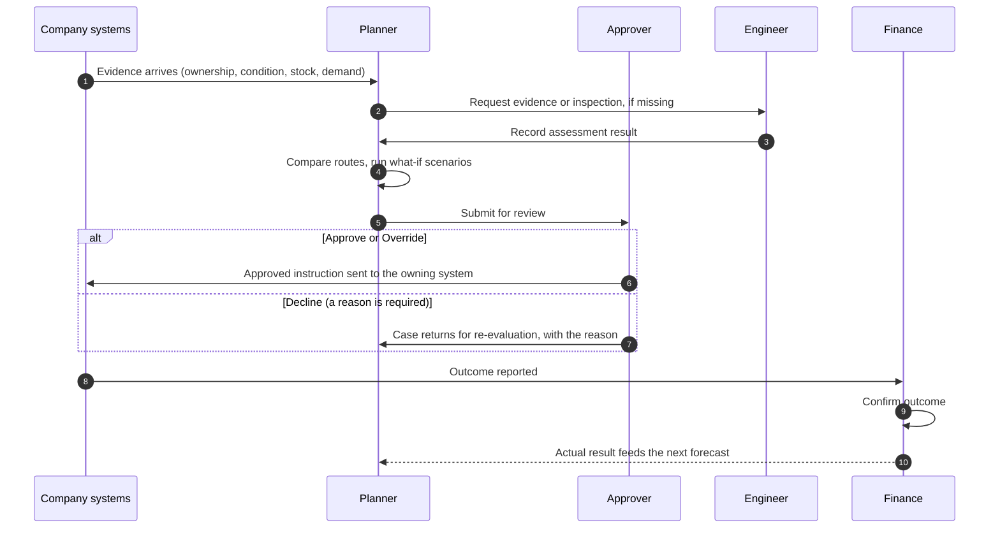

# Circularity Decision Workbench

**Decide what happens to every returned asset: redeploy it, resell it, re-lease it, strip it for parts or exit it responsibly. Back each choice with evidence, a forecast and a human approval, then measure what it actually returned.**

Circularity is part of the Artizent Decision Intelligence Framework. This repository holds the clickable product demo: one web page that shows the whole product, for every role, on desktop, tablet and phone.

[](docs/screenshots/rbac-approver-command.webp)

| | |
|---|---|
| **Try it** | Open the hosted demo at [ranilmukesh-artizent.github.io/Circularity-ui](https://ranilmukesh-artizent.github.io/Circularity-ui/), or open `index.html` from this folder in any browser. Nothing to install. |
| **Sign in** | Pick one of eight demo accounts. There are no passwords. |
| **Data** | Everything is **synthetic**. The demo company is *Northfield Industrial Leasing*, with three customer tenants and eight sites. No personal or customer data is used, and none should be entered. |
| **What changed and when** | [`CHANGES.md`](CHANGES.md) has one walk-through per release. |

> **Note for reviewers.** Access control is close to compliance. The role matrix, the access wording and any regulatory claims in this document should be reviewed by Kinective's Legal team before anyone relies on them or uses them in a client commitment.

---

## Contents

1. [The problem we solve](#1-the-problem-we-solve)
2. [What Circularity does](#2-what-circularity-does)
3. [The demo in numbers](#3-the-demo-in-numbers)
4. [Who uses it: six roles](#4-who-uses-it-six-roles)
5. [How a decision moves through the product](#5-how-a-decision-moves-through-the-product)
6. [Screen by screen](#6-screen-by-screen)
7. [Every screen for every role](#7-every-screen-for-every-role)
8. [A day in each role](#8-a-day-in-each-role)
9. [Trust and governance](#9-trust-and-governance)
10. [Demo scripts](#10-demo-scripts)
11. [Phone, tablet, dark mode and print](#11-phone-tablet-dark-mode-and-print)
12. [How it is built](#12-how-it-is-built)
13. [What is real and what is simulated](#13-what-is-real-and-what-is-simulated)
14. [Open points](#14-open-points)

---

## 1. The problem we solve

Leasing companies, equipment makers and large fleet owners get thousands of assets back every year: motors, pumps, control units, power tools and IT equipment. The usual answer is **sell it or scrap it**, because the better options are hard to see:

- **The evidence is scattered.** Ownership sits in the lease system, condition in the inspection app, service history in the asset system, stock in the warehouse system and prices in a market feed. Nobody sees all of it at once.
- **The better routes are hard to judge.** Redeploying, re-leasing or harvesting parts can be worth much more than a sale, but only if the asset passes technical, policy and commercial checks, and only if there is demand.
- **Decisions are not linked to outcomes.** Once an asset leaves, nobody checks whether the forecast was right, so the next decision is no better.
- **Approvals are slow.** Value drains away while a case waits for evidence or a signature.

## 2. What Circularity does

Circularity sits **on top of the systems a company already runs**. It does not replace them. *"Existing lease, ERP, asset, repair, warehouse and service systems keep owning their transactions. Circularity assembles their evidence, sends approved instructions back, and reconciles what returns."*

### The ten-step journey

Every returned asset follows the same ten steps. The current step is shown in the strip along the top of every page.

| Step | What happens |
|---|---|
| 1. Supply evidence | Pull ownership, condition, service history, stock and demand from the systems that own them |
| 2. Build alternatives | List every route the asset could take |
| 3. Predict outcomes | Forecast value, cost, time, success chance and CO₂e for each route, with a range |
| 4. Optimize plan | Allocate scarce assets and parts across competing demand, so nothing is promised twice |
| 5. Approve plan | **A person decides.** Nothing that commits stock, spend or price happens without approval |
| 6. Send instruction | Send the approved instruction to the system that owns the work |
| 7. Create work | That system creates the work order, reservation or sale |
| 8. Repair and certify | The work is done and certified |
| 9. Return outcome | The actual result comes back |
| 10. Reconcile and learn | Compare actual with forecast, and improve the next prediction |

### Seven routes and six gates

**Seven routes** an asset can take: **Redeploy**, **Whole-asset resale**, **Internal recovered-part use**, **Re-lease**, **Material recovery**, **External parts sale** and **Responsible exit**.

**Six gates** every route must pass before it can be recommended: **Condition and life**, **Post-intervention**, **Policy and certification**, **Demand fit**, **Economics** and **Sustainability**. A route that fails a gate is shown as restricted, with the reason. It is never hidden.

### Six asset classes

Industrial motors, hydraulic pumps, control units (PLCs), power tools, tool-fleet batches and IT electronics.

## 3. The demo in numbers

These figures come from the synthetic demo data (as of 07 Oct 2026). They show what the product reports, not a promise of results for a client.

| Measure | Demo figure | Where you see it |
|---|---|---|
| Live returns being decided | **128** assets | Command Center |
| Closed decisions used for learning | **1,400**, of which **1,277** reconciled | Analytics |
| Extra net recovery against the sell-or-scrap baseline | **+$652k** (+37%): $2.43M against $1.78M | Analytics, Command Center |
| Avoided spend (new purchases not needed) | **$1.74M**, confirmed in the ERP on 524 decisions | Analytics, Finance view |
| CO₂e avoided | **263 t**, estimated on reconciled decisions | Finance view |
| Median days to realise value | **21 days**, against 27 today (22% faster) | Analytics |
| Recovery yield (actual against predicted) | **97%** | Finance view |
| Connected business systems | **19** systems, **31** workflows, **96.8%** integration health | Integration |
| Governed tools for AI agents | **10** tools (4 that write, all behind a gate) | MCP and Tools |

Every number is computed from the same data, so it is the same on every page. For example, *41 decisions awaiting approval* appears on the Command Center, on Product and in Analytics.

## 4. Who uses it: six roles

The app opens on a sign-in screen. Each role sees **only the pages, panels, figures and buttons that belong to its job**. Anything a role can never use is **not shown at all**, rather than greyed out.

| Sign-in (desktop) | Sign-in (phone, dark mode) |
|---|---|
| [](docs/screenshots/rbac-signin.webp) | [](docs/screenshots/rbac-phone-signin.webp) |

| Role | Their job in one line | Lands on | Demo accounts |
|---|---|---|---|
| **Planner** | Prepares cases in their own customer tenant, requests evidence, evaluates options and submits decisions for review | Command Center | Planner · Customer A, B or C |
| **Approver** | Approves or declines what Admin has delegated to them: decisions and overrides, MCP server proposals, tenant access requests | Command Center, with the approvals inbox | Approver |
| **Engineer** | Inspects assets, records assessments and test results, and owns technical eligibility | Asset intelligence | Engineer |
| **Finance** | Confirms outcomes and tracks recovery, avoided spend and variance; reads and comments on the audit log and Source map | Analytics | Finance |
| **Developer** | An integration and platform engineer: connects systems, builds workflows, proposes MCP servers and governs agent tools | Integration, Source map | Developer |
| **Admin** | Everything above, plus accounts, Approver delegations and every request | Command Center | Admin |

**Key rules**
- **Admin is the master role.** Admin can do everything on every page and every tenant.
- **The Approver is delegated by Admin**, scope by scope (decisions, MCP proposals, tenant access). If Admin removes a scope, its buttons, inbox items and key figure disappear for the Approver straight away.
- **Planners see only their own customer.** To see another customer they **request access**; an Approver or Admin approves or declines it.
- **Finance reads, confirms and comments.** It never approves.
- **The Developer never sees case data.** No Product or Analytics pages, only integration, tools and audit.

Switch role at any time from the account menu (top right): **Switch account** or **Sign out**.

## 5. How a decision moves through the product



Every request, decision and delegation is written to the **event stream** and the **audit log**, with the account that made it.

## 6. Screen by screen

The left menu has seven areas. Each area has a dropdown of its sections, and every section has its own link (for example `#/integration/map`) that can be shared.

### 6.1 Command Center

**For:** every role, with a different view for each. **Purpose:** what needs attention now, and what is it worth?

- A **data health strip** (how many sources are live, stale or disconnected).
- **Filters** for tenant, site, asset class, route and time horizon. They apply to every number on the page.
- **Needs attention now:** plain-language alerts, such as *"41 decisions await approval"*. Click one to filter.
- **Key figures** chosen for the role, each with a change against last month and a trend line.
- **Panels:** lifecycle portfolio, treatment opportunity, value at risk by reason, time to action, top 10 actions to prioritise, emerging signals, capacity and bottlenecks, value realisation (predicted against actual).
- **Refresh**, **Share** (copies the link) and **Export** (a one-page PDF).

| Role | Key figures | Extra panels |
|---|---|---|
| Planner | Assets in scope, Awaiting approval, Evidence gaps, Closing within 5 days | Portfolio, actions, signals |
| Approver | Awaiting approval (value), Potential recovery, Value at risk, Closing within 5 days, Requests waiting | **Approvals inbox**, value realisation |
| Engineer | Inspection queue, Failed gates, Graded A or B, Parts on backorder | Portfolio, treatment opportunity, capacity |
| Finance | Net recovery, Uplift against baseline, Recovery yield, Avoided spend, CO₂e avoided | **Outcomes to confirm**, value realisation |
| Developer | Integration health, Sources needing attention, Failing workflows, Open conflicts, My MCP proposals | Integration health, mapping exceptions, live events |
| Admin | Requests waiting, Potential recovery, Value at risk, Integration health, Uplift | Everything |

| Planner | Approver |
|---|---|
| [](docs/screenshots/rbac-planner-command.webp) | [](docs/screenshots/rbac-approver-command.webp) |
| **Engineer** | **Finance** |
| [](docs/screenshots/readme-engineer-command.webp) | [](docs/screenshots/rbac-finance-command.webp) |
| **Developer** | **Admin** |
| [](docs/screenshots/rbac-developer-command.webp) | [](docs/screenshots/readme-admin-command.webp) |

### 6.2 Product: Returned assets and Expected returns

**For:** Planner, Approver, Engineer; Finance read-only. **Purpose:** the work list.

- **Returned assets:** every asset received this cycle, with product, asset ID, owner, location, condition, assessment, status and the **best next action with its value** (for example *RT-1048 · $9,600 · Redeploy*). Counters across the top: returned, ready to evaluate, awaiting inspection, need information, awaiting approval.
- **Expected returns:** planning signals for assets that are due back but not yet received.
- Search and filter by condition, location, owner and assessment. Click a row to open its decision; click an asset ID to open Asset intelligence.

[](docs/screenshots/readme-product-received.webp)

### 6.3 Product: Pool optimizer

**For:** Planner and Approver; Finance read-only. **Purpose:** when several assets compete for the same demand, allocate them across the whole pool so each resource is used once and nothing is promised twice. In the demo, optimising the motor pool adds **$2,200** over choosing asset by asset.

[](docs/screenshots/readme-pool-optimizer.webp)

### 6.4 Product: Asset intelligence

**For:** Planner, Approver, Engineer and Finance, each with their own tabs. **Purpose:** everything known about one asset, on one page.

- Product photo, twelve key facts and an **overall health score**.
- **Compare similar assets** (up to four side by side) and **Evaluate treatments →**.
- **Eight tabs:** Overview, Lifecycle, Condition, Product and Components, Economic Analysis, Eligibility and Compliance, Data and Evidence, Related Assets.

| Role | Tabs |
|---|---|
| Planner, Approver, Admin | All eight |
| Engineer | All except Economic Analysis |
| Finance | Overview, Lifecycle, Economic Analysis, Data and Evidence, Related Assets |

| Overview | Economic Analysis | Data and Evidence | Engineer view |
|---|---|---|---|
| [](docs/screenshots/asset-overview.webp) | [](docs/screenshots/asset-economic-tab.webp) | [](docs/screenshots/asset-data-tab.webp) | [](docs/screenshots/rbac-engineer-asset.webp) |

### 6.5 Product: Treatment Intelligence (the decision page)

**For:** Planner, Approver, Engineer and Finance; what each can press differs. **Purpose:** choose the best route for one asset, and get it approved.

Business-objective sliders (net recovery, turnaround time, environmental impact, serviceability), then **five panels**:

| Panel | What it answers |
|---|---|
| 1. Treatment eligibility and feasible pathways | Which routes are **Eligible**, **Conditional** or **Restricted**, and why |
| 2. Predicted outcomes and comparison | Value, cost, net, cycle time, success chance, useful life and CO₂e per route; compare up to three |
| 3. Recommendation and rationale | The recommended route, why it wins, why the runner-up lost, and the binding constraints |
| 4. Scenario simulation (what-if) | Drag price, cost and demand sliders; save, load and delete scenarios |
| 5. Execution readiness | Six checks (repair capacity, parts, hazmat and battery rules, customer release, work order, ERP reservation) and the timeline |

What each role can press:

| Moment | Planner | Approver | Engineer | Finance |
|---|---|---|---|---|
| Decision waiting | **Submit for review** | **Approve**, **Override**, **Decline** (with a reason) | Status only | Status only |
| Evidence missing | Request evidence | Request evidence | Request inspection, **Record assessment result** | Status only |
| Outcome reported | Status only | Status only | Status only | **Confirm outcome** |
| Scenarios | Save, load, delete | Save, load, delete | Preview only | Preview only |

| Planner: Submit for review | Approver: Approve, Override, Decline |
|---|---|
| [](docs/screenshots/rbac-planner-case.webp) | [](docs/screenshots/rbac-approver-case.webp) |
| **Lower panels** | **Phone** |
| [](docs/screenshots/treatment-bottom.webp) | [](docs/screenshots/treatment-phone.webp) |

### 6.6 Analytics: reconcile and learn

**For:** Approver, Finance and Admin see every section. The Planner sees the seven business sections, read-only. The Engineer sees Engineering economics and Sustainability. **Purpose:** did the decisions deliver, and is the model getting better?

| Section | What it shows |
|---|---|
| Recovery waterfall | From the sell-or-scrap baseline to the Circularity result, route by route |
| Pipeline | Cases opened → approved → executed → reconciled, with drop-off explained (pending is never counted as failure) |
| Route mix | How the routes chosen change month by month |
| Predicted vs actual | Forecast against outcome |
| Model versions | The learning loop: error and bias by model release |
| Pool efficiency | What pool allocation added |
| Overrides | When people changed the plan, and how that turned out |
| Engineering economics | Parts and repair economics |
| Sustainability | Estimated against measured CO₂e |

[](docs/screenshots/readme-analytics.webp)

### 6.7 Integration: the Connection Fabric

**For:** Developer and Admin can change everything. The Approver reads the Event stream and Conflict queue; the Engineer reads the Source map, Source tables and Canonical models; Finance reads and comments on the Source map. Planners do not see it. **Purpose:** connect the company's systems and keep the evidence flowing.

| Tab | What it does |
|---|---|
| **Workflow studio** | 31 workflows: one ingest workflow per source, one outbound workflow per system we write to, and three decision workflows. Edit on an Airflow-style canvas, run, simulate a failure, publish |
| **Source map** | 19 systems, each named by product (SAP S/4HANA, IBM Maximo, Salesforce, ServiceNow and others), with how it connects (native connector, JDBC, API, event API, Delta Sharing, flat file), freshness, completeness and confidence. Add, edit, sync, delete with undo |
| **Source tables** | The tables Circularity reads from a system and how they link, as a graph or a list |
| **Canonical models** | The shared, versioned data models every source maps into |
| **Event stream** | Every message in and out, with acknowledgement and idempotency key |
| **Conflict queue** | When two systems disagree, Circularity names the system with authority and holds any dependent route. It never picks silently |
| **Manual import** | Controlled CSV import where no API exists yet |

Roles that may look but not change see a **Read-only view** banner, and every field is locked.

| Source map (Developer) | Workflow studio (Developer) |
|---|---|
| [](docs/screenshots/readme-source-map.webp) | [](docs/screenshots/readme-workflow-studio.webp) |
| **Source tables (Developer)** | **Event stream (Approver, read-only)** |
| [](docs/screenshots/readme-source-tables.webp) | [](docs/screenshots/readme-event-stream.webp) |
| **Conflict queue (Approver, read-only)** | |
| [](docs/screenshots/readme-conflicts.webp) | |

### 6.8 MCP and Tools: AI agents within permissions

**For:** Developer and Admin; Approver and Engineer read-only. **Purpose:** let AI agents and other platforms work with Circularity safely, through governed tools (MCP is the Model Context Protocol, an open standard for connecting AI agents to tools).

| Section | What it shows |
|---|---|
| Tool catalog | 10 tools, such as `get_case_evidence`, `predict_outcomes`, `optimize_pool` and `send_instruction`. Six only read; four write, and those need a specific agent or a human approval |
| Agent registry | Five agents (Evidence Assembler, Opportunity Finder, Gap Requester, Execution Coordinator, Reconciler), each with its authority and calls this month |
| Playground | Try a tool call (Developer and Admin) |
| Permission matrix | Which agent may call what, per customer tenant |
| Call log and gate | Every call, including the ones held or denied |
| As MCP client | Enterprise MCP servers Circularity can use instead of custom adapters |
| Server proposals | The Developer proposes a new MCP server; an Approver or Admin approves or declines it |

**Hard rules, shown on the page:** an agent cannot waive a failed gate, and it cannot make a commercial commitment beyond its authority.

[](docs/screenshots/readme-mcp.webp)

### 6.9 Audit and provenance

**For:** every role (Planners see their own tenant). **Purpose:** prove where every piece of evidence came from.

- **Fetch log:** every data fetch, with the time, source system, case, the exact request, the result, where it was used and whether provenance is full or partial. Export to CSV.
- **Evidence gaps:** evidence with no recorded fetch, so no provenance can be shown.
- Entries are read-only. **Comments:** Finance, Developer and Admin can comment on an audit entry, and everyone who can see the entry can read the comments.

[](docs/screenshots/readme-audit.webp)

### 6.10 Access (Admin only)

**Purpose:** who can do what.

- **Accounts and roles:** the eight demo accounts, their role, their tenants and their landing page.
- **Approver delegations:** tick or untick what the Approver may decide (decisions, MCP proposals, tenant access). The change takes effect straight away.
- **All requests:** every tenant access request and MCP server proposal, with its status and who decided.

[](docs/screenshots/rbac-admin-access.webp)

## 7. Every screen for every role

`●` full use · `R` read-only · `R+C` read-only plus comments · `—` not shown. Admin has `●` everywhere.

| Screen | Planner | Approver | Engineer | Finance | Developer |
|---|---|---|---|---|---|
| **Command Center** (own view) | ● | ● with Approvals inbox | ● | ● with Outcomes to confirm | ● integration health only |
| Product · Returned assets, Expected returns | ● own tenant | ● | ● | R | — |
| Product · Pool optimizer | ● own tenant | ● | — | R | — |
| Product · Asset intelligence | ● all tabs | ● all tabs | ● no Economic tab | ● economic tabs | — |
| Product · Treatment Intelligence | ● Submit for review | ● Approve, Override, Decline | ● Record assessment | ● Confirm outcome | — |
| Analytics · all business sections | R | ● | — | ● | — |
| Analytics · Engineering economics, Sustainability | — | ● | ● | ● | — |
| Integration · Workflow studio | — | — | — | — | ● |
| Integration · Source map | — | — | R | R+C | ● |
| Integration · Source tables, Canonical models | — | — | R | — | ● |
| Integration · Event stream, Conflict queue | — | R | — | — | ● |
| Integration · Manual import | — | — | — | — | ● |
| MCP · Catalog, Agents, Permissions, Call log, As client | — | R | R | — | ● |
| MCP · Playground | — | — | — | — | ● |
| MCP · Server proposals | — | ● approve or decline | R | — | ● propose |
| Audit · Fetch log, Evidence gaps | R own tenant | R | R | R+C | R+C |
| Access | — | — | — | — | — |
| Request access to another tenant | ● | — | — | — | — |

Opening a page your role cannot see (for example from an old bookmark) takes you to your home page with a short message saying why. A link to another tenant's case says it belongs to another tenant.

## 8. A day in each role

**Planner (Customer A).** Signs in to a Command Center scoped to Customer A. Under Product → Returned assets: 64 assets returned this cycle, 21 waiting for approval. Opens **RT-1048**, an industrial motor whose best route is *Redeploy* for $9,600. Checks the eligibility gates, compares it against resale, drags the price slider to test a drop in demand, saves the scenario and presses **Submit for review**. Needs Customer B's motors for a shared pool, so picks **Request access…** in the tenant menu.

**Approver.** Lands on the **Approvals inbox**: the Planner's tenant access request and a Developer's MCP server proposal. Approves the access request with a note. Opens RT-1048, sees who submitted it and when, and either **Approves**, **Overrides** with another route, or **Declines** with a reason that the Planner will see.

**Engineer.** Lands on Asset intelligence. The Command Center shows the inspection queue (24) and failed gates (41). Requests an inspection on an asset with missing evidence, then **Records the assessment result**, which unblocks the case for the Planner.

**Finance.** Lands on Analytics: +$652k over baseline, $1.74M avoided spend, 97% recovery yield. Confirms outcomes as they arrive, and leaves a **comment** on an audit entry or on the ERP source in the Source map to question a figure.

**Developer.** Lands on the Source map. Sees that Market pricing is stale (expired token) and Device telemetry is not connected; opens a failing workflow on the canvas to see which step broke. Tests a tool in the MCP Playground and **proposes a new MCP server** for review.

**Admin.** Sees everything. Uses the **Access** page to decide what the Approver may approve. Unticking *MCP server proposals* removes those items from the Approver's inbox straight away.

## 9. Trust and governance

| Principle | How the product shows it |
|---|---|
| **People decide, systems execute** | Anything that commits stock, spend or price stops for human approval (journey step 5). Write tools for agents sit behind a gate |
| **Least privilege** | Each role sees only its own pages and controls. Controls a role can never use are not shown at all |
| **Delegated authority** | Admin delegates approval rights to the Approver per scope, and can take them back at any time |
| **Tenant isolation** | A Planner sees only their own customer until an Approver or Admin grants access |
| **Separation of duties** | The Planner submits, the Approver decides, the Engineer certifies, Finance confirms |
| **Full provenance** | Every fetched fact records its source, request and use. Gaps are flagged, never filled in silently |
| **Conflicts are surfaced** | When systems disagree, the source with authority is named and dependent routes are held |
| **Every action is logged** | Requests, decisions and delegation changes go to the event stream and the audit log, with the account that made them |
| **Honest forecasts** | Predictions show a range. Pending cases are shown as pending, never as failures. Modelled figures say they are modelled |
| **One version of the truth** | Every page computes from the same data, so figures match everywhere |

> These describe how the demo behaves. They are not a statement of certification or regulatory compliance. Please have Kinective's Legal team review this section before it is used with clients.

## 10. Demo scripts

### Five-minute executive pitch

1. **Sign in as Admin.** "One view of every returned asset, and what it is worth." Show the Command Center: 128 assets, value at risk, *needs attention now*.
2. **Click the Awaiting approval slice**, then open **RT-1048**. "Every route, every gate, the reason for the recommendation." Drag one what-if slider.
3. **Open Analytics.** "This is what the decisions actually returned: +37% over sell-or-scrap, and the model learns from every outcome."
4. **Open Integration → Source map.** "We sit on top of the systems you already run, SAP, Maximo, Salesforce, ServiceNow, and keep them in charge of their transactions."
5. **Switch account to Planner · Customer A.** "Each person sees only their job and their customer." Then **Approver**: "and nothing commits money without a person deciding."

### Three-minute role walk-through

The step-by-step version, with every click, is in [`CHANGES.md` → Update 7 → Try it](CHANGES.md#try-it-three-minutes).

### Integration deep dive

For a technical audience, follow the [two-minute demo script](CHANGES.md#two-minute-demo-script) in `CHANGES.md` (sign in as Developer or Admin).

## 11. Phone, tablet, dark mode and print

- **Phone and tablet:** every page works at phone width (390 px) with no sideways scrolling. Key figures swipe, panels stack, tables scroll inside their panel, and the side menu becomes a scrolling bar with a second row for sections.
- **Dark mode:** the moon button in the top bar.
- **Print or PDF:** **Export** on the Command Center prints a clean one-page summary; asset pages have **Print or save as PDF** in their Actions menu.

| Dark mode | Phone |
|---|---|
| [](docs/screenshots/rbac-dark-approver.webp) | [](docs/screenshots/rbac-phone-planner.webp) |

## 12. How it is built

For the Product Owner and engineering.

| | |
|---|---|
| **Shape** | One self-contained file, `index.html`. No build step, no framework, no backend; the only external request is for Google Fonts |
| **Run locally** | Open `index.html`, or serve the folder (`python -m http.server`) and open `http://localhost:8000` |
| **Hosting** | GitHub Pages, deployed automatically from `main` by `.github/workflows/static.yml` |
| **Data** | A seeded synthetic world (seed 20261007): 128 live cases, about 1,400 closed decisions, 19 sources, 31 workflows. Built-in integrity checks make sure the numbers reconcile across pages |
| **State** | In memory; resets on refresh. Only the theme, the menu state and the signed-in demo account are remembered on the device |
| **Navigation** | Hash links such as `#/product/RT-1048` or `#/integration/map`, so every page and section can be bookmarked and the back button works |
| **Access policy** | One block in `index.html`, between `/*RBAC-START*/` and `/*RBAC-END*/`: the roles, their pages, their permissions and the demo accounts. The menu, the page guard and the control filtering all read from it |
| **Images** | Five unbranded product photos in `assets/products/`; prompts to regenerate them are in [`IMAGE_PROMPTS.md`](IMAGE_PROMPTS.md) |
| **Quality checks** | An automated headless-browser suite (178 checks) covers sign-in, every page for every account, hidden controls, tenant lock, approvals, comments, cross-page numbers and data integrity. A second run checks every reachable page at phone width |

**Repository map**

```
index.html                      the whole app
README.md                       this product guide
CHANGES.md                      release walk-throughs, one per update
docs/PLAN_RBAC_ADAPTIVE_UI.md   role design, with the Product Owner's decisions (section 9)
docs/screenshots/               every screenshot used in the docs
assets/products/                product photos
IMAGE_PROMPTS.md                how the product photos were made
```

## 13. What is real and what is simulated

| Real in the demo | Simulated |
|---|---|
| Every screen, interaction and role rule | Sign-in: demo accounts, no passwords, no real authentication |
| The decision logic: routes, gates, forecasts with ranges, pool allocation | All data: companies, assets, prices, volumes and results are synthetic |
| Numbers that reconcile across every page | Connections: vendor and product names make the demo realistic, but nothing is connected |
| Phone, tablet, dark mode and print layouts | Live activity: syncs, workflow runs and failures are simulated on a timer |
| | Component health, part numbers, stock and some costs are modelled from grade, age and class, and are labelled as such |

Nothing is saved to a server. All changes reset on refresh.

## 14. Open points

**Still to confirm with the Product Owner.** These follow the draft plan until confirmed (see `docs/PLAN_RBAC_ADAPTIVE_UI.md`, section 9):
- the Approver's and Engineer's access to the Integration sections and the audit log
- roles other than Planner see all tenants
- the Developer and Admin can reply to Finance comments
- the Access page lists the demo accounts but does not create new ones

**For Legal review.** The role matrix (sections 4 and 7), the governance claims (section 9) and any access or compliance wording should be reviewed by Kinective's Legal team before client use.

**Before a production build.** Real sign-in (single sign-on), server-side enforcement of the same access policy, persistent storage, live connectors and a security review.
