# Circularity Decision Workbench

**Decide what happens to every returned asset: redeploy it, resell it, re-lease it, strip it for parts or exit it responsibly. Back each choice with evidence, a forecast and a human approval, then measure what it actually returned.**

Circularity is part of the Artizent Decision Intelligence Framework. This repository holds the clickable product demo: one web page that shows the whole product, for every role, on desktop, tablet and phone.

[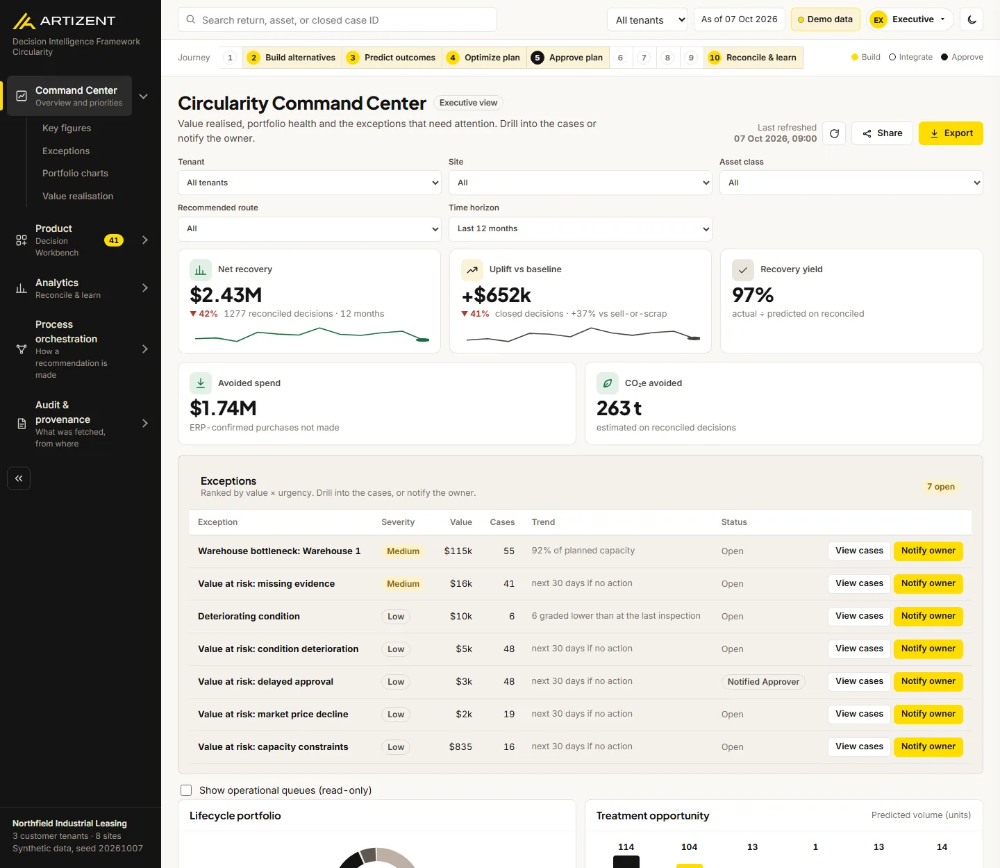](docs/screenshots/flow-executive-command.webp)

| | |
|---|---|
| **Try it** | Open the hosted demo at [ranilmukesh-artizent.github.io/Circularity-ui](https://ranilmukesh-artizent.github.io/Circularity-ui/), or open `index.html` from this folder in any browser. Nothing to install. |
| **Sign in** | A normal sign-in form. Type `exec` (senior management) or `ops` (end user) and any password, or a work email such as `planner.b@northfield.example` (full list in section 4). Sign-in is simulated: nothing is checked and nothing leaves the browser. In production, users and roles come from the customer's identity provider (single sign-on). |
| **The journey** | Sign in, open **Returned assets**, pick one asset and follow it through the ten steps of the *Typical User Journey* (supply evidence to reconcile and learn). Every step is clickable in the strip under the top bar, and a bar at the bottom says what the step established and what comes next. The demo record is the returned motor **RT-1048**; the click-by-click script is [`docs/demo/DEMO_SCRIPT.md`](docs/demo/DEMO_SCRIPT.md). |
| **Data** | Everything is **synthetic**. The demo company is *Northfield Industrial Leasing*, with three customer tenants and eight sites. No personal or customer data is used, and none should be entered. |
| **What changed and when** | [`CHANGES.md`](CHANGES.md) has one walk-through per release. |

> **Note for reviewers.** Access control is close to compliance. The role matrix, the access wording and any regulatory claims in this document should be reviewed by Kinective's Legal team before anyone relies on them or uses them in a client commitment.

---

## Contents

1. [The problem we solve](#1-the-problem-we-solve)
2. [What Circularity does](#2-what-circularity-does)
3. [The demo in numbers](#3-the-demo-in-numbers)
4. [Who uses it: eight roles](#4-who-uses-it-eight-roles)
5. [How a decision moves through the product](#5-how-a-decision-moves-through-the-product)
6. [Screen by screen](#6-screen-by-screen)
7. [Every screen for every role](#7-every-screen-for-every-role)
8. [A day in each role](#8-a-day-in-each-role)
9. [Trust and governance](#9-trust-and-governance)
10. [Demo scripts](#10-demo-scripts)
11. [Phone, tablet, dark mode and print](#11-phone-tablet-dark-mode-and-print)
12. [How it is built](#12-how-it-is-built)
13. [What is real and what is simulated](#13-what-is-real-and-what-is-simulated)
14. [Open points](#14-open-points)

---

## 1. The problem we solve

Leasing companies, equipment makers and large fleet owners get thousands of assets back every year: motors, pumps, control units, power tools and IT equipment. The usual answer is **sell it or scrap it**, because the better options are hard to see:

- **The evidence is scattered.** Ownership sits in the lease system, condition in the inspection app, service history in the asset system, stock in the warehouse system and prices in a market feed. Nobody sees all of it at once.
- **The better routes are hard to judge.** Redeploying, re-leasing or harvesting parts can be worth much more than a sale, but only if the asset passes technical, policy and commercial checks, and only if there is demand.
- **Decisions are not linked to outcomes.** Once an asset leaves, nobody checks whether the forecast was right, so the next decision is no better.
- **Approvals are slow.** Value drains away while a case waits for evidence or a signature.

## 2. What Circularity does

Circularity is **decision intelligence**: it evaluates, calculates, recommends and **sends approved instructions**. The enterprise systems a company already runs carry out the work and report the outcome; Circularity does not replace them. *"Existing lease, ERP, asset, repair, warehouse and service systems keep owning their transactions. Circularity assembles their evidence, sends approved instructions back, and reconciles what returns."*

### The ten-step journey

Every returned asset follows the same ten steps. The current step is shown in the strip along the top of every page.

| Step | What happens |
|---|---|
| 1. Supply evidence | Pull ownership, condition, service history, stock and demand from the systems that own them |
| 2. Build alternatives | List every route the asset could take |
| 3. Predict outcomes | Forecast value, cost, time, success chance and CO₂e for each route, with a range |
| 4. Optimize plan | Allocate scarce assets and parts across competing demand, so nothing is promised twice |
| 5. Plan approval | **Human in the loop: a person decides.** Nothing that commits stock, spend or price happens without approval |
| 6. Send instruction | Send the approved instruction to the system that owns the work |
| 7. Create execution work | That system creates the work order, reservation or sale |
| 8. Repair and certify | The work is done and certified |
| 9. Action and return outcome | The action is processed and the actual result, costs and proceeds come back |
| 10. Reconcile and learn | Compare actual with forecast, and improve the next prediction |

### Seven routes and six gates

**Seven routes** an asset can take: **Redeploy**, **Whole-asset resale**, **Internal recovered-part use**, **Re-lease**, **Material recovery**, **External parts sale** and **Responsible exit**.

**Six gates** every route must pass before it can be recommended: **Condition and life**, **Post-intervention**, **Policy and certification**, **Demand fit**, **Economics** and **Sustainability**. A route that fails a gate is shown as restricted, with the reason. It is never hidden.

### Six asset classes

Industrial motors, hydraulic pumps, control units (PLCs), power tools, tool-fleet batches and IT electronics.

## 3. The demo in numbers

These figures come from the synthetic demo data (as of 07 Oct 2026). They show what the product reports, not a promise of results for a client.

| Measure | Demo figure | Where you see it |
|---|---|---|
| Live returns being decided | **128** assets | Command Center |
| Closed decisions used for learning | **1,400**, of which **1,277** reconciled | Analytics |
| Extra net recovery against the sell-or-scrap baseline | **+$652k** (+37%): $2.43M against $1.78M | Analytics, Command Center |
| Avoided spend (new purchases not needed) | **$1.74M**, confirmed in the ERP on 524 decisions | Analytics, Finance view |
| CO₂e avoided | **263 t**, estimated on reconciled decisions | Finance view |
| Median days to realise value | **21 days**, against 27 today (22% faster) | Analytics |
| Recovery yield (actual against predicted) | **97%** | Finance view |
| Connected business systems | **19** systems, **31** workflows, **96.8%** integration health | Integration |
| Instructions with enterprise systems, awaiting an outcome | **38** (31 handed off + 7 approved and being handed off) | Command Center · Handed off |
| Expected returns from Contract Management | **9** contracts and leases, each with a likely outcome | Product · Expected returns |
| Governed tools for AI agents | **10** tools (4 that write, all behind a gate) | MCP and Tools |

Every number is computed from the same data, so it is the same on every page. For example, *41 decisions awaiting approval* appears on the Command Center, on Product and in Analytics.

## 4. Who uses it: eight roles

The app opens on a **sign-in form** (work email or user ID, password, *Continue with single sign-on*). Signing in goes straight to that person's home page; there is no role picker. Each role sees **only the pages, panels, figures and buttons that belong to its job**. Anything a role can never use is **not shown at all**, rather than greyed out.

[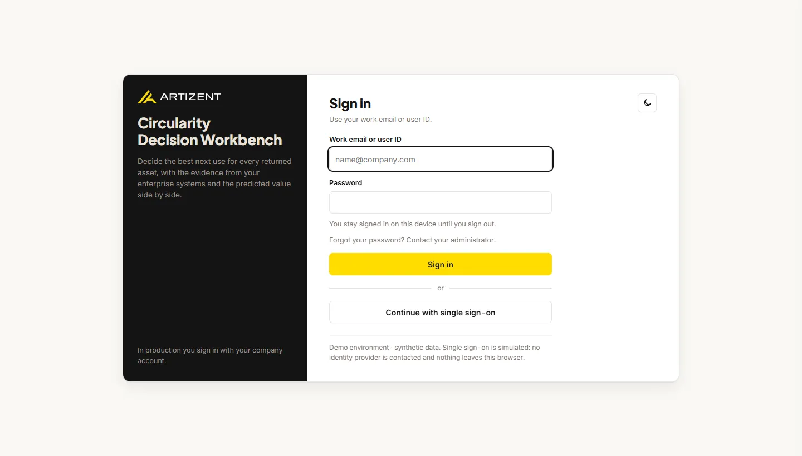](docs/screenshots/demo-signin.webp)

**Demo sign-in IDs** (any password; the domain `northfield.example` is reserved for examples):

| Type this | Signs in as | Lands on |
|---|---|---|
| `exec` or `executive@northfield.example` | Executive (senior management) | Command Center, senior view |
| `ops`, `user` or `planner.a@northfield.example` | Planner · Customer A (end user) | Returned assets, with **RT-1048** marked *Start here* |
| `planner.b@…`, `planner.c@…` | Planner · Customer B or C | Returned assets |
| `warehouse1@…`, `warehouse2@…` | Warehouse Manager · Warehouse 1 or 2 | Command Center, operational view |
| `approver@…`, `engineer@…`, `finance@…`, `developer@…`, `admin@…` | That role | Its home (table below) |

*Continue with single sign-on* uses the email typed above it, shows a short "redirecting to your identity provider (simulated)" step and signs in. An unknown ID shows an error and nothing else. For presenters, `index.html?presenter=1` adds two small shortcuts under the form (**Senior management**, **End user**) and a quick switch in the account menu; `?presenter=0` turns it off. The build team's role list is still at `#/signin?roles`.

| Role | Their job in one line | Lands on | Demo accounts |
|---|---|---|---|
| **Planner** | Prepares cases in their own customer tenant, requests evidence, evaluates options and submits decisions for review | Returned assets (Customer A opens on RT-1048) | Planner · Customer A, B or C |
| **Approver** | Approves or declines what Admin has delegated to them: decisions and overrides, MCP server proposals, tenant access requests | Command Center, with the approvals inbox | Approver |
| **Engineer** | Inspects assets, records assessments and test results, and owns technical eligibility | Asset intelligence | Engineer |
| **Finance** | Confirms outcomes and tracks recovery, avoided spend and variance; reads and comments on the audit log and Source map | Analytics | Finance |
| **Developer** | An integration and platform engineer: connects systems, builds workflows, proposes MCP servers and governs agent tools | Integration, Source map | Developer |
| **Executive** | Senior view: value realised, portfolio health and ranked exceptions; drills into Analytics and cases, and can **Notify the owner**. Read-only otherwise | Command Center (senior view) | Executive |
| **Warehouse Manager** | Runs one warehouse: its cases, inbound expected returns, capacity and items awaiting handoff outcomes. Requests evidence and acknowledges notifications; the WMS stays the system of record | Command Center (operational view) | Warehouse Manager · Warehouse 1 or 2 |
| **Admin** | Everything above, plus accounts, identity and users, Approver delegations and every request. Has a **Senior / Operational** switch on the Command Center | Command Center | Admin |

**Key rules**
- **Admin is the master role.** Admin can do everything on every page and every tenant.
- **The Approver is delegated by Admin**, scope by scope (decisions, MCP proposals, tenant access). If Admin removes a scope, its buttons, inbox items and key figure disappear for the Approver straight away.
- **Planners see only their own customer.** To see another customer they **request access**; an Approver or Admin approves or declines it.
- **Finance reads, confirms and comments.** It never approves.
- **The Developer never sees case data.** No Product or Analytics pages, only integration, tools, orchestration and audit.
- **A Warehouse Manager is locked to one warehouse** (the asset's current location) on every page, in search and in the audit log. Planners and Engineers get a **default** site filter on their queues that they can widen.
- **Everyone sees Process orchestration**, read-only; Developer and Admin also get links to the live call log.

Switch role at any time from the account menu (top right): **Switch account** or **Sign out**. Both return to the sign-in form, and the next account lands on its own home.

## 5. How a decision moves through the product

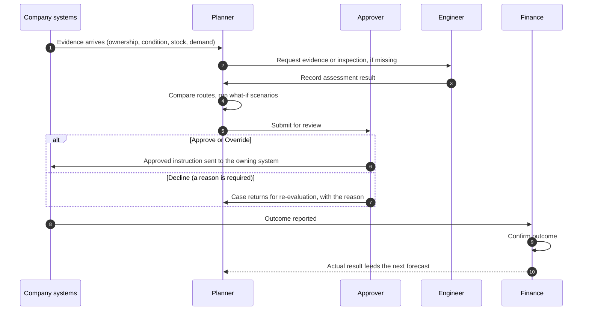

Every request, decision and delegation is written to the **event stream** and the **audit log**, with the account that made it.

## 6. Screen by screen

The left menu has eight areas. Each area has a dropdown of its sections, and every section has its own link (for example `#/integration/map`) that can be shared.

### 6.1 Command Center

**For:** every role, with a different view for each. **Purpose:** what needs attention now, and what is it worth?

- **One section per page** (Update 11): each Command Center entry in the sidebar opens its own page, and a role sees only the sections its view has. `#/command` opens **Key figures**, which also holds the portfolio charts and value realisation (they are not separate sidebar entries), and *What these figures mean*, a plain definition of every figure.
- A **data health strip** (how many sources are live, stale or disconnected).
- **Filters** for tenant, site, asset class, route and time horizon. They apply to every number on the page.
- **Needs attention now:** plain-language alerts, such as *"41 decisions await approval"*. Click one to filter.
- **Key figures** chosen for the role, each with a change against last month and a trend line.
- **Panels:** lifecycle portfolio, treatment opportunity, value at risk by reason, time to action, top 10 actions to prioritise, emerging signals, capacity and bottlenecks, value realisation (predicted against actual).
- **Refresh**, **Share** (copies the link) and **Export** (a one-page PDF).

**Senior and operational views** (Update 8). The **senior view** (Executive, and Admin's *Senior* switch) puts the value figures on top (the same figures as Finance), then portfolio health and a ranked **Exceptions** list: value at risk by reason, warehouse bottlenecks, declining metrics and deteriorating condition. Since Update 9 the list is **Exceptions by warehouse**: one row per warehouse and exception type, showing **Warehouse · Exception · Items · Value · Status**, with **Notify owner** on every row. Clicking a row opens a drill-down with three columns only: **Warehouse · Item · Value**. The values add up to the same totals as before. Operational queues are hidden unless *Show operational queues* is ticked. The **operational view** (Planner, Engineer, Warehouse Manager) starts with **Actions on me**, then **Waiting for approval** (status only) and **Handed off · awaiting outcome**, scoped to the user's site or warehouse. A notification lands in the recipient's *Actions on me*; when they acknowledge it, the exception shows *In hand by …*.

| Role | Key figures | Extra panels |
|---|---|---|
| Planner | Assets in scope, Awaiting approval, Evidence gaps, Closing within 5 days | Portfolio, actions, signals |
| Approver | Awaiting approval (value), Potential recovery, Value at risk, Closing within 5 days, Requests waiting | **Approvals inbox**, value realisation |
| Engineer | Inspection queue, Failed gates, Graded A or B, Parts on backorder | Portfolio, treatment opportunity, capacity |
| Finance | Net recovery, Recovery yield, Avoided spend, CO₂e avoided | **Outcomes to confirm**, value realisation |
| Developer | Integration health, Sources needing attention, Failing workflows, Open conflicts, My MCP proposals | Integration health, mapping exceptions, live events |
| Executive | Net recovery, Recovery yield, Avoided spend, CO₂e avoided (same as Finance) | **Exceptions** with Notify, portfolio, value realisation |
| Warehouse Manager | Actions on me, Assets at the warehouse, Handed off, Capacity used | Exceptions (read-only), Actions on me, Handed off, capacity |
| Admin | Requests waiting, Potential recovery, Value at risk, Integration health | Everything; Senior / Operational switch |

*Uplift vs baseline* is hidden for now (Update 11, `FEAT.uplift`); Analytics still shows it. Planner and Engineer also get **Actions on me** as their first figure, and every role except the Executive has the *Actions on me* panel.

| Executive (senior view) | Warehouse Manager (operational view) |
|---|---|
| [](docs/screenshots/flow-executive-command.webp) | [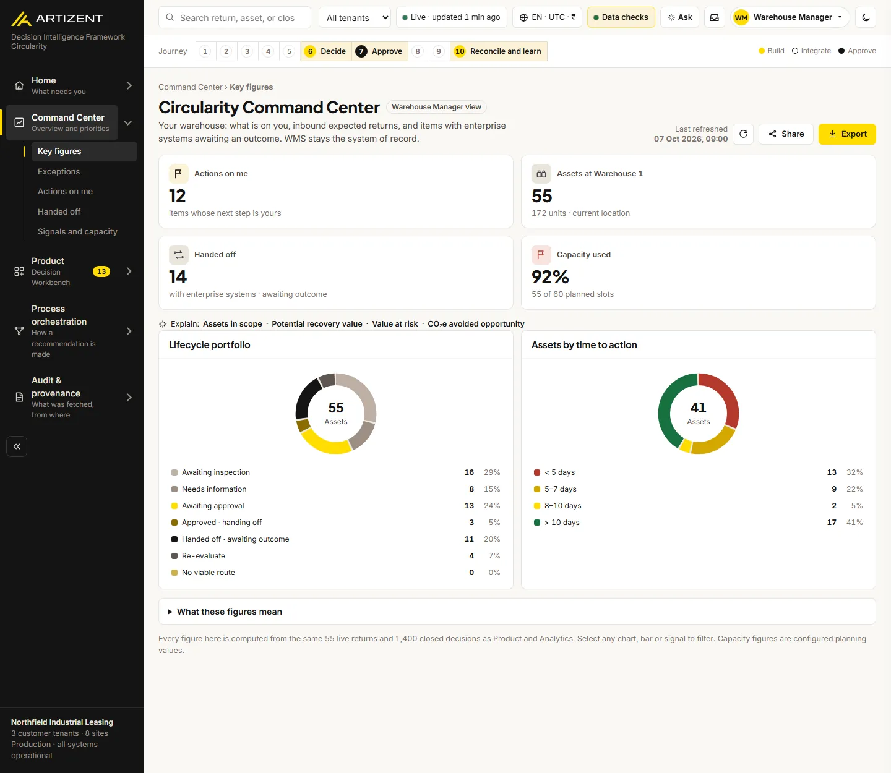](docs/screenshots/flow-wm-command.webp) |

| Planner | Approver |
|---|---|
| [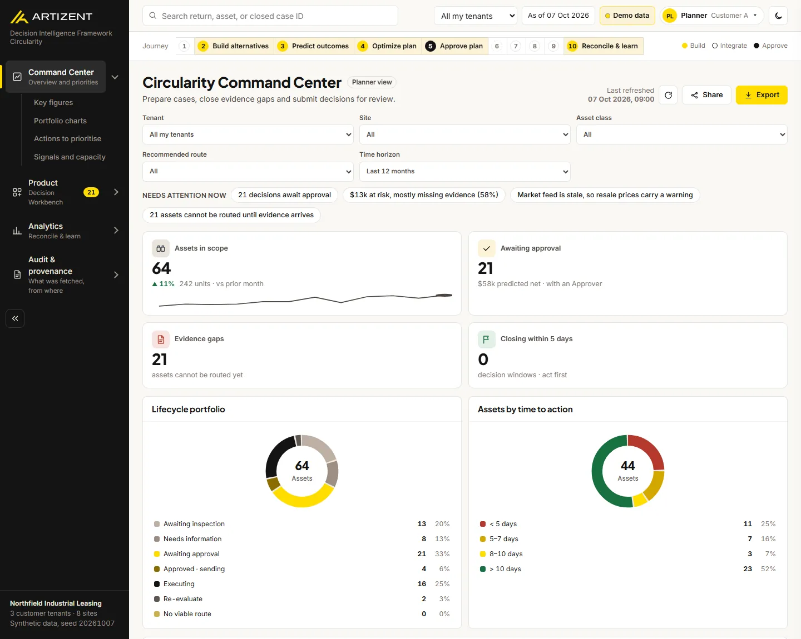](docs/screenshots/rbac-planner-command.webp) | [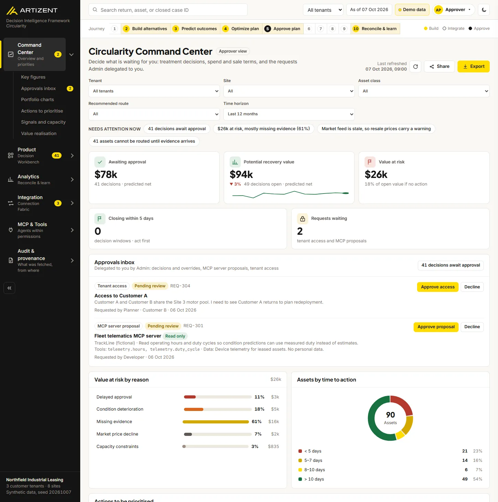](docs/screenshots/rbac-approver-command.webp) |
| **Engineer** | **Finance** |
| [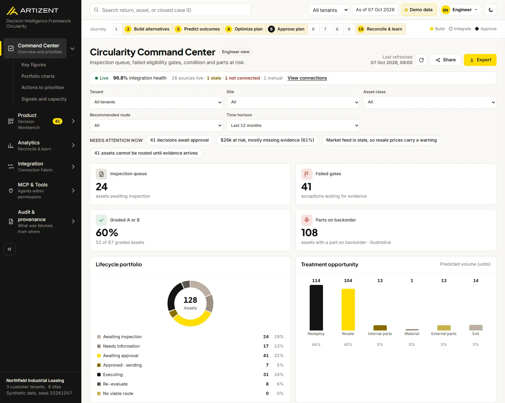](docs/screenshots/readme-engineer-command.webp) | [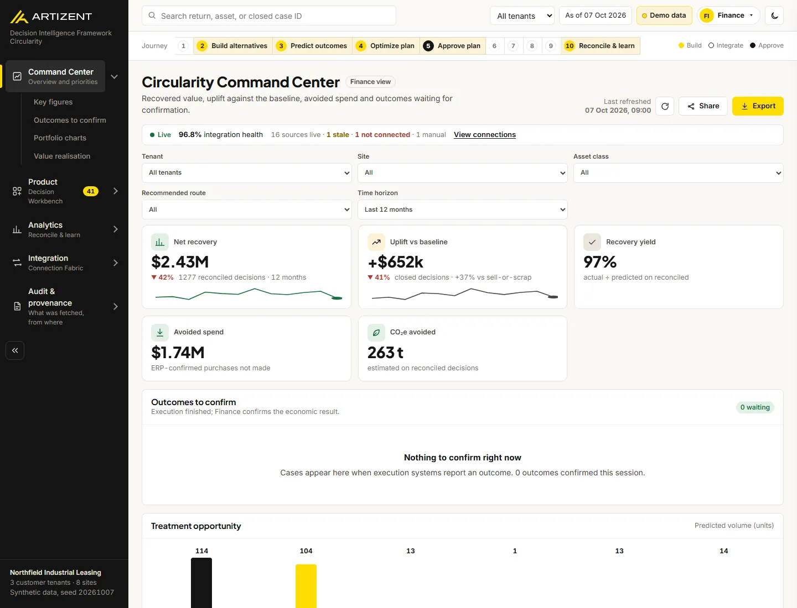](docs/screenshots/rbac-finance-command.webp) |
| **Developer** | **Admin** |
| [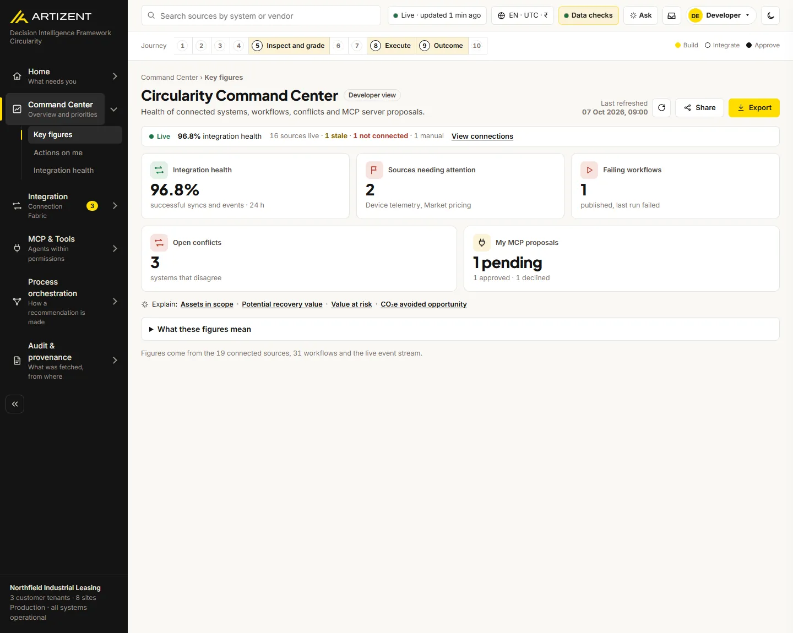](docs/screenshots/rbac-developer-command.webp) | [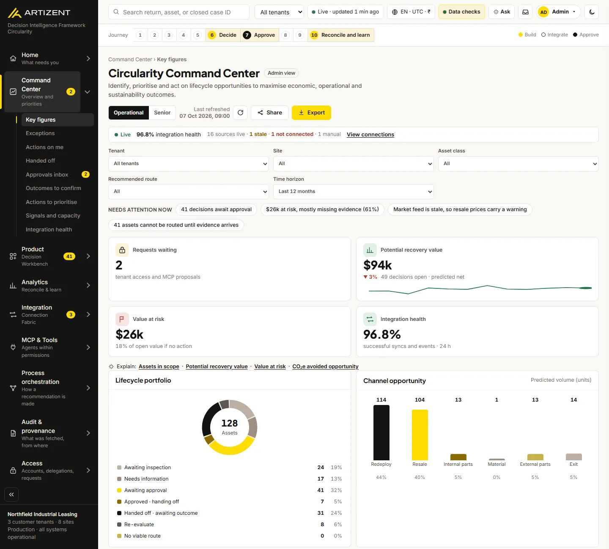](docs/screenshots/readme-admin-command.webp) |

### 6.2 Product: Returned assets and Expected returns

**For:** Planner, Approver, Engineer; Finance read-only. **Purpose:** the work list.

- **Returned assets:** every asset received this cycle, with product, asset ID, owner, location, condition, assessment, status and the **best next action with its value** (for example *RT-1048 · $9,600 · Redeploy*). Counters across the top: returned, ready to evaluate, awaiting inspection, need information, awaiting approval.
- **Expected returns:** assets due back but not yet received, **derived from contract and lease expiry in the Contract Management application** (the Lease management source). Columns: Contract ID, Customer, Asset, Lease period, Contract expiry, **Likely outcome** (return, buyout, extension or early termination, with its probability), Expected return window, Site, Planning range (also weighted by the chance of return), Source application and Status. A row opens the contract summary and a lease timeline.

[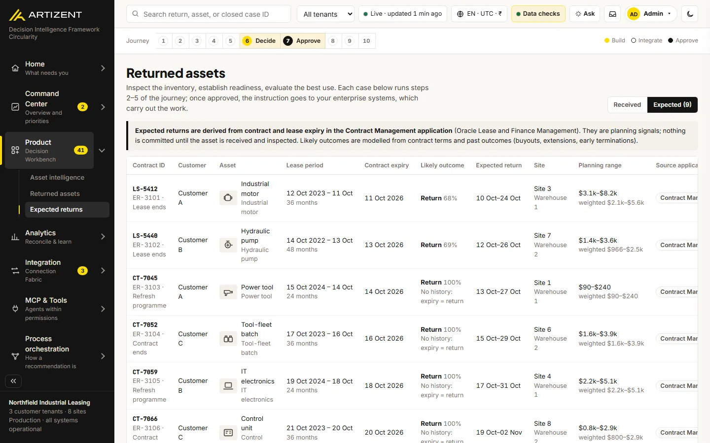](docs/screenshots/flow-expected-returns.webp)
- Search and filter by condition, location, owner and assessment. Click a row to open its decision; click an asset ID to open Asset intelligence.
- **Signals** (Update 11): under each status, four signals (received, diagnostics, certification, economic path) and the next one awaited, e.g. *1/4 · awaiting EAM*. The economic path appears only when the signals are in; until then the row says *Not priced yet*.
- **Group by product** (next to the filters) folds the list into one row per product and customer, for example *Voltara V4 motor · Customer A · 15 units · grades A–D · $85,758 predicted*. Click a group to see its units.
- This is **Start** of the journey. The demo record **RT-1048** is marked **Start here**; the **journey strip** under the top bar links to its ten steps, and the guide bar at the bottom continues to step 1 (section 10). Opening any other asset gives that asset its own strip. Notifications sent to you appear at the top of this page as well as in *Actions on me*.

[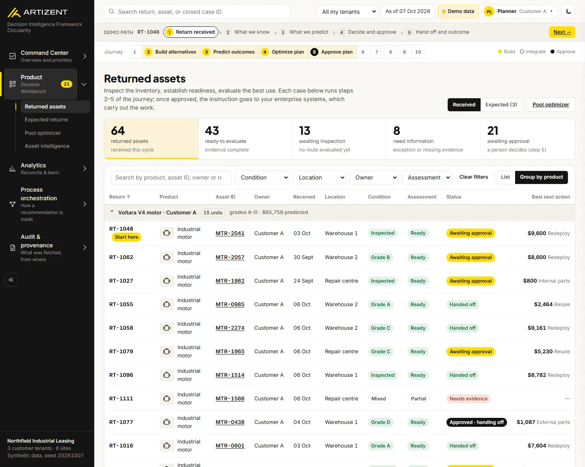](docs/screenshots/demo-sku-grouped.webp)

[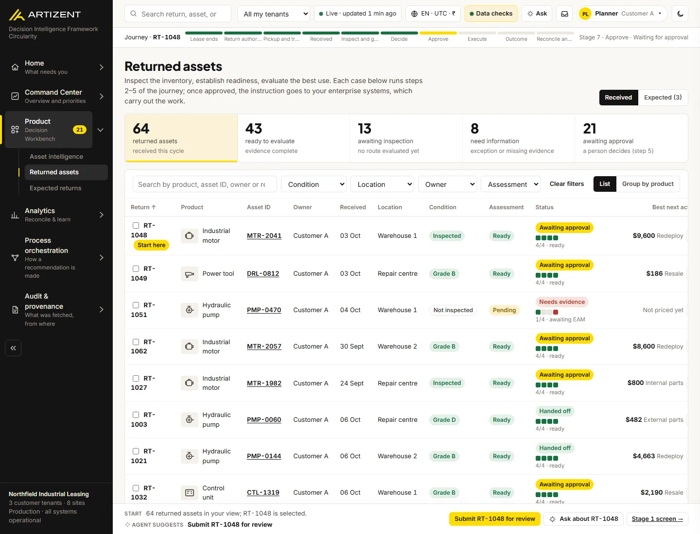](docs/screenshots/readme-product-received.webp)

### 6.3 Product: Pool optimizer

> **Hidden for now** (Update 11). The Pool optimizer, its switch on the decision page, its block in the full analysis and *Pool efficiency* in Analytics are switched off in the UI with one flag (`FEAT.pools` in `index.html`); the code and data stay.

**For:** Planner and Approver; Finance read-only. **Purpose:** when several assets compete for the same demand, allocate them across the whole pool so each resource is used once and nothing is promised twice. In the demo, optimising the motor pool adds **$2,200** over choosing asset by asset.

[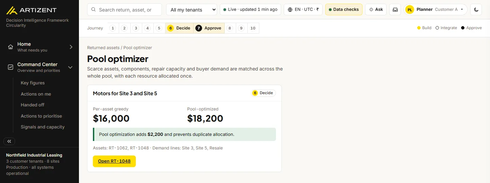](docs/screenshots/readme-pool-optimizer.webp)

### 6.4 Product: Asset intelligence

**For:** Planner, Approver, Engineer and Finance, each with their own tabs. **Purpose:** everything known about one asset, on one page.

- Product photo, key facts (including **Received under GR-…**, the WMS receipt, the **return authorisation RMA-…** from Order Management, the contract demand and the lease the unit came back from) and an **overall health score**.
- **Two pages in the left menu** (Update 11): **Retrieved data** and **Predictions**, each its own page. Detail views (Lifecycle, Condition, Product & Components, Economic Analysis, Eligibility & Compliance, Data & Evidence, Related Assets) open from each card's *View details*; *Compare similar assets* is in the **Actions** menu. Asset intelligence is first in the Product menu.
- **Product (SKU) → Customer → Unit** selectors. One customer can return many units of the same product (Customer A has 15 Voltara V4 motors back now); each unit has its own serial number, grade, life, value and route. A strip above the tabs counts the units by inspection grade and by recommended route; click a count to filter the *Unit* list.
- **Retrieved data** page (journey step 1), **Retrieved from enterprise systems**: diagnostic condition (EAM), certified period (QMS, certified by the EAM and quality process; Circularity reads the certificate), **Cost inputs** (catalogue value, RMA, EAM repair scope, contracted part prices), inspection findings, lifecycle evidence timeline, the **return history of this unit**, **Product specs** and related assets. **Predictions** page (journey steps 2–3), **Predicted and computed by Circularity**, in journey order: **Commercial value**, eligibility gates and **Matched demand** (step 2: for RT-1048, order SO-48102 at Site 3 and re-lease opportunity LS-5530), estimated remaining useful life and economic intelligence with predicted value by route and **how the preparation cost is built** (step 3), and data quality. Matched demand names the customer contract, says it accepts a certified refurbished unit, and compares the life it needs with the certified life. Every card carries a badge: **Retrieved · system**, **Model · name** or **Rules · name**. No route or predicted value appears on the retrieved side.
- **Commercial value builds with the journey.** Its chip reads **Pending evaluation** (nothing recommended yet), **Predicted, not committed** (awaiting approval), **Committed** against the order the enterprise system returned (for example *Sales order SO-48102*), and finally **Predicted vs actual** with the variance and a link to step 10. Opened from **step 1** of the journey, the predicted side waits (*Not evaluated yet*, with *Continue to step 2* and *Show the predictions now*).

[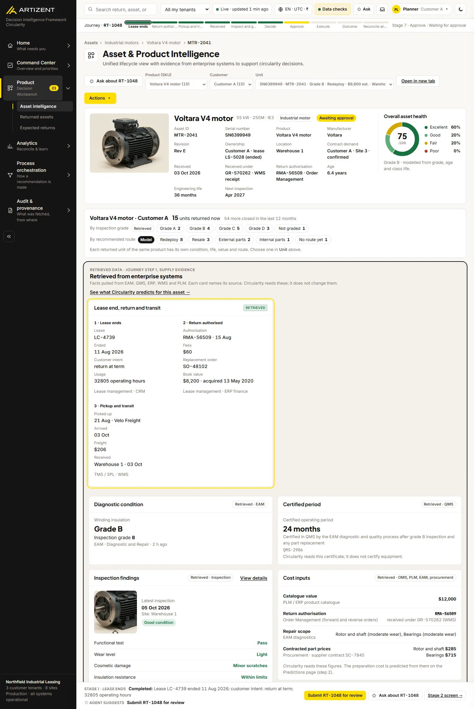](docs/screenshots/demo-asset-zones.webp)
- **Compare similar assets** (up to four side by side) and **Evaluate treatments →**.
- **Eight tabs:** Overview, Lifecycle, Condition, Product and Components, Economic Analysis, Eligibility and Compliance, Data and Evidence, Related Assets.

| Role | Tabs |
|---|---|
| Planner, Approver, Admin | All eight |
| Engineer | All except Economic Analysis |
| Finance | Overview, Lifecycle, Economic Analysis, Data and Evidence, Related Assets |

| Overview | Economic Analysis | Data and Evidence | Engineer view |
|---|---|---|---|
| [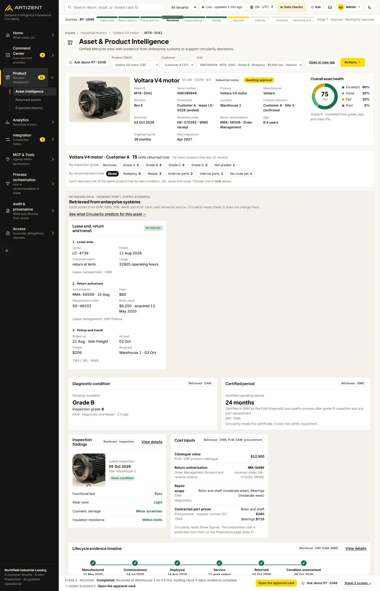](docs/screenshots/asset-overview.webp) | [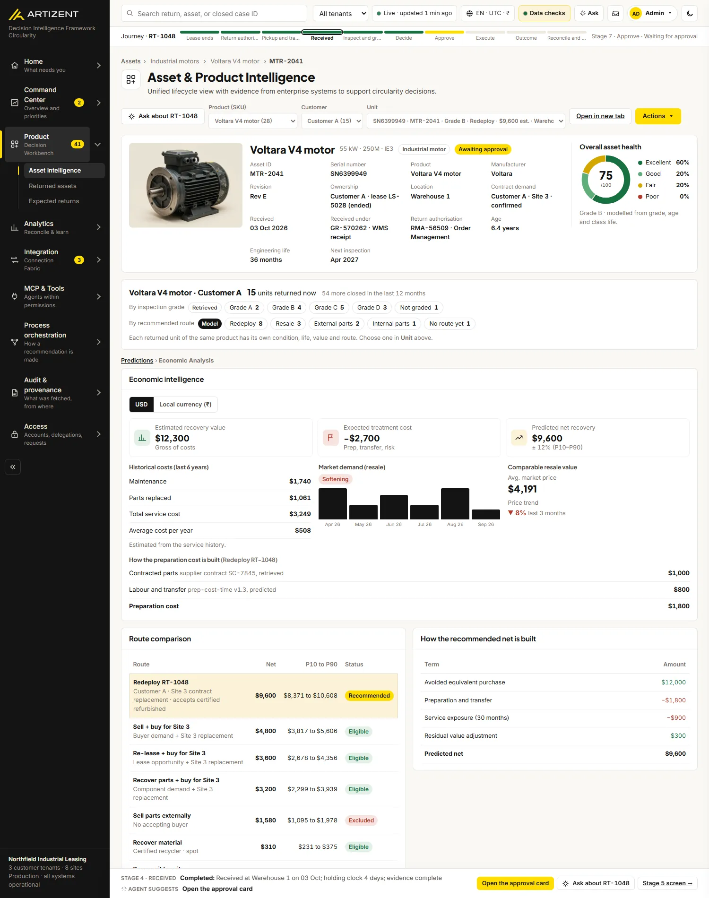](docs/screenshots/asset-economic-tab.webp) | [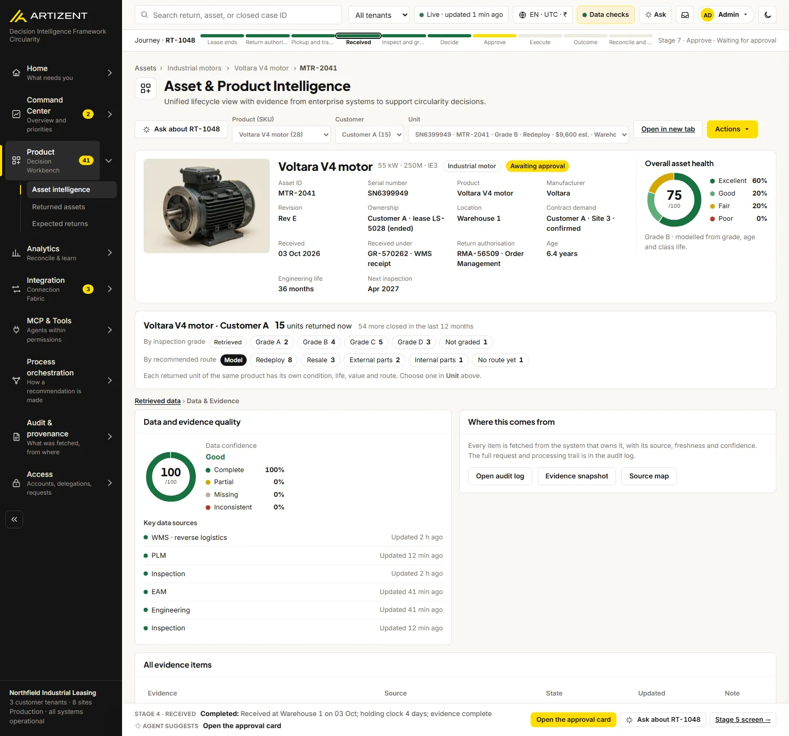](docs/screenshots/asset-data-tab.webp) | [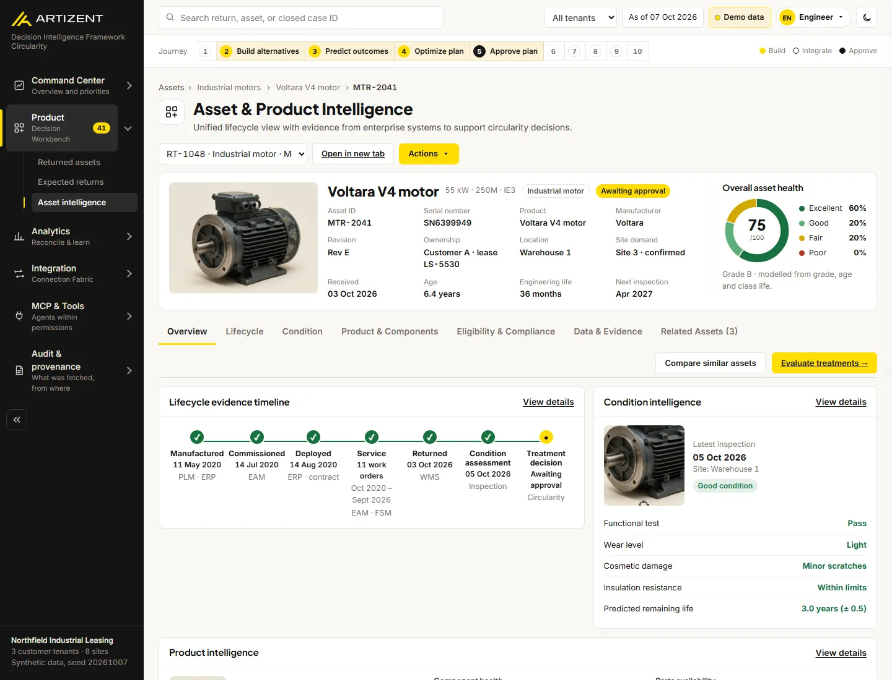](docs/screenshots/rbac-engineer-asset.webp) |

### 6.5 Product: Treatment Intelligence (the decision page)

**For:** Planner, Approver, Engineer and Finance (Executive and Warehouse Manager read-only); what each can press differs. **Purpose:** choose the best route for one asset, and get it approved.

The page reads **top to bottom in five steps**, with a sticky step bar. Each step has its own link (`#/product/RT-1048?step=3`).

| Step | What it answers |
|---|---|
| 1. Returned asset and current status | What the asset is, **why** it is in its status (for example *awaiting approval since 01 Oct*) and what is **outstanding** (evidence, test report, approval and who it waits on) |
| 2. Recommended outcome | Route, net recovery, costs, success, cycle time and a **confidence level** (High, Medium, Low, each saying what to do); **All pathways**, every route built for the asset with its net, P10–P90 and *Recommended*, *Eligible* or *Withheld* with the gate's reason (journey step 4); then the **condition → life → value** card: A. diagnostic condition, B. **estimated RUL as a range** next to the **certified operating period** (one firm figure), C. commercial value for that life with the matched order (for example *SO-48102 at Site 3*). A demand horizon longer than the certified period shows **Needs re-certification** and makes the route Conditional |
| 3. Why this outcome | Eligibility and gates, predicted outcomes for every route, the rationale, and a **Close call** box when the top two are within 5% or $250, naming the secondary factor that decides (risk, demand certainty, cycle time, RUL, carbon). Full analysis is one click away |
| 4. What-if and edge cases | A large **what-if result** card (Base net, Simulated net, Δ $, Δ %, with ▲ ▼ and the assumptions changed), sliders, **Apply to** one pathway, edge-case presets (Demand cancelled, Parts cost +30%, Resale price −20%, Certification shorter than demand, **Critical part unavailable**, **Customer requires a new unit**, each withholding routes with the reason), and the **top pathways side by side**. The comparison opens by itself on a close call or Low confidence |
| 5. Next best action: approval and enterprise handoff | The role's buttons (only here), required approval and responsible approver, the **target applications**, an **instruction preview before approval** (with *View raw payload*), handoff readiness and the **Enterprise handoff** timeline, where each acknowledgement shows the reference its system returned (*Sales order SO-48102*, *Work order WO-…*, *Transfer TR-…*, *Fulfilment FUL-…*). Below it, **Reconcile and learn** (journey step 10): once Finance confirms, every cost line's predicted and actual amount, the difference and the model that learns from it |

| Steps 1 and 2 | What-if | Approval and handoff |
|---|---|---|
| [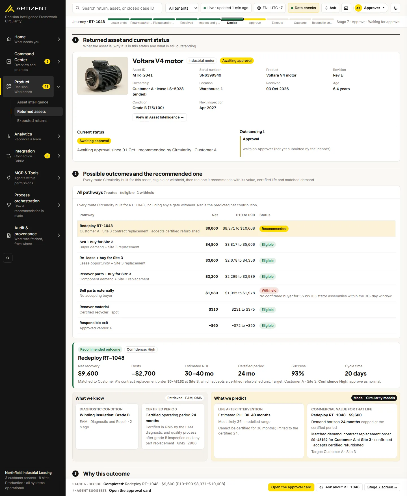](docs/screenshots/flow-case-steps-1-2.webp) | [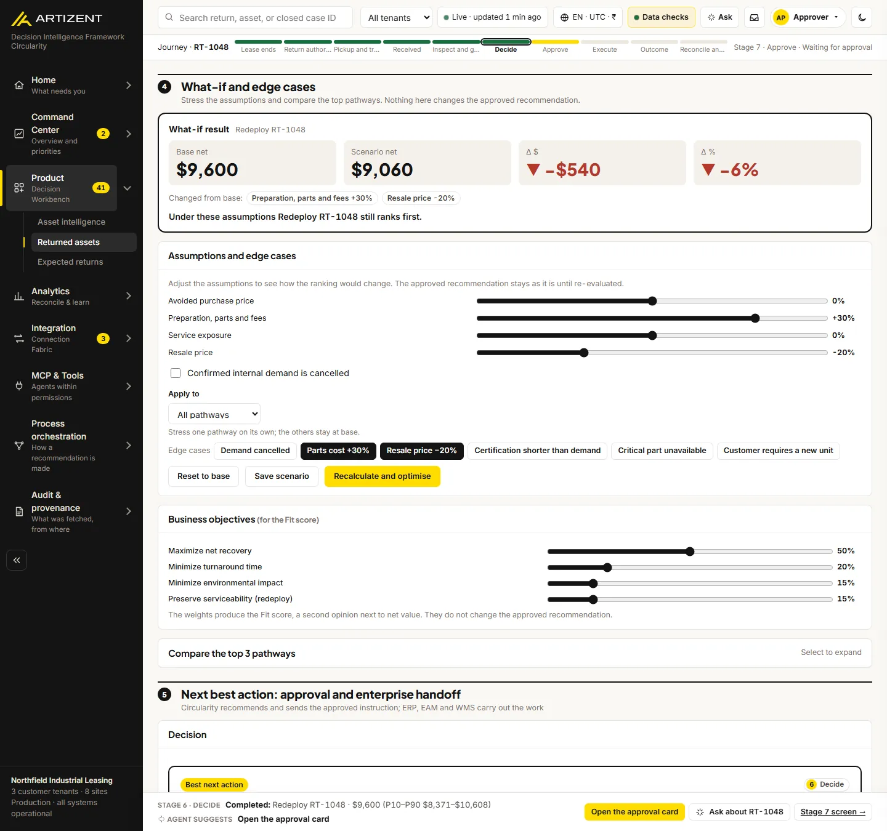](docs/screenshots/flow-case-whatif.webp) | [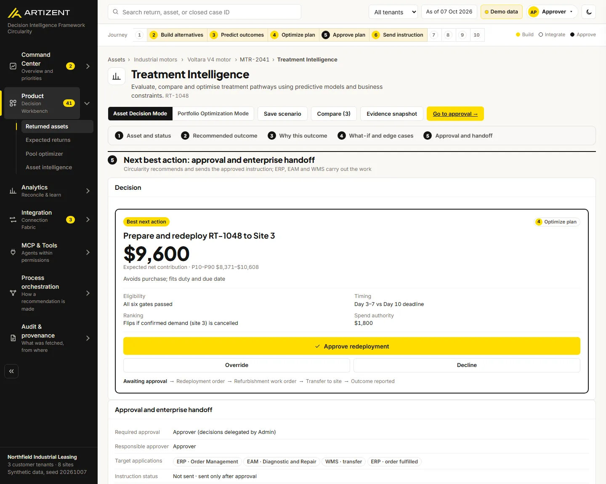](docs/screenshots/flow-case-handoff.webp) |

What each role can press:

| Moment | Planner | Approver | Engineer | Finance |
|---|---|---|---|---|
| Decision waiting | **Submit for review** | **Approve**, **Override**, **Decline** (with a reason) | Status only | Status only |
| Evidence missing | Request evidence | Request evidence | Request inspection, **Record assessment result** | Status only |
| Outcome reported | Status only | Status only | Status only | **Confirm outcome** |
| Scenarios | Save, load, delete | Save, load, delete | Preview only | Preview only |

| Planner: Submit for review | Approver: Approve, Override, Decline |
|---|---|
| [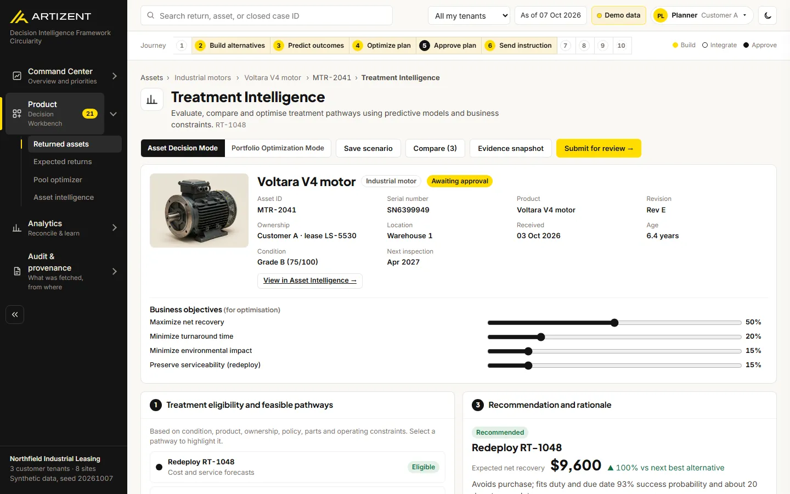](docs/screenshots/rbac-planner-case.webp) | [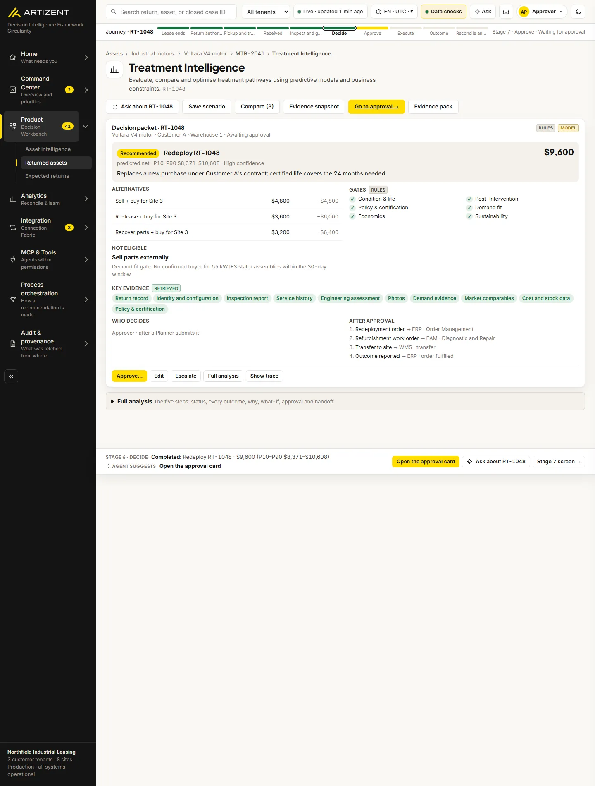](docs/screenshots/rbac-approver-case.webp) |
| **Close call (RT-1094)** | **Phone** |
| [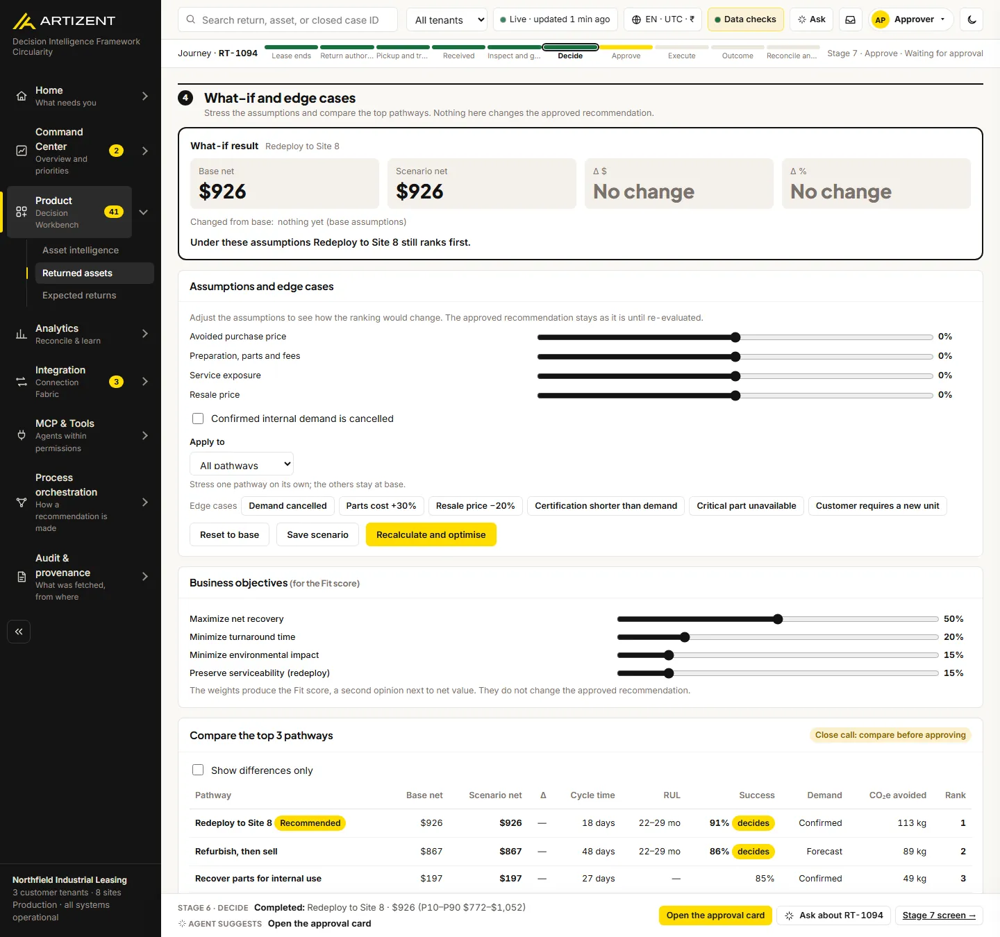](docs/screenshots/flow-case-neartie.webp) | [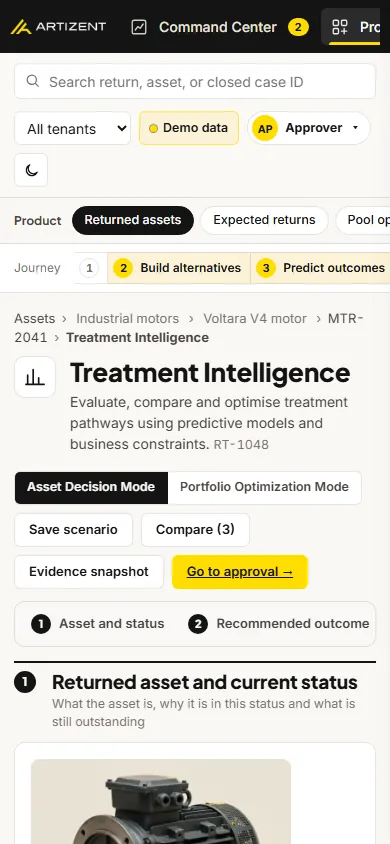](docs/screenshots/flow-phone-case.webp) |

### 6.6 Analytics: reconcile and learn

**For:** Approver, Finance and Admin see every section. The Planner sees the seven business sections, read-only. The Engineer sees Engineering economics and Sustainability. **Purpose:** did the decisions deliver, and is the model getting better?

| Section | What it shows |
|---|---|
| Recovery waterfall | From the sell-or-scrap baseline to the Circularity result, route by route |
| Pipeline | Cases opened → approved → executed → reconciled, with drop-off explained (pending is never counted as failure) |
| Route mix | How the routes chosen change month by month |
| Predicted vs actual | Forecast against outcome |
| Model versions | The learning loop: error and bias by model release |
| Pool efficiency | What pool allocation added |
| Overrides | When people changed the plan, and how that turned out |
| Engineering economics | Parts and repair economics |
| Sustainability | Estimated against measured CO₂e |

[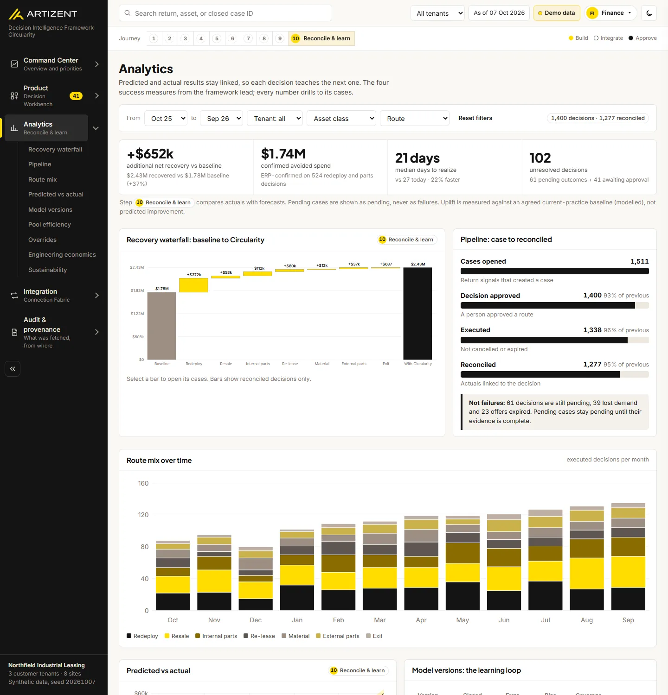](docs/screenshots/readme-analytics.webp)

### 6.7 Integration: the Connection Fabric

**For:** Developer and Admin can change everything. The Approver reads the Event stream and Conflict queue; the Engineer reads the Source map, Source tables and Canonical models; Finance reads and comments on the Source map. Planners do not see it. **Purpose:** connect the company's systems and keep the evidence flowing.

| Tab | What it does |
|---|---|
| **Workflow studio** | 31 workflows: one ingest workflow per source, one outbound workflow per system we write to, and three decision workflows. Edit on an Airflow-style canvas, run, simulate a failure, publish |
| **Source map** | 19 systems, each named by product (SAP S/4HANA, IBM Maximo, Salesforce, ServiceNow and others), with how it connects (native connector, JDBC, API, event API, Delta Sharing, flat file), freshness, completeness and confidence. Add, edit, sync, delete with undo |
| **Source tables** | The tables Circularity reads from a system and how they link, as a graph or a list |
| **Canonical models** | The shared, versioned data models every source maps into |
| **Event stream** | Every message in and out, with acknowledgement and idempotency key |
| **Conflict queue** | When two systems disagree, Circularity names the system with authority and holds any dependent route. It never picks silently |
| **Manual import** | Controlled CSV import where no API exists yet |

Roles that may look but not change see a **Read-only view** banner, and every field is locked.

| Source map (Developer) | Workflow studio (Developer) |
|---|---|
| [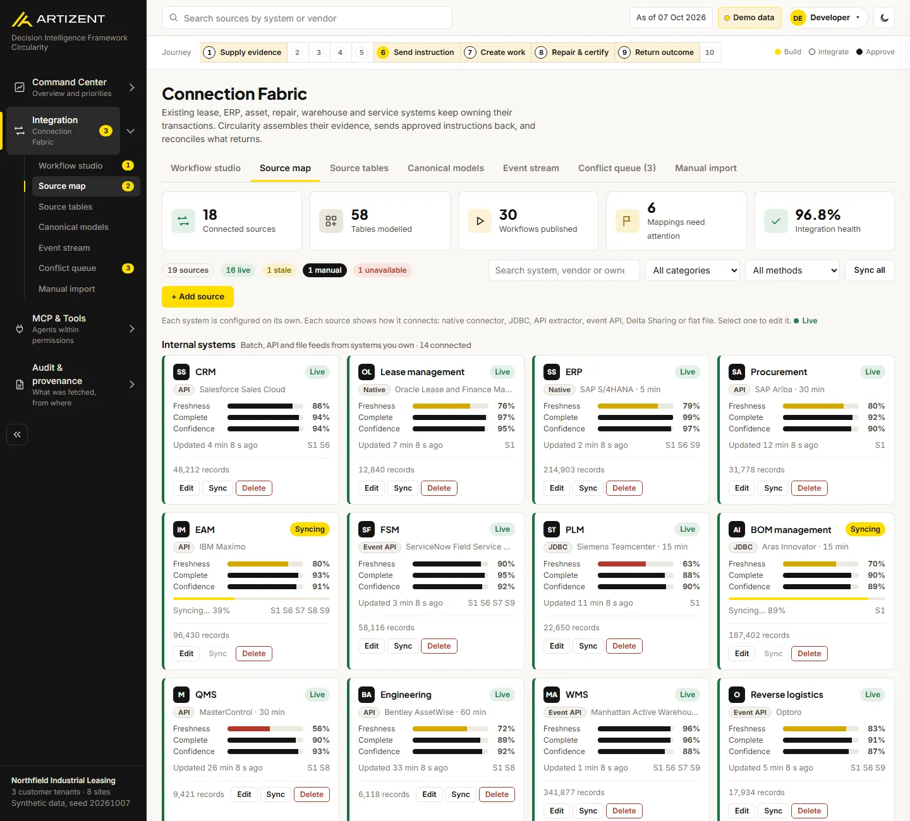](docs/screenshots/readme-source-map.webp) | [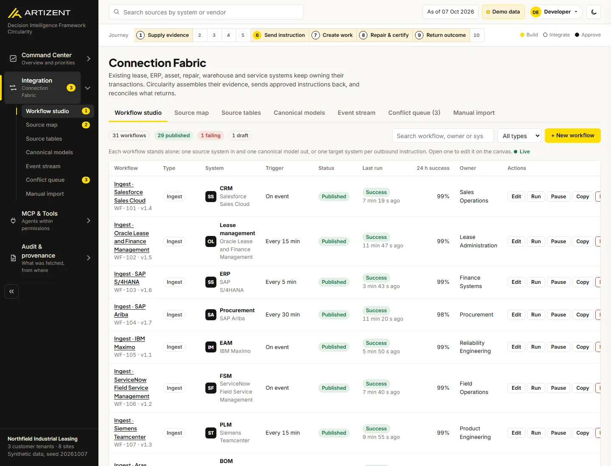](docs/screenshots/readme-workflow-studio.webp) |
| **Source tables (Developer)** | **Event stream (Approver, read-only)** |
| [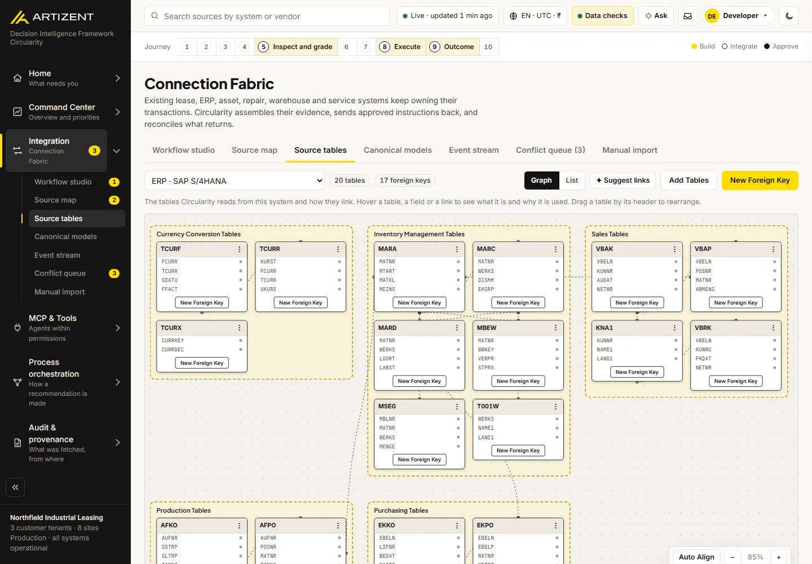](docs/screenshots/readme-source-tables.webp) | [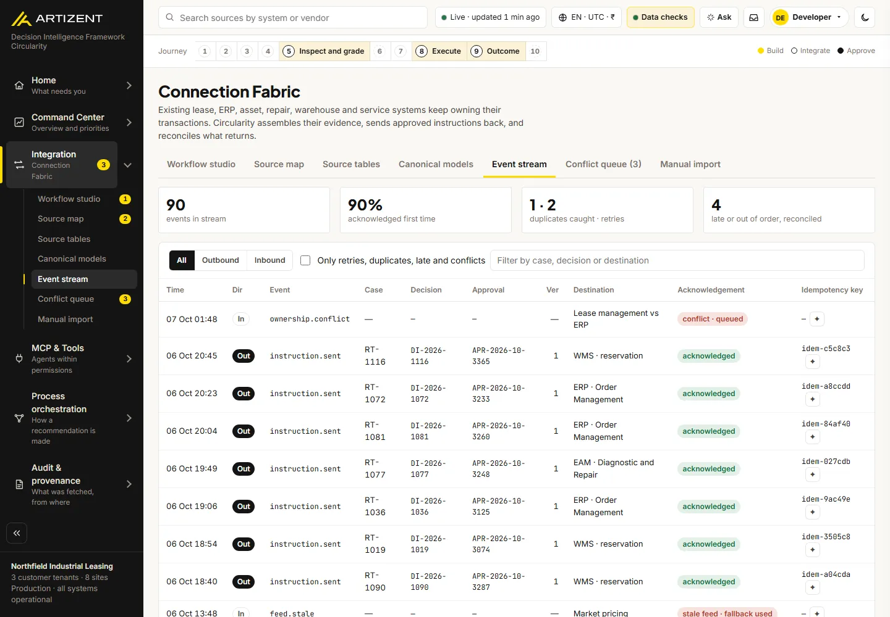](docs/screenshots/readme-event-stream.webp) |
| **Conflict queue (Approver, read-only)** | |
| [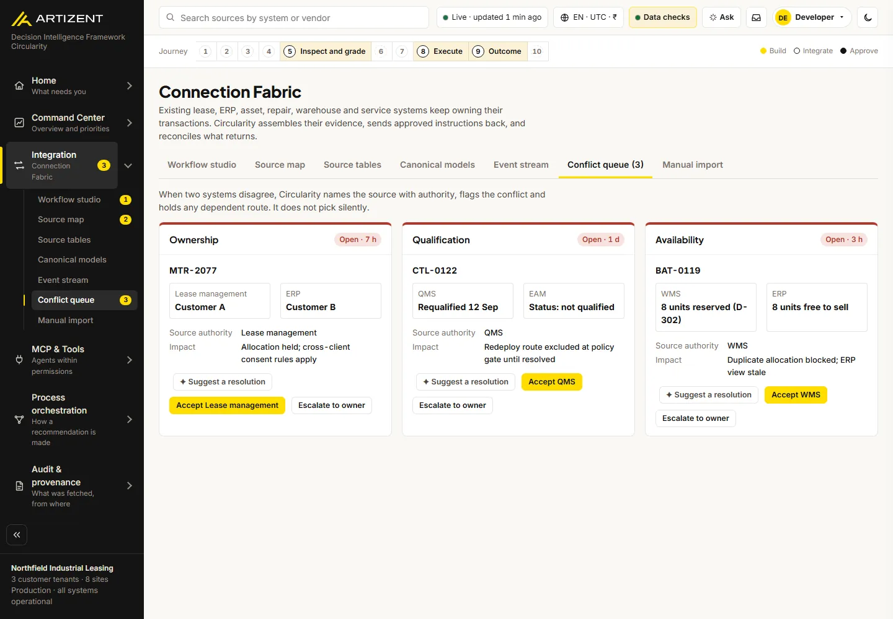](docs/screenshots/readme-conflicts.webp) | |

### 6.8 MCP and Tools: AI agents within permissions

**For:** Developer and Admin; Approver and Engineer read-only. **Purpose:** let AI agents and other platforms work with Circularity safely, through governed tools (MCP is the Model Context Protocol, an open standard for connecting AI agents to tools).

| Section | What it shows |
|---|---|
| Tool catalog | 10 tools, such as `get_case_evidence`, `predict_outcomes`, `optimize_pool` and `send_instruction`. Six only read; four write, and those need a specific agent or a human approval |
| Agent registry | Five agents (Evidence Assembler, Opportunity Finder, Gap Requester, Execution Coordinator, Reconciler), each with its authority and calls this month |
| Playground | Try a tool call (Developer and Admin) |
| Permission matrix | Which agent may call what, per customer tenant |
| Call log and gate | Every call, including the ones held or denied |
| As MCP client | Enterprise MCP servers Circularity can use instead of custom adapters |
| Server proposals | The Developer proposes a new MCP server; an Approver or Admin approves or declines it |

**Hard rules, shown on the page:** an agent cannot waive a failed gate, and it cannot make a commercial commitment beyond its authority.

[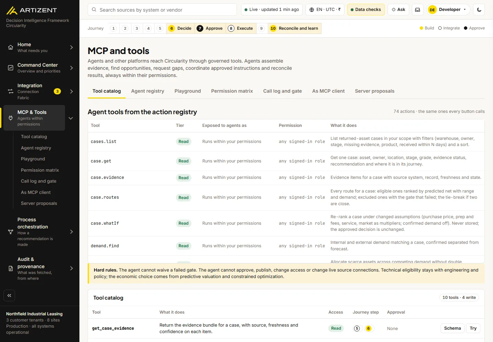](docs/screenshots/readme-mcp.webp)

### 6.9 Audit and provenance

**For:** every role (Planners see their own tenant). **Purpose:** prove where every piece of evidence came from.

- **Fetch log:** every data fetch, with the time, source system, case, the exact request, the result, where it was used and whether provenance is full or partial. Export to CSV.
- **Evidence gaps:** evidence with no recorded fetch, so no provenance can be shown.
- Entries are read-only. **Comments:** Finance, Developer and Admin can comment on an audit entry, and everyone who can see the entry can read the comments.

[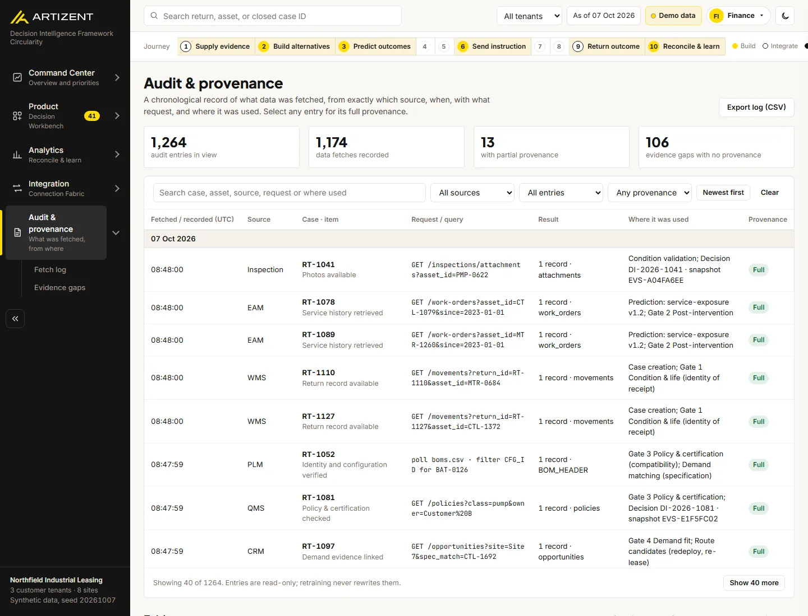](docs/screenshots/readme-audit.webp)

### 6.10 Access (Admin only)

**Purpose:** who can do what.

- **Accounts and roles:** the eleven demo accounts, their role, their tenants and their landing page.
- **Identity and users** (simulated): how users and roles arrive from the customer's identity provider (for example Microsoft Entra ID). Setup order SSO → provisioning (SCIM) → role mapping, **Sync from directory**, App Roles or directory groups mapped to role, tenant and site (editable; membership is read-only), users from the directory with `example.com` addresses (there is no *Add user*; users are added in the identity provider), a simulated leaver, the escalation path, and **out-of-office delegation** to someone who already holds the Approver role.

[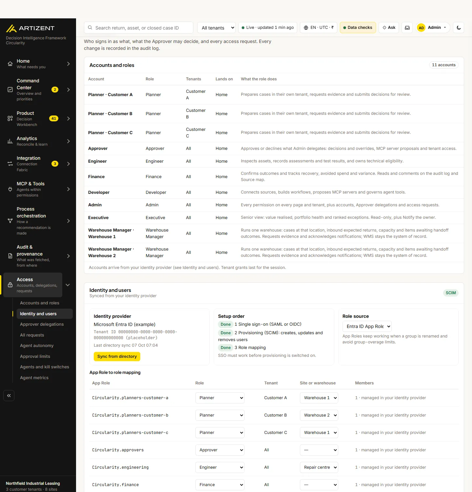](docs/screenshots/flow-identity.webp)
- **Approver delegations:** tick or untick what the Approver may decide (decisions, MCP proposals, tenant access). The change takes effect straight away.
- **All requests:** every tenant access request and MCP server proposal, with its status and who decided.

[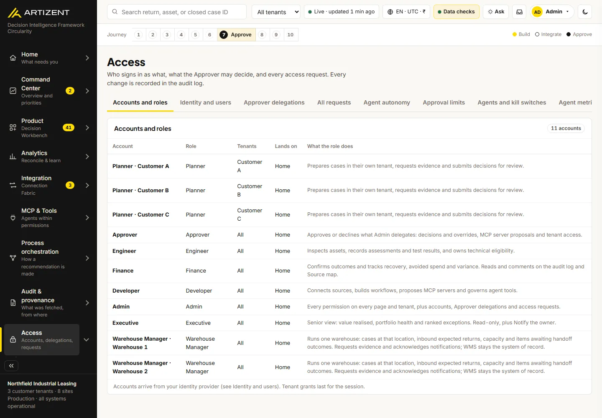](docs/screenshots/rbac-admin-access.webp)

### 6.11 Process orchestration ("behind the screen")

**For:** every role, read-only. **Purpose:** show how a recommendation is made. Ten stages, Start → Pull data → Data preparation → Evaluate gates → ML predictions → Optimise pool → Recommendation → Present for approval → Hand off to enterprise system → Retrieve actual outcome, each with its agent or service, source systems, status (done, active, failed, upstream failed, pending), start and end time and duration, for any case you can see. **Replay** animates the stages; **Simulate failure** shows how a failure stops what follows. A **run trace**, built from the audit trail and the agent call log, has one span per stage or tool call, with sensitive values redacted. Developer and Admin get links to the live call log.

[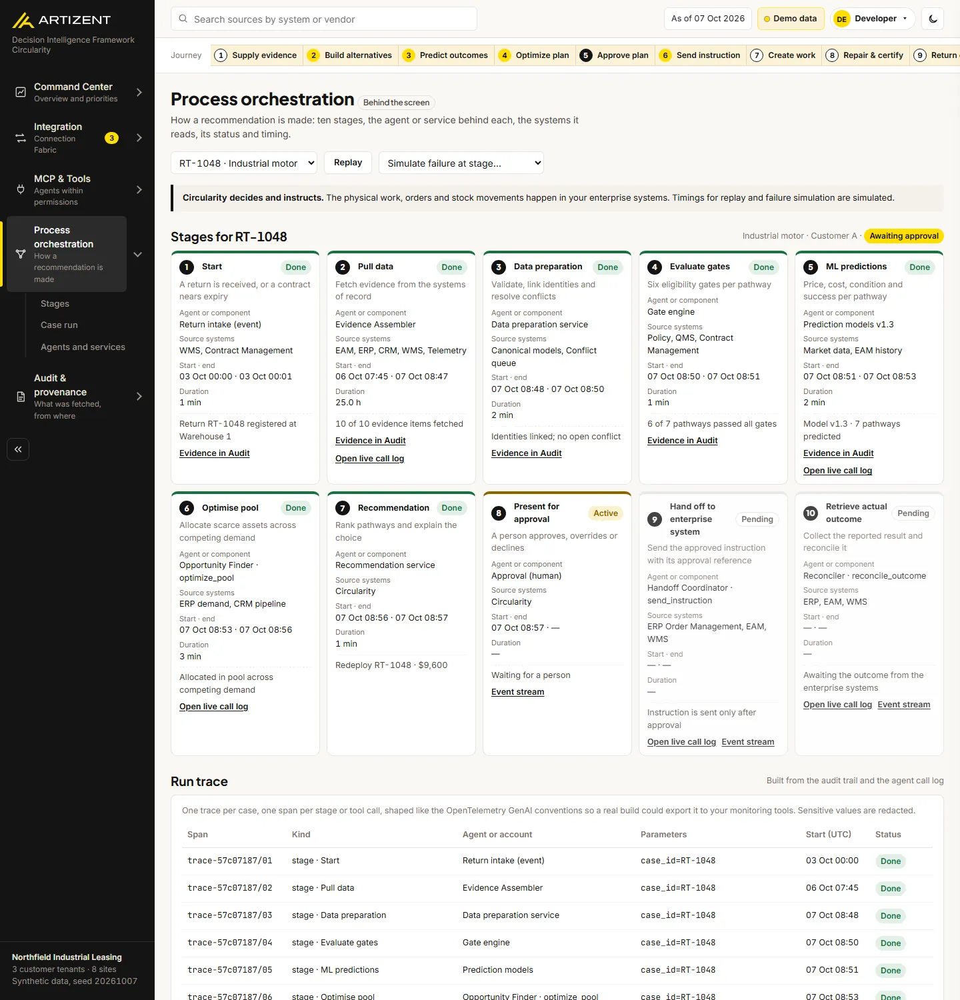](docs/screenshots/flow-orchestration.webp)

## 7. Every screen for every role

`●` full use · `R` read-only · `R+C` read-only plus comments · `—` not shown. Admin has `●` everywhere.

| Screen | Executive | Warehouse Mgr | Planner | Approver | Engineer | Finance | Developer |
|---|---|---|---|---|---|---|---|
| **Command Center** (own view) | ● senior view, Notify | ● own warehouse | ● | ● with Approvals inbox | ● | ● with Outcomes to confirm | ● integration health only |
| Command Center · Actions on me | — | ● | ● | ● | ● | ● | ● |
| Command Center · Exceptions | ● with Notify | R own warehouse | — | — | — | — | — |
| Product · Returned assets, Expected returns | R | R own warehouse | ● own tenant | ● | ● | R | — |
| Product · Pool optimizer | — | — | ● own tenant | ● | — | R | — |
| Product · Asset intelligence | R all tabs | R some tabs | ● all tabs | ● all tabs | ● no Economic tab | ● economic tabs | — |
| Product · Treatment Intelligence | R | ● request evidence | ● Submit for review | ● Approve, Override, Decline | ● Record assessment | ● Confirm outcome | — |
| Analytics · all business sections | R | — | R | ● | — | ● | — |
| Analytics · Engineering economics, Sustainability | R | — | — | ● | ● | ● | — |
| Integration · Workflow studio | — | — | — | — | — | — | ● |
| Integration · Source map | — | — | — | — | R | R+C | ● |
| Integration · Source tables, Canonical models | — | — | — | — | R | — | ● |
| Integration · Event stream, Conflict queue | — | — | — | R | — | — | ● |
| Integration · Manual import | — | — | — | — | — | — | ● |
| MCP · Catalog, Agents, Permissions, Call log, As client | — | — | — | R | R | — | ● |
| MCP · Playground | — | — | — | — | — | — | ● |
| MCP · Server proposals | — | — | — | ● approve or decline | R | — | ● propose |
| Process orchestration | R | R | R | R | R | R | R + call log |
| Audit · Fetch log, Evidence gaps | R | R own warehouse | R own tenant | R | R | R+C | R+C |
| Access (incl. Identity and users) | — | — | — | — | — | — | — |
| Request access to another tenant | — | — | ● | — | — | — | — |

Opening a page your role cannot see (for example from an old bookmark) takes you to your home page with a short message saying why. A link to another tenant's case says it belongs to another tenant.

## 8. A day in each role

**Planner (Customer A).** Signs in straight to Returned assets, scoped to Customer A: 64 assets returned this cycle, 21 waiting for approval. Opens **RT-1048**, an industrial motor whose best route is *Redeploy* for $9,600. Checks the eligibility gates, compares it against resale, drags the price slider to test a drop in demand, saves the scenario and presses **Submit for review**. Needs Customer B's motors for a shared pool, so picks **Request access…** in the tenant menu.

**Approver.** Lands on the **Approvals inbox**: the Planner's tenant access request and a Developer's MCP server proposal. Approves the access request with a note. Opens RT-1048, sees who submitted it and when, and either **Approves**, **Overrides** with another route, or **Declines** with a reason that the Planner will see.

**Engineer.** Lands on Asset intelligence. The Command Center shows the inspection queue (24) and failed gates (41). Requests an inspection on an asset with missing evidence, then **Records the assessment result**, which unblocks the case for the Planner.

**Finance.** Lands on Analytics: +$652k over baseline, $1.74M avoided spend, 97% recovery yield. Confirms outcomes as they arrive, and leaves a **comment** on an audit entry or on the ERP source in the Source map to question a figure.

**Developer.** Lands on the Source map. Sees that Market pricing is stale (expired token) and Device telemetry is not connected; opens a failing workflow on the canvas to see which step broke. Tests a tool in the MCP Playground and **proposes a new MCP server** for review.

**Executive.** Lands on the senior view: $2.43M net recovery, +$652k uplift, 97% yield, then the ranked exceptions. Clicks **View cases** on a warehouse bottleneck, then **Notify owner**; the Warehouse Manager sees it in *Actions on me* and acknowledges it, and the exception shows *In hand by Warehouse Manager · Warehouse 1*.

**Warehouse Manager.** Sees only Warehouse 1: actions on them (notifications, WMS acknowledgements pending, inbound returns from Contract Management), what waits for approval and what is with the enterprise systems.

**Admin.** Sees everything. Uses the **Access** page to decide what the Approver may approve and to show how users and roles come from the identity provider. Unticking *MCP server proposals* removes those items from the Approver's inbox straight away.

## 9. Trust and governance

| Principle | How the product shows it |
|---|---|
| **People decide, enterprise systems carry out the work** | Circularity recommends and sends approved instructions; ERP, EAM and WMS carry out the work and report back. Anything that commits stock, spend or price stops for human approval (journey step 5), and the Approver sees the full instruction before approving. Write tools for agents sit behind a gate |
| **Least privilege** | Each role sees only its own pages and controls. Controls a role can never use are not shown at all |
| **Delegated authority** | Admin delegates approval rights to the Approver per scope, and can take them back at any time |
| **Tenant isolation** | A Planner sees only their own customer until an Approver or Admin grants access |
| **Separation of duties** | The Planner submits, the Approver decides, the Engineer certifies, Finance confirms |
| **Full provenance** | Every fetched fact records its source, request and use. Gaps are flagged, never filled in silently |
| **Conflicts are surfaced** | When systems disagree, the source with authority is named and dependent routes are held |
| **Every action is logged** | Requests, decisions and delegation changes go to the event stream and the audit log, with the account that made them |
| **Honest forecasts** | Predictions show a range. Pending cases are shown as pending, never as failures. Modelled figures say they are modelled |
| **One version of the truth** | Every page computes from the same data, so figures match everywhere |

> These describe how the demo behaves. They are not a statement of certification or regulatory compliance. Please have Kinective's Legal team review this section before it is used with clients.

## 10. Demo scripts

### The Monday demo path (one record, the ten journey steps)

Sign in as `ops`: you land on **Returned assets**, with RT-1048 marked *Start here*. The **journey strip** under the top bar has **▶ Start** and the ten steps; each one is a link, with **Back** and **Next**. Filled boxes are done for the asset, the ringed box is where it is now, dimmed boxes are still to come. The guide bar at the bottom says what the step established, what the next step answers, and has **Continue**.

| Step | Screen (link) |
|---|---|
| ▶ Start | Returned assets (`#/product/received?focus=RT-1048`) |
| 1 Supply evidence | Asset Intelligence, retrieved side; the predicted side waits (`#/product/asset/RT-1048?zone=known&jstep=1`) |
| 2 Build alternatives | Eligibility and gates, Matched demand (`…?zone=predicted&jstep=2`) |
| 3 Predict outcomes | Remaining life, economic intelligence (`…?zone=predicted&jstep=3`) |
| 4 Optimize plan | Treatment Intelligence step 2, All pathways (`#/product/RT-1048?step=2&jstep=4`) |
| 5 Plan approval | The decision card: submit, then the Approver approves (`…?step=5&jstep=5`) |
| 6 Send instruction | The instruction preview, or what was sent (`…?step=5&at=handoff&jstep=6`) |
| 7 Create execution work | Handoff rows 1–2: ERP returns SO-48102, EAM a work order (`jstep=7`) |
| 8 Repair & certify | Handoff row 2: repaired, tested and certified (`jstep=8`) |
| 9 Action & return outcome | Handoff rows 3–4: WMS transfer, ERP order fulfilled (`jstep=9`) |
| 10 Reconcile & learn | Reconcile and learn: predicted vs actual by cost line (`…?step=5&at=reconcile&jstep=10`) |

The Executive's **Exceptions by warehouse** is a side dashboard, not a step: problems in steps 1–5 surface there, and *Notify owner* sends them to the person who acts. The steps follow the Product Owner's **Typical User Journey** diagram ([`docs/demo/user-journey-diagram.png`](docs/demo/user-journey-diagram.png)). The full script, with what to say, timings, recovery steps and Q&A notes, is [`docs/demo/DEMO_SCRIPT.md`](docs/demo/DEMO_SCRIPT.md); [`docs/demo/user-flow.svg`](docs/demo/user-flow.svg) ([PNG](docs/demo/user-flow.png), Mermaid source [`docs/demo/user-flow.md`](docs/demo/user-flow.md)) is the user flow, and [`docs/demo/journey-slide.svg`](docs/demo/journey-slide.svg) ([PNG](docs/demo/journey-slide.png)) tags each box with the screen that shows it.

[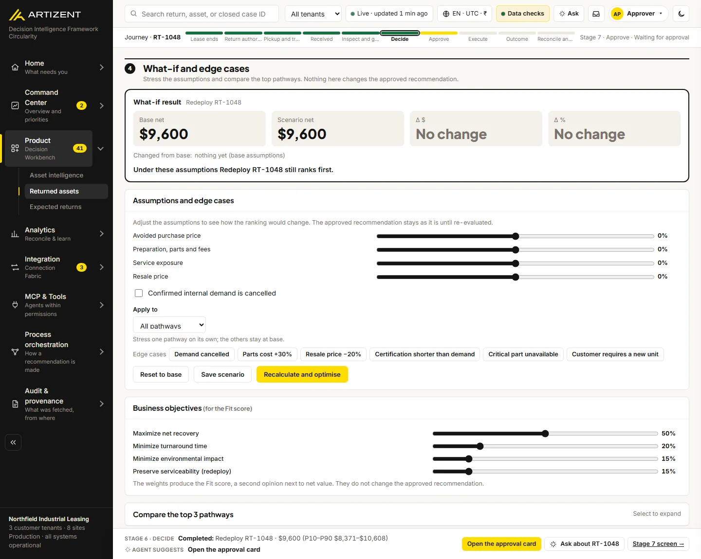](docs/screenshots/iter2-step4-pathways.webp)

### Five-minute executive pitch

1. **Sign in as Executive.** "Value realised, portfolio health and what needs attention, without scrolling." Show the exceptions; click **View cases**, then **Notify owner**.
2. **Open RT-1048** and scroll down the five steps. "Where it stands, what we recommend, why, what if, and who approves what goes to ERP, EAM and WMS." Drag the *Preparation, parts and fees* slider and watch the what-if card.
3. **Open Process orchestration.** "This is how the recommendation was made, stage by stage, and which agent did what."
4. **Open Analytics.** "This is what the decisions actually returned: +37% over sell-or-scrap, and the model learns from every outcome."
5. **Open Integration → Source map.** "We sit on top of the systems you already run, SAP, Maximo, Salesforce, ServiceNow, and keep them in charge of their transactions."
6. **Switch account to Planner · Customer A.** "Each person sees only their job and their customer." Then **Approver**: "and nothing commits money without a person deciding."

### Three-minute role walk-through

The step-by-step version, with every click, is in [`CHANGES.md` → Update 7 → Try it](CHANGES.md#try-it-three-minutes).

### Integration deep dive

For a technical audience, follow the [two-minute demo script](CHANGES.md#two-minute-demo-script) in `CHANGES.md` (sign in as Developer or Admin).

## 11. Phone, tablet, dark mode, print and region

**Region** (Update 11): the globe menu in the top bar sets the language (English; Japanese, German, French and Finnish as a preview of the menu, journey steps and guide), the time zone (the *As of* pill and the Command Center clock) and the local currency used by Asset Intelligence (₹, ¥, €; illustrative rates).

- **Phone and tablet:** every page works at phone width (390 px) with no sideways scrolling. Key figures swipe, panels stack, tables scroll inside their panel, and the side menu becomes a scrolling bar with a second row for sections.
- **Dark mode:** the moon button in the top bar.
- **Print or PDF:** **Export** on the Command Center prints a clean one-page summary; asset pages have **Print or save as PDF** in their Actions menu.

| Dark mode | Phone |
|---|---|
| [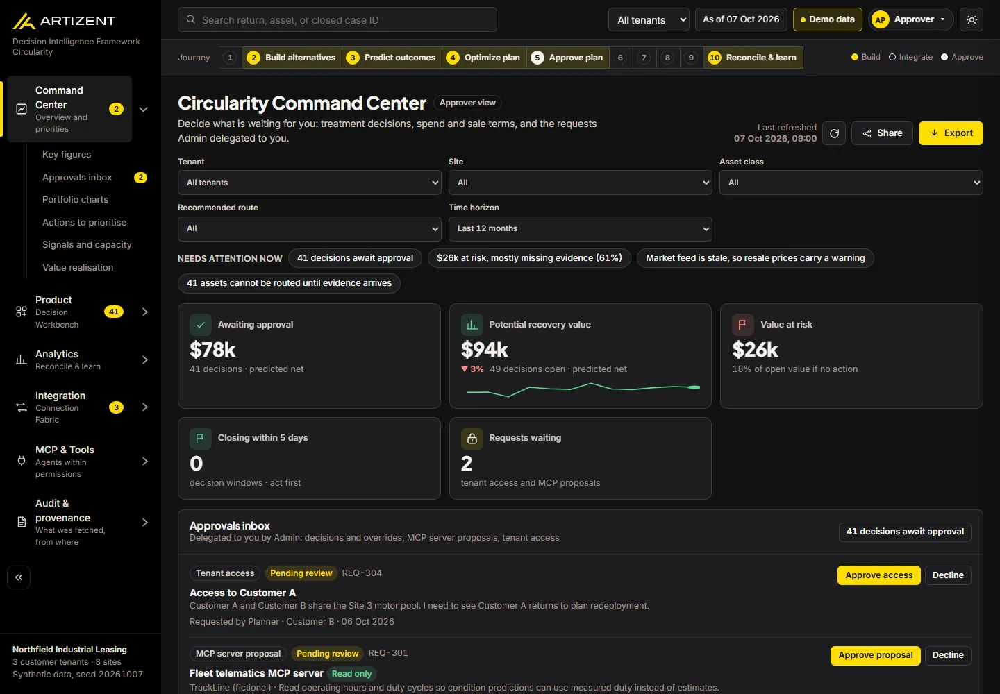](docs/screenshots/rbac-dark-approver.webp) | [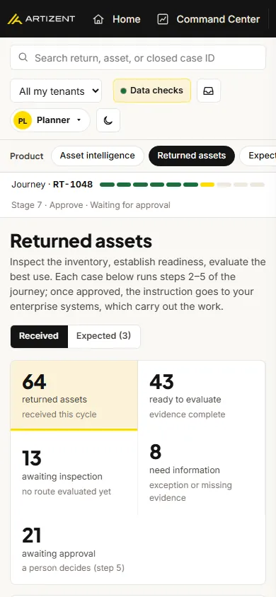](docs/screenshots/rbac-phone-planner.webp) |

## 12. How it is built

For the Product Owner and engineering.

| | |
|---|---|
| **Shape** | One self-contained file, `index.html`. No build step, no framework, no backend; the only external request is for Google Fonts |
| **Run locally** | Open `index.html`, or serve the folder (`python -m http.server`) and open `http://localhost:8000` |
| **Hosting** | GitHub Pages, deployed automatically from `main` by `.github/workflows/static.yml` |
| **Data** | A seeded synthetic world (seed 20261007): 128 live cases, about 1,400 closed decisions, 19 sources, 31 workflows. Built-in integrity checks make sure the numbers reconcile across pages |
| **State** | In memory; resets on refresh. Only the theme, the menu state and the signed-in demo account are remembered on the device |
| **Navigation** | Hash links such as `#/product/RT-1048` or `#/integration/map`, so every page and section can be bookmarked and the back button works |
| **Access policy** | One block in `index.html`, between `/*RBAC-START*/` and `/*RBAC-END*/`: the roles, their pages, their permissions and the demo accounts. The menu, the page guard and the control filtering all read from it |
| **Images** | Five unbranded product photos in `assets/products/`; prompts to regenerate them are in [`IMAGE_PROMPTS.md`](IMAGE_PROMPTS.md) |
| **Quality checks** | Three automated headless-browser suites (208 role checks, 110 guided-flow checks and 88 demo-path checks) cover sign-in, every page for every account, hidden controls, tenant lock, approvals, comments, cross-page numbers and data integrity. A second run checks every reachable page at phone width |

**Repository map**

```
index.html                      the whole app
README.md                       this product guide
CHANGES.md                      release walk-throughs, one per update
docs/PLAN_RBAC_ADAPTIVE_UI.md   role design, with the Product Owner's decisions (section 9)
docs/PLAN_GUIDED_FLOW_AND_EXEC_VIEWS.md   guided flow, senior and operational views, handoffs (Update 8)
docs/screenshots/               every screenshot used in the docs
assets/products/                product photos
IMAGE_PROMPTS.md                how the product photos were made
```

## 13. What is real and what is simulated

| Real in the demo | Simulated |
|---|---|
| Every screen, interaction and role rule | Sign-in: the form accepts any password for the demo IDs; single sign-on, the identity provider, directory sync and SCIM are simulated |
| The decision logic: routes, gates, forecasts with ranges, pool allocation | All data: companies, assets, prices, volumes and results are synthetic |
| Numbers that reconcile across every page | Connections: vendor and product names make the demo realistic, but nothing is connected |
| Phone, tablet, dark mode and print layouts | Live activity: syncs, workflow runs and failures are simulated on a timer |
| The decision page logic: tie-breaker, confidence levels, instruction preview | Component health, part numbers, stock and some costs are modelled from grade, age and class, and are labelled as such |
| | Notifications (nothing leaves the app), enterprise-system acknowledgements, orchestration timings, replay and failure simulation |
| | Diagnostic metrics, RUL ranges, certified periods, order numbers and lease outcome probabilities are modelled and labelled |

Nothing is saved to a server. All changes reset on refresh.

## 14. Open points

**Still to confirm with the Product Owner.** These follow the draft plan until confirmed (see `docs/PLAN_RBAC_ADAPTIVE_UI.md`, section 9):
- the Approver's and Engineer's access to the Integration sections and the audit log
- roles other than Planner see all tenants
- the Developer and Admin can reply to Finance comments
- the Access page lists the demo accounts but does not create new ones

**From Update 8, still assumed** (see `docs/PLAN_GUIDED_FLOW_AND_EXEC_VIEWS.md`, section 10): what the Executive may open (D2), "site" means the asset's current location (D5), notification recipients (D7), the tie-breaker threshold and factor order (D8, D18), a horizon longer than the certified period is Conditional (D10), lease outcome history exists (D19), Entra ID and SCIM (D20). The user journey diagram (D15) and the "increase the count of the rows" point (D12) are still to come.

**From Update 9, still assumed** (see `docs/PLAN_DEMO_SIGNIN_SINGLE_ASSET.md`, section 10): the two lead identities and where they land (E1, E2), the hidden role list and presenter shortcuts (E3, E4), the `northfield.example` IDs (E5), RT-1048 as the one record (E6), exceptions grouped by warehouse first (E8), real unit counts instead of "100 units" (E9), production system names on the badges (E10), *Inspection findings* (E11), no sixth Executive figure (E12), and hosting (E13).

**From Update 10, still assumed** (see `docs/feature-demo-refractor-iter-two.md`, section 4): the Executive still lands on the Command Center (H1), one journey strip replaces the demo rail (H2), the screen for each step (H3), the predicted side collapsed from step 1 (H4), a WMS receipt instead of an intake work order (H5), no separate QMS row (H6), which model learns from which cost line (H7), the size of the synthetic differences and RT-1048's preparation overrun (H8), case-level line items only (H9), and the replaced flow diagram (H10).

**From Update 11, still assumed** (see `docs/feature-demo-refactor-iter-three.md`, section 4): uplift hidden with plain alternatives proposed (J1), `#/command` opens Key figures (J2), Returned assets stays in the Product menu (J3), the Asset Intelligence layout (J4), the redeploy wording (J5), what *Critical part unavailable* withholds (J6), preview languages (J7), time zones and currencies (J8), cost inputs (J9) and signals (J10).

**For Legal review.** The role matrix (sections 4 and 7), the governance claims (section 9) and any access or compliance wording should be reviewed by Kinective's Legal team before client use.

**Before a production build.** Real sign-in (single sign-on), server-side enforcement of the same access policy, persistent storage, live connectors and a security review.
