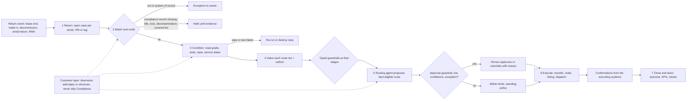
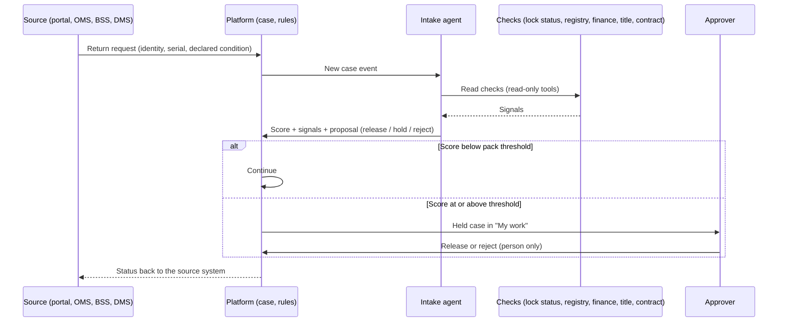
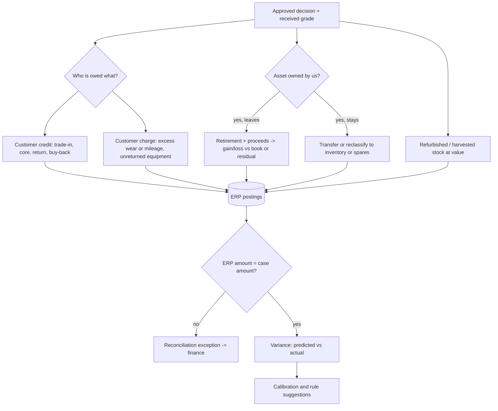

# B. Industries, gates, roles, template packs and stories (revision 2, 24 Nov 2026)

Part B of the platform research ([brief](00-brief.md)). It is the business and subject-matter view. It covers the five
Recover industry segments ([01](01-recover-segments.md)), the gate rules that regulation turns into, who uses the
product, what a template pack must hold, and the stories. It ends with the segments that come after the five.

Report A ([A-pilot-templates.md](A-pilot-templates.md)) owns tool-fleet AMS and device recommerce, with stories TF-, SD-,
CR- and DV-. This report owns **used cars (UC-)**, **telecom network equipment (TN-)** and **medical rental (MR-)**. It
also owns the shared parts: the gate catalogue, the roles, the pack format, cross-segment stories (X-) and the next
segments (NS-).

Names used: **Recover** is the circularity product on the Decision Intelligence core. **Compose** is where a flow is written. **Decide** (Pulse, Cases, Exceptions) and
**Understand** (Analytics, Agents) are the screens Compose generates. Numbers marked *sample, modelled* come from the
prototype's synthetic data. They are not facts or forecasts.

> **Legal review.** Sections 2–5 and 9 describe regulation, standards, export control, accounting and reporting rules.
> They are a research summary, not legal advice. Kinective's Legal team must review them before anyone relies on them
> or builds them into a shipped template pack. Items we could not confirm are marked **unconfirmed**.

## What changed in this revision and why

| # | Change | Type | Why |
|---|---|---|---|
| 1 | Three new segment chapters: used cars (§2), telecom network equipment (§3) and medical rental (§4). Each covers process, gates, roles, routes, systems, entities, KPIs, exceptions, valuer and stories. | Added | The user decided today to build towards the five segments of the Recover prototype ([01](01-recover-segments.md)). B owns the three new ones in depth. |
| 2 | 72 segment stories (UC-01–25, TN-01–24, MR-01–23), each with P0/P1/P2, actor (Agent or Person) and Given/When/Then. | Added | The plan needs stories it can build and test. They cover the seven stages, guardrails, customer rules, diversions (including the blocked compliance skip), exceptions and analytics questions from the prototype. |
| 3 | 17 new gates in the catalogue (§5.2): tool safety recall, telematics freshness, device data-wipe, blacklist and lock, vehicle title and finance, odometer, open vehicle recall, title brand, salvage reporting, network inventory match, configuration wipe, export control, covered network equipment, decontamination, service and certification in date, medical recall, and refurbish-stays-servicing. Every gate now has a **type** and a **stage**. | Added | The five packs need these gates. 01 §9 types each guardrail (Compliance / Data quality / Threshold / Approval) and places it at a stage, so the catalogue must carry both. |
| 4 | Stage model changed from four stages (S1–S4) to the **seven stages** every pack uses (01 §3), with a mapping from the old four. | Updated | The prototype's packs, agents and screens all use seven stages. The four stages stay as a mapping because the team gave them to an outside assistant (brief). |
| 5 | Template-pack format (§7) rewritten to match 01 §9. Now included: sample prompts and the configuration agent's question, per-stage agents with autonomy, typed guardrails placed at a stage, the **customer layer**, the replay dataset, pack-driven Decide/Understand behaviour (concept, not layout), exception types with owners, and KPIs with a trend and worked questions. | Updated | The old 13 parts came from the code. The prototype defines the contract every pack must meet. We still keep 13 parts so the plan's references stay stable. |
| 6 | Roles (§6): the prototype's standard roles (flow author, flow approver, operator, analyst, administrator) and the segment roles are mapped onto the platform's roles. New rows were added for Compose, the customer layer and identity-provider groups. | Updated | Each pack's approval guardrails name owners (used-car manager, trade compliance, clinical engineering…) that must resolve to sign-in roles. |
| 7 | Epics re-cut to the seven stages plus Compose. The old "top 15 stories" became 16 cross-segment stories (X-01–16), re-prioritised for the five segments. | Updated | Stories that serve all five packs (pack contract, customer layer, gates as data, replay) are now P0. Fraud triage, credit settlement and reporting moved down because the new three segments need them less. |
| 8 | Roadmap (§10): the five segments come first. Order: the pilots (A), then telecom network equipment, used cars and medical rental, then the next segments. | Updated | User decision of 24 Nov 2026. |
| 9 | ITAD / IT lease end, rental and construction fleets, telecom CPE, EV and industrial batteries, automotive cores, medical capital equipment, B2C retail and the industrial base moved to **§9 Next segments (after the five)**. Their text was tightened and each got later-phase stories (NS-). | Moved | The user asked not to delete them. The plan will "enhance and complete all the stories" for them later. |
| 10 | Telecom CPE (home routers, set-top boxes) is now kept apart from telecom **network** equipment. | Updated | 01 §7 excludes home CPE. The two differ in value per unit, decision unit (lot versus unit) and gates. |
| 11 | Medical **capital equipment** refurbishment (trade-in, resale) is now kept apart from medical **rental**. | Updated | The rental pack re-rents its own fleet. Capital-equipment refurbishment resells to new owners and carries the remanufacturing questions. |
| 12 | Removed the per-stage process text for tool fleet and device (old §1.3). | Deleted | Report A owns those segments. Two copies would drift. |
| 13 | Removed the old summary claim "the two pilot packs need 6 new parts" and the old roadmap order "ITAD first". | Deleted | Both are replaced by the five-segment plan and the new pack contract. |
| 14 | Corrected the battery note. Reg. (EU) 2026/1738 is the new **End-of-Life Vehicles Regulation** (signed 8 Jul 2026, Official Journal 24 Jul 2026). It is not an unknown battery amendment. Which battery articles it changes is still **unconfirmed**. | Updated | Found while researching the used-car salvage route. The old open question was wrong. |
| 15 | Carbon section: added notes on how the formula applies to cars, network gear and rental devices. | Updated | Without them, the displacement factor `d` would be over-stated for retail of used cars and for re-rent. |
| 16 | Resolve and Reconcile removed (parked as out of scope, user decision 25 Nov 2026). | Deleted | The product is Recover only. |

## Summary

1. **Five segments, one engine.** Tool-fleet AMS and device recommerce (report A), plus used cars, telecom network
   equipment and medical rental (this report). Every pack has the same seven stages, the same six stage agents and
   the same Decide/Understand screens. What differs is pack data: routes, typed guardrails, systems, entities, mappings,
   valuer parameters, KPIs and sample replay.
2. **Each new segment has one or two hard compliance gates.** Used cars: title and finance clear, odometer, and no
   retail with an open recall. Network equipment: configuration wipe and export control (plus, in the US, covered
   equipment that must be disposed of). Medical rental: decontamination record, and service and certification in date
   for the whole rental. All of them are evidence checks on records that already exist in a named system type. That
   is what makes them good gates.
3. **The customer layer is the new platform capability all five need.** A customer can tighten a locked compliance
   guardrail but never weaken it. They can add diversions (extra steps or shortcuts), but a diversion that skips a
   compliance guardrail is blocked. Pack updates never overwrite customer changes. Nothing like this exists in the code
   today.
4. **The gate catalogue grows from 24 to 41 gates.** Each has a type, a stage, an owner, evidence and a dated citation.
   A pack lists the gates it uses and their parameters. It does not copy them.
5. **Stories:** 72 segment stories (UC 25, TN 24, MR 23: 39 P0, 24 P1, 9 P2), 16 cross-segment stories and 21
   later-phase stories for the next segments.
6. **Roadmap:** first the pilots (A). Then telecom network equipment (all 8 systems have adapters; it reuses the
   tool-fleet spares and harvest logic and the device wipe gate). Then used cars (US-first rules are clear; one legacy
   connector is needed). Then medical rental (simple valuer, but clinical-safety gates and the hospital's own duties).
   After the five come ITAD, rental and construction fleets, telecom CPE, batteries, automotive cores, medical capital
   equipment, and B2C retail for serialised goods only.

---

## 1. The five segments and what they share

### 1.1 The five packs

| Segment | Pack (01) | Written by | Unit | Routes | Sample replay (*modelled*) | Owner report |
|---|---|---|---|---|---|---|
| Tool-fleet AMS | After-market services · power tools, v3.2 | Fleet services lead | tools | 6 | 3,420 tools, 81% straight-through, +9% value | A (TF, SD, CR) |
| Device recommerce | Recommerce · phones and devices, v2.7 | Recommerce operations lead | devices | 4 channels | 18,600 devices, 88%, +6% net recovery | A (DV) |
| Used cars | Used vehicles · lease and trade-in returns, v1.9 | Remarketing director | cars | 4 channels | 2,140 cars, 79%, +$410 gross per car | B §2 (UC) |
| Telecom network equipment | Telecom network equipment, v1.4 | Network asset manager | units | 5 | 1,260 units, 84%, $1.1M new spend avoided | B §3 (TN) |
| Medical rental | Medical rental · hospital equipment, v1.6 | Rental fleet director | devices | 4 | 1,880 devices, 83%, +6 pts utilisation | B §4 (MR) |

### 1.2 Seven stages, and the four stages of the brief

Every pack uses the same seven stages (01 §3): **1 return/receive → 2 match/verify → 3 condition → 4 value each route
→ 5 decide → 6 execute → 7 close and learn**. Each pack renames them in its own words (for example "Title and
finance" is stage 2 for cars).

| Brief's stage (00-brief) | Seven stages | Used cars | Network equipment | Medical rental |
|---|---|---|---|---|
| S1 RMA intake and fraud triage | 1, 2 | Car returned; title and finance | Decommission notified; match to inventory | Device returned; decontamination |
| S2 Receiving and grading | 2, 3 | Inspect and estimate | Wipe and test | Inspect and test |
| S3 Disposition and recommerce | 4, 5, (6) | Price by channel; decide channel; recondition and list | Value each route; decide; broker listing | Value each route; decide |
| S4 Financial reconciliation | 6, 7 | Sold and learn (gain/loss against residual, lessee charges) | Close and learn (new spend avoided, asset transfer) | Close and learn (utilisation, write-offs) |

### 1.3 Stage agents and autonomy

Compose puts one agent on each stage (01 §3). Default autonomy, and how it maps onto today's agent registry, which
offers *act* or *propose*:

| Agent | Stages | Default autonomy (01) | On the platform |
|---|---|---|---|
| Intake | 1, 2 | Act alone | *act*, read and case-open actions only |
| Condition | 3 | Act within limits | *act* inside run limits; a fallback estimate is always labelled |
| Valuation | 4 | Act alone | *act* (compute only) |
| Routing | 5 | Act within limits | *propose* above thresholds, low confidence or a guardrail hit; *act* inside a standing policy (needs the decision in X-05) |
| Follow-through | 6 | Act within limits | *act* for instructions inside limits; never approve (`forbidden.py`) |
| Analytics | 7 | Act alone | *act*, read only |

The confidence threshold is 65–85%, with 75% as the default. Below it, any agent hands the item to a person with its
recommendation. Guardrails are enforced by the platform whatever the autonomy level.

### 1.4 What makes a good fit (kept; used to rank the next segments)

| Criterion | Why it matters |
|---|---|
| Value per unit or lot | Deciding must cost less than the uplift. Low-value goods need lot-level or fully automatic decisions. |
| Route count | With one or two routes there is little to optimise. |
| Serialisation and data | Serial numbers, VINs, asset tags, telemetry, service history and contracts make a case explainable. |
| Regulatory weight | Gates add value (we enforce them) but also add effort (evidence, certificates, legal review). |
| Enterprise systems | With ERP, EAM, WMS, leasing or rental systems in place, our adapters matter. With a single SaaS returns portal, they don't. |
| Approval culture | B2B asset owners already approve disposals and write-offs. B2C does not. |

---

## 2. Used cars (lease and trade-in returns), pack v1.9

### 2.1 How the process works

Sources are cited in §2.2 and in the source list. Process details marked *practice* are from general industry
knowledge, are **unconfirmed** in detail, and should be checked with a design partner.

- **Return.** A leased car comes back at lease end. Lease contracts usually give the lessee, and often the dealer, an
  option to buy at the residual value before the car goes back to the lessor (*practice*). A trade-in arrives at a
  dealer against a new sale. Both open one case per VIN.
- **Title and finance.** The lessor or dealer needs a clear title before selling. Liens from lenders must be released.
  For a trade-in, the payoff of the customer's loan must be confirmed. Title, lien and brand rules (salvage, flood,
  rebuilt, lemon buyback) are **state law in the US and vary by state**. The national title database (NMVTIS) holds
  title brands and junk/salvage reports.
- **Odometer.** For a leased car, the lessor must tell the lessee that a mileage disclosure is required. The lessee
  must then give a signed written or electronic odometer statement (49 CFR 580.7). Under the amended exemption (49 CFR
  580.17), vehicles from model year 2011 on need a disclosure until they are 20 model years old (in force from 1 Jan
  2021).
- **Inspect and estimate.** Condition report with photos, damage, tyres and brakes, and a reconditioning ("recon")
  estimate. For EVs, battery state of health matters to price. The prototype's diversion sends EVs under 80% to a
  battery assessment.
- **Recalls.** A VIN-level recall lookup is available from NHTSA. US law forbids rental companies with 35 or more
  vehicles from renting, leasing **or selling** vehicles under open recall (Safe Rental Car Act, part of the FAST Act,
  Dec 2015, effective 1 Jun 2016). We found **no federal ban for used-car dealers** (**unconfirmed**; state law not
  checked). The FTC Buyers Guide, as amended in 2016 (effective 27 Jan 2017), points buyers to the recall check. "No
  retail with an open recall" is therefore pack policy for most customers, and law for rental-fleet sellers.
- **Channels.** Retail on one of the group's lots (which lot matters for days to sale), wholesale auction (fees,
  transport, arbitration risk), dealer trade to a partner, or salvage (when recon exceeds value or the car is a total
  loss).
- **Execute.** Recon order to the body shop or service bay, transfer to the lot, listing; or consignment to auction
  with the title; or a salvage sale to a buyer that reports to NMVTIS.
- **Close and learn.** Sale price and days to sale against forecast. For a lease, the lessor's gain or loss is measured
  against the booked residual, and excess mileage and wear charges go to the lessee (finance).
- **Outside the US** (**unconfirmed**, not researched in depth): in the EU, a car that becomes waste falls under the new
  End-of-Life Vehicles Regulation (EU) 2026/1738 (Official Journal 24 Jul 2026), which replaces Directive 2000/53/EC
  and also governs the line between a used car and an end-of-life vehicle at export. In the UK, a private buyer of a
  car under hire purchase has statutory protection, which makes the outstanding-finance check a seller duty in
  practice.

### 2.2 Gates and guardrails (pack v1.9 plus research)

| Guardrail | Type | Stage | Owner | Evidence | Source |
|---|---|---|---|---|---|
| Clear title, no open finance (G-VEH-TITLE) | Compliance, locked | 2 Title and finance | Title desk | Title status, lien search, payoff or lien release | Pack v1.9; state title law; NMVTIS (49 U.S.C. 30502–30505, 28 CFR Part 25 Subpart B) |
| Odometer verified and disclosed (G-VEH-ODO) | Compliance, locked | 2 (disclosure), 3 (photo match) | Title desk / inspection lead | Lessee's odometer statement, odometer photo, match within tolerance | 49 U.S.C. Ch. 327; 49 CFR 580.7, 580.17; NHTSA final rule 2 Oct 2019, date moved 26 Nov 2019 |
| No retail with an open recall (G-VEH-RECALL) | Compliance, locked | 3 Inspect and estimate | Used-car manager | VIN recall result with check date; remedy record | Pack v1.9; 49 U.S.C. 30120(i) for rental fleets; FTC 16 CFR 455 (81 FR, 18 Nov 2016) |
| Title brand disclosed (G-VEH-BRAND) | Compliance | 2 | Title desk | Brand from title service or NMVTIS | State law (**unconfirmed** per state) |
| Salvage buyer reports to NMVTIS (G-VEH-SALV) | Compliance | 6 Execute | Remarketing manager | Buyer's reporting status | 49 U.S.C. 30504; 28 CFR 25.56 |
| Recon over $2,500 → used-car manager | Approval | 5 Decide | Used-car manager | Recon estimate | Stated in the description |
| Auction under 40,000 miles → remarketing manager | Approval (added in plain words) | 5 Decide | Remarketing manager | Mileage, channel | Added by the user; 31 replay cases affected (*sample*) |

**Customer rules** (business rules, editable): send each retail-ready car to the lot where it will sell fastest at the
best price; compare retail gross after recon with auction net of fees and transport; flag cars on a lot for more than
45 days; hail damage under the recon limit stays retail-eligible (the answer to the clarifying question).

**Diversions** (customer layer): EV with battery health under 80% → battery assessment (new step at stage 3); over
120,000 miles → wholesale auction directly (stage 4); "dealer trade within the group: skip the title check" (stage 2)
→ **blocked**, because it would bypass the locked compliance guardrail "Clear title, no open finance".

### 2.3 Roles

| Prototype role | Decides / approves | Platform role |
|---|---|---|
| Remarketing director | Writes the flow (flow author); owns channel policy | Planner (author); FDE helps |
| Operations director | Approves and publishes the flow (flow approver, maker-checker) | Approver |
| Used-car manager | Approves recon over $2,500; owns the recall policy | Approver |
| Remarketing manager | Approves auction under 40,000 miles; owns salvage buyers | Approver |
| Title desk | Resolves liens, title brands and odometer disclosure | Compliance (operator scope) |
| Inspection lead | Second inspection on an odometer or condition mismatch | Warehouse / Engineer |
| Lot manager | Acts on ageing alerts and lot transfers | Planner (operator scope) |
| Finance | Lease-end gain or loss, lessee charges | Finance |

### 2.4 Systems, entities and mappings

- **Systems (8):** lease system (lease ends, residuals), dealer management system (lots, stock, sales), title and lien
  service, inspection app (condition, photos, recon), recall database, auction platform (run lists, results, fees),
  pricing guide (retail and wholesale values), and a legacy body-shop system (older damage history). The legacy system
  **needs a connector**; the other 7 have adapters in the registry.
- **Canonical entities (7):** Vehicle, Return event, Condition grade, Compliance record, Market price, Cost rate,
  Channel. They map onto the platform model as follows: Asset & component ← Vehicle; Condition & eligibility ←
  Condition grade and Compliance record; Demand opportunity ← Channel and Market price; Outcome ← sale result.
- **Unsure mappings in the sample:** mileage at return (77%: two mileage fields, the agent picked the one taken at
  return); condition score (72%: the direction of the 1–5 scale was inferred from photos and notes). Both need a person.

### 2.5 Exceptions, KPIs and analytics

| Exception or alert | Kind | Owner | Recommended action |
|---|---|---|---|
| Recon over $2,500 | Approval | Used-car manager | Approve and retail if retail gross after recon beats auction gross |
| Auction under 40,000 miles | Approval | Remarketing manager | Auction when retail days-to-sale is far above average at every lot |
| Lien found after check-in | Exception, critical | Title desk | Hold the car; customer care requests the lien release |
| Odometer photo does not match the lease system | Exception, critical | Inspection lead | Second inspection before pricing |
| One model type ageing at one lot | Alert | Lot manager | Move cars to the lot where demand is higher |

**KPIs (6):** gross per car, days in stock, retail share, straight-through %, recon cost per car, % held by guardrails.
**Trend:** days in stock (42 → 31 over 12 months, *sample*). **Worked questions:** "Why are EV crossovers sitting
longer on our lots?" (answer: most returned EVs go to the lot nearest the return centre, where EV demand is lowest) and
"Which lots sell lease returns fastest?"

### 2.6 Valuer sketch (what each channel's value is net of)

All values are gross to the group against the car's book value (the residual for a lease return, the trade allowance
for a trade-in). Holding cost covers floor-plan interest plus depreciation per day.

| Channel | Value | Net of |
|---|---|---|
| Retail lot *L* | Expected retail price at *L* (pricing guide plus own sales history per lot, segment and mileage band) | Recon (inspection estimate, plus recall remedy if needed), transport to *L*, holding cost × expected days to sale at *L*, retail selling cost (prep, warranty reserve) |
| Wholesale auction | Expected auction price (wholesale guide adjusted for mileage and condition score) | Buy/sell fees, transport, holding × days to the next sale, arbitration risk (odometer or condition disputes) |
| Dealer trade | Agreed trade price or partner bid | Transport, title transfer cost |
| Salvage | Best salvage bid | Tow, title brand administration; only considered when recon exceeds a share of value or the car is a total loss |

Confidence comes from the spread of comparable sales. Carbon: reselling a used car does not displace a new car
one-for-one, so the pack sets `d` low for retail and auction (§5.7 note). Only salvage and parts carry material
factors.

### 2.7 Stories (UC)

Actors: **Agent** means a stage agent or the configuration agent; **Person** names the role.

| ID | Pri | Stage | Actor | Story and acceptance |
|---|---|---|---|---|
| UC-01 | P0 | Compose 1 | Person: remarketing director | Draft the flow from a sample prompt. **Given** the used-car pack v1.9 is installed, **when** I submit "Lease returns to best channel", **then** the configuration agent shows its reading log (word count, 1 explicit control), matches the pack, and lists asset fields (VIN, mileage, title, finance, damage history), 7 stages, 4 channels, 1 stated + 2 pack guardrails, 8 systems (7 with adapters, 1 needing a connector) and 6 KPIs. It asks exactly one clarifying question and drafts the flow; nothing is published. |
| UC-02 | P0 | Compose 1 | Agent: configuration | Turn the clarifying answer into a rule. **Given** the question "Should cars with minor hail damage still be considered for retail?", **when** I pick "Yes, if repair is under the recon limit", **then** a customer rule "hail damage under the recon limit stays retail-eligible" is added at stage 5 and marked as coming from my answer. |
| UC-03 | P0 | Compose 2 | Person: forward-deployed engineer | Resolve unsure mappings. **Given** mileage at return (77%) and condition score (72%) are below the mapping threshold, **when** I open adapter mapping, **then** each shows its reason and the five choices (accept, choose another field, accept with conversion, not needed, ask the system owner). A test run over past cars shows where cases stopped. The flow cannot be sent for approval while a required field has no decision. |
| UC-04 | P1 | Compose 2 | Person: customer IT | Connect the legacy body-shop system. **Given** it is marked "needs a connector", **when** I build the connector once from its API specification or a file drop, **then** the system owner approves the connection, discovery samples 500 records and proposes mappings. Until then, cases show "older damage history not connected". |
| UC-05 | P0 | 1 | Agent: intake | Open one case per VIN. **Given** a lease end in the lease system or a trade-in in the dealer system, **when** the return is checked in, **then** one case opens with VIN, mileage, lease end date and source, each fact showing its source and age. A second event for the same VIN joins the open case. |
| UC-06 | P0 | 2 | Agent: intake; Person: title desk | Title and finance gate. **Given** the title service reports a lien or open finance, **when** stage 2 runs, **then** every sale channel fails "Clear title, no open finance" and an exception goes to the title desk with "hold; customer care to request the lien release". Only a person clears it, and only with the lien release on file. |
| UC-07 | P0 | 2–3 | Agent: condition; Person: inspection lead | Odometer gate. **Given** the odometer photo reads 61,240 and the lease system shows 46,240, **when** the difference exceeds the pack tolerance, **then** pricing does not run, the case is held for a second inspection, and the lessee's odometer statement (49 CFR 580.7) is shown as evidence. A reading certified as "not actual mileage" sets the disclosure flag on every channel. |
| UC-08 | P0 | 3 | Platform gate | Open-recall gate. **Given** the recall lookup reports an open recall for the VIN, **when** channels are evaluated, **then** retail fails "open recall" until a remedy record exists, while auction and dealer trade stay eligible with the recall disclosed. **Given** the seller is a rental fleet of 35+ vehicles, **then** sale is also blocked until remedied (pack parameter). The recall check date is shown, and a check older than the pack's limit is re-run. |
| UC-09 | P0 | 3 | Agent: condition | Read the inspection; never compute it. **Given** the inspection app has a score, photos and a recon estimate, **then** the case shows them with source and age. **Given** the inspection is late, **then** the condition estimate is used, labelled "estimate", and routing confidence drops below the auto threshold. |
| UC-10 | P0 | 4 | Agent: valuation | Price every channel net. **Given** an inspected car, **then** retail (per eligible lot), auction, dealer trade and salvage are valued net of the costs in §2.6. Each shows value, days and confidence, and salvage shows "not considered" when it is below its trigger. |
| UC-11 | P0 | 5 | Agent: routing | Right car, right lot. **Given** a retail-eligible car, **when** the routing agent decides, **then** it picks the lot with the best gross after holding cost. Evidence lines show comparable sales and days at that lot, recon against the limit, the auction value before fees, and the guardrail results. |
| UC-12 | P0 | 5 | Person: used-car manager | Recon approval. **Given** a recon estimate over $2,500, **then** the case goes to the used-car manager's inbox with cause, retail gross after recon, auction gross and a recommended action. The agent cannot approve. An override needs a reason, which is logged. |
| UC-13 | P1 | Compose ext. | Person: remarketing director; flow approver | Add a guardrail in plain words. **When** I type "Any car sent to auction with fewer than 40,000 miles needs approval from the remarketing manager", **then** the assistant places an Approval guardrail at stage 5 and the replay shows how many past decisions it would change (31, *sample*). It goes to maker-checker approval, and once published the inbox, audit trail and KPIs include it. |
| UC-14 | P1 | 3 | Person: remarketing director | EV battery diversion. **When** I insert "EV with battery health under 80% → battery assessment", **then** a new step appears at stage 3 in my layer, the template stays unchanged, and EV cases under 80% wait for the assessment before pricing. |
| UC-15 | P1 | 4 | Person: remarketing director | High-mileage shortcut. **When** I insert "over 120,000 miles → wholesale auction directly", **then** such cars skip lot pricing but still pass the title, odometer and recall gates. |
| UC-16 | P0 | 2 | Person: any author | Blocked compliance skip. **When** I try "dealer trade within the group: skip the title check", **then** Compose refuses with "would bypass the compliance guardrail 'Clear title, no open finance'; ask for a change to the guardrail instead", and the attempt is written to the audit log. |
| UC-17 | P0 | Compose ext. | Person: any author | Locked guardrail is tighten-only. **When** I edit "Clear title, no open finance" or "No retail with an open recall", **then** threshold, scope, exception and suspend fields are disabled, the mode stays "Block until approved", and I can only add an extra approver. |
| UC-18 | P1 | 6 | Agent: follow-through | Execute the channel. **Given** an approved decision, **then** the agent sends the recon order, lot transfer and listing (retail), the consignment with the title (auction), or the sale to a salvage buyer that reports to NMVTIS (salvage). It reminds the owner when a confirmation is late and records each confirmation. |
| UC-19 | P1 | Decide · overview | Agent: analytics; Person: lot manager | Ageing on the lot. **Given** a car more than 45 days on a lot, **then** it is flagged. A suggestion rule proposes a transfer to the lot with demand, or auction, ordered oldest value band first. An alert fires when one model type ages at one lot. |
| UC-20 | P1 | Understand | Person: remarketing director | Worked question 1. **When** I ask "Why are EV crossovers sitting longer on our lots?", **then** I get a chart (days in stock by lot), a plain answer and three example records, and I can save the view, share it and set an alert on the measure. |
| UC-21 | P2 | Understand | Person: analyst | Worked question 2: "Which lots sell lease returns fastest?", with chart, answer and examples. |
| UC-22 | P0 | Compose 5 | Person: flow approver | Publish to one region at 20%. **Given** the flow is approved by someone other than its author, **when** v1.0 is published, **then** it runs on 20% of one region's volume. The replay of 2,140 past cars shows the route mix (actual against flow), 79% straight-through, about 9 approvals and 5 exceptions a day, and +$410 gross per car, all labelled *modelled*. |
| UC-23 | P1 | 7 | Agent: analytics; Person: finance | Sold and learn. **Given** a sale confirmation, **then** sale price and days to sale are recorded against forecast. For a lease return, the gain or loss against the residual and any excess mileage or wear charge are raised as instructions for finance to approve. |
| UC-24 | P2 | 2, 6 | Platform gate | Title brands. **Given** the title carries a brand (salvage, flood, rebuilt, buyback), **then** every listing carries the disclosure, and retail is blocked if the pack parameter says so. |
| UC-25 | P2 | 6 | Agent: follow-through | Personal data in the car. **Given** a returned car with paired phones or stored addresses, **then** a "reset infotainment and remove paired devices" step is added before release (**unconfirmed** as a legal duty in the US; required as data security under GDPR Art. 32 in the EU is our reading, Legal to confirm). |

---

## 3. Telecom network equipment, pack v1.4

### 3.1 How the process works

Scope: radios, baseband units, routers, line cards, power units and microwave links removed from mobile and fixed
network sites during upgrades (site swaps, 5G modernisation, decommissioning). **Not** home CPE (see §9).

- **Decommission notified.** A site swap or removal order in the decommission tracker or field service app lists what
  comes off which site. One case per serial.
- **Match to inventory.** The unit must exist in the network inventory (operations support system) with its model,
  hardware revision, firmware and site. Serials removed but not in inventory are the main data incident (as with
  manifest mismatches in ITAD).
- **Wipe and test.** Network elements hold configuration, credentials, keys and certificates, and logs that reveal the
  network. They are wiped and verified, bench-tested and firmware-checked. NIST SP 800-88 Rev. 2 (26 Sep 2025) is the
  general sanitisation reference. Rev. 2 removed Rev. 1's media-specific appendices (which covered routers and switches)
  and points to IEEE 2883 instead (Rev. 2 change list, read 25 Nov 2026).
- **Value each route.** Open demand on other sites (by model and firmware), regional spares targets, broker bids, and
  boards needed for repairs.
- **Export control.** Network infrastructure equipment usually has encryption functions. Under the US EAR, network
  infrastructure items described in License Exception ENC 740.17(b)(2) **cannot** be treated as mass market (BIS
  guidance). The export classification (for example 5A002, 5A992, 5A991 or EAR99) must come from trade compliance, not
  be guessed from a part number. In the EU, the dual-use control list (Annex I to Regulation (EU) 2021/821) was
  replaced by Delegated Regulation (EU) 2025/2003 (published 14 Nov 2025, in force 15 Nov 2025). A 2026 update was
  adopted on 14 Sep 2026; its publication is **unconfirmed**. Resale abroad also needs end-user and destination
  screening.
- **Covered equipment (US).** Operators that take part in the FCC's Secure and Trusted Communications Networks
  Reimbursement Program must permanently remove, replace **and dispose of** covered equipment (47 CFR 1.50004; disposal
  in paragraph (j), within one year of the first disbursement). Such units must never be redeployed, kept as spares or
  resold. The exact disposal method is **unconfirmed**.
- **Execute.** Transfer order to a site or spares pool, refurbishment order, broker listing, board harvest, recycler
  pickup with a certificate. Power units may contain lead-acid or lithium batteries, which need dangerous-goods lanes
  (G-BAT-4).
- **Close and learn.** New spend avoided (the purchase that did not happen), reuse rate, days to redeploy.

### 3.2 Gates and guardrails

| Guardrail | Type | Stage | Owner | Evidence | Source |
|---|---|---|---|---|---|
| Unit matches network inventory (G-NET-INV) | Data quality, locked | 2 Match to inventory | Inventory lead | Serial, model, revision and site matched; removal job | Pack v1.4 |
| Configuration wipe certificate (G-NET-CFG) | Compliance, locked | 3 Wipe and test | Test bench lead | Per-serial wipe record: configuration, credentials, keys and certificates, logs; tool and version; verification | Pack v1.4; NIST SP 800-88 Rev. 2 |
| Export control check before resale (G-NET-EXP) | Compliance (stated) | 4 Value each route | Trade compliance | Classification by a person, end-user and destination screening, licence or exception record | 15 CFR 730–774, 740.17; Reg. (EU) 2021/821 as replaced by 2025/2003 |
| Covered equipment: dispose only (G-NET-COV) | Compliance | 2 | Trade compliance | Manufacturer on the covered list; disposal evidence | 47 CFR 1.50004 (US only; research addition, not in the prototype) |
| Resale of current-generation cards → network planning | Approval (added in plain words) | 5 Decide | Network planning | Generation flag, regional 6-month forecast | Added by the user; 14 replay cases affected (*sample*) |

**Customer rules:** spares before new (stock each region's spares pool from returns before buying new); resell only
what no region needs in the next 6 months; the site-swap programme matches units to open site demand by model and
firmware; firmware two or more major versions behind must be upgraded before redeployment (the answer to the
clarifying question).

**Diversions:** unit from a core site → security inspection (new step at stage 3); firmware behind → upgrade step
(stage 3); "urgent site outage: skip the configuration wipe" → **blocked**.

### 3.3 Roles

| Prototype role | Decides / approves | Platform role |
|---|---|---|
| Network asset manager | Flow author; owns route policy | Planner (author) |
| Operations director | Flow approver | Approver |
| Trade compliance | Approves every export-controlled resale; owns classification | Compliance |
| Network planning | Approves resale of current-generation cards; owns the 6-month forecast | Approver |
| Spares planner | Owns regional spares targets; acts on transfer alerts | Planner (operator scope) |
| Test bench lead | Wipe, bench test, firmware; resolves failed wipes | Engineer / Warehouse |
| Inventory lead | Resolves inventory mismatches with the field team | Planner or Warehouse (operator scope) |
| Sustainability lead | Recycler qualification, WEEE records | Sustainability (new role) |

### 3.4 Systems, entities and mappings

- **Systems (8, all with adapters):** network inventory, decommission tracker, ERP (assets, costs, purchase orders),
  field service app (removal and install jobs), test bench (results, firmware), spares planning (targets by region),
  broker marketplace (bids, cleared prices), recycler portal (pickups, certificates).
- **Canonical entities (7):** Network element, Return event, Test result, Compliance record, Demand signal, Market
  price, Cost rate.
- **Unsure mappings in the sample:** hardware revision (74%: revision codes differ by vendor; needs a conversion
  table); export class (70%: inferred from the part number). The export class mapping must always go to a person
  ("ask the system owner": trade compliance). The gate must treat an inferred class as missing.

### 3.5 Exceptions, KPIs and analytics

| Exception or alert | Kind | Owner | Recommended action |
|---|---|---|---|
| Export control: units to an overseas broker | Approval | Trade compliance | Confirm the end user; otherwise keep as spares |
| Resale of current-generation cards | Approval | Network planning | Resell what the forecast doesn't need; keep the rest as regional spares |
| Unit not in network inventory | Exception, critical | Inventory lead | Field team confirms serial and site |
| Configuration wipe failed | Exception, critical | Test bench lead | Re-run the wipe; units held |
| Power units idle in one region while another buys new | Alert | Spares planner | Transfer to the region buying new (cross-region transfer rule) |

**KPIs (6):** new spend avoided, reuse rate, spares filled from returns, straight-through %, days to redeploy, export
holds. **Trend:** days to redeploy (21 → 12, *sample*). **Worked questions:** "Why are we still buying new power units
when returns are coming in?" (answer: spares targets are set per region, so one region's surplus is never offered to
another) and "Which regions hold the most idle spares?"

### 3.6 Valuer sketch

The value line is **new spend avoided** wherever a named demand exists. This is the same logic as tool-fleet re-issue
and parts harvest, so the tool-fleet queue planner can be reused.

| Route | Value | Net of |
|---|---|---|
| Redeploy to a site | New purchase price (ERP purchase order price) × displacement (1 for a named open site demand) | Test, firmware upgrade, logistics, install job |
| Refurbish as a spare | New spare price × probability of use within the horizon (regional spares target and failure rate) | Refurbishment, storage holding cost, logistics |
| Resell to a broker | Best broker bid (cleared prices for confidence) | Fees, logistics, export compliance cost; only eligible if no region needs it within 6 months (otherwise the future buy is an opportunity cost) |
| Harvest boards | Σ board value for open repair needs | Teardown, test of each board |
| Recycle | Material value | Recycling fee, logistics; certified downstream (G-DS-1) |

Queue rule: each open site or spares demand is filled once. When two units compete for one demand, the second goes to
its next best route (01 §4.1 pattern).

### 3.7 Stories (TN)

| ID | Pri | Stage | Actor | Story and acceptance |
|---|---|---|---|---|
| TN-01 | P0 | Compose 1 | Person: network asset manager | Draft from "Decommissioned network kit". **Then** the reading log shows the word count and 1 explicit control. The draft lists asset fields (model, revision, firmware, configuration, export class), 7 stages, 5 routes, 1 stated + 2 pack guardrails, 8 systems (all with adapters) and 6 KPIs. One clarifying question is asked. |
| TN-02 | P0 | Compose 1 | Agent: configuration | Firmware question. **When** I answer "Yes, always upgrade first" (or "Only for core sites") to the firmware question, **then** the customer rule "two or more major versions behind → upgrade before redeploy" is added with that scope. |
| TN-03 | P0 | Compose 2 | Person: forward-deployed engineer; trade compliance | Export class is never guessed. **Given** export class mapped at 70% from the part number, **then** the field is marked "needs a person". The only allowed choices are "ask the system owner" or a confirmed source field, and until then G-NET-EXP treats the class as missing. Hardware revision (74%) offers a vendor conversion table. |
| TN-04 | P0 | 1 | Agent: intake | One case per serial from the decommission tracker or a field-service removal job, with site, removal date and source and age on each fact. |
| TN-05 | P0 | 2 | Platform gate; Person: inventory lead | Inventory match. **Given** a serial removed from a site but not in the network inventory, **then** no route is valued, an exception goes to the inventory lead ("field team to confirm serial and site"), and the case resumes on its own once the match exists. |
| TN-06 | P0 | 3 | Platform gate; Person: test bench lead | Configuration wipe. **Given** no wipe certificate, or a failed wipe, **then** every route fails G-NET-CFG, the units are held, and the test bench lead gets "re-run the wipe". A unit that fails twice requires a destroy-storage step and loses the resale route. |
| TN-07 | P0 | 4 | Platform gate | Export control before resale. **Given** a resale route and an export class that is controlled or unconfirmed, **then** the route needs trade compliance approval with destination and end-user screening on file. Reuse routes (redeploy, spare, harvest) are not triggered, and the guardrail result says "not triggered for reuse". |
| TN-08 | P0 | 5 | Person: trade compliance | Approve or refuse a controlled resale. **Given** 40 controlled radio units with a best overseas bid, **then** the inbox shows the bid, the classification and the alternative ("keep as spares"). Only trade compliance can approve. An agent's proposal is held. |
| TN-09 | P1 | 2 | Platform gate | Covered equipment (US). **Given** a unit whose manufacturer is on the FCC covered list and that was removed under the reimbursement programme, **then** redeploy, spare, resale and harvest are blocked and only recycle/destroy with a disposal record is eligible. |
| TN-10 | P0 | 3 | Agent: condition | Read the bench result (for example 18 of 18 passed), firmware version and wipe certificate from the test bench. Never compute a pass. |
| TN-11 | P0 | 4 | Agent: valuation | Value all five routes net (§3.6). New spend avoided is shown as the value line for reuse routes. |
| TN-12 | P0 | 5 | Agent: routing | Spares before new. **Given** a region below its spares target and a unit with no open site demand, **then** the recommendation is "refurbish as a spare for that region". Resale is proposed only when no region's 6-month forecast needs the model, and the queue fills each demand once. |
| TN-13 | P1 | 4–5 | Agent: routing | Site-swap matching by model and firmware. **Given** open site demand, **then** units are matched by model and firmware, and those needing an upgrade get the upgrade step before transfer. |
| TN-14 | P1 | Compose ext. | Person: network asset manager; flow approver | Add "resale of current-generation cards → network planning" in plain words. Placed at stage 5 as an Approval guardrail; replay shows the affected decisions (14, *sample*); maker-checker applies. |
| TN-15 | P1 | 3 | Person: author | Core-site diversion: a unit from a core site gets a security inspection step at stage 3. The template is unchanged. |
| TN-16 | P1 | 3 | Person: author | Firmware diversion: an upgrade step is inserted when firmware is behind. |
| TN-17 | P0 | 3 | Person: any author | Blocked skip. "Urgent site outage: skip the configuration wipe" is refused with the reason and logged. The suggestion offered instead is "send an already wiped spare from the nearest pool". |
| TN-18 | P1 | Decide · overview | Agent: analytics; Person: spares planner | Cross-region transfer. **Given** returned power units idle more than 30 days in one region while another raises purchase orders for the same model, **then** an alert proposes the transfer, and a suggestion rule "offer surplus across regions before a new purchase order" can be adopted (needs approval). |
| TN-19 | P1 | 6 | Agent: follow-through | Execute: transfer order, refurbishment order, broker listing or recycler pickup. On reuse, a proposal to cancel or reduce the matching purchase requisition is held for a person. The ERP asset transfer or retirement is confirmed. |
| TN-20 | P0 | Compose 5 | Person: flow approver | Publish to one region at 20%. The replay of 1,260 units shows the route mix, 84% straight-through, about 6 approvals and 4 exceptions a day, and $1.1M new spend avoided, all *modelled*. |
| TN-21 | P2 | Understand | Person: analyst | Worked question: "Which regions hold the most idle spares?", with chart and example records. |
| TN-22 | P1 | 7 | Agent: analytics | Close and learn: new spend avoided is recorded against the purchase price at close, along with days to redeploy and reuse rate. Worked question "Why are we still buying new power units…" is answered from these records. |
| TN-23 | P2 | 6 | Platform gate | Power units with batteries: lithium modules route through a dangerous-goods lane (G-BAT-4); damaged ones cannot be resold. |
| TN-24 | P2 | 6–7 | Platform gate; Person: sustainability lead | Recycle only through a qualified downstream vendor (G-DS-1), with WEEE category and weight recorded (G-WEEE-2) for EU sites. |

---

## 4. Medical rental (hospital equipment), pack v1.6

### 4.1 How the process works

Scope: infusion pumps, patient monitors, electric beds, syringe drivers, transport ventilators and pulse oximeters
that a rental company owns and rents to hospitals, usually for peaks in need. The rental company re-rents its own fleet.
Selling refurbished devices to new owners is the next segment "medical capital equipment" (§9).

- **Return.** The device is collected from the ward and checked in at a depot. One case per asset tag.
- **Decontamination.** Returned devices are treated as contaminated until a cleaning/disinfection cycle is recorded.
  The method follows the manufacturer's instructions. Pumps, monitors and beds are usually "non-critical" items in the
  Spaulding scheme used by the US CDC guideline, which means low- or intermediate-level disinfection (guideline not
  re-read). UK and Scottish NHS guidance expects a decontamination certificate or declaration to travel with loaned
  devices when they go back to the supplier or to repair (MHRA *Managing Medical Devices*, 2021, section 9;
  NHSScotland loan-device guidance). We could not read the exact wording; **unconfirmed**.
- **Inspect and test.** Functional test, electrical safety test (IEC 62353:2014 covers recurrent tests and tests
  after repair of medical electrical equipment), and service status (preventive maintenance due date, certification or
  calibration expiry).
- **Why service dates are a gate.** US hospitals must keep equipment maintained, following the manufacturer's
  recommendations or a written risk-based alternate equipment maintenance programme (CMS conditions of participation,
  42 CFR 482.41; CMS S&C 14-07-Hospital, 20 Dec 2013). That duty sits with the hospital, so the hospital expects the
  rental company to prove each device's service is in date for the rental. How this flows down through rental
  contracts is **unconfirmed**.
- **Routes.** Re-rent; service then re-rent; refurbish; retire (sell for parts, harvest the motor or controller, or
  dispose through a partner).
- **Refurbish versus remanufacture.** In the US, servicing restores a device to its specifications; remanufacturing
  significantly changes performance, safety or intended use and brings manufacturer duties (FDA guidance, May 2024). The
  FDA's Quality Management System Regulation (in force 2 Feb 2026, built on ISO 13485) applies to manufacturers and
  remanufacturers, **not** to third-party servicers. In the EU, a person who "fully refurbishes" a device (complete
  rebuild with a new lifetime) is a manufacturer under the MDR (Art. 2 definitions; paragraph number to be checked on
  EUR-Lex). The refurbish route must stay "servicing" unless the company holds manufacturer status.
- **Recalls and safety notices.** Manufacturers' recalls and field safety notices apply to the rental fleet. A device
  under an open correction should not go out. This is not in the prototype; we recommend adding it (G-MED-FSN).
- **Patient data.** Monitors and some pumps store patient data. When a device leaves the company (retire, sale for
  parts), G-DATA-3 applies.
- **Close and learn.** Utilisation, turnaround, re-rented within 48 h, and repairs over the limit.

### 4.2 Gates and guardrails

| Guardrail | Type | Stage | Owner | Evidence | Source |
|---|---|---|---|---|---|
| Decontamination record required (G-MED-DECON) | Compliance, locked (stated, and locked by our proposal) | 2 Decontamination | Decontamination lead | Per-tag record: cycle, method, end time after check-in, operator | Stated in the description; CDC guideline; MHRA guidance (**unconfirmed** wording) |
| Service and certification in date for the whole rental (G-MED-SVC) | Compliance, locked | 3 Inspect and test | Biomedical engineer | Preventive-maintenance record; IEC 62353 test; certification expiry later than rental end | Pack v1.6; 42 CFR 482.41 and S&C 14-07 (hospital duty); IEC 62353:2014 |
| No open recall or field safety notice (G-MED-FSN) | Compliance | 3 | Biomedical engineer | Manufacturer correction status per model and serial; correction record | Research addition |
| Refurbish stays servicing (G-MED-REFURB) | Compliance | 5 Decide | Clinical engineering | Servicing-versus-remanufacturing assessment | FDA May 2024; QMSR; EU MDR |
| Repair over $1,000 → fleet manager | Approval (stated) | 5 | Fleet manager | Repair estimate | Stated in the description |
| Retire under 5 years → clinical engineering | Approval (added in plain words) | 5 | Clinical engineering | Age, repair estimate, residual | Added by the user; 11 replay cases affected (*sample*) |

The prototype types the stated decontamination rule as Compliance. We recommend that the pack locks it, so customers
can tighten it but never weaken it. The blocked diversion depends on it.

**Customer rules:** send each device to the hospital that needs it next with the least travel, while service and
certification stay in date for the rental; bring servicing forward when it falls due within the next rental (the answer
to the clarifying question: always, or only for rentals over 30 days), and schedule it when the region's demand is
lowest.

**Diversions:** from an isolation ward → enhanced decontamination (new step at stage 2); the same hospital asks again
within 24 h → re-rent directly (stage 5; still passes both gates); "emergency request: skip the decontamination record"
→ **blocked**.

### 4.3 Roles

| Prototype role | Decides / approves | Platform role |
|---|---|---|
| Rental fleet director | Flow author; route policy | Planner (author) |
| Operations director | Flow approver | Approver |
| Fleet manager | Approves repairs over $1,000 | Approver |
| Clinical engineering | Approves retiring devices under 5 years; owns the refurbish assessment | Engineer (approver scope) |
| Biomedical engineer | Service, certification, electrical safety tests, recalls | Engineer |
| Decontamination lead | Decontamination records; enhanced decontamination | Warehouse / Compliance (operator scope) |
| Operations manager | Depot turnaround, capacity moves | Planner (operator scope) |

### 4.4 Systems, entities and mappings

- **Systems (8, all with adapters):** rental system (orders, returns, customers), asset management (devices, models,
  ages), decontamination log (cycles, records), biomedical service system (service, certification), CRM (hospitals,
  contracts), ERP (costs, write-offs), parts supplier portal (parts, lead times), disposal partner (collections,
  certificates).
- **Canonical entities (7):** Device, Return event, Test result, Compliance record, Demand signal, Cost rate, Location.
- **Unsure mappings in the sample:** decontamination timestamp (79%: two timestamps; the agent chose the end of the
  cycle); preventive-maintenance code (73%: meaning taken from the service manual). The gate must use the end of the
  cycle and must compare it with the check-in time.

### 4.5 Exceptions, KPIs and analytics

| Exception or alert | Kind | Owner | Recommended action |
|---|---|---|---|
| Repair over $1,000 | Approval | Fleet manager | Approve when modelled rental income over the next period clearly exceeds the repair |
| Retire under 5 years | Approval | Clinical engineering | Retire and harvest when repair exceeds residual value |
| No decontamination record | Exception, critical | Decontamination lead | Re-run decontamination; held until the record exists |
| Certification expires during the rental | Exception, critical | Biomedical engineer | Send a different unit; book certification for this one |
| Turnaround slipping at a depot | Alert | Operations manager | Move decontamination capacity from a quieter depot |

**KPIs (6):** fleet utilisation, turnaround time, re-rented within 48 h, straight-through %, compliance exceptions,
repairs over the limit. **Trend:** turnaround (2.9 → 1.6 days, *sample*). **Worked questions:** "Why did turnaround slip
at the East depot?" (answer: one decontamination line against two elsewhere, after returns rose 30%) and "Which device
models are retired earliest?"

### 4.6 Valuer sketch

| Route | Value | Net of |
|---|---|---|
| Re-rent | Rental rate × expected rental days for the next named request (or the probability of a request within the horizon) | Transport to the hospital, preparation; eligible only if service and certification stay in date for the whole rental |
| Service then re-rent | As re-rent, starting after the service days | Service parts and labour, rental days lost while in service |
| Refurbish | Extra years of rental life × annual rental margin | Refurbishment cost, downtime; must stay servicing (G-MED-REFURB) |
| Retire | Residual sale or harvested parts (for example motor and controller), plus service costs avoided | Disposal fee, data sanitisation for devices with patient data |

Demand is named (an open rental request within a distance) or forecast by region. The "least travel" rule is a
tie-break inside the value, not a separate route.

### 4.7 Stories (MR)

| ID | Pri | Stage | Actor | Story and acceptance |
|---|---|---|---|---|
| MR-01 | P0 | Compose 1 | Person: rental fleet director | Draft from "Return to re-rent". **Then** the reading log shows the word count and 2 explicit controls. The draft lists asset fields (model, service interval, certification, decontamination), 7 stages, 4 routes, 2 stated + 1 pack guardrails, 8 systems (all with adapters) and 6 KPIs. One clarifying question is asked. |
| MR-02 | P0 | Compose 1 | Agent: configuration | Service question. **When** I answer "Yes, always service first" or "Only if the rental is longer than 30 days", **then** the customer rule is added at stage 5 with that scope. |
| MR-03 | P0 | Compose 2 | Person: forward-deployed engineer | Resolve decontamination timestamp (79%) and preventive-maintenance code (73%). The test run shows how many past devices would have stopped at the decontamination gate under each choice. |
| MR-04 | P0 | 1 | Agent: intake | One case per asset tag from the rental system's return, with hospital, depot and check-in time, each with source and age. |
| MR-05 | P0 | 2 | Platform gate; Person: decontamination lead | Decontamination gate. **Given** no record, or a record that ends before check-in, **then** every route fails (including service, to protect technicians). The device is held, the exception goes to the decontamination lead, and the case is released automatically when a valid record arrives. Batches are held and released per tag. |
| MR-06 | P0 | 3 | Platform gate; Person: biomedical engineer | In date for the whole rental. **Given** certification ends in 12 days and the requested rental is 30 days, **then** this unit fails for that request, the recommendation is "send a different unit", and a certification booking is proposed for this one. |
| MR-07 | P0 | 3 | Agent: condition | Read the functional test, IEC 62353 electrical safety result, inspection notes and service dates from the biomedical service system. A cosmetic note (for example a housing scuff) is shown but does not change eligibility unless the test fails. |
| MR-08 | P0 | 4 | Agent: valuation | Value the four routes net (§4.6) with confidence. |
| MR-09 | P0 | 5 | Agent: routing | Nearest next hospital. **Given** several open requests, **then** the device goes to the request with the best value and least travel among those its service window covers. Evidence lines show the distance, request date, service due date against rental end, and decontamination age. |
| MR-10 | P0 | 5 | Person: fleet manager | Repair approval over $1,000, with modelled rental income and the alternative. The agent cannot approve. |
| MR-11 | P1 | Compose ext. | Person: rental fleet director; flow approver | Add "retire under 5 years → clinical engineering" in plain words: Approval at stage 5, replay count shown (11, *sample*), maker-checker. |
| MR-12 | P1 | 2 | Person: author | Isolation-ward diversion: an enhanced decontamination step is inserted for devices returned from isolation wards (source field from the rental system). |
| MR-13 | P1 | 5 | Person: author | Same-hospital shortcut: when the same hospital asks again within 24 h, re-rent directly, still after both compliance gates pass. |
| MR-14 | P0 | 2 | Person: any author | Blocked skip: "emergency request: skip the decontamination record" is refused with the reason and logged. The suggestion offered instead is "dispatch an already decontaminated unit from the nearest depot". |
| MR-15 | P1 | 3 | Platform gate; Person: biomedical engineer | Recall or field safety notice open for the model or serial → re-rent held until the correction record exists. |
| MR-16 | P1 | 5 | Platform gate; Person: clinical engineering | The refurbish route needs a recorded servicing assessment; work that would be remanufacturing or full refurbishment is blocked unless the company holds manufacturer status in that market. |
| MR-17 | P1 | Decide · overview | Agent: analytics; Person: rental fleet director | Plan servicing around demand: devices due within the next rental period are proposed for service in the week of lowest regional demand. |
| MR-18 | P1 | Understand | Person: operations manager | Turnaround alert at a depot, and the worked question "Why did turnaround slip at the East depot?", answered with waiting days by cause and example records. |
| MR-19 | P1 | 6 | Agent: follow-through | Execute: dispatch order, service order, or retirement (ERP write-off proposal for finance, disposal partner collection with certificate, data sanitisation for devices with patient data). |
| MR-20 | P0 | Compose 5 | Person: flow approver | Publish to one region at 20%. The replay of 1,880 devices shows the route mix, 83% straight-through, about 7 approvals and 5 exceptions a day, and +6 pts utilisation, all *modelled*. |
| MR-21 | P2 | Understand | Person: analyst | Worked question "Which device models are retired earliest?", with chart and examples. |
| MR-22 | P2 | 7 | Agent: analytics | Close and learn: utilisation, turnaround and re-rented-within-48-h recorded per case; retraining data for demand and repair-cost models. |
| MR-23 | P2 | 6 | Agent: follow-through | Evidence for the hospital: on dispatch, the service record, certification date and decontamination record reference are sent with the device (supports the hospital's own maintenance duty). |

---

## 5. Gate catalogue

### 5.1 How a gate is written

Each gate has: **ID; type** (Compliance / Data quality / Threshold / Approval, as in 01 §9); **stage** where the pack
places it; **trigger; evidence; effect** ("blocks" a route with a reason, or "requires" a step, evidence or approval);
**owner; source** with date. Compliance gates are **locked by the pack**: the customer layer may tighten them or add
an approver, never weaken, suspend or remove them (§7.3). Threshold and Approval guardrails are per pack and editable
(§2.2, §3.2, §4.2). The catalogue is shared; a pack lists the gates it uses with parameters.

Size: **41 gates** (24 kept from revision 1, 17 added). All need review by Kinective's Legal team before they go into a
shipped pack.

### 5.2 Gates for the five segments (new)

| ID | Gate | Type | Stage | Pack | Trigger | Evidence | Effect | Owner | Source |
|---|---|---|---|---|---|---|---|---|---|
| G-TOOL-REC | Safety recall check | Compliance | 1–2 | Tool fleet | Model or serial under an active safety recall | Recall lookup with date; remedy record | Quarantine step; blocks re-issue, pool, pre-owned sale and harvest of the recalled part until remedied | Quality | Pack v3.2 (01 §4.1); US Consumer Product Safety Act §15 (15 U.S.C. 2064); EU General Product Safety Regulation (EU) 2023/988 (applies 13 Dec 2024). Texts not re-read; detail in A |
| G-TOOL-TEL | Telematics under 7 days old | Data quality | 3 | Tool fleet | RUL or usage used in the decision | Last telematics reading and its date | Stale: RUL shown as estimate; routes that need RUL go to a person | Engineer | Pack v3.2 (no regulation) |
| G-DEV-WIPE | Data-wipe certificate | Compliance | 3 | Device | Any release route | Per-IMEI certificate: method, tool, verification | Blocks listing; batch held and released automatically | Compliance | Specialises G-DATA-1 (NIST SP 800-88 Rev. 2, 26 Sep 2025); detail in A |
| G-DEV-LOCK | Blacklist and lock | Compliance | 2 | Device | Any | Registry status (blacklist, activation lock, finance) with check date | Blocks every channel; hold for a person | Compliance | Pack v2.7; industry registries (GSMA Device Registry; CTIA stolen-phone checker). Practice, not law, in most places (**unconfirmed**); detail in A |
| G-VEH-TITLE | Clear title, no open finance | Compliance | 2 | Used cars | Any route that transfers ownership | Title status, lien search, payoff or lien release | Blocks every sale channel until released; title desk exception | Title desk | Pack v1.9; state title law; 49 U.S.C. 30502–30505; 28 CFR Part 25 Subpart B |
| G-VEH-ODO | Odometer verified and disclosed | Compliance | 2–3 | Used cars | Transfer of a vehicle not exempt (model year 2011+ until 20 years old) | Lessee statement (lease); odometer photo match within tolerance | Mismatch holds pricing; "not actual mileage" sets the disclosure on every channel | Title desk / inspection lead | 49 CFR 580.7, 580.17; NHTSA final rule 2 Oct 2019, effective 1 Jan 2021 (FR 26 Nov 2019) |
| G-VEH-RECALL | No retail with an open recall | Compliance | 3 | Used cars | Retail channel (any sale for rental fleets of 35+) | VIN recall result with date; remedy record | Blocks retail until remedied; other channels carry the disclosure | Used-car manager | Pack v1.9; 49 U.S.C. 30120(i) (Safe Rental Car Act, in force 1 Jun 2016); FTC Used Car Rule amendment (81 FR, 18 Nov 2016, effective 27 Jan 2017); NHTSA VIN lookup |
| G-VEH-BRAND | Title brand disclosed | Compliance | 2 | Used cars | Title carries a brand | Brand from title service or NMVTIS | Disclosure on every listing; retail blocked if the pack says so | Title desk | State law (**unconfirmed** per state) |
| G-VEH-SALV | Salvage reporting | Compliance | 6 | Used cars | Salvage channel | Buyer is an NMVTIS reporting entity; (EU) certificate of destruction from an authorised facility | Blocks salvage to other buyers | Remarketing manager | 49 U.S.C. 30504; 28 CFR 25.56; EU ELV Reg. 2026/1738 (OJ 24 Jul 2026; detail **unconfirmed**) |
| G-NET-INV | Unit matches network inventory | Data quality | 2 | Network equipment | Any | Serial, model, revision, site matched | Hold; no valuation; inventory lead exception | Inventory lead | Pack v1.4 |
| G-NET-CFG | Configuration wipe certificate | Compliance | 3 | Network equipment | Any route leaving the site | Per-serial wipe record and verification | Blocks all routes; failed twice → destroy storage, no resale | Test bench lead | Pack v1.4; NIST SP 800-88 Rev. 2 (no router/switch appendix since Rev. 2; IEEE 2883) |
| G-NET-EXP | Export control before resale | Compliance | 4 | Network equipment | Resale or any cross-border shipment | Classification by trade compliance; end-user and destination screening; licence or exception | Requires trade compliance approval; inferred class counts as missing | Trade compliance | 15 CFR 730–774; 15 CFR 740.17(b)(2) (BIS guidance); Reg. (EU) 2021/821 Annex I as replaced by Del. Reg. (EU) 2025/2003 (in force 15 Nov 2025) |
| G-NET-COV | Covered equipment: dispose only | Compliance | 2 | Network equipment (US) | Manufacturer on the FCC covered list; removed under the reimbursement programme | Disposal record | Blocks redeploy, spare, resale, harvest | Trade compliance | Secure and Trusted Communications Networks Act of 2019; 47 CFR 1.50004 (disposal: (j)); FCC best practices, FR 27 Oct 2021 |
| G-MED-DECON | Decontamination record | Compliance | 2 | Medical rental | Any route | Per-tag cycle record ending after check-in | Blocks all routes; held and released automatically | Decontamination lead | Pack v1.6; CDC disinfection guideline (Spaulding, not re-read); MHRA *Managing Medical Devices* (2021) and NHSScotland loan-device guidance (**unconfirmed** wording) |
| G-MED-SVC | Service and certification in date for the whole rental | Compliance | 3 | Medical rental | Re-rent or dispatch | PM record; IEC 62353 test; expiry later than rental end | Blocks that request; another unit proposed | Biomedical engineer | Pack v1.6; 42 CFR 482.41 and CMS S&C 14-07-Hospital (20 Dec 2013); IEC 62353:2014 |
| G-MED-FSN | No open recall or field safety notice | Compliance | 3 | Medical rental | Re-rent | Correction status per model and serial | Holds re-rent until corrected | Biomedical engineer | FDA recalls (21 CFR Part 7; Part 806 for manufacturers); EU MDR field safety corrective actions. Not re-read |
| G-MED-REFURB | Refurbish stays servicing | Compliance | 5 | Medical rental; next: medical capital | Refurbish route | Servicing-versus-remanufacturing assessment | Remanufacturing or full refurbishment needs manufacturer status, else blocked | Clinical engineering / Regulatory | FDA *Remanufacturing of Medical Devices* (May 2024); QMSR in force 2 Feb 2026; EU MDR 2017/745 Art. 2 ("fully refurbishing") |

Gates from §5.3–5.6 used by the five segments: G-DATA-1/3 (device; patient monitors; car infotainment), G-DS-1
(recycle routes in all five), G-WEEE-1/2 (EU sites), G-BAT-4 (power units, EV cars), G-CON-1 (tool fleet, lease
returns), G-SAFE-1 (tool fleet), G-REP-3 (carbon on every card).

### 5.3 Data, devices and e-waste (kept from revision 1; all type Compliance)

| ID | Source | Trigger | Required evidence | Effect | Owner |
|---|---|---|---|---|---|
| G-DATA-1 | NIST SP 800-88 Rev. 2 (Sep 2025); IEEE 2883-2022 | Asset class has storage media and the route leaves the owner's control | Sanitisation record **per serial**: method (clear / purge / destruct), tool and version, verification, date, operator, media serial | Blocks release routes until present; redeploy inside the same owner and security level may accept "clear" | Compliance |
| G-DATA-2 | NIST SP 800-88 Rev. 2 | Verification failed or media not sanitisable | Destruction record | Requires a destruct step; blocks parts sale of that media | Compliance |
| G-DATA-3 | HIPAA 45 CFR 164.310(d) (US); GDPR Art. 32 (EU) | Device held personal or patient data | As G-DATA-1, plus data-controller sign-off where the contract requires it | Blocks release routes | Compliance |
| G-DS-1 | R2v3 (SERI, 2020); e-Stewards v4.0 (BAN, 2020) | Route sends equipment or focus materials downstream | Vendor on the approved list with a valid certificate and expiry | Blocks recycle, exit and parts-broker routes to unqualified vendors | Sustainability lead |
| G-DS-2 | e-Stewards v4.0 | Owner's policy is e-Stewards | No hazardous e-waste export to non-OECD countries; no landfill or incineration | Blocks such routes | Sustainability lead |
| G-WEEE-1 | WEEE Directive 2012/19/EU, Annex VI | Used EEE shipped cross-border as "not waste" | Functionality test, invoice or contract of transfer, declaration, protective packaging | Required for cross-border reuse; without it the item is WEEE | Compliance |
| G-WEEE-2 | WEEE Directive, Art. 8 and Annex VII | Recycle or exit of EEE | Authorised treatment facility; category and weight; selective-treatment items removed | Blocks non-authorised facilities | Sustainability lead |
| G-WASTE-1 | Basel e-waste amendments (in force 1 Jan 2025); EU WSR 2024/1157 | Cross-border shipment of e-waste | Prior informed consent; shipment documents | Blocks without consent | Compliance |
| G-WASTE-2 | EU WSR 2024/1157 (export rules from 21 May 2027, **unconfirmed** detail) | Waste to a non-OECD destination | Destination on the Commission's list, plus consent | Blocks otherwise | Compliance |

### 5.4 Batteries (kept; type Compliance)

| ID | Source | Trigger | Required evidence | Effect | Owner |
|---|---|---|---|---|---|
| G-BAT-1 | Reg. (EU) 2023/1542, Art. 14 | EV, LMT or rechargeable industrial battery | State of health and expected lifetime from the BMS, with read date | Required for reuse, reman, repurpose; otherwise only recycle | Engineer |
| G-BAT-2 | Reg. 2023/1542, Art. 73 (details **unconfirmed**) | Waste battery to reuse or repurpose | SoH tests, fitness documentation, conformity of the repurposed product | Required before those routes | Quality |
| G-BAT-3 | Reg. 2023/1542, Art. 77 (passport from 18 Feb 2027) | Battery placed on the EU market after repurpose or reman | New passport linked to the original (**unconfirmed** wording) | Passport step required | Compliance |
| G-BAT-4 | ADR / IATA lithium battery rules (special provisions **unconfirmed**) | Damaged, defective or thermal-event battery | Safety class; approved packaging and carrier | Blocks standard lanes and resale | Warehouse / Compliance |
| G-BAT-5 | Reg. 2023/1542, Art. 71 | Recycle | Recycler permitted for the chemistry; recovery reporting | Blocks others | Sustainability lead |

Note: Regulation 2023/1542 has been amended. The due-diligence date moved to 18 Aug 2027 (Reg. 2025/1561). The new
End-of-Life Vehicles Regulation (EU) 2026/1738 (signed 8 Jul 2026, OJ 24 Jul 2026) appears in the battery
regulation's consolidated text of 13 Aug 2026. Which battery provisions it changes is **unconfirmed**. Check the
consolidated text before building the battery pack.

### 5.5 Products, medical devices, contracts (kept; type Compliance)

| ID | Source | Trigger | Required evidence | Effect | Owner |
|---|---|---|---|---|---|
| G-MED-1 | FDA *Remanufacturing of Medical Devices* (May 2024) | Work significantly changes performance, safety or intended use | Servicing-versus-remanufacturing assessment | Reman requires the remanufacturer's registration/clearance, else blocked | Quality / Regulatory |
| G-MED-2 | FDA (reprocessed single-use devices need clearance); EU MDR Art. 17 | Device labelled single-use | Clearance (US) or national permission plus reprocessor duties (EU) | Blocks reuse/resale; default recycle | Quality / Regulatory |
| G-MED-3 | EU MDR (economic operators, UDI) | Refurbished device resold into another market | Distributor/importer duties, UDI, service record, recalls closed | Blocks cross-market resale otherwise | Regulatory |
| G-ESPR-1 | ESPR 2024/1781 destruction ban (large companies from 19 Jul 2026) | Unsold apparel, accessories, footwear | An allowed exception with evidence | Blocks destruction; reuse, donation, recycling first | Compliance |
| G-DPP-1 | ESPR digital product passport (registry live 20 Jul 2026; product rules by delegated act, timing **unconfirmed**) | Product group with a delegated act in force | Passport ID read at intake; update after refurbish/reman | Passport step required | Compliance |
| G-CON-1 | Contract (lease, fleet, service) | Owner is not the operator, or the contract restricts refurbish/resale | Clause from the leasing or fleet system; consent | Blocks resale/re-lease without consent (today GR-I3) | Customer operations |
| G-SAFE-1 | Product safety and quality (OEM spec, QMS) | Safety-rated unit or recertification needed | Test certificate with expiry | Blocks redeploy/resale until certified (today GR-I2) | Quality |

G-MED-REFURB (§5.2) is G-MED-1 applied to a rental fleet's own devices, with the EU "fully refurbishing" test added.

### 5.6 Reporting (kept; type Compliance, placed at stage 7)

These rules don't block routes. They **require evidence before a case can close**.

| ID | Source | Trigger | Required evidence | Effect | Owner |
|---|---|---|---|---|---|
| G-REP-1 | CSRD as amended by Omnibus I (Directive (EU) 2026/470); ESRS E5 (simplified datapoints **unconfirmed**) | Owner in CSRD scope | Mass, material, treatment category per closed case | Blocks close without it | Sustainability lead |
| G-REP-2 | Waste Framework Directive 2008/98/EC, Annexes I–II | Recycle or exit | R- or D-code from the facility | Blocks close without it | Sustainability lead |
| G-REP-3 | GHG Protocol Scope 3 cat. 12; WBCSD avoided-emissions guidance (Mar 2023) | Carbon shown on a card or report | Factor source, version, year; "avoided, not inventory" | Blocks publishing a figure without provenance | Sustainability lead |

### 5.7 Deterministic CO2e avoided per route (kept, with segment notes)

Same inputs give the same number. Every factor carries source, version and year. Avoided emissions are reported
separately from the inventory (WBCSD 2023).

| Route | Formula (per unit; × quantity) | Main factors and sources |
|---|---|---|
| Redeploy / re-lease / reuse as is | `E_new × d − E_prep − E_log` | Product carbon footprint (PACT), EPD (ISO 14025; EN 15804), or LCA database; `d` from the demand line (confirmed order = 1) |
| Refurbish then place | `E_new × d − E_refurb − E_parts − E_log` | Repair-centre energy and hours; embodied parts |
| Remanufacture | `E_new × d − E_reman − E_log` | Remanufacturer's footprint |
| Harvest parts | `Σ(E_part × d_part) − E_teardown − E_log` | BOM mass × material factors; `d_part` = 1 only when replacing a purchase order |
| Repurpose (batteries) | `E_alt × d − E_repurpose − E_log` | EU battery carbon-footprint declaration where available |
| Recycle | `Σ mass_m × (EF_virgin,m − EF_recycled,m) − E_treat − E_log` | US EPA WARM v16 (Dec 2023); UK DESNZ factors (OGL); ADEME Base Empreinte |
| Exit | `−E_treat − E_log` | WARM, DESNZ |
| Logistics `E_log` | `Σ tkm × EF_mode` | ISO 14083:2023; GLEC Framework |

Segment notes (new):
- **Used cars:** retail or auction of a used car rarely displaces a new car one-for-one. Set `d` low (a pack parameter
  the sustainability lead publishes), or show carbon only for salvage, parts and recycle. Do not claim "a new car
  avoided".
- **Network equipment:** `d` = 1 when a named site or spares demand would otherwise have produced a purchase order.
  This is the same evidence as "new spend avoided", so the two numbers stay consistent. Telecom sector method: GSMA
  (Feb 2025).
- **Medical rental:** re-rent displaces nothing new. Carbon is avoided only when higher utilisation avoids a fleet
  purchase, which belongs at fleet level (Understand), not on a case card. Show transport `E_log` on the card.
- Licence check before bundling factors in the trial package (ecoinvent restricts redistribution; WARM, DESNZ and
  ADEME are safer). Needs review by Kinective's Legal team.
- The demo's `CO2S` shares stay as the parity default for the industrial pack only.

---

## 6. Roles

### 6.1 Prototype roles mapped onto platform roles

The prototype has five standard roles, plus the operator roles each published flow creates (01 §2, Access). Directory
groups from the identity provider map to roles, with a scope (everywhere, or one source or region).

| Prototype standard role | Can do | Platform role today |
|---|---|---|
| Flow author | Compose: describe, map, request approval | Planner, FDE (new) |
| Flow approver | Compose: approve or modify, publish (never their own flow) | Approver |
| Operator | Decide: approve, override, handle exceptions in their scope | Approver / Planner / Engineer / Warehouse / Compliance, by guardrail owner |
| Analyst | Understand: analytics, saved views, alerts | any role with read; Exec |
| Administrator | Access, adapters, audit | Admin, Customer IT (new) |

Segment operator roles (from §2.3, §3.3, §4.3, and A for the pilots) resolve to platform roles. Approval owners:
used-car manager, remarketing manager, trade compliance, network planning, fleet manager, clinical engineering.
Exception owners: title desk, inspection lead, lot manager, inventory lead, test bench lead, spares planner,
decontamination lead, biomedical engineer, operations manager. A pack names its owners; installing it creates them as
operator roles. A customer maps directory groups to them.

### 6.2 Capability matrix (updated)

Legend: **D** does it, **A** approves (checker), **P** gets agent proposals, **R** reads, blank = no access. New rows
are marked *(new)*.

| Capability | Planner | Approver | Engineer | Finance | Warehouse | Compliance | Sustain. | Admin | FDE | Cust. IT | Exec |
|---|---|---|---|---|---|---|---|---|---|---|---|
| Compose: describe a flow, answer the agent's question *(new)* | D | R | R | R |  | R | R |  | D |  | R |
| Compose: approve or modify, publish (maker-checker) *(new)* |  | A |  |  |  | A (compliance parts) |  |  |  |  |  |
| Customer layer: diversions, guardrail tightening *(new)* | D | A |  |  |  | A (locked gates) |  |  | D |  |  |
| Connect sources, credentials, mappings |  |  |  |  |  |  |  | A | D | D |  |
| Ingest workflows (ETL) |  |  |  |  |  |  |  | A | D | D |  |
| Decision flows and business rules | D | A | R | R |  | R | R |  | D |  | R |
| Gate rules and compliance guardrails | R | R | R | R |  | D / A | D / A |  | D |  | R |
| Finance parameters (holding cost, floors, thresholds) | R | R |  | D / A |  |  |  |  |  |  | R |
| Carbon factor sets | R | R |  | R |  | R | D / A |  | D |  | R |
| Agent mapping per stage, autonomy, confidence threshold *(new)* | P | A |  |  |  |  |  | D / A | D |  |  |
| Intake, match and fraud triage queue | P / D | A (high risk) |  | R | R | R |  |  |  |  |  |
| Compliance records: title, lock, wipe, decontamination, export class *(new)* | R | R | D | | D | D / A | R |  |  |  |  |
| Receiving, serial match, grade capture | R |  | R |  | D |  |  |  |  |  |  |
| RUL, wear, service and certification | R | R | D / A |  |  |  |  |  |  |  |  |
| Case decision (route) | P / D | A | R | R |  |  |  |  |  |  | R |
| Overrides (reason logged, used to tune rules) | D | A |  |  |  |  |  |  |  |  | R |
| Exceptions and alerts in "My work" (by owner) | D | D | D | D | D | D | D |  |  |  |  |
| Conflicts between sources | P / D |  | D |  |  |  |  | R | D | D |  |
| Execution confirmations | D | R |  | R | D |  |  |  | R |  |  |
| Financial reconciliation (credits, retirements, residual gain/loss) | R | R |  | D / A |  |  |  |  |  |  | R |
| Regulatory and sustainability reports | | | | R | | D | D |  |  |  | R |
| Replay / back-test / simulation | D | R | R | D | | | R | | D | | R |
| Analytics from a prompt, saved views, alerts *(new)* | D | D | D | D | R | D | D | R | D |  | D |
| Users, roles, tenants, access grants; directory groups → roles *(new)* |  |  |  |  |  |  |  | D (maker-checker) |  | D (groups) |  |
| "Test a user" access check *(new)* |  |  |  |  |  |  |  | D |  | D |  |
| Agent registry, tool allow-lists |  |  |  |  |  |  |  | D / A | D |  |  |

What each does in "agents plan, humans approve" (unchanged from revision 1 except the additions):
- **Planner.** Works exceptions, not every case. Authors flows in Compose. Adds diversions.
- **Approver.** Approves flows (never their own), thresholds, overrides, and Approval guardrails that name them.
- **Engineer.** RUL, wear, service and certification, test evidence; biomedical engineer and test bench lead sit here.
- **Finance.** Thresholds, floors, credits, residual gain or loss, retirements.
- **Warehouse.** Receiving, serial match, decontamination and wipe operations, physical moves.
- **Compliance (new role).** Owns locked gates; approves gate changes and any customer-layer change to them; trade
  compliance and title desk sit here.
- **Sustainability lead (new role).** Downstream vendors, carbon factor sets, CSRD E5 and WEEE.
- **Admin.** Access, groups, agent autonomy and limits.
- **Forward-deployed engineer (new role, internal).** First-week set-up: mappings, connectors, pack import, replay.
- **Customer IT (new role).** Credentials, directory groups, the write-back side.
- **Executive.** Outcomes: uplift, replay result, carbon, cycle time, approval load.

---

## 7. Template-pack format (matches 01 §9)

### 7.1 What exists today (kept)

Read from `backend/di/services/modeler/templates.py`, `packs/industrial.json` and `valuers/*.py` (24 Nov 2026):
- A `Template` has `key`, `name`, `pre`, `paths`, `guardrails` (authoring checks with `forbids`/`protects`), `dims`,
  `actors`, `wording`. Only `industrial` is a data file; `tool_fleet` and `device` are built in code.
- Guardrails are **authoring checks** on rule text, not runtime evidence checks. Runtime gates are the six fixed engine
  gates in `di/services/engine/routes.py`; pack-specific reasons come from valuer code.
- Valuers are code (`tool_fleet.py`, `device.py`) with constants. Grades A–D are hard-coded. Carbon factors exist only
  for industrial classes. Execution step templates are per route kind. Sample data are generated with a seeded RNG.
- Agents: the registry has autonomy *act/propose* per agent, not per stage. "Build with AI" maps a prompt onto the
  nearest known topology. There is no customer layer.

### 7.2 The 13 parts

A pack is a versioned bundle (one folder or JSON document plus optional valuer code). It is imported through the action
pipeline, published with maker-checker, and shown in Compose. "Today" says what exists.

| # | Part | Contents | Today |
|---|---|---|---|
| 1 | Identity and manifest | Name, pack version, unit, author role, case prefix, industry, regions the gates were written for, legal-review status and date, licence of bundled data | partial (`key`, `name`, `pre`) |
| 2 | Sample prompts and configuration agent | Three sample prompts; what the reading log reports (word count, explicit controls, matched pack, asset fields, stages, routes, guardrails stated + from the pack, systems with or without adapter, KPIs); **one** clarifying question with its options and the rule each answer adds | **new** ("Build with AI" and the Modeler assistant are the nearest) |
| 3 | Asset classes and grade scale | Class attributes (serialised, has media, hazardous, regulated, has patient data), unit, new-price reference, residual curve; grades, who grades (read or computed), mapping from external scales (e.g. a 1–5 score with its direction) | in valuer code; grades **new** |
| 4 | Stages and agents | The seven stages in the pack's words; the agent per stage and its default autonomy (Recommend only / Act within limits / Act alone); default confidence threshold (65–85%, 75% default) | **new** per stage (registry has per-agent autonomy) |
| 5 | Routes or channels | Id, name, executing system, owner, lead days, execution step template, instructions (sales order, transfer, work order, credit memo, listing) | partial (`paths`; steps elsewhere) |
| 6 | Guardrails and gates | Each typed **Compliance / Data quality / Threshold / Approval**, placed at a stage, with owner, evidence types, effect, citation, and a **locked** flag (all Compliance). References gates in the catalogue (§5) with parameters. Authoring guardrails (what a business rule may not say) stay here too. | authoring only; runtime gates **new** |
| 7 | Customer-layer contract | Which guardrails are locked; which fields of each guardrail a customer may change; sample diversions, including **one blocked compliance skip**; the merge rule for pack updates (§7.3) | **new** |
| 8 | Data | Systems needed, each marked "adapter in the registry" or "needs a connector"; about seven canonical entities and their mapping onto the platform's canonical model; field mappings with confidence and a reason when unsure; minimum fields to open a case | **new** per pack (canonical model is global) |
| 9 | Valuer and carbon factor set | Standard parameterised valuer (value lines and cost lines as data) or a declared code plug-in (e.g. queue planning); carbon factors per class and route with source, version, year, licence | code only; carbon **new** |
| 10 | Evidence and replay | Replay dataset (past items, actual routes, realised values); an example asset with facts (each with source and age), recommendation, alternatives with values, evidence lines and guardrail results; replay outputs (route mix actual against flow, straight-through %, approvals and exceptions per day, modelled uplift) | partial (simulation of drafts; pilot mode) |
| 11 | Run-time behaviour from pack data (concept; our own UI) | Decide: overview suggestion rules (such as ageing moves), cases, exceptions with **exception and alert types, each with an owner and a recommended action**; Understand: analytics and the agents in the flow. The pack supplies the data; no screen code per pack | **new** (pages are hand-built per template) |
| 12 | KPIs and analytics | Six KPIs with definitions and a trend; **two worked analytics questions** with expected chart and example records | **new** |
| 13 | Stories and tests | The pack's stories and acceptance tests (§2.7, §3.7, §4.7, and A), fraud signals where relevant, reconciliation map (route → postings), sample cases | partial (sample data in valuers) |

### 7.3 Customer layer rules

From the prototype (01 §2), with our proposals marked:
- The layer sits on top of the pack version. The template itself is never edited.
- **Locked (Compliance) guardrails:** threshold, scope, exception and suspend-until are disabled; the mode stays "block
  until approved"; the customer may add an extra approver. The guardrail cannot be weakened, suspended or removed.
- **Other guardrails** (Data quality, Threshold, Approval): the customer may change threshold, mode (block until
  approved / require approval / warn and log), approver, scope, exception and suspend-until. Each change is replayed on
  90 days, shows how many decisions it would have changed, and goes to approval.
- **Diversions:** "at stage *s*, if *condition*, go to *step or route*". They can add a step or a shortcut. A
  diversion that would skip a compliance guardrail is **blocked** with a reason, and the attempt is audited.
- **Pack updates never overwrite the customer's changes.** *Our proposal:* when a new pack version changes a guardrail
  that the customer layer also changed, the stricter of the two applies and the flow approver gets a review item.
  A new locked gate in the pack applies at once and is shown as "added by the pack".
- Every layer change is versioned with the flow and listed in the version history with its audit log.

### 7.4 Design points (kept and updated)

- The gate catalogue (§5) is shared across packs. A pack lists which gates apply and with which parameters. That makes
  "data-erasure only for IT/compute assets, RUL and grade certification for tools" (brief, item 3) a configuration.
- Use the standard valuer unless the domain needs code (tool-fleet and network-equipment queue planning do).
- Packs are business policy, kept apart from connection workflows (brief, item 12). A pack declares adapters and fields;
  the Connection Studio fills them.
- The engine is the same for every pack (01 §9). A new pack must not need new screens or new engine code. That is the
  acceptance test for the format.

---

## 8. Epics, cross-segment stories and flows

### 8.1 Epics by stage

| Stage | Epic | Segments that need it first | Today |
|---|---|---|---|
| Compose | EX.1 Pack contract (13 parts), import, maker-checker | all | partial |
| Compose | EX.2 Configuration agent: reading log, pack match, one clarifying question, drafted flow | all | partial |
| Compose | EX.3 Adapter mapping with confidence, reasons, five choices, test run | all | partial |
| Compose | EX.4 Agent mapping per stage, autonomy, confidence threshold | all | partial |
| Compose | EX.5 Publish to one region at a share of volume, with replay | all | partial (pilot mode, simulation) |
| Compose | EX.6 Customer layer: locked guardrails, diversions, blocked skips, pack-update merge | all | **no** |
| Compose | EX.7 Identity-provider groups → roles, "test a user" | all | **no** |
| Compose | EX.8 Decide and Understand driven by pack data (no screen code per pack) | all | **no** |
| 1 Return/receive | E1.1 Open a case from any trigger (one per serial, VIN or tag) | all | yes |
| 1 | E1.2 Entitlement and contract check | tool fleet, cars (lease) | partial |
| 1 | E1.3 Fraud and abuse triage | device; later cores | **no** |
| 2 Match/verify | E2.1 Match to the system of record (inventory, lease, quote, rental order) | network, cars, device | partial |
| 2 | E2.2 Compliance records: title and lien, lock and blacklist, decontamination, covered equipment | cars, device, medical, network | **no** |
| 2 | E2.3 Declared versus received, re-quote | device | **no** |
| 3 Condition | E3.1 Read grade and test results (never compute) | all | yes (read) |
| 3 | E3.2 Evidence capture: wipe, configuration wipe, safety test, certification, SoH | all | partial |
| 3 | E3.3 Life and wear (RUL, service due) with explanation | tool fleet, medical | partial |
| 4 Value | E4.1 Value every route net, with confidence | all | yes |
| 4 | E4.2 Carbon with provenance | all | partial |
| 4 | E4.3 Queue planning: each demand filled once | tool fleet, network | tool fleet only |
| 5 Decide | E5.1 Typed gates placed at stages, as pack data | all | partial (six fixed gates) |
| 5 | E5.2 Agent proposes; person approves thresholds, low confidence, exceptions | all | partial |
| 5 | E5.3 Channel routing and lot choice | device, cars | device |
| 6 Execute | E6.1 Instructions and confirmations | all | yes |
| 6 | E6.2 Customer credit settlement | device, tool fleet | **no** |
| 6 | E6.3 Fixed-asset retirement or transfer; lease residual gain/loss | cars, network, medical | **no** |
| 7 Close and learn | E7.1 Predicted versus actual, learning | all | yes |
| 7 | E7.2 Analytics from a prompt, saved views, alerts, overview suggestion rules | all | partial |
| 7 | E7.3 Regulatory and sustainability reporting | later | **no** |
| 7 | E7.4 Inventory valuation of refurbished and harvested stock | later | **no** |

### 8.2 Cross-segment stories (X)

| ID | Pri | Story | Acceptance (short) |
|---|---|---|---|
| X-01 | P0 | Pack contract (EX.1) | A pack with all 13 parts imports through the action pipeline, is validated (missing part → named error), goes through maker-checker, and appears in Compose. The five packs import with no new engine code. |
| X-02 | P0 | Configuration agent (EX.2; was story 15) | From a sentence or sample prompt, the agent shows the reading log, matches the closest pack, asks exactly one question and drafts the flow; every assumed item is marked until confirmed; nothing publishes without a person. |
| X-03 | P0 | Gates as typed pack data (E5.1; was story 6) | A gate has type, stage, trigger, evidence, effect, owner and citation; a change goes draft → submit → approve → publish with a 90-day replay; agents may draft but never approve or publish. |
| X-04 | P0 | Customer layer (EX.6) | Locked guardrails are tighten-only; diversions add steps or shortcuts; a compliance skip is blocked and audited; a pack update keeps customer changes (§7.3). |
| X-05 | P0 | Agents plan, people approve (EX.4, E5.2; was story 7) | Per-stage autonomy and a confidence threshold (default 75%); below it, or on a guardrail hit, the item goes to a person with the recommendation and the reason it came to them. Standing approval inside policy needs a decision-log entry (conflicts with GR-05 / GR-D6). |
| X-06 | P0 | Replay and publish to a share of volume (EX.5; was story 9) | Import a period of past items (CSV), held rows with reasons; output route mix actual against flow, straight-through %, approvals and exceptions per day, modelled uplift; publish v1.0 to one region at 20%. |
| X-07 | P0 | Evidence gates with batch hold and auto-release (E3.2; was story 4) | Wipe, configuration-wipe and decontamination records gate every release route per serial; a batch waits and each item releases on its own when its record arrives; a failed verification adds a destroy or re-run step. |
| X-08 | P0 | Match to the system of record (E2.1; was story 3) | A serial, VIN or tag not found in the owner's system opens an exception to its owner within one sync; extra or missing units are caught; chain of custody kept. |
| X-09 | P1 | Pack-driven run-time views (EX.8) | Publishing a pack makes its cases, exceptions (types and owners from the pack), KPIs, suggestion rules, analytics questions and agents available in our existing pages, with no screen code per pack. Layout follows our own design, not the prototype's. |
| X-10 | P1 | Identity-provider roles (EX.7) | Directory groups map to roles with scope; joiners get access on the next sync; "test a user" shows roles and why. |
| X-11 | P1 | Contract entitlement (E1.2; was story 10) | Clause and source on the case; forbidden routes fail; consent on file passes with its reference. |
| X-12 | P1 | Carbon with provenance (E4.2; was story 8) | "Avoided, not inventory", factor set version, each factor's source and year; same inputs give the same number; segment `d` rules (§5.7). |
| X-13 | P1 | Fixed-asset retirement and lease residual (E6.3; was story 12) | Resale, salvage or retire triggers a retirement instruction with proceeds; redeploy triggers a transfer; ERP gain or loss is stored on the case. |
| X-14 | P1 | Downstream vendor qualification (G-DS-1; was story 13) | Expired certificates exclude the vendor with the date; the certificate reference used is kept. |
| X-15 | P1 | Fraud triage on intake (E1.3; was story 1) | Signals, source and rule version on each hold; only a person releases; rules are pack data, simulated first. Device detail in A. |
| X-16 | P2 | Credit settlement, re-quote and close-with-reporting (E6.2, E2.3, E7.3; were stories 2, 11, 14) | Credit memo from decision and received grade; ERP mismatch opens an exception; a case closes only with mass, material and treatment code where G-REP applies. |

### 8.3 End-to-end flow (seven stages, with the customer layer)

### 8.4 Fraud triage (stage 1–2) and 8.5 financial reconciliation (stage 6–7)

Kept from revision 1 without change. They now matter most for device (A) and the next segments (automotive cores,
ITAD), and for lease returns in used cars (residual gain or loss).

Accounting references, for orientation only (Finance and Kinective's Legal team to confirm): IAS 16 / ASC 360
(derecognition, gain or loss on disposal), IAS 2 / ASC 330 (inventory at lower of cost and net realisable value), IFRS
15 / ASC 606 (right of return), IFRS 16 / ASC 842 (lessor accounting at lease end; not re-read).

---

## 9. Next segments (after the five)

These segments stay in the plan as a **later phase**. Their stories (NS-) are short so that the plan can "enhance and
complete all the stories" later. Each reuses the five-segment engine; what is new is listed.

### 9.1 Fit overview

| Segment | Fit | Effort | Market signal (directional) | Builds on |
|---|---|---|---|---|
| Industrial equipment, lease end (base) | 5 | built | Base demo, 128 cases | `industrial` pack |
| IT asset disposition (ITAD), IT lease end | 5 | low | ITAD USD ~13–26 bn 2025 (vendor estimates vary) | device pack + G-DATA |
| Rental and construction fleets | 5 | low | US rental penetration ~57% (Q1 2025) | tool fleet + medical rental (re-rent) |
| Telecom CPE (home routers, set-top boxes, ONTs) | 4 | low–medium | Operators report millions of devices reused a year | device pack (lots), network pack (spares) |
| EV and industrial batteries | 4 | high | Second-life market ~USD 1–2 bn; EU passport 18 Feb 2027 | used-car EV diversion; G-BAT |
| Automotive cores / remanufacturing | 3 | medium | Auto reman ~USD 62–69 bn (vendor estimates) | used cars (DMS adapter), fraud triage |
| Medical capital equipment (trade-in, refurbish, resale) | 3 | high | Strong, heavy rules | medical rental gates + G-MED-1/2/3 |
| B2C retail returns | 2 | medium | US returns ~USD 850 bn 2025; 9% fraudulent (NRF) | device pack for serialised goods only |

### 9.2 Per segment (tightened), with later-phase stories

**Industrial lease end (base, built).** Lease-end notice → receipt and grading → seven routes (redeploy, re-lease,
resale, internal and external parts, material, exit) → wear charges and asset retirement. Must stay at parity with the
demo. NS-IND-01: migrate `packs/industrial.json` to the 13-part format with no change in the 128 cases (parity test).

**ITAD and IT lease end.** Decommission from ITSM/CMDB or a lease-end schedule; chain of custody from pickup; serial
reconciliation against the manifest; sanitisation per serial (G-DATA-1/2); test and configuration read; routes:
redeploy, return to lessor, resell, harvest, certified recycle (G-DS-1); settlement to the owner and CMDB retirement.
- NS-IT-01: manifest reconciliation at pickup and receipt (X-08 reused), with missing serials as critical exceptions.
- NS-IT-02: sanitisation certificate per serial with the method by media type; redeploy inside the same owner accepts "clear".
- NS-IT-03: residual value decays monthly; the overview suggests moving ageing stock to wholesale.

**Rental and construction fleets.** Off-rent return or end of fleet life (age or hours); check-in inspection and
damage claim; keep, rebuild, transfer to a branch, retail, auction, dealer, parts, scrap. Closest to tool fleet
(hours from telematics) and medical rental (re-rent, turnaround).
- NS-RC-01: re-rent versus rebuild versus sell using hours, utilisation by branch and used-equipment price indices.
- NS-RC-02: damage recovery from the renter raised as a finance instruction.
- NS-RC-03: cross-branch transfer rule (as in TN-18).

**Telecom CPE.** Return at contract end, upgrade or fault swap; subscriber link; factory reset and firmware refresh;
grading in lots; refurbish to new subscribers (main route), broker, harvest, recycle; unreturned-equipment charges.
Kept apart from network equipment (lower value, lot decisions, subscriber data).
- NS-CPE-01: decisions per lot under a standing policy (depends on X-05).
- NS-CPE-02: factory-reset record per serial (G-DATA-1 "clear") before redeploy to a new subscriber.
- NS-CPE-03: carbon with the GSMA (Feb 2025) method.

**EV and industrial batteries.** Pack return; SoH from the BMS (G-BAT-1); safety class and dangerous-goods lane
(G-BAT-4); reuse, reman, repurpose (G-BAT-2), recycle (G-BAT-5); passport from 18 Feb 2027 (G-BAT-3). The used-car
pack's "EV battery under 80%" diversion is the first entry point.
- NS-BAT-01: battery assessment step from the used-car diversion feeds a battery case.
- NS-BAT-02: passport step on repurpose and reman routes.
- NS-BAT-03: damaged batteries never take a standard lane.

**Automotive cores / remanufacturing.** Core return against a deposit; fraud and abuse (wrong or non-rebuildable core)
is the main issue; inspection per part number; reman, harvest, broker, scrap; core credit carries most of the money.
- NS-CORE-01: core acceptance criteria per part number as pack data; full, partial or no credit.
- NS-CORE-02: core credit settlement (X-16) with ERP match.
- NS-CORE-03: fraud signals (part-family mismatch, repeat returners) with a hold for a person (X-15).

**Medical capital equipment (trade-in, refurbish, resale).** Trade-in at a new sale, lease end, service contract end;
device class, single-use status (G-MED-2), recalls; servicing versus remanufacturing (G-MED-1); patient data (G-DATA-3);
cross-market resale duties (G-MED-3). Partner with a refurbisher.
- NS-MED-01: regulatory assessment workflow (servicing / remanufacturing / full refurbishment) per planned work.
- NS-MED-02: patient-data sanitisation for imaging and monitors before any release.
- NS-MED-03: cross-market resale blocked without UDI, service record and recall closure.

**B2C retail returns (weak fit).** Low value per item, few routes, no serial or contract data; fraud and abuse is a
point-of-return problem solved by returns SaaS. It fits only for serialised electronics (device pack), and for the EU
destruction ban on unsold apparel and footwear (G-ESPR-1, from 19 Jul 2026).
- NS-B2C-01: serialised electronics enter through the device pack.
- NS-B2C-02: exit route gated by G-ESPR-1 for apparel brands already using the platform.

---

## 10. Roadmap

| Phase | Segments | Why this order | Platform work it needs first |
|---|---|---|---|
| 1 (pilots) | Tool-fleet AMS, device recommerce (report A) | Pilot commitments | X-01–X-08: pack contract, configuration agent, typed gates, customer layer, autonomy and threshold, replay, evidence gates, record match |
| 2a | Telecom network equipment | All 8 systems have adapters. It reuses tool-fleet queue planning (spares, harvest) and the device wipe gate. High value per unit; clear "new spend avoided" story. Export control is a person's approval, which the platform already supports. | G-NET-*; cross-region transfer suggestion; FCC covered list as a reference table |
| 2b | Used cars | Clear US rules with dated sources (odometer, recalls, NMVTIS). The channel and lot choice reuses device routing. One legacy connector is needed. | G-VEH-*; lot choice in the valuer; lease residual gain or loss (X-13) |
| 2c | Medical rental | Simple valuer (re-rent), but clinical-safety gates, the hospital's own maintenance duty, and decontamination evidence need a design partner and careful legal review. | G-MED-DECON/SVC/FSN/REFURB; service planning against demand |
| 3 | ITAD → rental and construction → telecom CPE → EV and industrial batteries → automotive cores → medical capital equipment; B2C retail only via the device pack | Fit × market ÷ effort, as in revision 1. ITAD and rental reuse almost everything from phase 1–2. | Lot decisions under standing policy (CPE); passport and dangerous goods (batteries); fraud and core credit (cores); regulatory assessment workflow (medical capital) |

All five phase-1/2 packs run on one engine (01 §9). The test that the engine is done: phase 2 packs import with no new
screens and no engine code; only pack data, gate entries and (for queue planning) a declared valuer plug-in.

---

## Unconfirmed / open questions

New in this revision:
- **Used-car open recalls:** we found no federal ban on dealers selling used cars with open recalls (only rental
  fleets of 35+). State laws were not checked. "No retail with an open recall" is pack policy unless the seller is a
  rental fleet.
- **Title, lien and brand rules** are state law and differ; G-VEH-TITLE and G-VEH-BRAND use generic evidence.
  NMVTIS reporting timing (monthly versus within a month of receipt) and the 5-vehicle threshold come from a 2026
  Federal Register document whose status we could not confirm.
- **49 CFR 573.15** (manufacturers' VIN recall lookup, 15 years) is cited from memory; text not re-read.
- **EU and UK used-car rules** (ELV Regulation 2026/1738 detail, used-vehicle versus end-of-life export criteria,
  certificate of destruction; UK outstanding-finance protection) not researched in depth.
- **Personal data in returned cars** (UC-25): a legal duty in the US not found; the GDPR reading is ours.
- **NIST SP 800-88 Rev. 2** dropped Rev. 1's media-specific appendices (incl. routers, switches); device detail now
  comes from IEEE 2883 or the vendor (checked 25 Nov 2026).
- **Export classification** of specific network equipment is case by case; the ECCNs named are examples, not a
  classification. The EU 2026 Annex I update's publication was not confirmed.
- **FCC covered equipment disposal** method under 47 CFR 1.50004(j) not read; the gate assumes "no reuse of any kind".
- **Medical decontamination evidence:** MHRA *Managing Medical Devices* section 9 and NHSScotland loan-device guidance
  wording not read (the PDF did not parse). CDC guideline cited without re-reading.
- **Hospital maintenance duty flowing to rental suppliers** through contracts is our reading of CMS S&C 14-07.
- **EU MDR "fully refurbishing"** paragraph number (Art. 2(30)/(31)) differs across secondary sources; check EUR-Lex.
  Whether renting a device is "making available" with distributor duties under the MDR was not checked.
- **Medical recall rules** (21 CFR Part 7 / 806; MDR Art. 89) cited from general knowledge.
- **Customer-layer merge rule** on pack updates ("stricter applies, review item") is our proposal; the prototype only
  says updates never overwrite customer changes.
- **Industry process details** marked *practice* in §2.1 (lease buy-out options, auction arbitration) should be
  checked with a design partner.

Kept from revision 1:
- Battery Regulation: Reg. 2026/1738 is the ELV Regulation (corrected); which battery provisions it amends is
  unconfirmed. Art. 73 and 77 details are from article titles.
- ADR/IATA special provisions for damaged lithium batteries not checked.
- EU WSR export dates; WEEE revision / Circular Economy Act publication; ESRS E5 datapoints after Omnibus I; ESPR
  delegated-act timing and destruction-ban disclosure date; EU MDR Art. 17 revision; R2v3 and e-Stewards current
  versions; NIST SP 800-88 Rev. 2 FAQ date; carbon factors row by row; ecoinvent licence terms.
- Market sizes are vendor estimates with wide spreads.
- **Product decision needed:** standing approval within policy (X-05) conflicts with guardrails GR-05 and GR-D6
  ("every decision approved by a named owner"). The prototype's "Act within limits" and straight-through % depend on it.
- Regions: gates are written for US, EU and UK rules. India and other regions not researched.

## Sources (accessed 24 Nov 2026 unless stated)

Repository and team sources: [01-recover-segments.md](01-recover-segments.md) (Recover prototype "5 Industry
Segments", pre-final, received 24 Nov 2026) and the prototype script it summarises (packs, diversions, customer layer;
sample names left out); `backend/di/services/modeler/templates.py`, `packs/industrial.json`, `valuers/tool_fleet.py`,
`valuers/device.py`, `valuers/routes_adapter.py`, `backend/di/services/engine/routes.py`,
`backend/di/services/canonical/schema.py`, `backend/di/repositories/common.py`, `backend/di/services/execution/steps.py`,
`fixtures/golden/po/templates.json` (read 24 Nov 2026).

Used cars:
- NHTSA odometer disclosure exemption change (final rule 2 Oct 2019; effective date moved, FR 26 Nov 2019): https://www.govinfo.gov/content/pkg/FR-2019-11-26/html/2019-25657.htm ; https://www.nhtsa.gov/press-releases/odometer-disclosure-requirements-change
- 49 CFR Part 580, §580.7 (leased vehicles): https://www.law.cornell.edu/cfr/text/49/580.7 ; Part 580: https://www.law.cornell.edu/cfr/text/49/part-580
- FTC Used Car Rule amendment (81 FR, 18 Nov 2016, effective 27 Jan 2017; Buyers Guide points to recall check): https://www.govinfo.gov/content/pkg/FR-2016-11-18/html/2016-27694.htm ; https://www.ftc.gov/enforcement/rules/rulemaking-regulatory-reform-proceedings/used-car-rule
- Safe Rental Car Act (FAST Act, Dec 2015; effective 1 Jun 2016; 49 U.S.C. 30120(i)): https://www.autorentalnews.com/news/safe-rental-car-act-effective-today ; NHTSA audit query citing 30120(i) (2026): https://static.nhtsa.gov/odi/inv/2026/INOA-AQ26001-14347.pdf
- NHTSA recall lookup by VIN: https://www.nhtsa.gov/recalls ; https://vinrcl.safercar.gov/vin/
- NMVTIS: 49 U.S.C. 30504: https://www.law.cornell.edu/uscode/text/49/30504 ; 28 CFR 25.56: https://www.law.cornell.edu/cfr/text/28/25.56 ; 2026 FR public-inspection document (status unconfirmed): https://public-inspection.federalregister.gov/2026-07895.pdf ; BJA reporting page: https://vehiclehistory.bja.ojp.gov/es/node/36
- EU End-of-Life Vehicles Regulation (EU) 2026/1738 (OJ 24 Jul 2026): https://eur-lex.europa.eu/eli/reg/2026/1738/oj ; Commission ELV page: https://environment.ec.europa.eu/waste/elv/ ; Commission news 12 Aug 2026: https://environment.ec.europa.eu/news/new-rules-more-circular-european-automotive-sector-2026-08-12_en

Telecom network equipment:
- BIS encryption controls, mass market and License Exception ENC 740.17(b)(2) (network infrastructure not mass market): https://www.bis.gov/learn-support/encryption-controls/mass-market ; https://www.law.cornell.edu/cfr/text/15/740.17
- EU dual-use list update, Delegated Reg. (EU) 2025/2003 (adopted 8 Sep 2025, OJ 14 Nov 2025): https://policy.trade.ec.europa.eu/news/2025-update-eu-control-list-dual-use-items-2025-09-08_en ; 2026 update adopted 14 Sep 2026: https://sanctionsnews.bakermckenzie.com/eu-commission-adopts-2026-delegated-regulation-updating-annex-i-of-the-eu-dual-use-regulation/
- FCC Secure and Trusted Communications Networks Reimbursement Program, 47 CFR 1.50004: https://www.law.cornell.edu/cfr/text/47/1.50004 ; disposal best practices (FR 27 Oct 2021): https://www.govinfo.gov/content/pkg/FR-2021-10-27/pdf/2021-23213.pdf ; FCC DA 21-1234: https://docs.fcc.gov/public/attachments/DA-21-1234A1.txt ; FAQ 2025: https://www.fcc.gov/sites/default/files/SCRP-FAQ-2025.pdf
- NIST SP 800-88 Rev. 2 (26 Sep 2025): https://csrc.nist.gov/pubs/sp/800/88/r2/final

Medical rental:
- CMS S&C 14-07-Hospital (posted 20 Dec 2013), equipment maintenance and AEM programme: https://www.cms.gov/Medicare/Provider-Enrollment-and-Certification/SurveyCertificationGenInfo/Policy-and-Memos-to-States-and-Regions-Items/Survey-and-Cert-Letter-14-07
- IEC 62353:2014 (ed. 2.0, Sep 2014): https://webstore.iec.ch/en/publication/6913
- FDA, *Remanufacturing and Servicing Medical Devices* (page updated 2 Feb 2026): https://www.fda.gov/medical-devices/quality-and-compliance-medical-devices/remanufacturing-and-servicing-medical-devices ; guidance (May 2024): https://www.fda.gov/regulatory-information/search-fda-guidance-documents/remanufacturing-medical-devices
- FDA QMSR (in force 2 Feb 2026): https://www.fda.gov/medical-devices/postmarket-requirements-devices/quality-system-qs-regulationmedical-device-good-manufacturing-practices ; scope for servicers (law-firm summaries): https://www.gtlaw.com/it/insights/2024/2/fda-final-rule-harmonizes-medical-device-quality-system-regulation-with-international-standard ; https://m.jonesday.com/en/insights/2024/03/fdas-final-device-manufacturing-rulenot-quite-harmonious-with-status-quo
- EU MDR 2017/745 Art. 2 definitions (manufacturer, fully refurbishing): https://www.legislation.gov.uk/eur/2017/745/adopted/data.pdf (check EUR-Lex for current text)
- MHRA, *Managing Medical Devices* (2021; text not parsed): https://assets.publishing.service.gov.uk/media/6089dc938fa8f51b91f3d82f/Managing_medical_devices.pdf ; NHSScotland, loan medical devices guidance (SHTM 01-08): https://www.nss.nhs.scot/publications/national-decontamination-guidance-on-loan-medical-devices-reusable-roles-and-responsibilities-shtm-01-08/
- CDC *Guideline for Disinfection and Sterilization in Healthcare Facilities* (2008, with updates): cited from general knowledge, not re-read.

Kept from revision 1 (regulation, standards, carbon, market): NIST SP 800-88 Rev. 2 and FAQ; IEEE 2883-2022; EU
Battery Regulation 2023/1542 consolidated 13 Aug 2026 (https://eur-lex.europa.eu/eli/reg/2023/1542/2026-08-13/eng);
Basel e-waste amendments; EU WSR 2024/1157; WEEE 2012/19/EU; R2v3; e-Stewards v4.0; ESPR destruction ban and DPP
registry; FDA remanufacturing guidance; EU MDR Art. 17; Omnibus I (Directive (EU) 2026/470); GHG Protocol Scope 3;
WBCSD avoided emissions (Mar 2023); US EPA WARM v16; UK DESNZ factors 2025/2026; GSMA *Quantifying the Carbon Savings
of Circularity* (Feb 2025); ISO 14083:2023; NRF 2025 returns; Counterpoint and IDC device markets; ITAD, second-life
battery, automotive reman and rental market estimates; telecom CPE reuse disclosures. Full URLs are in revision 1 of
this file (git history) and unchanged; the main ones:
https://csrc.nist.gov/pubs/sp/800/88/r2/final ·
https://www.basel.int/Implementation/Ewaste/EwasteAmendments/Overview/tabid/9266/Default.aspx ·
https://environment.ec.europa.eu/topics/waste-and-recycling/waste-shipments_en ·
https://sustainableelectronics.org/r2-standard-development/ ·
https://environment.ec.europa.eu/news/ban-destruction-unsold-clothes-and-shoes-enters-application-2026-07-17_en ·
https://health.ec.europa.eu/medical-devices-topics-interest/reprocessing-medical-devices_en ·
https://www.wbcsd.org/Imperatives/Climate-Action/Resources/Guidance-on-Avoided-Emissions ·
https://www.epa.gov/node/137733 ·
https://www.gov.uk/government/publications/greenhouse-gas-reporting-conversion-factors-2025 ·
https://www.gsma.com/solutions-and-impact/connectivity-for-good/external-affairs/wp-content/uploads/2025/02/Quantifying-the-Carbon-Savings-of-Circularity.pdf ·
https://nrf.com/media-center/press-releases/consumers-expected-to-return-nearly-850-billion-in-merchandise-in-2025
