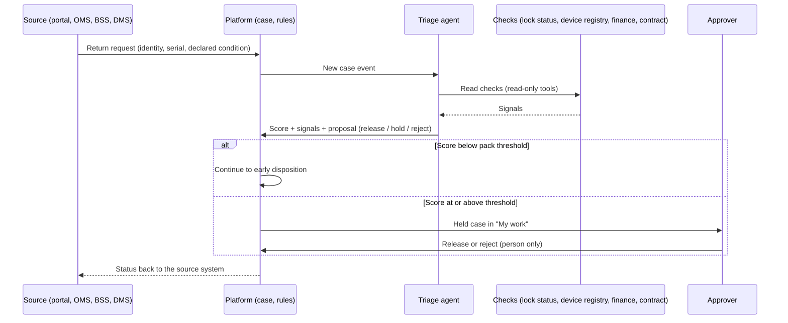
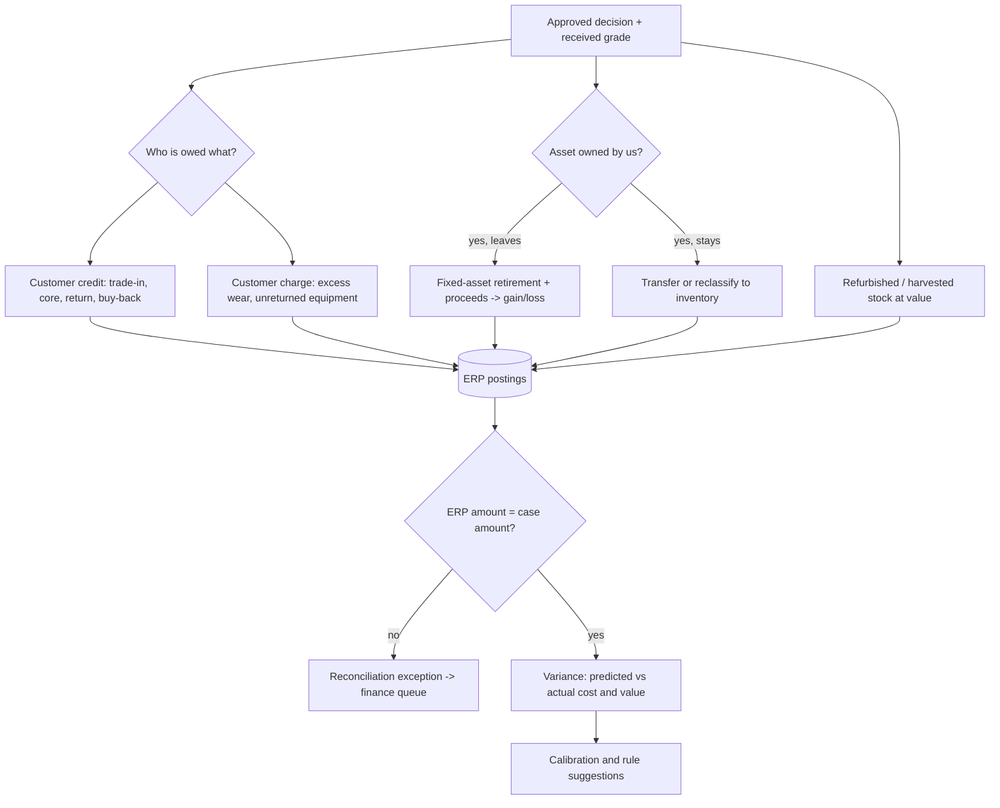

# B. Industries, guardrails, roles, template packs and stories (24 Nov 2026)

Part B of the platform research ([brief](00-brief.md)). Business and subject-matter view: where returned-asset
disposition decisions matter, which rules from regulation and standards become gate rules, who uses the product, what a
domain-agnostic template pack must hold, the epics and stories across the four stages, and the industry order after the
two pilot templates (tool-fleet AMS, device trade-in).

> **Legal review.** Sections 2 and parts of 1 and 5 describe regulation, standards, accounting and reporting rules.
> They are a research summary, not legal advice, and must be reviewed by Kinective's Legal team before anyone relies
> on them or builds them into a shipped template pack. Several items are marked **unconfirmed**.

## Summary

1. The product fits best where the returned item is **serialised, worth more than the cost of deciding, has 3+ real
   routes, and its data sits in enterprise systems**: industrial lease end (base), rental/construction fleets, ITAD,
   telecom CPE, device trade-in. Medical devices and EV/industrial batteries fit well but carry heavy regulatory effort.
   Automotive cores fit stages 1 and 4 (fraud triage, core credit) more than stage 3. B2C retail returns are a weak fit.
2. Regulation turns into a small, reusable set of **gate rules** (about 20), each with trigger, evidence and effect.
   The same six or seven gate *types* recur across industries: data sanitisation, hazardous handling, certified
   downstream, cross-border waste consent, regulated-product status, contract/consent, reporting evidence.
3. Today's packs hold **authoring guardrails** (what a business rule may not say), not runtime **gates** with evidence.
   Runtime gates are six fixed engine gates; the regulatory gates live in valuer code. A pack needs declarative gates.
4. Carbon today is `embodied(class) × qty × route share` (`backend/di/repositories/common.py`, `EMB`, `CO2S`), with no
   factor source. A deterministic method per route with cited, licence-safe factors is specified in section 2.4.
5. Stage 1 (fraud triage) and stage 4 (financial reconciliation) are the biggest gaps: no fraud logic in the backend,
   and "reconcile" today means predicted-versus-actual cost learning, not credits, refunds or asset retirement.
6. A template pack should be a versioned bundle of 13 parts (section 4); the two pilot packs need 6 new parts.
7. Roadmap after the pilots: **ITAD / IT lease end → rental and construction fleets → telecom CPE → EV and industrial
   batteries (aim at 18 Feb 2027) → automotive cores → medical devices**. B2C retail only for serialised electronics.

---

## 1. Industry scan

### 1.1 What makes a good fit

Scored 1 (poor) to 5 (strong) against what the platform does well today: per-case decision over many routes, data from
many enterprise systems, explainable value/risk/carbon, a person approves anything consequential, instructions to ERP.

| Criterion | Why it matters |
|---|---|
| Value per unit or lot | Deciding must cost less than the uplift. Low-value goods need lot-level or fully automatic decisions. |
| Route count | With one or two routes (restock or liquidate) there is little to optimise. |
| Serialisation and data | Serial numbers, telemetry, service history and contracts make a case explainable. |
| Regulatory weight | Gates add value (we enforce them) but add effort (evidence, certificates, legal review). |
| Enterprise systems | ERP/EAM/WMS/leasing in place means our adapters matter; a single SaaS returns portal means they don't. |
| Approval culture | B2B asset owners already approve disposals (asset retirement, write-offs); B2C does not. |

### 1.2 Fit overview

| Industry | Fit | Effort | Market signal (see sources) | Nearest existing pack |
|---|---|---|---|---|
| Industrial equipment, lease end (base) | 5 | built | Base demo, 128 cases | `industrial` |
| Tool fleet / aftermarket service (pilot a) | 5 | built (pilot) | Pilot | `tool_fleet` |
| Device trade-in / protection (pilot b) | 4 | built (pilot) | Refurbished phones +3% H1 2025; used shipments +3.2% 2025 | `device` |
| IT asset disposition (ITAD) | 5 | low | Global ITAD ~USD 13–26 bn 2025, CAGR 7–14% (vendor estimates vary widely) | `device` + data gates |
| Rental and construction fleets | 5 | low | US rental penetration ~57% (Q1 2025); rental fleets cycle ~7 years | `tool_fleet` |
| Telecom CPE (routers, set-top boxes) | 4 | low–medium | One operator: ~2.45 m refurbished fixed devices in 2025; another: 3 m routers/STBs reused or recycled | `device` (lots) |
| EV and industrial batteries | 4 | high | Second-life market ~USD 1–2 bn 2025–26, very wide estimates; EU passport 18 Feb 2027 | new pack |
| Automotive cores / reman | 3 | medium | Global auto reman ~USD 62–69 bn 2025 (vendor estimates) | new pack |
| Medical devices | 3 | high | Strong (capital equipment refurbishment), heavy rules | new pack |
| Consumer electronics recommerce | 4 | low | Same as device trade-in | `device` |
| B2C retail returns | 2 | medium | US returns ~USD 850 bn 2025; 9% fraudulent (NRF) | — |

### 1.3 Per industry: process across the four stages

Stages: **S1** RMA intake and fraud triage, **S2** receiving and grading, **S3** smart disposition and recommerce,
**S4** ERP/WMS financial reconciliation.

**Industrial equipment, lease end (base).**
- S1: lease-end notice from the leasing system, return authorisation, entitlement (owner, lessee, contract terms on
  refurbish/resale), early disposition before shipping. Fraud is rare; the risk is wrong identity or missing parts.
- S2: receipt against return, inspection grade from the repair centre, bench test, life assessment from engineering,
  telemetry hours and alarms, certificates (QMS).
- S3: redeploy, re-lease, whole resale, internal parts, external parts, material recovery, responsible exit (the
  demo's seven routes). Value drivers: avoided new purchase, lease income, part avoidance, holding cost, demand fit.
- S4: excess wear-and-tear charges to the lessee, asset transfer or retirement in the fixed-asset register, gain or
  loss on disposal, actual cost versus predicted (built as "reconcile and learn").
- Systems: ERP, EAM, leasing, PLM, QMS, WMS, TMS, field service, IoT. Data: serial, configuration, BOM, run hours.

**Tool fleet / aftermarket service (pilot a).** Same as above with contracts per tool, a repair centre that grades (we
read the grade), a tool pool, fleet renewal and pre-owned dealers. S4: credit for fleet swap, refurbishment work orders
costed, pool transfers. Value drivers: avoided new tool, refurbishment cost, wear index and RUL from IoT + PLM.

**IT asset disposition (ITAD) and IT lease end.**
- S1: decommission request from ITSM/CMDB or lease-end schedule; serial list, asset tags, data classification of the
  owner; chain-of-custody starts at pickup (sealed containers, serial count at pickup).
- S2: serial reconciliation against the manifest (missing serials are the main incident), data sanitisation (clear,
  purge, destruct per media type) with a certificate per serial, functional test, cosmetic grade, configuration
  (CPU, RAM, storage) read by diagnostic tools.
- S3: redeploy internally, return to lessor, resell (wholesale, B2B refurbished, marketplace), harvest parts (memory,
  drives where policy allows), recycle via certified downstream. Value drivers: residual value decays monthly, so time
  to sale matters; data risk dominates.
- S4: settlement to the asset owner (revenue share or buy-back), certificates of sanitisation and recycling, asset
  retirement in the CMDB and fixed-asset register, lease buy-out or return credit.
- Systems: ITSM/CMDB, ERP fixed assets, ITAD vendor portal, diagnostic and erasure tools, marketplace.

**Medical devices (capital equipment, imaging, monitors, pumps).**
- S1: trade-in at new sale, lease end, end of service contract; check device class, whether it is single-use, recall
  and field-safety notices, service history.
- S2: inspection and functional test against OEM specification by a qualified servicer; patient data on the device
  (imaging, monitors) must be sanitised.
- S3: redeploy within the hospital network, refurbish and resell (where the work stays "servicing"), remanufacture (a
  regulated activity: the remanufacturer takes on manufacturer duties), parts harvest, recycle. Export rules per
  destination market.
- S4: trade-in credit against the new sale, asset retirement, service-contract close-out.
- Systems: CMMS/HTM (healthcare technology management), ERP, QMS (complaints, CAPA), UDI database, service management.

**Automotive cores / remanufacturing (starters, alternators, turbos, ECUs, transmissions, injectors).**
- S1: core return against a core charge (deposit) paid by the buyer; entitlement (was a core charge paid, which part
  number, within the return window). **Fraud and abuse is the main issue**: wrong core, non-rebuildable core, core from
  a different product family, cracked housings.
- S2: core inspection against acceptance criteria per part number; accept, partial credit or reject.
- S3: remanufacture, harvest components, sell core to a broker, scrap for material. Value drivers: core availability
  (constrained supply), reman yield, credit cost.
- S4: **core credit** back to the customer (full, partial, none), core-bank inventory valuation, deposit liability
  clearing. This stage carries most of the money.
- Systems: dealer management, ERP, warranty system, core-management tools, parts catalogue (interchange data).

**EV and industrial batteries (second life).**
- S1: pack return from vehicle end of life, warranty replacement, or stationary storage decommissioning; check
  chemistry, pack ID, state of health (SoH) from the battery management system, damage or thermal event history.
- S2: diagnostics (SoH, internal resistance, cell imbalance), safety classification (damaged / defective / critical),
  discharge for storage.
- S3: reuse in vehicle, remanufacture (replace modules), repurpose to stationary storage, harvest modules, recycle
  (black mass). Value drivers: SoH and chemistry (LFP versus NMC), demand for second-life storage, recycling payable
  for nickel/cobalt/lithium, hazardous transport cost.
- S4: warranty claim reconciliation, battery passport update (new economic operator for repurposed packs), recycled
  content and recovery reporting, producer-responsibility fees.
- Systems: BMS data platforms, vehicle telematics, ERP, WMS with dangerous-goods handling, recycler portals.

**Telecom CPE (routers, set-top boxes, ONTs, mobile handsets from operator programmes).**
- S1: return at contract end, upgrade, fault swap; device linked to subscriber account; check lock status and
  provisioning.
- S2: high volume, low value: test in lots, factory reset and firmware refresh, cosmetic grade.
- S3: refurbish and redeploy to new subscribers (main route), sell to brokers, harvest power supplies and remotes,
  recycle. Decisions are per **lot**, not per unit; value comes from avoided new-CPE purchase.
- S4: unreturned-equipment charges to subscribers, inventory revaluation of refurbished stock, recycling certificates.
- Systems: BSS/OSS (subscriber, provisioning), ERP, WMS, refurbishment partner portals.

**Rental and construction equipment.**
- S1: off-rent return, end of fleet life (age or hours), damage claim; telematics hours and fault codes.
- S2: check-in inspection (damage, wear parts), repair estimate.
- S3: keep in fleet, refurbish/rebuild, transfer to another branch, sell retail, sell at auction, sell to dealer,
  parts harvest, scrap. Value drivers: used-equipment price indices, utilisation by branch, rebuild cost versus new.
- S4: damage recovery from renter, fixed-asset disposal gain/loss, auction settlement, rebuild capitalisation.
- Systems: rental management, telematics, ERP, auction and marketplace platforms. Closest to the tool-fleet pack.

**Consumer electronics recommerce (device trade-in pilot and related).**
- S1: trade-in quote from customer-declared condition; **fraud triage**: activation/anti-theft lock, blacklisted IMEI,
  finance not paid off, swapped or non-genuine parts, declared grade far above received grade.
- S2: automated diagnostics, cosmetic grade, data wipe certificate.
- S3: channel routing (buy now, offers, auction, marketplace, wholesale), lot building, repair or parts. ML price
  prediction and dynamic routing (pilot b).
- S4: **re-quote** when received grade differs (credit adjustment), trade-in credit settlement, channel fee and sale
  reconciliation, return-from-buyer handling.

**B2C retail returns (apparel, home, general merchandise). Weak fit, because:**
- Value per item is low (often below the cost of a reverse shipment), so a per-case decision with a human approver is
  uneconomic; decisions must be instant rules at the returns portal or in the warehouse.
- Few real routes: restock, return to vendor, liquidate in bulk, donate, recycle. Little to optimise per item.
- Items are rarely serialised; there is little telemetry, contract or service data to explain a decision.
- The main money is fraud and abuse (NRF: 9% of returns fraudulent in 2025; a second study counts most of it as abuse,
  not fraud), which is a point-of-return identity and policy problem solved by returns-management and fraud SaaS.
- The buyer is a retailer with a returns portal, not an asset owner with ERP/EAM; our connection fabric matters less.
- Where it does fit: serialised electronics and high-value goods (handled by the device pack), and the EU ban on
  destroying unsold apparel and footwear for large companies from 19 July 2026, which makes "exit" a gated route.

---

## 2. Guardrails from regulation and standards, as gate rules

Each gate rule: **ID, trigger** (when it applies), **evidence** (what must be on file), **effect** (which route it
blocks or requires), **owner** role. "Blocks" means the route fails the gate with the reason; "requires" means the route
is only eligible after the evidence exists or the step is added to execution. All of this needs review by Kinective's
Legal team before it is built into a pack.

### 2.1 Data, devices and e-waste

| ID | Source | Trigger | Required evidence | Effect | Owner |
|---|---|---|---|---|---|
| G-DATA-1 | NIST SP 800-88 Rev. 2 (Sep 2025); IEEE 2883-2022 | Asset class has storage media (IT, phones, CPE, medical imaging, controllers with logs) and route leaves the owner's control (resale, redeploy to another customer, parts sale, recycle) | Sanitisation record **per serial**: method (clear / purge / destruct per IEEE 2883), tool and version, verification result, date, operator, media serial | Blocks all release routes until present; redeploy inside the same owner and security level may accept "clear" | Compliance |
| G-DATA-2 | NIST SP 800-88 Rev. 2 | Sanitisation verification failed or media not sanitisable | Destruction record | Requires "destruct" step; blocks parts sale of that media | Compliance |
| G-DATA-3 | HIPAA Security Rule 45 CFR 164.310(d) (US); GDPR Art. 32 (EU) | Device held personal or patient data | As G-DATA-1, plus data-controller sign-off where contract requires | Blocks release routes | Compliance |
| G-DS-1 | R2v3 (SERI, 2020); e-Stewards v4.0 (BAN, 2020) | Route sends equipment or focus materials to a downstream processor | Downstream vendor on approved list with valid certificate (R2v3 or e-Stewards) and expiry date; focus-material chain to final disposition | Blocks recycle/exit/parts-broker routes to non-qualified vendors | Sustainability lead |
| G-DS-2 | e-Stewards v4.0 | Owner's policy is e-Stewards | No export of hazardous e-waste to non-OECD countries; no landfill or incineration of hazardous e-waste | Blocks such routes | Sustainability lead |
| G-WEEE-1 | WEEE Directive 2012/19/EU, Annex VI | Used EEE is shipped (cross-border) as "not waste" for reuse | Per item: functionality test record, copy of invoice/contract of transfer, declaration that it is not waste, protective packaging | Requires the evidence for cross-border resale/redeploy; without it the item is treated as WEEE (G-WASTE-1) | Compliance |
| G-WEEE-2 | WEEE Directive 2012/19/EU, Art. 8 and Annex VII | Route is material recovery or exit for EEE | Authorised treatment facility; WEEE category and weight recorded; selective treatment items (batteries, circuit boards, etc.) removed | Blocks recycle routes to non-authorised facilities; requires weight and category | Sustainability lead |
| G-WASTE-1 | Basel Convention e-waste amendments (in force 1 Jan 2025); EU Waste Shipment Regulation 2024/1157 | Cross-border shipment of e-waste (hazardous *or* non-hazardous) | Prior informed consent (notification and consent of the countries concerned) on file; shipment documents | Blocks cross-border waste routes without consent | Compliance |
| G-WASTE-2 | EU WSR 2024/1157 (most export rules from 21 May 2027, **unconfirmed** detail) | Destination outside OECD and item is waste | Destination on the Commission's list of countries that may receive it, plus consent | Blocks export routes otherwise | Compliance |

### 2.2 Batteries

| ID | Source | Trigger | Required evidence | Effect | Owner |
|---|---|---|---|---|---|
| G-BAT-1 | EU Battery Regulation 2023/1542, Art. 14 | EV, LMT or rechargeable industrial battery | State of health and expected lifetime read from the BMS (with read date) | Requires SoH for reuse, remanufacture or repurpose routes; without it only recycle | Engineer |
| G-BAT-2 | Reg. 2023/1542, Art. 73 (preparation for re-use or repurposing of waste batteries; details **unconfirmed**) | Battery is waste and route is reuse or repurpose | Examination and test results on SoH, documentation that it is fit for the new use, conformity of the repurposed battery as a product placed on the market | Requires these before repurpose/reuse | Quality |
| G-BAT-3 | Reg. 2023/1542, Art. 77 (passport mandatory from 18 Feb 2027 for LMT, industrial > 2 kWh and EV batteries) | Battery placed on the EU market after repurposing or remanufacturing | New passport linked to the original passport, under the new economic operator (**unconfirmed** wording) | Requires passport step in execution for repurpose/reman routes | Compliance |
| G-BAT-4 | ADR / IATA dangerous-goods rules for lithium batteries (damaged or defective batteries; **unconfirmed** special-provision numbers) | Battery classified damaged, defective or with a thermal event | Safety classification; packaging and carrier approved for that class | Blocks standard lanes; requires dangerous-goods lane; blocks resale | Warehouse / Compliance |
| G-BAT-5 | Reg. 2023/1542, Art. 71 (recycling efficiency, material recovery targets) | Route is recycle | Recycler permitted for the chemistry; recovery reporting | Blocks recyclers without the permit | Sustainability lead |

Note: Regulation 2023/1542 has been amended (due-diligence date moved to 18 Aug 2027 by Reg. 2025/1561; a further
amendment, Reg. 2026/1738 of 8 Jul 2026, whose contents we could not confirm). Check the consolidated text before
building the battery pack.

### 2.3 Products, medical devices, contracts

| ID | Source | Trigger | Required evidence | Effect | Owner |
|---|---|---|---|---|---|
| G-MED-1 | FDA guidance "Remanufacturing of Medical Devices" (May 2024) | Planned work on a medical device significantly changes performance, safety specs or intended use | Regulatory assessment (servicing versus remanufacturing, using the guidance's flowchart) | If remanufacturing: requires registration/listing/clearance status of the remanufacturer; else blocks reman route | Quality / Regulatory |
| G-MED-2 | FDA (reprocessed single-use devices need premarket clearance); EU MDR 2017/745 Art. 17 (only where national law allows; reprocessor takes manufacturer duties) | Device is labelled single-use | Clearance (US) or national permission plus reprocessor's MDR obligations (EU) | Blocks reuse/resale of single-use devices otherwise; default is recycle | Quality / Regulatory |
| G-MED-3 | EU MDR (economic operators, UDI); national rules | Resale of a refurbished device into another market | Distributor/importer obligations, UDI kept, service record by qualified servicer, open recalls closed | Blocks cross-market resale without it | Regulatory |
| G-ESPR-1 | ESPR 2024/1781, destruction ban (large companies from 19 Jul 2026; medium from 2030) | Unsold (incl. returned unsold) apparel, clothing accessories, footwear held by a large company | One of the allowed exceptions with evidence (unsafe, damaged, counterfeit, rejected by donation schemes …) | Blocks destruction/exit; requires reuse, donation, recycling first; disclosure of discarded volumes | Compliance |
| G-DPP-1 | ESPR digital product passport (registry live 20 Jul 2026; product rules by delegated act, textiles ~2027, iron and steel ~2028, timing **unconfirmed**) | Product group has a delegated act in force | Passport identifier read at intake; update after refurbishment/remanufacture where the act requires | Requires passport step on reman/refurbish routes for that group | Compliance |
| G-CON-1 | Contract (lease, fleet, service) | Owner is not the operator, or contract restricts refurbishment or resale | Contract clause read from the leasing/fleet system; consent on file | Blocks resale/re-lease to another client without consent (today GR-I3) | Customer operations |
| G-SAFE-1 | Product safety and quality (OEM spec, QMS) | Safety-rated unit or recertification needed | Recertification / test certificate with expiry | Blocks redeploy/resale until certified (today GR-I2) | Quality |

### 2.4 Reporting and carbon

These rules don't block routes; they **require evidence before a case can close** so the reports are complete.

| ID | Source | Trigger | Required evidence | Effect | Owner |
|---|---|---|---|---|---|
| G-REP-1 | CSRD as amended by Omnibus I (Directive (EU) 2026/470: > 1,000 employees and > EUR 450 m turnover); ESRS E5 (resource outflows; simplified ESRS pending, **unconfirmed** final datapoints) | Owner is in CSRD scope | Mass, material and waste-treatment category per closed case (prepared for reuse / recycling / other recovery / incineration / landfill; hazardous flag) | Blocks case close without it | Sustainability lead |
| G-REP-2 | Waste Framework Directive 2008/98/EC, Annexes I and II (R- and D-codes) | Route is recycle or exit | Recovery or disposal operation code from the receiving facility | Blocks close without it | Sustainability lead |
| G-REP-3 | GHG Protocol Scope 3 Standard, category 12 (end-of-life treatment of sold products); WBCSD avoided-emissions guidance (Mar 2023) | Carbon shown on a card or report | Factor source, version and year per factor; avoided emissions labelled as outside the inventory and never netted against it | Blocks publishing a carbon figure without provenance | Sustainability lead |

**Deterministic CO2e avoided per route.** Same inputs give the same number; every factor carries source, version and
year. Avoided emissions are reported separately from the scope 1–3 inventory (WBCSD 2023), and the GHG Protocol's
cut-off method gives recycling credits to the user of recycled material, not to the end-of-life treatment line, so the
card must say "avoided, not inventory".

| Route | Formula (per unit; × quantity) | Main factors and credible sources |
|---|---|---|
| Redeploy / re-lease / reuse as is | `E_new × d − E_prep − E_log` | `E_new` cradle-to-gate footprint of the equivalent new product: manufacturer PCF (PACT methodology), EPD (ISO 14025; EN 15804 for construction products), or LCA database; `d` displacement (1 if it replaces a planned purchase, lower if not; take `d` from the demand line: confirmed order = 1); `E_prep` cleaning/test energy |
| Refurbish then place | `E_new × d − E_refurb − E_parts − E_log` | `E_refurb` from repair-centre energy and hours; `E_parts` embodied in replacement parts (PCF or database) |
| Remanufacture | `E_new × d − E_reman − E_log` | Remanufacturer's own footprint or study for the product family |
| Harvest parts | `Σ(E_part × d_part) − E_teardown − E_log` | Part footprints from PLM/BOM mass × material factors; `d_part` = 1 only for parts that replace a purchase order |
| Repurpose (batteries) | `E_alt × d − E_repurpose − E_log` | `E_alt` footprint of the new stationary battery displaced; EU battery carbon-footprint declaration where available |
| Recycle / material recovery | `Σ mass_m × (EF_virgin,m − EF_recycled,m) − E_treat − E_log` | US EPA WARM v16 (Dec 2023, public domain); UK DESNZ conversion factors (2025 and 2026 sets, Open Government Licence) for waste routes; ADEME Base Empreinte (France) |
| Exit (landfill, incineration) | `−E_treat − E_log` (avoided = 0 or negative) | WARM, DESNZ waste-disposal factors |
| Logistics term `E_log` (all routes) | `Σ tkm × EF_mode` | ISO 14083:2023 and the GLEC Framework for transport chains |

Notes on factors:
- **Licence check before shipping factors in a trial package.** Commercial LCA databases (for example ecoinvent)
  restrict redistribution of their datasets; public sources (WARM, DESNZ, ADEME) are safer to bundle. Licence findings
  need review by Kinective's Legal team.
- Telecom has a sector method: the GSMA guide "Quantifying the Carbon Savings of Circularity" (Feb 2025) covers
  refurbished phones and CPE. Use it for the CPE pack.
- The current demo's `CO2S` shares (redeploy 0.7, resale 0.55, re-lease 0.65, internal parts 0.3, external parts 0.25,
  material 0.08, exit 0) are a reasonable shape (reuse > parts > material > exit) but have no source. Keep them as the
  parity default and add a "factor set" per pack that the sustainability lead can publish (maker-checker like rules).

---

## 3. Roles across industries

The platform today signs in 11 accounts (`admin`, `exec`, `ops`/`planner.a`, `planner.b`, `planner.c`, `approver`,
`engineer`, `finance`, `developer`, `warehouse1`, `warehouse2`). Packs name guardrail owners such as "Compliance",
"Quality" and "Sustainability lead" that are not sign-in roles yet. Missing as roles: compliance, sustainability,
forward-deployed engineer, customer IT integrator.

Legend: **D** does it (creates, edits), **A** approves (the checker), **P** gets agent proposals for it, **R** reads,
blank = no access.

| Capability | Planner | Approver | Engineer | Finance | Warehouse | Compliance | Sustain. | Admin | FDE | Cust. IT | Exec |
|---|---|---|---|---|---|---|---|---|---|---|---|
| Connect sources, credentials, mappings |  |  |  |  |  |  |  | A | D | D |  |
| Ingest workflows (ETL) |  |  |  |  |  |  |  | A | D | D |  |
| Decision flows and business rules (Modeler) | D | A | R | R |  | R | R |  | D |  | R |
| Gate rules and guardrails (regulatory) | R | R | R | R |  | D / A | D / A |  | D |  | R |
| Finance parameters (holding cost, floors, thresholds) | R | R |  | D / A |  |  |  |  |  |  | R |
| Carbon factor sets | R | R |  | R |  | R | D / A |  | D |  | R |
| Intake and fraud triage queue | P / D | A (high risk) |  | R | R | R |  |  |  |  |  |
| Receiving, serial match, grade capture | R |  | R |  | D |  |  |  |  |  |  |
| Evidence: sanitisation, test, certificates | R | R | D | | D | A | R |  |  |  |  |
| RUL / wear assessment, requalification | R | R | D / A |  | |  |  |  |  |  |  |
| Case decision (route) | P / D | A |  R | R | | | |  |  |  | R |
| Overrides of a recommendation | D (with reason) | A |  |  |  |  |  |  |  |  | R |
| Conflicts between sources | P / D |  | D |  |  |  |  | R | D | D |  |
| Execution confirmations, exceptions | D | R |  | R | D |  |  |  | R |  |  |
| Financial reconciliation (credits, retirements, variances) | R | R |  | D / A | |  |  |  |  |  | R |
| Regulatory and sustainability reports | | | | R | | D | D |  |  |  | R |
| Back-test / simulation | D | R | R | D | | | R | | D | | R |
| Users, roles, tenants, access grants |  |  |  |  |  |  |  | D (maker-checker) |  |  |  |
| Agent registry, autonomy, tool allow-lists |  |  |  |  |  |  |  | D / A | D |  |  |
| Analytics and pilot report | R | R | R | R | R | R | R | R | R |  | R |

What each does in "agents plan, humans approve":

- **Planner (operations).** Works the exception queue, not every case: low confidence, conflicts, missing evidence,
  near-ties. Accepts or edits agent proposals; writes business rules in plain language and runs simulations.
- **Approver (disposition owner).** Approves decisions above value or risk thresholds and every override; the only role
  that may release a high-risk fraud case. Approvals stay out of agents' reach (`forbidden.py`).
- **Engineer (reliability / quality).** Owns RUL, wear index, requalification, test evidence; approves model candidates
  for life estimates; resolves conflicts in technical fields.
- **Finance.** Owns holding cost, recovery floors, approval thresholds; reconciles credits, refunds, core credits,
  asset retirements and the predicted-versus-actual variance.
- **Warehouse.** Receives against the RMA, matches serials, captures grade and photos (or confirms the external grade),
  runs sanitisation and tests, confirms physical moves. The agent prepares pick lists and labels.
- **Compliance (new role).** Owns data, waste-shipment, regulated-product and contract gates; approves gate-rule
  changes; holds certificates and consents.
- **Sustainability lead (new role).** Owns certified downstream vendors, carbon factor sets, CSRD E5 and WEEE reporting.
- **Admin.** Users, tenants, access grants (maker-checker), agent autonomy and limits.
- **Forward-deployed engineer (new role, internal).** Uses Connection Studio and the pack builder in the first week:
  connects sources, generates adapters, imports a template pack, runs the back-test.
- **Customer IT integrator (new role).** Owns credentials, network access, webhooks and the ERP side of instructions;
  approves mappings that write into their systems.
- **Executive.** Reads outcomes: recovery uplift, back-test result, carbon avoided, cycle time, approval load.

---

## 4. A generic template-pack structure

### 4.1 What exists today

Read from `backend/di/services/modeler/templates.py`, `packs/industrial.json`, `valuers/*.py`:

- A `Template` has: `key`, `name`, `pre` (case prefix), `paths` (id, name, executing app, owner, lead days),
  `guardrails` (id, text, owner, plus `forbids` and `protects` checks), `dims` (scope dimensions: set/min/max over case
  fields), `actors`, `wording` (how a rule reads).
- Only `industrial` is a data file (`packs/industrial.json`, 39 lines). `tool_fleet` and `device` are built in code
  from the PO golden files plus guard checks written as Python constants (`TOOL_FLEET_GUARDS`, `DEVICE_GUARDS`).
- **Guardrails are authoring checks**: they stop a business rule from saying something (for example "prefer re-issue
  for grade C/D" breaks GR-01; any text matching "skip approval" breaks GR-05). They do not check evidence at runtime.
- **Runtime gates** are the six engine gates in `di/services/engine/routes.py` (`Condition & life`,
  `Post-intervention`, `Policy & certification`, `Demand fit`, `Economics`, `Sustainability`). Pack-specific reasons are
  set by the valuer (`routes_adapter.to_routes` fails gate 2 with the valuer's reason).
- **Valuers are code**: `tool_fleet.py` (1,116 lines, classes `CLS` with prices and residual curves, finance `FIN`,
  queue planning across open returns) and `device.py` (286 lines, channel config `DCFG`, channel statistics `DST` by
  grade × age band × channel, policy `DG` with SLA 60 days and recovery floor 55%). Parameters are constants.
- Grades are A–D everywhere. Carbon factors are only in `repositories/common.py` for the industrial classes.
- Execution step templates are per route kind in `services/execution/steps.py`, not per pack.
- Sample data are generated inside the valuers with a seeded RNG (`valuers/rng.py`).

### 4.2 What a pack must contain

A pack is a versioned bundle (one folder or one JSON document plus optional valuer code), imported through the action
pipeline, published with maker-checker, and shown in the Modeler. Parts marked **new** do not exist today.

| # | Part | Contents | Today |
|---|---|---|---|
| 1 | Manifest | key, name, version, case prefix, industry, regions the gates were written for, legal-review status and date, licence of bundled data | partial (`key`, `name`, `pre`) |
| 2 | Asset classes | class id, name, family, attributes (serialised? has media? hazardous? regulated?), unit of measure, new-price reference, residual curve | in valuer code (`CLS`) or `dims` values |
| 3 | Grade scale | grades, meaning, who grades (read or computed), mapping from external scales (e.g. a repair centre's 1–5 to A–D) | **new** (A–D hard-coded) |
| 4 | Routes | id, name, executing system, owner, lead days, execution step template, required instructions (sales order, transfer, work order, credit memo) | partial (`paths`; steps elsewhere) |
| 5 | Gate rules | declarative: trigger (class attribute, route, region, owner), evidence types, effect (block / require step / require approval), owner, source citation | **new** (today valuer code + six fixed gates) |
| 6 | Authoring guardrails | what a business rule may not say (today's `guardrails`) | yes |
| 7 | Evidence types | sanitisation record, test record, certificate, consent, passport ID, SoH reading: fields, issuer, expiry, which adapter supplies it | **new** |
| 8 | Valuer | either a parameterised standard valuer (value lines: sale, avoided purchase, lease, parts, material; costs: prep, logistics, fees, holding; risk) with parameters as data, or a code plug-in with a declared interface | code only |
| 9 | Carbon factor set | per class and route: factors, source, version, year, licence; formula per route (section 2.4) | **new** (industrial constants only) |
| 10 | Required adapters and canonical fields | system types the pack needs (e.g. leasing, IoT, PLM, repair), canonical fields per stage with authority, minimum fields to open a case | **new** (canonical model is global) |
| 11 | Scope dimensions and wording | today's `dims`, `wording`, `actors` | yes |
| 12 | KPIs | recovery rate, uplift versus actual, cycle time, approval load, override rate, fraud catch rate, credit accuracy, carbon avoided, evidence completeness | **new** |
| 13 | Stories, fraud rules, reconciliation map, demo data | user stories and acceptance tests for the pack; fraud signals and thresholds; mapping of each route to its financial postings; seeded sample cases and a back-test dataset | partial (sample data in valuers) |

Design points:
- Keep the **gate catalogue** (section 2) shared across packs; a pack only lists which gates apply and with which
  parameters. That is what makes "data-erasure only for IT/compute assets, RUL and grade certification for tools and
  motors" (brief, item 3) a configuration, not code.
- A pack's valuer should be the standard valuer with parameters unless the domain truly needs code (tool-fleet queue
  planning is a real case for code).
- Packs are business policy: they stay separate from connection workflows (brief, item 12); a pack *declares* the
  adapters and fields it needs and the Connection Studio fills them.
- "Create a template for my AMS process" (brief, item 1) becomes: an agent drafts a pack from the closest existing pack
  plus the user's sentence, the user confirms, and the pack goes through maker-checker like a rule.

---

## 5. Epics, stories and flows

### 5.1 Epics per stage (industry-neutral)

| Stage | Epic | Covered today |
|---|---|---|
| S1 | E1.1 Open a case from any trigger (RMA, lease end, trade-in, contract end, IoT alarm, manual, file) | yes |
| S1 | E1.2 Entitlement and contract check (owner, warranty, lease terms, may we refurbish/resell, consent) | partial |
| S1 | E1.3 Fraud and abuse triage with explainable signals and a hold for a person | **no** |
| S1 | E1.4 Early disposition: decide the destination before the item ships (nearest capable site) | partial |
| S2 | E2.1 Receive against the RMA: serial and quantity match, discrepancy case | partial |
| S2 | E2.2 Read grading and test results from the repair centre or inspection app (not compute) | yes (read) |
| S2 | E2.3 Evidence capture: sanitisation, test, certificates, SoH, passport ID | partial |
| S2 | E2.4 Life and wear: RUL and wear index from IoT + PLM with an explanation | partial |
| S2 | E2.5 Declared-versus-received discrepancy and re-quote | **no** |
| S3 | E3.1 Value every route with the pack's valuer, with ranges and confidence | yes |
| S3 | E3.2 Apply gate rules per asset type with evidence | partial (fixed gates) |
| S3 | E3.3 Carbon per route with factor provenance | partial (no provenance) |
| S3 | E3.4 Agent proposes; person approves on thresholds, low confidence, exceptions | partial (proposals exist) |
| S3 | E3.5 Channel routing and lot building for recommerce | yes (device pack) |
| S3 | E3.6 Back-test a period of historical returns against actual outcomes | partial (simulation of drafts) |
| S4 | E4.1 Hand the decision to the systems as instructions and track confirmations | yes |
| S4 | E4.2 Customer credit settlement (trade-in credit, core credit, return credit, wear charges) | **no** |
| S4 | E4.3 Fixed-asset retirement or transfer with gain/loss | **no** |
| S4 | E4.4 Inventory valuation of refurbished and harvested stock | **no** |
| S4 | E4.5 Predicted-versus-actual variance and learning | yes |
| S4 | E4.6 Regulatory and sustainability reporting (WEEE, CSRD E5, battery, scope 3 cat 12) | **no** |
| X | EX.1 Template pack authoring, import and maker-checker | partial |
| X | EX.2 Role-based home with "My work" (exceptions, approvals, proposals) | partial |

### 5.2 Top 15 stories with acceptance criteria

1. **Fraud triage on intake (E1.3).** As a planner, I want every new return scored against fraud and abuse signals so
   that suspicious returns are held before credit is issued.
   - Given a trade-in with an activation lock, blacklisted identifier or unpaid finance flag, the case opens with
     status "held: fraud check" and no credit instruction can be sent.
   - Each hold lists the signals that fired, their source system and the rule version.
   - Only an approver can release a held case; the agent can propose "release" or "reject" but not do it.
   - Fraud rules and thresholds are pack data, simulated over history before publishing.
2. **Declared-versus-received re-quote (E2.5).** As a finance user, I want a re-quote when the received grade is lower
   than the declared grade so that credits match what arrived.
   - When received grade ≠ declared grade, the case recalculates the credit with the pack's price table and shows old,
     new and the difference.
   - Differences below a pack threshold apply automatically; above it they go to an approver.
   - The customer-facing notice is drafted by the agent and sent only after a person approves (sending on the user's
     behalf is a held action).
3. **Serial match on receipt (E2.1).** As a warehouse user, I want the received serials matched to the RMA or pickup
   manifest so that missing or extra units are caught at the dock.
   - Missing serials open a discrepancy linked to the original case within one sync cycle.
   - Extra serials open new cases with source "unexpected receipt".
   - Chain-of-custody records (who, when, seal ID) are kept per serial.
4. **Sanitisation gate (E2.3, G-DATA-1).** As compliance, I want release routes blocked until a sanitisation record
   exists for every media-bearing serial so that no data leaves the owner.
   - For a class with `has_media = true`, resale, redeploy-to-other-customer, parts sale and recycle fail the
     "Policy & certification" gate with reason "no sanitisation record" until a record arrives.
   - A record with failed verification requires the destruct step and blocks parts sale of that media.
   - Classes without media (motors, tools) never show the gate.
5. **Grade and RUL certification gate (E2.4).** As an engineer, I want refurbish/redeploy for tools, motors and
   hardware to need a grade and an RUL assessment so that unsafe units don't return to service.
   - The RUL shows its inputs (run hours from IoT, design life from PLM, wear factors) and the formula version.
   - With RUL below the pack threshold, redeploy and re-issue fail; refurbish stays eligible only with a requalification
     step.
6. **Gate rules as pack data (E3.2).** As a compliance owner, I want to edit a gate rule's trigger and evidence in the
   Modeler so that regulation changes don't need a code release.
   - A gate rule change goes draft → submit → approve → publish, with simulation over the last 90 days of cases.
   - The simulation shows how many decisions would change route and the value difference.
   - Agents can draft a gate change but cannot approve or publish it.
7. **Agent proposes, person approves on thresholds (E3.4).** As an approver, I want only cases above value or risk
   thresholds, below a confidence level, or with a conflict to reach me.
   - Thresholds (value, confidence, risk class) are finance-owned pack parameters.
   - Cases inside thresholds follow the agent's proposal under a standing approval that names the approver and the
     policy version (if the governance guardrail allows it; GR-05/GR-D6 today require a named approver per decision, so
     this needs a decision in the decision log).
   - Every routed case shows why it came to a person.
8. **Carbon with provenance (E3.3).** As a sustainability lead, I want each route's CO2e avoided to show its formula and
   factor sources so that numbers survive an audit.
   - The card shows "avoided, not inventory", the factor set version and each factor's source and year.
   - Same case and factor set give the same number on every run.
   - A factor set is published with maker-checker; changing it does not change closed cases.
9. **Back-test a quarter (E3.6).** As a forward-deployed engineer, I want to load one quarter of historical returns and
   actual dispositions and see the uplift so that the customer sees value before a pilot.
   - Import accepts CSV for cases, routes taken and realised values; failing rows are held with reasons.
   - The result shows per class: actual recovery, recommended recovery, uplift, and cases where gates would have
     blocked the actual route.
   - The report states the pack version, factor set and assumptions.
10. **Contract entitlement (E1.2, G-CON-1).** As customer operations, I want contract terms read at intake so that we
    never resell or re-lease an asset the contract forbids.
    - The clause and its source are shown on the case.
    - Routes forbidden by the clause fail the gate; with consent on file they pass and show the consent reference.
11. **Customer credit settlement (E4.2).** As finance, I want the credit memo (trade-in credit, core credit, return
    credit or wear charge) generated from the decision and the received grade so that settlement matches the case.
    - The instruction carries the case ID and approval reference; ERP confirmation closes the step.
    - A mismatch between the ERP amount and the case amount opens a reconciliation exception.
12. **Fixed-asset retirement (E4.3).** As finance, I want owned assets retired or transferred in the fixed-asset
    register when the route executes so that the books match the floor.
    - Resale or exit triggers a retirement instruction with sale proceeds; redeploy triggers a transfer.
    - The gain or loss returned by the ERP is stored on the case and shown in the outcome.
13. **Downstream vendor qualification (G-DS-1).** As a sustainability lead, I want recycle and exit routes limited to
    vendors with a valid certification so that we can prove responsible end of life.
    - A vendor whose certificate expired is excluded with the reason "certificate expired on <date>".
    - The case keeps the vendor's certificate reference used at decision time.
14. **Close with reporting evidence (G-REP-1/2).** As a sustainability lead, I want a case to close only with mass,
    material and treatment code so that WEEE and CSRD E5 reports come straight from the cases.
    - Missing evidence keeps the case in "awaiting evidence" and puts it in the owner's queue.
    - An export gives totals by treatment category and period.
15. **Pack drafted from a sentence (EX.1).** As an operations manager, I want to type "create a template for my AMS
    process" and get a draft pack so that set-up takes days, not weeks.
    - The draft starts from the closest existing pack and lists routes, gates, valuer parameters, required adapters
      and missing fields, each marked "assumed" until confirmed.
    - Nothing is published until a person approves; the import runs through the action pipeline.

### 5.3 End-to-end flow

```mermaid
flowchart LR
  T[Trigger: RMA, lease end, trade-in, IoT alarm, file] --> O[Open case]
  O --> EN{Entitlement and contract}
  EN -- not entitled --> RJ[Reject or route to customer service]
  EN -- ok --> FR{Fraud triage}
  FR -- high risk --> HF[Hold for approver]
  HF -- released --> ED
  HF -- rejected --> RJ
  FR -- low risk --> ED[Early disposition: destination site]
  ED --> RC[Receive: serial match, chain of custody]
  RC -- discrepancy --> DQ[Discrepancy case]
  RC --> GR[Read grade, tests, SoH, RUL]
  GR --> EV[Evidence: sanitisation, certificates]
  GR -- declared differs --> RQ[Re-quote credit]
  EV --> VA[Value every route + carbon]
  VA --> GT{Gate rules per asset type}
  GT --> PR[Agent proposal: best eligible route]
  PR --> TH{Above threshold, low confidence, conflict?}
  TH -- yes --> AP[Person approves or overrides]
  TH -- no --> SA[Standing approval within policy]
  AP --> EX[Instructions: SO, transfer, WO, credit memo]
  SA --> EX
  EX --> CF[Confirmations from ERP, WMS, TMS]
  CF --> RE[Reconcile: credits, asset retirement, stock value, variance]
  RE --> RP[Reports: WEEE, E5, battery, carbon]
  RP --> CL[Close and learn]
```

### 5.4 Fraud triage (stage 1)

Typical signals by industry (pack data): device lock or blacklist status, finance not paid, declared-versus-received
grade gap, serial not in the owner's register, repeat returns per customer, core part number family mismatch, warranty
claim outside coverage, return after a price drop, mismatch between pickup manifest and receipt.

### 5.5 Financial reconciliation (stage 4)

Accounting references for orientation only (Finance and Kinective's Legal team to confirm): asset derecognition and
gain or loss on disposal (IAS 16 / ASC 360), inventory at the lower of cost and net realisable value (IAS 2 / ASC 330),
refund liabilities and right-of-return assets for sales with a right of return (IFRS 15 / ASC 606).

---

## 6. Industry roadmap after the two pilots

Scores 1–5; priority = fit × market ÷ effort, then judgement.

| Order | Industry | Fit | Market | Effort (5 = low) | Reasons |
|---|---|---|---|---|---|
| 1 | ITAD and IT lease end | 5 | 4 | 5 | Reuses the device valuer and channel routing; the data-erasure gate is already the brief's example; buyers are enterprises and lessors with ERP/CMDB; standards are clear (NIST 800-88 Rev. 2, IEEE 2883, R2v3, e-Stewards). |
| 2 | Rental and construction fleets | 5 | 4 | 5 | Near copy of the tool-fleet pack (hours from telematics, rebuild versus sell, auction channels); clear value from used-equipment price data; few regulatory gates. |
| 3 | Telecom CPE | 4 | 4 | 4 | Large volumes reported by operators; lot-level decisions fit the device pack's lots; carbon method exists (GSMA 2025). Low unit value: needs automatic decisions within policy, so it depends on story 7. |
| 4 | EV and industrial batteries | 4 | 4 | 2 | Strong regulatory pull (SoH, Art. 73, passport from 18 Feb 2027); many routes (reuse, reman, repurpose, recycle); but safety and dangerous-goods gates, chemistry-specific valuers and a young market. Start with a design partner in 2027. |
| 5 | Automotive cores | 3 | 4 | 3 | Value sits in stage 1 (core fraud) and stage 4 (core credit); routes are fewer; incumbents have core-management tools. Good after fraud triage and credit settlement exist. |
| 6 | Medical devices | 3 | 3 | 1 | High value per unit, but servicing-versus-remanufacturing assessment, single-use rules, patient data and long sales cycles. Partner with a refurbisher; keep for later. |
| — | B2C retail returns | 2 | 5 | 2 | Big market, weak fit (section 1.3). Only via the device pack for serialised electronics, plus the ESPR destruction-ban gate for apparel brands that already use us elsewhere. |

What the roadmap needs from the platform, in order: declarative gate rules and evidence types (packs 1–6), fraud
triage (3, 5 and device), credit settlement and asset retirement (all, critical for 5), automatic decisions within a
standing policy (3), dangerous-goods lanes and passport steps (4), regulatory assessment workflow (6).

---

## Unconfirmed / open questions

- **Battery Regulation amendments:** Reg. (EU) 2026/1738 (8 Jul 2026) amends 2023/1542; we could not confirm which
  provisions. Art. 73 and Art. 77 details in G-BAT-2/3 are from article titles and memory, not the operative text.
- **ADR/IATA special provisions** for damaged lithium batteries: numbers not checked.
- **EU WSR export dates:** sources give 21 May 2026 (most provisions) and 21 May 2027 (most export rules); the EU
  application of e-waste consent inside the Union (from 1 Jan 2027 per one source) not confirmed.
- **WEEE revision / Circular Economy Act:** expected 11 Nov 2026 after a delay; we found no confirmation that it was
  published. Gate G-WEEE-* follow the current directive.
- **ESRS E5 datapoints after Omnibus I:** the simplified ESRS delegated act was pending in the sources; G-REP-1 uses the
  original E5 categories.
- **ESPR delegated-act timing** (textiles ~2027, iron and steel 2026 or 2028): Commission sources conflict.
- **ESPR destruction ban disclosure start date:** sources conflict (already in force versus standard format from
  Feb 2027).
- **EU MDR Art. 17 revision** (a 2026 industry paper refers to a Commission proposal) and the MDR definition used for
  refurbished resale: not confirmed.
- **R2v3 and e-Stewards current versions:** we found no 2025–26 revision of R2v3 and only e-Stewards v4.0 (2020); check
  the standard owners' sites. The R2v3 appendix structure was not checked.
- **NIST SP 800-88 Rev. 2 FAQ** is dated 16 Jul 2026, after the Sep 2025 final; content consistent, date odd.
- **Carbon factors:** DESNZ 2026 WEEE/closed-loop values and WARM's status after v16 not checked row by row; ecoinvent
  licence terms not read (flagged as a redistribution risk only).
- **Market sizes** are vendor estimates with wide spreads (ITAD USD 13–26 bn; second-life batteries USD 0.1–2 bn);
  treat as directional. Returns-fraud share differs by definition (NRF 9% fraudulent versus a 2026 loss study: 2%
  fraud, 12% abuse of returns-related loss).
- **Accounting references** in 5.5 are orientation only.
- **Product decision needed:** standing approvals within policy (story 7) conflict with today's guardrails GR-05 and
  GR-D6 ("every decision approved by a named owner"); the brief's "people step in only on thresholds" needs a decision
  log entry.
- **Regions:** gates are written for EU, UK and US rules; the demo's industrial sites suggest India too (E-Waste
  Management Rules, battery rules) — not researched here.

## Sources (accessed 24 Nov 2026 unless stated)

Repository (read 24 Nov 2026): `backend/di/services/modeler/templates.py`, `backend/di/services/modeler/packs/industrial.json`,
`backend/di/services/modeler/valuers/tool_fleet.py`, `valuers/device.py`, `valuers/routes_adapter.py`,
`backend/di/services/engine/routes.py`, `backend/di/services/canonical/schema.py`, `backend/di/repositories/common.py`
(`EMB`, `CO2S`), `backend/di/services/execution/steps.py`, `fixtures/golden/po/templates.json`.

Regulation and standards:
- NIST, SP 800-88 Rev. 2 *Guidelines for Media Sanitization*, final 26 Sep 2025: https://csrc.nist.gov/pubs/sp/800/88/r2/final ; FAQ: https://csrc.nist.gov/files/pubs/sp/800/88/r2/final/docs/sp800-88r2-faq.pdf
- IEEE 2883-2022 *Standard for Sanitizing Storage* (cited by NIST SP 800-88 Rev. 2; standard text not read).
- EU Battery Regulation 2023/1542, consolidated text 13 Aug 2026: https://eur-lex.europa.eu/eli/reg/2023/1542/2026-08-13/eng ; Commission batteries page: https://environment.ec.europa.eu/waste/batteries_en ; article titles: https://lexaris.de/library/tableofcontents/4633453 ; Baker McKenzie radar (updated 1 Jan 2026): https://www.bakermckenzie.com/en/insight/publications/resources/product-risk-radar-articles/eu-sustainable-batteries-regulation
- Basel Convention e-waste amendments (in force 1 Jan 2025): https://www.basel.int/Implementation/Ewaste/EwasteAmendments/Overview/tabid/9266/Default.aspx ; US EPA: https://www.epa.gov/node/291575 ; OECD (Jun 2024): https://www.oecd.org/en/about/news/announcements/2024/06/oecd-countries-update-rules-on-international-shipments-of-electronic-waste
- EU Waste Shipment Regulation 2024/1157: https://environment.ec.europa.eu/topics/waste-and-recycling/waste-shipments_en ; go-live 21 May 2026: https://environment.ec.europa.eu/news/new-waste-shipment-regulation-and-diwass-platform-go-live-2026-05-21_en
- WEEE Directive 2012/19/EU (Annex VI, VII; text not re-read); evaluation 2 Jul 2025: https://environment.ec.europa.eu/news/new-evaluation-looks-how-improve-weee-directive-2025-07-02_en ; Circular Economy Act timing (Oct 2026): https://erp-recycling.org/news-and-events/2026/10/circular-economy-act-2/
- R2v3 (SERI): https://sustainableelectronics.org/r2-standard-development/ ; e-Stewards v4.0 (Feb 2020): https://resource-recycling.com/e-scrap/2020/02/27/ban-publishes-latest-e-stewards-standard/
- ESPR destruction ban in application (Commission, 17 Jul 2026): https://environment.ec.europa.eu/news/ban-destruction-unsold-clothes-and-shoes-enters-application-2026-07-17_en ; DPP registry live 20 Jul 2026: https://single-market-economy.ec.europa.eu/news/digital-product-passport-registry-now-live-2026-07-20_en ; Implementing Reg. 2026/1778: https://eur-lex.europa.eu/eli/reg_impl/2026/1778/oj ; DPP page: https://single-market-economy.ec.europa.eu/single-market/digital-product-passport_en
- FDA, *Remanufacturing of Medical Devices*, final guidance May 2024: https://www.fda.gov/regulatory-information/search-fda-guidance-documents/remanufacturing-medical-devices ; FDA page (updated 2 Feb 2026): https://www.fda.gov/medical-devices/quality-and-compliance-medical-devices/remanufacturing-and-servicing-medical-devices
- EU MDR Art. 17 reprocessing (Commission): https://health.ec.europa.eu/medical-devices-topics-interest/reprocessing-medical-devices_en ; national rules: https://health.ec.europa.eu/medical-devices-topics-interest/reprocessing-devices/national-rules-reprocessing-single-use-devices_en
- Omnibus I, Directive (EU) 2026/470 (in force 18 Mar 2026): https://knowledge.dlapiper.com/dlapiperknowledge/globalemploymentlatestdevelopments/2026/corporate-sustainability-reporting-directive-amendments-under-omnibus-i-finalised ; https://cms.law/en/lux/legal-updates/final-adoption-of-omnibus-i-directive-simplifying-csrd-and-csddd
- GHG Protocol, *Corporate Value Chain (Scope 3) Standard* (2011) and *Technical Guidance* (2013), category 12 (not re-read); GHG Protocol AMI meeting deck (1 Jul 2026, draft): https://ghgprotocol.org/sites/default/files/2026-09/AMI-InPersonMeeting-Presentation-2026.07.01.pdf
- WBCSD *Guidance on Avoided Emissions* (Mar 2023; consultation Nov 2024): https://www.wbcsd.org/Imperatives/Climate-Action/Resources/Guidance-on-Avoided-Emissions ; https://wbcsd.org/wp-content/uploads/2024/11/Technical-Document_Open-Consultation_WBCSD-Guidance-on-Avoided-Emissions.pdf
- US EPA WARM v16 (Dec 2023): https://www.epa.gov/node/137733 ; electronics chapter: https://www.epa.gov/system/files/documents/2023-12/warm_electronics_v16_dec.pdf
- UK DESNZ GHG conversion factors 2025 (10 Jun 2025): https://www.gov.uk/government/publications/greenhouse-gas-reporting-conversion-factors-2025 ; 2026 methodology: https://assets.publishing.service.gov.uk/media/6a2940543b15d05a7ce3202e/2026-GHG-conversion-factors-methodology-report.pdf
- GSMA, *Quantifying the Carbon Savings of Circularity* (Feb 2025): https://www.gsma.com/solutions-and-impact/connectivity-for-good/external-affairs/wp-content/uploads/2025/02/Quantifying-the-Carbon-Savings-of-Circularity.pdf ; GSMA circularity target definitions (Mar 2025): https://gsma.com/solutions-and-impact/connectivity-for-good/external-affairs/wp-content/uploads/2025/03/GSMA-Circularity-Targets-Definitions.pdf
- ISO 14083:2023 and GLEC Framework (transport emissions), Waste Framework Directive 2008/98/EC Annexes I–II, HIPAA 45 CFR 164.310(d), IAS 16 / IAS 2 / IFRS 15: cited from general knowledge, not re-read.

Market signals:
- NRF and Happy Returns, *2025 Retail Returns Landscape* (USD 849.9 bn, 15.8% return rate, 9% fraudulent): https://nrf.com/media-center/press-releases/consumers-expected-to-return-nearly-850-billion-in-merchandise-in-2025 ; Appriss Retail loss study (2025 data): https://chainstoreage.com/study-returns-shrink-totaled-nearly-800b-2025
- Counterpoint, refurbished smartphones H1 2025 (+3%): https://counterpointresearch.com/en/insights/global-refurbished-smartphone-market-h1-2025 ; IDC (27 Aug 2025, used +3.2%): https://www.idc.com/resource-center/blog/the-smartphone-shifts-why-second-hand-devices-are-outpacing-new-ones/
- ITAD market estimates: https://www.marketsandmarkets.com/Market-Reports/it-asset-disposition-market-28474391.html ; https://www.imarcgroup.com/it-asset-disposition-market ; https://www.gminsights.com/industry-analysis/data-center-it-asset-disposition-market
- Second-life batteries: https://www.idtechex.com/en/research-article/key-second-life-bess-market-developments/32762 ; https://www.marketsandmarkets.com/Market-Reports/second-life-battery-market-247281850.html
- Automotive remanufacturing: https://www.globenewswire.com/news-release/2026/01/06/3213820/0/en/Remanufactured-Automotive-Parts-Global-Market-Report-2025-2029-and-2034-Featuring-Prominent-Players-Robert-Bosch-BorgWarner-ZF-Friedrichshafen-and-Denso.html ; https://www.ibisworld.com/united-states/industry/auto-parts-remanufacturing/5933/
- Rental and used equipment: Rouse used-equipment trends Q3 2025: https://s24.q4cdn.com/560830410/files/doc_downloads/2025/11/Rouse-Used-Equipment-Market-Trends-Summary-US-CA-Edition-Q3-2025.pdf ; https://www.internationalrentalnews.com/news/when-is-the-right-time-to-sell-your-rental-fleet/8042482.article ; https://equipmentfinancenews.com/news/construction/used-construction-equipment-market-stabilizing
- Telecom CPE reuse (operator disclosures, 2025–26): https://telecomlead.com/telecom-equipment/telecom-equipment-reuse-in-2026-how-operators-extend-hardware-life-to-control-procurement-costs-128147 (operator names left out of this report; figures are self-reported)
