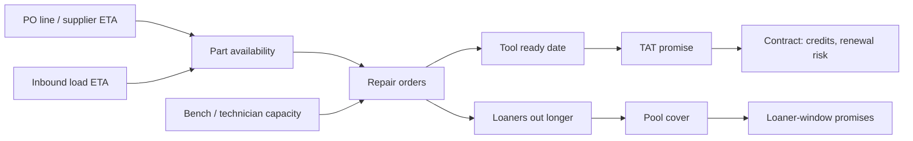

# H. Resolve: service network disruptions (research, 24 Nov 2026)

> Plan task IDs (P9-x.y) in this report follow [plan 9 revision 2](../../plans/09-agentic-platform.md) (remapped 25 Nov 2026; its last table maps old to new).

Part H of the platform research (brief: [00-brief.md](00-brief.md); product family: [01 §1](01-recover-segments.md)).
Resolve is the second product on the Decision Intelligence core. It answers this question: "What is the best action to protect the
turnaround promise, given cost and alternatives?" This report covers:

- what Resolve decides;
- how industry does it today and who sells it;
- which open source fits our constraints (Postgres only, no new container, permissive licences);
- what data, stories and agents it needs;
- what the core already gives us.

The first context is after-market tool service; notes for the other four segments follow.

Sources are listed at the end as [R#]. Vendor claims are vendor claims; nothing was tested hands-on. Thresholds, costs and
numbers marked *assumed* are starting values for the team to challenge. They are not facts. Licence and contract
findings need review by Kinective's Legal team before anyone relies on or acts on them. No customer or prospect is
named.

## Summary

1. **Resolve's unit is a promise at risk, not an asset.** A Recover case is one returned item. A Resolve case is one
   **disruption**: a root signal such as "part P backordered" together with every turnaround promise it puts at risk. Actions are
   portfolio-level: one expedite can unblock 14 repair orders, and one rebalance can refill two pools. So the case
   holds the affected promises as lines. The decision is an **allocation of scarce remedies across promises**, in the same
   shape as Recover's queue plan (`tool_fleet.py:684` `_plan_queue`, "each order filled once").
2. **The ripple chain is a small dependency graph:** part → repair order → loaner/swap pool → customer promise, with
   inbound shipments and technician capacity feeding it. It fits in Postgres, using recursive CTEs over canonical
   references. No graph database or stream processor is needed.
3. **Detection is deterministic first, probabilistic second.** Start with slack arithmetic: the remaining step lead
   times compared with the promise date, as `execution/move.py:86` already does for need-by dates. Then add P(breach) from
   empirical lead-time distributions (time-to-event fits, conformal intervals). This reuses the LightGBM + MAPIE decision
   (D2).
4. **Every action is costed like a Recover route.** Its value is the expected breach cost avoided, and its cost lines are
   the action's cost. The opportunity cost of using a returned unit as a loaner, swap or parts donor is **Recover's best
   alternative net for that unit**. That makes the two products one economic model, and it is our differentiator.
5. **The core covers about 60% of what Resolve needs** (*assumed*, by component count in §8): case store, routes with P10/P90, gates,
   business rules, approvals with limits, proposals, agent runtime, job queue with `run_after`, Wait steps, event
   triggers, live stream, instructions to systems, journal. The new parts are:
   - the promise/disruption model;
   - the ripple tracer;
   - the breach-risk estimator;
   - an action catalogue with cost rates;
   - a solver for allocation;
   - the case process layer (SLA timers), already planned as P9-5.8.
6. **Market.** Service-parts planners (PTC Servigistics, Syncron, Oracle, SAP), field-service suites (ServiceNow,
   Salesforce, IFS, PTC ServiceMax) and control towers (Kinaxis, Blue Yonder, project44, FourKites, Aera) all ship or
   announce agents. None that we found traces a part shortage through repair backlog and loaner depletion to a named
   customer promise and prices the alternatives across vendors. Each one stops at its own data.
7. **Top three to watch:**
   - **PTC** (Servigistics planning plus ServiceMax field service and advance exchange, agentic AI announced 2025–26);
   - **IFS** (field service management plus depot repair plus agent studio);
   - **Aera Technology** (horizontal decision intelligence with "Skills", the closest framing to ours).
8. **Recommended open source** (all permissive):
   - **OR-Tools** (Apache-2.0) for allocation and scheduling, with **HiGHS** (`highspy`, MIT) as the light MILP alternative;
   - **statsforecast** (Apache-2.0) for intermittent part demand;
   - **lifelines** (MIT) for time-to-ready;
   - **NetworkX** (BSD-3) for impact analysis off the hot path;
   - **SimPy** (MIT) for what-if;
   - **ruptures** or **river** (BSD) for change detection, later.

   Avoid scikit-survival (GPL-3.0), igraph (GPL), pm4py (AGPL-3.0) and python-mip (EPL-2.0, weak copyleft). Also avoid the
   Timefold Python solver: it is beta, its last release was Jul 2025, and Timefold archived its repository (6 Nov 2026).
9. **Stories:** 22 RS stories in total: P0 9, P1 8, P2 5.
10. **Proposed phase:** plan-9 **Phase 7** (revision 2: P9-7.4 R0 spike, P9-7.5 R1, P9-7.6 R2), after P9-5.8 (case process layer) and
    packs as data (Phase 1). R0 is a one-week spike on the tool-fleet sample world.

---

## 1. What Resolve decides

### 1.1 The decision and its unit

- **Question:** for each disruption, which combination of actions protects the most turnaround promises at the lowest
  total cost? Two limits apply: each scarce remedy is used once, and the result stays inside guardrails.
- **Case = disruption.** It has these parts:
  - a root signal;
  - the ripple (affected repair orders, pools and promises, each with slack and P(breach));
  - candidate actions, each costed;
  - a recommended **plan** (a set of actions);
  - approvals;
  - instructions to systems;
  - the outcome: promises kept or broken, and the actual cost.
- **Promise** is the general word. It covers the turnaround time (TAT) committed on a repair ticket, a loaner delivery
  window, a contract SLA (for example "swap within 48 h"), a rental delivery date, or a site's redeploy need-by date.

### 1.2 Disruption types and their ripple chains (tool fleet first)

| # | Disruption | First signal (source system) | Default trigger (*assumed*) | Ripples to |
|---|---|---|---|---|
| D1 | **Part shortage** | Spare-parts stock below open requirements; supplier confirms backorder; PO ETA moves (ERP, procurement, WMS) | Days of supply < replenishment lead time, or a backorder on a part with open repair orders | Repair orders blocked → repair backlog → longer loaner use → pool depletion → TAT breach |
| D2 | **Repair backlog** | WIP at a repair centre grows faster than throughput (depot repair) | WIP ÷ daily throughput > 0.8 × TAT target, rising for 3 days | Queue time on every ticket → TAT breach; more loaners out |
| D3 | **Loaner / pool depletion** | Available loaners at a site below expected demand (fleet/pool system, WMS) | Cover < 2 days of loaner demand, or units overdue back > 10% of the pool | New tickets get no loaner → customer downtime → breach of the "loaner promised" term (01 §4.1, stage 2) |
| D4 | **Inbound / carrier delay** | ETA slip on an inbound load (a part from a supplier, or a tool from a customer) (TMS) | ETA later than the need date of the order it feeds, or slip > 1 day | Part late → D1; tool late to repair → TAT clock risk; loaner return late → D3 |
| D5 | **Technician / bench capacity** | Planned hours < required hours (absence, skill gap, test bench down) (FSM, EAM, depot repair) | Required ÷ available > 1.0 for any day in the next 5 working days | D2 at one site; the same skill is short everywhere |
| D6 | **TAT promise breach (predicted)** | Per-ticket slack < 0 or P(breach) ≥ threshold (computed) | P ≥ 0.6, or slack < 1 working day | Contract penalty or credit; customer escalation; renewal risk (contract refresh, 01 §4.3) |
| D7 | **Quality / recall hold** (from Recover's safety-recall guardrail) | A recall or quality hold on a part or tool family (QMS, PLM) | Any hold on stock that open orders depend on | Sudden D1 + D3 together |

Ripple, worked example (*sample, synthetic*): a bearing is backordered (D1). It blocks 14 repair orders at Repair Centre
A. Those orders hold 14 tools that each have a loaner out. Pool A's cover falls to 1.2 days (D3). In 6 days, 9 customer
tickets with a 5-day TAT promise breach (D6). Two of them are on contracts renewing within 90 days.

### 1.3 Detection: slack first, probability second

- **Slack (deterministic).** Ready date = now + Σ(expected remaining step durations): wait for part, queue, repair,
  test, ship. Slack = promise − ready. This is the same arithmetic as `ex_move` (`execution/move.py:74-86`: legs, ETA,
  slack against need-by), extended upstream to parts and queue time. Cheap, explainable and enough for P0.
- **P(breach) (probabilistic).** Each remaining step gets a duration distribution: empirical quantiles per step, site
  and part family, with time-to-event fits that treat still-open orders as censored. The total is then sampled with
  Monte Carlo (numpy, about 1,000 draws per promise). The result is P(ready > promise). This is "outcome-oriented
  predictive process monitoring", for which the literature has a benchmark of 11 methods on 24 tasks [R14]. Calibrate on
  closed tickets and show a reliability plot and Brier score on the Models panel, as D2 does for MAPIE coverage.
- **Thresholds are rules.** "Watch at 0.3, act at 0.6" lives in the Modeler as template parameters, versioned,
  simulated and shadowed like any rule (D2). A back-test shows how many alerts and false alarms a threshold gives.
- **Noise control.** One disruption case per root cause. A new ticket hit by the same backorder joins the open case as
  a line; it does not open a new case. This works like intake dedupe (`cases/intake.py`: same key and reason → one case).

### 1.4 Next-best actions and how each is costed

Common formula, in the shape of a Recover route (`engine/routes.py`: terms, net, P10/P90, gates, rank):

> **Net(action) = Σ over affected promises [P(breach before) − P(breach after)] × breach cost − action cost lines.**
> Breach cost = contract credit or penalty + loaner days × daily loaner cost + downtime cost to the customer (if the
> contract states it) + renewal risk × contract margin (*assumed*; needs the commercial team's sign-off).

| Action | What it does | Cost lines | Executing system (instruction) | Reversible? | Default approver (*assumed*) |
|---|---|---|---|---|---|
| A1 Expedite part | Pay for a faster supplier or premium freight | Expedite fee, premium freight − standard freight | Procurement (PO change), TMS (re-book) | Partly (fee may be sunk) | Service parts planner; > $2,000 → supply chain manager |
| A2 Alternate supplier / approved substitute part | Buy from a second source or use a supersession | Price difference, qualification risk, lead time | Procurement (new PO), PLM (read: is the substitute approved?) | Yes until shipped | Service parts planner; non-approved substitute → engineering (gate) |
| A3 **Harvest from returns** (link to Recover) | Take a certified part from a returned tool that Recover would harvest or scrap | Teardown, test and certify (Recover lines `tool_fleet.py:523-546`) + **opportunity cost = that unit's best Recover alternative net** | Depot repair (teardown WO), WMS (parts putaway, `steps.py` `teardown`, `partsput`) | No (teardown) | Repair centre lead; quality certifies fit-for-use (Recover agent 4) |
| A4 Rebalance stock or loaners across sites | Lateral transfer of parts or loaners from a site with surplus | Freight on the lane (`execution/lanes.py` rate card), the risk created at the giving site (its own ΔP) | WMS transfer, TMS load (`steps.py` `move`, `transport`) | Yes (transfer back) | Tool pool planner; inter-region → both planners |
| A5 Outsource repair | Send to an approved third-party repairer | Their price + freight − internal cost saved; quality risk | Depot repair / procurement (service PO) | No once shipped | Repair centre lead; > $600 per tool → fleet manager (01 §4.1 guardrail) |
| A6 **Swap instead of repair** | Ship a refurbished unit now and repair the returned unit later | Refurbished unit consumed at its **Recover best alternative net**, freight both ways; cover terms must allow it (01 §4.2) | Fleet/contract system, WMS reserve + ship | Partly | Fleet desk; uncovered swap → account manager |
| A7 Overtime / extra shift / reassign technician | Add bench hours or move a skilled technician | Hours × overtime rate (market rules, 01 §4.2 labour rates), travel | FSM / workforce scheduling | Yes (until worked) | Repair centre lead; above the weekly budget → service operations |
| A8 Re-sequence the queue | Repair first the tickets whose promises are tightest or most valuable | None direct; ΔP on the tickets moved back | Depot repair (priority) | Yes | Agent within limits (no cost) |
| A9 **Customer communication / promise reset** | Tell the customer early, offer a new date, a credit or a loaner | Credit offered; goodwill; it avoids an unannounced breach | CRM / service desk (message, case note) | No (sent) | **Always a person** (external message); credits > $300 → sales (01 §4.3) |
| A10 Do nothing / watch | Accept the risk and re-check at the next signal | Expected breach cost | none | n/a | Agent (logged), so "watch" is a decision with a reason |

- **Plans, not single actions.** Remedies compete: one harvested bearing can serve only one repair order, and a
  transferred loaner leaves a hole at its origin. The recommended plan is an assignment of remedies to promises that
  maximises total net under capacity and one-use constraints. This is the same pattern as Recover's queue plan
  (`tool_fleet.py:684-816`, with the "free depot slots" logic at `:735-745`) and the pool optimiser (`engine/pool.py`,
  which compares greedy with optimal). `pool.py` uses exhaustive search ("pools are small"). Resolve's portfolios
  (dozens of promises × a handful of remedies) need a MILP/CP solver (§4).
- **Explain against the standard route.** Show the plan's net against "do nothing" and against "first come, first
  served", as Recover shows `total` against `fcfs` (`tool_fleet.py:667-683`, `Plan.fcfs`, `Plan.gain`).

### 1.5 Who approves

- A person approves only what is above a threshold, low in confidence, irreversible, or customer-facing. Below that,
  approval comes from a standing policy (D4): the journal records "approved by policy P vN, owner X".
- The approval limits per role (`core/policy.py:152` `limit_for`) and the "above your limit escalates to Admin" refusal
  (`services/actions/decisions.py:296-310`) apply unchanged, with the plan's total cost as the amount.
- Hard gates are not approvals: a non-approved substitute part, an uncertified harvested part, a swap the cover terms
  forbid, or an export-controlled transfer (telecom). They exclude an action, as `engine/gates.py` excludes a route.

---

## 2. Industry practice and terms

| Term | Meaning (plain) | Source |
|---|---|---|
| Service parts planning (SPP) | Forecast and position spare parts so repairs are not waiting. Demand is intermittent and lumpy; the target is availability, not turns | Vendor and analyst material [R1, R2, R5]; Croston's method for intermittent demand (1972) [R16]; TSB (2011) [R17] |
| Multi-echelon inventory | Stock at several levels (central depot, regional, site) planned together. The classic model is **METRIC** (Sherbrooke, *Operations Research* 16(1):122–141, Feb 1968): one repair depot, many bases, recoverable items, compound Poisson demand | [R12] |
| Recoverable / repairable item | A part or tool that is repaired and returned to stock. Our repair loop is exactly this, which is why Recover and Resolve share data | [R12] |
| Lateral transshipment | Moving stock between sites at the same level (our A4). It helps when the transfer is fast, and a case study found it can hurt when transfer time is not negligible | Yang & Dekker 2010 [R13] |
| Time-based service level | The share of demand met within a set time, rather than fill rate. It fits TAT promises better | [R13] |
| Depot repair, advance exchange, loaner | Depot repair: the customer sends the unit in and gets it back repaired. Advance exchange: a replacement ships before the faulty unit arrives. Loaner: a temporary unit goes out before the faulty one is received, with a return step | Oracle Depot Repair docs [R11]; PTC ServiceMax Asset 360 advance exchange [R10] |
| TAT / SLA | Turnaround time from receipt (or request) to return; the SLA states the promise and the penalty or credit | Contract-specific; examples in 01 §4.2–4.3 |
| Control tower | Gartner calls it a *concept* combining people, process, data and organisation with technology for transparency and coordination, and has warned against vendor hype | [R15] |
| Disruption / event management | Sense → assess impact → decide → act → learn. Vendors now pitch agents to "compress truth, decision, action into one motion" (project44 Decision44, Apr 2026) | [R8] |
| Predictive process monitoring | Predict a running case's outcome (for example on-time or late) from its event history; a review and benchmark exists (Teinemaa et al., *ACM TKDD* 2019) | [R14] |

Practices to adopt:

- **Plan for availability per promise, not inventory value**: a time-based service level per contract tier.
- **Exception-based management**: people see only what crosses a threshold. PTC frames its 2026 government renewal around
  "exception-based management" [R1].
- **Treat lateral moves as an action with a cost and a risk at the source site.** Never assume a free transfer [R13].
- **Pool loaners across sites** with a cover target per site. Advance-exchange programmes depend on a constantly
  rotating pool of ready units [R11].

---

## 3. Competitive landscape

"Shipped" means documented as available; "announced" means a press or event statement without documentation we
could read. The dates are those of the source.

| Vendor / product | Category | Agentic features (status, date) | Overlap with Resolve | Gap vs Resolve |
|---|---|---|---|---|
| **PTC Servigistics** (+ **ServiceMax**) | Service parts planning + field service | Servigistics 14.0 (Sep 2025) with an agentic assistant; AI Assistant available from Oct 2025; Spring 2026 "Agentic AI", AI/ML forecasting, SIOP; blog posts on control-tower agents that watch supply chain health (date **unconfirmed**) [R1]. ServiceMax Asset 360 documents advance exchange [R10] | Parts availability, multi-echelon optimisation, advance exchange, field service: the closest functional match | Planning horizon (weeks/months) rather than one disruption today; agent details are **announced**, and docs were not readable (403); PTC data only |
| **Syncron** | Service parts, pricing, warranty | A unified "AI-powered" SLM platform (Apr 2025); IDC MarketScape Major Player for AI-enabled service parts (Nov 2025); no agent product found in 2026 news [R2] | Parts planning, dealer inventory | No repair/loaner/promise chain; an independent review (Apr 2026) questions how deep the AI goes [R2]. Possible partner |
| **IFS Cloud** (FSM + Depot Repair, Loops Agent Studio) | ERP / EAM / FSM suite | Depot Repair module since 25R1; 26R1 (2026) service execution; Loops Agent Studio (Apr 2026, per C §2.5); no depot-repair "digital worker" found [R3] | Repair authorisation to invoice, field + depot coordination | Agents inside IFS data only; no cross-vendor ripple or remedy costing |
| **Oracle Fusion SCM** | Suite | **Service Parts Advisor** agent (26A): *recommends* parts and quantities from past service requests; the user orders [R4]. Depot Repair in EBS [R11] | Parts for a job | Recommends a part list; does not trace disruptions or price alternatives |
| **SAP** | Suite | Feb 2026 article: agents that monitor inventory, supplier readiness and demand for new product introduction and service parts (**announced**) [R5]; 60+ supply-chain agents, GA "phased through 2026" (C §2.3) | Service parts, field service and asset management | SAP-centric; no packaged disruption-to-promise agent found |
| **ServiceNow FSM** | Field service | Zurich family: Create-work-order and **Parts Manager** agents (shipped 2025, refined in 2026 patches); FSM Scheduling AI Agent Collection 1.0.7 in Zurich Patch 11 (16 Jul 2026) [R6] | Work orders, parts debrief, scheduling | Field-visit centric; no repair-depot/loaner economics |
| **Salesforce Field Service (Agentforce)** | Field service | Scheduling agent; scheduling GA reported May 2025 (CX Today); Dreamforce previews [R7] | Rescheduling when a gap opens | Appointment-level; no parts or pool ripple |
| **Kinaxis Maestro** | Supply chain planning / control tower | Maestro Agents launched 17 Oct 2025; Agent Studio (no-code) available to customers; orchestrator agents planned "later in 2026" (**announced**) [R9] | Sense-and-respond, scenarios | Forward supply chain; not repair loops or loaners |
| **Blue Yonder** | Planning + execution | Inventory Ops and Network Ops agents (announced May 2025; Inventory Ops ordering skills May 2026; Copilot listing needs a Blue Yonder planning subscription) [R18] | Supply-demand mismatch, alternate sourcing | Retail/CPG forward flows; GA status **unconfirmed** |
| **project44** | Visibility → agents | Agent portfolio at Decision44 (8 Apr 2026); Autopilot no-code agent platform (May 2026); acquired LunaPath.ai [R8] | Inbound delay detection and carrier outreach (our D4) | Transport only; a good *signal source*, not a rival for the remedy decision |
| **FourKites Loft** | Control tower → agents | Loft launched 9 Feb 2026 (Manifest); prebuilt "digital workers" for exceptions; records why and who approved (vendor) [R19] | Exception follow-up, audit of agent decisions | Transport/order exceptions; no service-network economics |
| **Aera Technology** | Horizontal decision intelligence | Aera Skills on Decision Cloud; six agentic additions at AeraHUB 26 (27 Oct 2026); reported Decision Ledger and Policy Studio with human approval (trade press) [R20] | "Decision" framing, governed agents, outcome ledger | Generic skills; no service-network content out of the box (**unconfirmed**) |

**Gaps across the field:**

- Nobody we found links **part → repair order → loaner pool → named customer promise** in one case, across vendors.
- Nobody prices remedies against **the value of the returned asset's next life**. That needs Recover's valuer.
- Agents are either planning assistants (weeks ahead) or execution bots (one shipment); none plans a portfolio of
  remedies for today's disruption with a person approving only the exceptions.

**What to copy:**

- Exception-first inbox with the reason and the recommended action (PTC, FourKites).
- Agents that contact carriers or suppliers for a new ETA, which would be "needs info" proposals for us (FourKites,
  project44).
- A "why and who approved" record, which our journal already has (FourKites Agent Operating Procedures).
- A no-code agent studio (Kinaxis, project44 Autopilot): our Compose step 3, agent mapping.
- Parts debrief from technician notes (ServiceNow Parts Manager): a later intake source.

---

## 4. Open source for the Resolve-specific parts

Constraints: Postgres only, no new container in the trial package, permissive licences, in-process Python. Versions
and dates are from PyPI metadata read on 24 Nov 2026 [R21] unless noted.

| Area | Project | Licence | Latest (date) | Python fit | Verdict |
|---|---|---|---|---|---|
| Allocation / MILP / CP | **OR-Tools** | Apache-2.0 | 9.15 (GitHub release 12 Jan 2026) | Wheels; CP-SAT for assignment and technician scheduling, MathOpt/linear solver | **Adopt** for plan allocation (A1–A8 over promises) and capacity scheduling. Wheel size and bundled solvers **unconfirmed**; check image size |
| MILP (light) | **HiGHS** (`highspy`) | MIT | 1.16.0 (11 Nov 2026) | Small, fast LP/MILP | **Adopt as alternative** if OR-Tools is too heavy for the image |
| Modelling layer | PuLP | MIT (LICENSE file and PyPI; old PyPI classifiers said BSD) | 4.3.1 (19 Nov 2026) | Simple modelling over CBC/HiGHS | Learn from; one modelling layer is enough |
| Modelling layer | Pyomo | BSD-3-Clause | 6.11.0 (20 Nov 2026) | Heavy, general | Avoid for now (more than we need) |
| Convex | CVXPY | Apache-2.0 | 1.9.3 (19 Sep 2026) | Convex only | Not needed |
| MILP | python-mip | **EPL-2.0** (weak copyleft) | 2.0.2 (9 Nov 2026) | Good | **Avoid** (licence flag) |
| MILP | PySCIPOpt | MIT (SCIP's own licence **unconfirmed**) | 6.3.0 (11 Oct 2026) | Good | Learn from |
| Planning solver | Timefold (Python) | Apache-2.0 | 1.24.0b0 beta (8 Jul 2025) | JVM bridge | **Avoid**: beta, repository archived by Timefold (6 Nov 2026); community fork exists [R22] |
| Multi-echelon inventory | **stockpyl** | MIT | 1.0.2 (2 May 2025) | Pure Python; base-stock, (s,S), multi-echelon models and simulation | **Learn from / borrow formulas** for pool cover targets; small project, slow releases |
| Intermittent demand forecast | **statsforecast** | Apache-2.0 | 2.1.1 (16 Jul 2026) | Croston, ADIDA, IMAPA, TSB; fast | **Adopt** for part and loaner demand per site |
| Time series | sktime | BSD-3-Clause | 1.3.0 (8 Nov 2026) | Already "learn from / adopt if needed" in E | Keep E's verdict |
| Price/ETA intervals | MAPIE + LightGBM | BSD-3 / MIT | 1.6.0 (19 Oct 2026) / 4.7.0 (18 Jul 2026) | Already D2 | **Reuse D2** for ETA and step-duration intervals |
| Time-to-event | **lifelines** | MIT | 0.30.3 (5 Mar 2026), beta classifier | Kaplan-Meier, Weibull, Cox; handles censored open orders | **Adopt** for step-duration distributions |
| Time-to-event | scikit-survival | **GPL-3.0-or-later** | 0.28.0 (5 Jul 2026) | Good | **Avoid** (copyleft) |
| Change detection | ruptures | BSD-2-Clause | 1.1.10 (10 Sep 2025); requires Python < 3.14 | Offline change points (backlog regime shift) | Learn from; check our Python version |
| Streaming drift | river | BSD-3-Clause | 0.27.0 (13 Nov 2026) | Online detectors (ADWIN, Page-Hinkley) | **Later (P2)** for "backlog is accelerating" alerts |
| Dependency graph | **NetworkX** | BSD-3-Clause | 3.7 (21 Sep 2026); requires Python ≥ 3.12 | Pure Python | **Adopt** for impact analysis and the ripple view; the hot path stays recursive SQL |
| Dependency graph | rustworkx | Apache-2.0 | 0.18.1 (30 Jul 2026) | Fast | Only if NetworkX is too slow |
| Dependency graph | igraph | **GPL** | 1.0.0 (23 Oct 2025) | Fast | **Avoid** (copyleft) |
| Discrete-event simulation | **SimPy** | MIT | 4.1.2 (24 May 2026) | Process-based simulation | **Adopt** for what-if ("if we expedite, how many promises hold?") and back-test of thresholds |
| Queueing simulation | Ciw | MIT (repo LICENSE file) | 3.2.7 (5 Dec 2025) | Queueing networks (repair centres) | Learn from |
| Simulation | salabim | MIT | 26.0.9 (3 Nov 2026) | Animation-heavy | Not needed |
| Process mining | pm4py | **AGPL-3.0-or-later** | 2.7.23.15 (24 Nov 2026) | Rich | **Avoid** in the product (copyleft); use offline only, if at all |

Not needed, and against the constraints: Kafka/Flink/Esper-style complex event processing, a graph database, a
time-series database, MLflow server. Event detection rides on what we have:

- database triggers into `stream_event` + `NOTIFY` (`services/stream.py`);
- webhook event triggers (`workflow/triggers.py`);
- periodic ticks (`worker.py:134-141`);
- the job queue's `run_after` (`core/jobs.py`).

---

## 5. Data needed and canonical entities to add

### 5.1 Per system type (adapters that exist as mocks today)

| System type | Mock adapter today | Resolve reads | Resolve writes (instructions) |
|---|---|---|---|
| Depot repair | `connectors/adapters/depot_repair.py` (already maps `repair_status`, `promise_date`, `hours`, `parts`) | Repair orders, status, promise date, parts needed, hours, WIP per centre | Priority/sequence (A8), outsource flag (A5), teardown WO (A3) |
| Field service / ITSM | `servicenow.py` (FSM: service demand, dispatch, visit outcomes) | Tickets, TAT clock start, technician schedules, skills | Reassign or reschedule (A7) |
| EAM | `maximo.py` (work orders, failure history, criticality) | Bench/test-rig availability, criticality | none (read) |
| WMS | `manhattan.py` (availability, reservations, transfers) | On-hand parts and loaners per site, reservations | Reserve, transfer (A4, A6) |
| ERP | `s4.py` (stock, valuation, actual costs) | Stock, open POs, actual costs for close and learn | Cost postings (via Reconcile later) |
| Procurement | `ariba.py` (supplier quotes, `supplier_lead_time`) | Lead times, alternate suppliers, quotes | PO change or new PO (A1, A2), **held** |
| TMS | `otm.py` (shipments, ETA, tracking events, rate card) | Inbound ETA for parts and tools, lanes and rates | Expedite or re-book (A1, A4) |
| OMS / contract | `sterling.py` (orders, need-by); fleet contract system (01 §4.1, *not yet a mock*) | Promises, SLA terms, swap rights, penalties | Promise reset (A9), swap order (A6) |
| CRM / service desk | `salesforce.py` | Customer tier, open escalations, renewal date | Customer message draft (A9), **always held** |
| PLM | `windchill.py`, `teamcenter.py`, `aras.py` (read-only) | Supersessions, approved substitutes | none |
| IoT telemetry | `aws_iot.py` | Failure-rate signals that predict incoming repairs | none |
| Supplier/carrier visibility | none (generic REST or MCP-client source) | ETAs from a visibility provider | none |

### 5.2 Canonical entities to add

Each entity follows the existing rules (`services/canonical/schema.py` authority per field, `canonical/store.py`
conflicts, `canonical/fields.py` typed fields; a new field must be typed, or its facts are held).

| Model | Key | Fields (type) | Authority (default) |
|---|---|---|---|
| `promise` | `<source>:<ticket or order ref>` | customer_ref, subject_ref (serial/ticket), kind (tat, loaner_window, swap_sla, delivery), clock_start (date), due_at (date), tier (text), penalty_per_day (number), credit_terms (text), status (open, kept, broken, reset) | Contract/OMS system; FSM for the TAT clock |
| `part_supply` | `<site>:<part number>` | on_hand, reserved, on_order, next_eta (date), backorder (bool), days_of_supply, lead_time_days, alt_parts (list) | WMS for on-hand; procurement for ETA and lead time; PLM for alternates |
| `repair_order` (extends `intervention`) | repair order ref | waiting_for (part, bench, technician, test, none), queue_position, expected_ready (date), required_hours, blocking_part_ref | Depot repair |
| `capacity` | `<site>:<resource>:<date>` | resource_kind (technician, bench, test_rig), skill, available_hours, planned_hours | FSM / EAM |
| `pool_position` | `<site>:<pool>:<class>` | units_total, available, on_loan, overdue_back, demand_per_day, cover_days, target_cover_days | Fleet/pool system or WMS |
| `disruption_event` | generated id | kind (D1–D7), root_ref, detected_at, source, severity, status | **Produced by Resolve** (like Route candidate and Decision) |
| `action_rate` | `<org unit>:<action kind>` | expedite fee tables, overtime rate, outsource price list, lane rates (reuse `execution/lanes.py`) | Finance / procurement; changed only with approval (01 §3) |

Seven new or extended models. That matches the pack contract's "about seven canonical entities" (01 §9).

---

## 6. Roles and user stories

Roles (tool fleet): **service parts planner**, **repair centre lead**, **tool pool planner**, **fleet desk / customer
service**, **account manager**, **service operations manager** (owns standing policies and thresholds), **finance**
(cost rates, credits), **quality** (certifies harvested and substitute parts), **admin** (agents, autonomy).

Actor: **Agent** = the agent does it, within its autonomy and the hold policy; **Person** = a person decides or acts.

| ID | P | Story | Given / When / Then | Actor |
|---|---|---|---|---|
| RS-01 | P0 | As a parts planner, I want a disruption case to open from the first signal | Given a backorder on a part with open repair orders, When the procurement or WMS sync lands it, Then one disruption case opens with its root signal and source age, and a second signal of the same root joins it | Agent |
| RS-02 | P0 | As a repair centre lead, I want the ripple traced | Given a disruption, When the case opens, Then it lists affected repair orders, pools and promises with slack per promise, each linked to its source record | Agent |
| RS-03 | P0 | As service ops, I want promises at risk ranked by slack and breach cost | Given a ripple, When it is computed, Then promises are sorted by slack and cost, and the thresholds come from the published flow | Agent |
| RS-04 | P0 | As a planner, I want every candidate action costed with the why | Given a ripple, When options are built, Then each action shows its value lines (breach cost avoided) and cost lines, with net and P10/P90, as a Recover route does | Agent |
| RS-05 | P0 | As a planner, I want harvest and swap priced at the returned unit's Recover value | Given a returned tool that could donate a part or be a swap unit, When A3/A6 is costed, Then its opportunity cost is that tool's best Recover alternative net, and the Recover case is linked | Agent |
| RS-06 | P0 | As service ops, I want one recommended plan across all promises | Given several actions compete for the same parts, loaners and slots, When the plan is computed, Then each remedy is used once, capacity holds, and total net is shown against "do nothing" and "first come, first served" | Agent |
| RS-07 | P0 | As an approver, I want only exceptions to reach me | Given a plan, When its cost is under the standing-policy threshold and nothing is irreversible or customer-facing, Then it runs under the policy (journalled); otherwise it holds for the role's approver with the hold reason | Person |
| RS-08 | P0 | As fleet desk, I want customer messages drafted, never sent by an agent | Given a promise that will break, When A9 is in the plan, Then a draft message with the new date and offer is held for a person | Agent drafts; Person sends |
| RS-09 | P0 | As a planner, I want approved actions sent to the systems and tracked | Given an approved plan, When it executes, Then each action becomes an instruction (PO change, transfer, priority, WO), confirmations are tracked, and a failure re-opens the case | Agent |
| RS-10 | P1 | As service ops, I want P(breach) per promise with a calibration view | Given step-duration history, When a promise is assessed, Then P(breach) shows with its inputs, and the Models panel shows the Brier score and a reliability plot | Agent |
| RS-11 | P1 | As a pool planner, I want pool cover forecast per site | Given loaner demand history, When cover falls below target in the forecast window, Then a D3 disruption opens before the pool is empty | Agent |
| RS-12 | P1 | As a planner, I want to ask a supplier or carrier for a new ETA | Given an inbound ETA is stale, When the agent needs it, Then a "needs info" request goes to the named contact or source, and the case waits (P9-5.8) | Agent; Person answers |
| RS-13 | P1 | As a repair centre lead, I want technician and bench capacity in the plan | Given capacity per site and day, When A7/A8 are planned, Then the plan respects hours and skills and shows overtime cost | Agent |
| RS-14 | P1 | As service ops, I want SLA timers on the case itself | Given a plan awaiting approval, When its own response SLA lapses, Then it escalates to the delegate or next role (never auto-approves) | Agent |
| RS-15 | P1 | As a manager, I want what-if on a plan | Given a recommended plan, When I change an assumption (supplier ETA, overtime cap), Then the plan re-ranks without changing the approved one (as `engine/scenario.py`) | Person |
| RS-16 | P1 | As finance, I want expedite fees and credits reconciled | Given a closed disruption, When actuals post, Then predicted vs actual cost and promises kept vs broken show, and the variance feeds the cost rates | Agent; Person confirms |
| RS-17 | P1 | As service ops, I want a back-test of thresholds | Given 3 months of tickets and stock history, When I replay a threshold set as of each day, Then alerts, false alarms, breaches avoided and cost show with a band | Agent; Person reviews |
| RS-18 | P2 | As a planner, I want rebalancing proposed before a disruption | Given forecast imbalance between sites, When cover diverges, Then a proactive transfer is proposed with its cost and risk at the giving site | Agent |
| RS-19 | P2 | As service ops, I want contract-refresh risk flagged | Given repeated breaches on a contract renewing within 90 days, When it is detected, Then the account manager sees it on the contract-refresh proposal (01 §4.3) | Agent |
| RS-20 | P2 | As an analyst, I want root-cause analytics | Given closed disruptions, When I ask "which parts cause most breach days?", Then a chart and example cases show (01 §2 Analytics) | Person |
| RS-21 | P2 | As admin, I want external visibility feeds as sources | Given a visibility provider's API, When it is connected as a generic REST or MCP-client source, Then its ETAs feed D4 | Person sets up; Agent reads |
| RS-22 | P2 | As quality, I want substitute-part approvals read from PLM as a gate | Given A2 proposes a substitute, When PLM has no approved supersession, Then A2 is excluded with the reason | Agent |

Counts: **P0 9, P1 8, P2 5 (22)**.

### Notes for the other four segments (01 §5–8)

| Segment | Promise | Typical disruptions | Remedies specific to it | Watch-outs |
|---|---|---|---|---|
| Device recommerce | Trade-in payout date, repair-and-return TAT under a protection plan | Grading or diagnostics backlog, parts for screen and battery repair short, wipe-tool outage | Swap from refurbished stock, route to a partner repairer, payout-on-receipt | Wipe certificate gate stays locked; no swap device without erasure |
| Used cars | Recon-to-frontline days, delivery date to a buyer | Body-shop backlog, parts backorder, transport delay, title/lien hold | Outsource recon, send to auction instead of retail (a Recover link), move to another lot | Title gate is locked; recall check before retail |
| Telecom network equipment | Site restoration or upgrade date, spares SLA per region | Spares pool empty in a region, RMA repair delay at an OEM, customs hold | Cross-region spares transfer, harvest boards from decommissioned units (Recover), advance exchange from a broker | Export-control gate on cross-border moves; configuration wipe before redeploy |
| Medical rental | Delivery window to a hospital, service-in-date for the rental | Decontamination backlog, biomedical service capacity, certification expiring | Send a different unit, bring servicing forward, hire from a partner | Decontamination record and certification are **locked** gates; clinical messages are always held for a person; regulatory specifics need review by Kinective's Legal team |

---

## 7. Agents for Resolve

By analogy with Recover's seven-agent chain (01 §3). The same stages apply: signal → match/verify → assess → value
each action → decide → execute → close and learn. Every agent call goes through `pipeline.invoke`, so the kill switch,
autonomy, org scope and run limits apply (`services/agents/limits.py`). Forbidden actions stay forbidden
(`services/agents/forbidden.py`). Holds become proposals (`services/agents/proposals.py`).

| # | Agent | Does | Default autonomy (*assumed*) | Typical hold reasons |
|---|---|---|---|---|
| 1 | **Sentinel** | Reads signals (backorder, ETA slip, WIP growth, pool cover, capacity gaps), opens or joins a disruption case | Act alone (reads and case opening only) | Source stale or conflicting (canonical conflict queue) |
| 2 | **Ripple tracer** | Walks part → repair orders → pools → promises; computes slack | Act alone | Unmapped link (repair order without a promise ref) → "needs info" |
| 3 | **Risk** | P(breach) per promise from duration models | Act alone | Model coverage below target; unseen part family → low confidence |
| 4 | **Options** | Finds feasible remedies (suppliers, substitutes, donors from Recover's queue, surplus sites, outsourcers, overtime) and applies gates | Act within limits | Gate needs a person (uncertified donor part, non-approved substitute) |
| 5 | **Costing** | Prices each action (value lines, cost lines, P10/P90); asks Recover's valuer for donor and swap opportunity costs | Act alone | Missing cost rate; wide interval |
| 6 | **Plan** | Solves the allocation across promises; explains against "do nothing" and first come, first served | Act within limits | Plan cost above the standing-policy threshold; irreversible action (teardown, outsource ship); customer-facing action; solver timeout or infeasible |
| 7 | **Follow-through** | Sends instructions, watches confirmations and ETAs, re-plans on a new signal, records the outcome, feeds calibration | Act within limits | Instruction failed twice; a promise breached despite the plan → review |

- **Shared with Recover:** Costing calls Recover's valuer, and Plan reserves a donor or swap unit through Recover's
  queue plan. So the two agents must not promise the same unit twice: one reservation table, or the Recover case gets
  a hold reason "reserved by Resolve D-123".
- **Always held, whatever the autonomy (*assumed*):**
  - customer messages and promise resets;
  - new purchase orders;
  - anything above the role's approval limit;
  - teardown of a unit that Recover values above a threshold.
- **New forbidden actions to consider** for `FORBIDDEN_ACTIONS`: changing a cost rate or a threshold (both are maker-checker
  objects, consistent with 01 §3: "Thresholds and factor tables change only with a person's approval").

---

## 8. What the core provides vs what is new

| Capability | Core today (file) | New for Resolve | Size |
|---|---|---|---|
| Case store, stages, intake, dedupe | `services/cases/intake.py`, `cases/lifecycle.py` | A case **kind** `disruption` with promise lines; stage set (detected → assessed → planned → approved → executing → closed) | M |
| Canonical models, authority, conflicts, held records | `services/canonical/schema.py`, `store.py`, `fields.py`, `failed.py` | 7 models (§5.2) with typed fields; mappings for 6 adapters | M |
| Adapters | `connectors/adapters/depot_repair.py`, `otm.py`, `ariba.py`, `manhattan.py`, `servicenow.py`, `sterling.py`, `s4.py` | New fields in mocks (WIP, backorders, pool cover, capacity); a fleet-contract mock | M |
| Signals and triggers | `workflow/triggers.py` (event, schedule), `connectors/webhook.py`, `worker.py` periodic step, `services/stream.py` | Sentinel rules (D1–D7 thresholds) as Modeler parameters | M |
| Dependency walk | none (references exist in facts: `repair_order_ref`, `inbound_load`) | Ripple tracer (recursive CTE + NetworkX for the view) | M |
| Slack | `execution/move.py:74-86` (need-by slack on legs) | Upstream steps (part wait, queue, test) | S |
| P(breach) | `engine/predictor.py` seam, D2 (LightGBM + MAPIE), `engine/calibration.py` | Step-duration models (lifelines), Monte Carlo, reliability view | L |
| Routes, ranking, P10/P90, gates | `engine/routes.py`, `engine/gates.py`, `engine/evaluate.py` | Actions as routes; gate set for actions (substitute approved, cover terms, export) | M |
| Business rules, guardrails, simulation, shadow | `services/modeler/` (`apply.py`, `guard.py`, `simulate.py`) | A Resolve template pack (thresholds, action guardrails) | M |
| Portfolio allocation | `engine/pool.py` (exhaustive, small), `valuers/tool_fleet.py:684` queue plan (greedy + slots) | Solver-backed plan (OR-Tools or HiGHS) behind a `PlanSolver` port, with the old ones as fallback | L |
| What-if | `engine/scenario.py` | Assumption levers for actions (ETA, caps) | S |
| Approvals, limits, delegation | `core/policy.py:152` `limit_for`, `actions/decisions.py:296-310`, delegations | Plan-level amount; standing policy (D4) | S |
| Proposals, agent runtime, limits | `agents/proposals.py`, `agents/runtime.py`, `agents/limits.py`, `agents/playbooks/case_autopilot.py` | Playbook `disruption_autopilot` (7 steps); "needs info" proposal (P9-5.8) | M |
| SLA timers, escalations | `core/jobs.py` (`run_after`), `workflow/waits.py`; **no case-level SLA** (E §1) | Uses P9-5.8 case process layer; promise timers re-check P(breach) | (in P9-5.8) |
| Instructions to systems | `execution/steps.py` (`order`, `repair`, `transport`, `move`, `reserve`, `teardown`, `partsxfer` …), `services/instructions/` | Step kinds: `po_change`, `expedite`, `priority`, `outsource`, `swap`, `notify_customer` (held) | M |
| Cost trace | `execution/trace.py` (Retrieved/Contracted/Modelled lines) | Same for action costs | S |
| Exceptions and capacity on screens | `services/screens/command.py` (exceptions, capacity chart) | Disruption board (Pulse), ripple view, plan card | L (frontend) |
| Back-test | Planned (README §5 step 4, X-01) | Replay thresholds and plans as of each day | M (on top of X-01) |

**About 60% exists in kind** (*assumed*: 11 of 18 rows reuse a core module with an extension, not a rewrite). Rough
total effort for R0–R2: **10–14 engineer-weeks** (*assumed*, first pass).

### Proposed phase for plan 9

- **Prerequisites:** Phase 1 (packs as data: Resolve is one pack of a new decision kind), P9-5.8 (case process layer,
  SLA timers, "needs info"), and the agent chain (Phase 2).
- **P9-7.4, R0 spike (1 week, S–M):** on the tool-fleet sample world, add `promise` and `part_supply` facts
  to the depot-repair and WMS mocks. Then compute slack and a greedy plan for one backorder scenario, and price the
  harvest and swap remedies with the existing tool-fleet valuer. Goal: prove the Recover ↔ Resolve price link and the
  demo story.
- **P9-7.5, R1 (P0 stories, 5–7 weeks):** disruption case kind, canonical models, Sentinel + Ripple + Options +
  Costing + Plan (deterministic slack; OR-Tools/HiGHS allocation behind a port), approvals under standing policy,
  instructions, the disruption board.
- **P9-7.6, R2 (P1 stories, 4–6 weeks):** P(breach) with lifelines + Monte Carlo + calibration, pool forecasts with
  statsforecast, capacity scheduling, needs-info ETAs, reconciliation hand-off to Reconcile, threshold back-test.
- P2 stories after the first Resolve pilot.

---

## 9. Open questions for the team

1. **Case unit:** one case per disruption with promise lines (recommended), or one case per promise at risk? The
   choice drives the screens and the KPIs.
2. **Breach cost:** do pilot contracts state penalties or credits per day late? If not, who signs off the *assumed*
   breach-cost formula (§1.4), and does renewal risk belong in it?
3. **Shared units:** may Resolve reserve a returned unit that Recover is still deciding? Which product wins a tie: the
   promise, or the higher recovery value?
4. **Customer messages:** always held for a person (recommended), or allowed under a standing template for small
   date changes?
5. **Solver dependency:** OR-Tools (broader, larger wheel) or HiGHS (small, MILP only)? Measure image size before
   choosing; both need Legal review before the trial package changes.
6. **Data:** will the tool-fleet pilot share repair-order history with step timestamps (for step durations), and loaner
   pool movements? Without timestamps, P(breach) stays deterministic.
7. **Reconcile boundary:** who owns expedite fees and SLA credits after the event, Resolve's close-and-learn or
   Reconcile?
8. **Visibility providers:** connect a transport-visibility API as a signal source (RS-21), or rely on TMS ETAs only?
9. **Regulated segments:** for medical rental and telecom, which gates are locked by the pack (decontamination,
   certification, export control)? These need review by Kinective's Legal team.

---

## Unconfirmed

- PTC's control-tower agent capabilities and the exact dates of the blog posts (pages returned 403); Servigistics
  agent features are taken from search summaries of PTC's pages [R1].
- Kinaxis press-release details (page returned 403); the dates come from the press-release URL and trade coverage [R9].
- Blue Yonder Inventory Ops and Network Ops GA status [R18].
- Salesforce scheduling agent GA date (one trade source, May 2025) [R7].
- IFS: no depot-repair agent found; the Loops Agent Studio date is from C §2.5 [R3].
- Aera's Decision Ledger and Policy Studio come from third-party listings; whether Aera ships service-network content [R20].
- Timefold Python: Solver 1.25.0 (12 Aug 2025) dropped Python and Timefold archived the Python repo on 6 Nov 2026;
  "discontinued" in those words is from the fork's page [R22].
- PuLP's licence (MIT text in its LICENSE file; old PyPI classifiers said BSD, no relicensing found); the OR-Tools wheel size and bundled solvers; SCIP's licence
  under PySCIPOpt; Ciw's licence from its repo file only (no PyPI licence field).
- All thresholds, costs, autonomy levels, sizes and the "about 60%" figure are *assumed*.

## Sources (read 24 Nov 2026 unless stated)

- R1 PTC: Servigistics 14.0 blog (Sep 2025), https://www.ptc.com/en/blogs/service/servigistics-transformative-release ;
  agentic AI blogs (date **unconfirmed**), https://www.ptc.com/en/blogs/service/servigistics-agentic-ai-optimization-foundation ,
  https://www.ptc.com/en/blogs/service/how-servigistics-agentic-ai-elevates-optimization ; Spring 2026 highlights,
  https://www.ptc.com/en/resources/ptc-next-on-demand/spring-highlights-servigistics ; US Air Force renewal (15 Oct 2026),
  https://www.ptc.com/en/news/2026/servigistics-renewal-us-air-force ; SLM AI solutions (2025),
  https://www.ptc.com/en/news/2025/ptc-delivers-new-slm-ai-solutions
- R2 Syncron: platform-first release (3 Apr 2025), https://www.manufacturingdive.com/press-release/20250403-syncron-announces-platform-first-approach-to-aftermarket-intelligence-for-c-1/ ;
  IDC MarketScape blog (Nov 2025), https://www.syncron.com/blog/syncron-idc-marketscape-ai-service-lifecycle-management ;
  TrueContext partnership (May 2026), https://www.syncron.com/press-releases/syncron-and-truecontext-help-manufacturers-turn-field-execution-into-better-warranty-decisions ;
  Lokad review (Apr 2026), https://www.lokad.com/review-of-syncron-com/
- R3 IFS: 26R1 blogs (2026), https://blog.ifs.com/ifs-cloud-26r1-intelligence-built-into-every-operation/ ,
  https://blog.ifs.com/how-ifs-cloud-26r1-elevates-service-management-with-predictable-execution/ ; Depot Repair in IFS
  Cloud FSM, https://www.ifs.com/assets/service-management/depot-repair-in-ifs-cloud-fsm ; releases,
  https://www.ifs.com/en/ifs-cloud/releases
- R4 Oracle: Service Parts Advisor (26A readiness), https://docs.oracle.com/en/cloud/saas/readiness/scm/26a/maint26a/26A-maintenance-wn-f39376.htm
- R5 SAP News (Feb 2026), https://news.sap.com/2026/02/customer-specific-ai-next-era-automotive-ecosystem/
- R6 ServiceNow docs: FSM AI agent use cases (Zurich), https://www.servicenow.com/docs/r/zurich/field-service-management/now-assist-for-field-service-management-fsm/fsm-ai-agent-use-cases.html ;
  Now Assist Suite release notes (16 Jul 2026), https://www.servicenow.com/docs/r/store-release-notes/na-suite-rn-2026-07-16.html
- R7 Salesforce: Agentforce for Field Service, https://www.salesforce.com/news/stories/agentforce-for-field-service-announcement/ ;
  scheduling blog, https://www.salesforce.com/blog/field-service-scheduling-optimization-in-the-agentforce-era/ ; CX Today,
  https://cxtoday.com/salesforce-drops-another-version-of-agentforce-this-time-targeting-field-service
- R8 project44: Decision44 agent portfolio (8 Apr 2026), https://www.project44.com/press-releases/project44-launches-ai-agent-portfolio-at-decision44-built-on-a-decade-of-context-skills-and-orchestration/ ;
  FreightWaves on Autopilot (May 2026), https://www.freightwaves.com/news/project44-launches-autopilot-an-ai-enabled-logistics-operating-system-that-offers-infinite-labor ;
  2026 outlook blog, https://www.project44.com/blog/2026-the-year-of-decision-advantage/
- R9 Kinaxis: Maestro Agents launch (17 Oct 2025), https://www.businesswire.com/news/home/20251017746583/en/ ; Microsoft
  feature (10 Sep 2026), https://news.microsoft.com/source/2026/09/10/what-if-everything-changes-tomorrow-a-canadian-company-is-using-ai-to-help-businesses-navigate-supply-chain-uncertainty ;
  ARC on Kinexions 2026, https://www.arcweb.com/industry-best-practices/kinexions-2026-ai-skills-speed-supply-chain-decisions-modernization
- R10 PTC ServiceMax Asset 360, advance exchange, https://support.ptc.com/help/servicemax_asset360/en/articles/asset-360/advanced-exchange.html
- R11 Oracle Depot Repair business scenarios (EBS 12.2), https://docs.oracle.com/cd/E26401_01/doc.122/e48965/T231848T344627.htm
- R12 Sherbrooke, C. C. "METRIC: A Multi-Echelon Technique for Recoverable Item Control", *Operations Research*
  16(1):122–141 (Feb 1968), doi:10.1287/opre.16.1.122, https://ideas.repec.org/a/inm/oropre/v16y1968i1p122-141.html ;
  RAND RM-5882, https://www.rand.org/pubs/research_memoranda/RM5882.html
- R13 Yang, G. & Dekker, R. "Service parts inventory control with lateral transshipment that takes time", Erasmus
  Econometric Institute report EI 2010-02 (2010), https://repub.eur.nl/pub/18588/EI2010-02.pdf
- R14 Teinemaa, Dumas, La Rosa, Maggi. "Outcome-Oriented Predictive Process Monitoring: Review and Benchmark", *ACM
  TKDD* (2019), doi:10.1145/3301300, https://arxiv.org/abs/1707.06766
- R15 Gartner analyst view on control towers (Supply Chain Dive), https://www.supplychaindive.com/news/gartner-what-supply-chain-managers-should-know-about-control-towers/574098/ ;
  ToolsGroup summary of "Don't Believe the Control Tower Hype" (2018), https://www.toolsgroup.com/blog/gartner-supply-chain-control-towers/
- R16 Croston, J. D. "Forecasting and stock control for intermittent demands", *Operational Research Quarterly* 23(3)
  (1972) (bibliographic record; not re-read)
- R17 Teunter, Syntetos, Babai. "Intermittent demand: linking forecasting to inventory obsolescence", *European Journal
  of Operational Research* 214(3) (2011) (bibliographic record; not re-read)
- R18 Blue Yonder: ICON 2025 agents (May 2025), https://www.supplychain247.com/article/blue-yonder-launches-five-new-ai-tools-logistics-warehousing/inventory_management ;
  Mar 2026 release, https://www.businesswire.com/news/home/20260311026920/en/ ; May 2026 release,
  https://www.businesswire.com/news/home/20260519113371/en/ ; Microsoft Marketplace listing,
  https://marketplace.microsoft.com/en-sg/product/WA200010745
- R19 FourKites Loft launch (9 Feb 2026), https://www.businesswire.com/news/home/20260209627320/en/FourKites-Launches-Loft-AI-Platform-to-Orchestrate-Enterprise-Systems-with-Real-World-Intelligence ;
  Nucleus Research note, https://nucleusresearch.com/research/single/fourkites-expands-its-control-tower-strategy-with-loft/
- R20 Aera Technology: Aera Skills, https://www.aeratechnology.com/aera-skills/ ; AeraHUB 26 coverage (27 Oct 2026),
  https://itbrief.com.au/story/aera-unveils-six-tools-to-automate-enterprise-decisions ,
  https://techstrong.ai/features/aera-defines-path-for-scaling-decision-intelligence/
- R21 PyPI JSON metadata (`https://pypi.org/pypi/<name>/json`) for ortools, highspy, pulp, pyomo, cvxpy, mip,
  pyscipopt, timefold, stockpyl, statsforecast, sktime, mapie, lightgbm, lifelines, scikit-survival, ruptures, river,
  networkx, rustworkx, igraph, simpy, ciw, salabim, pm4py; OR-Tools GitHub latest release v9.15 (12 Jan 2026),
  https://github.com/google/or-tools/releases ; Ciw LICENSE, https://github.com/CiwPython/Ciw
- R22 Timefold Python status: SolverForge legacy fork, https://pypi.org/project/solverforge-legacy/ ; original repo,
  https://github.com/TimefoldAI/timefold-solver-python
- Repo (read 24 Nov 2026): `backend/di/services/engine/{pool,routes,gates,evaluate,scenario,predictor}.py`,
  `services/execution/{move,steps,trace,lanes}.py`, `services/modeler/valuers/tool_fleet.py`,
  `services/cases/{intake,lifecycle}.py`, `services/agents/{runtime,proposals,registry,limits,catalog,forbidden}.py`,
  `services/agents/playbooks/case_autopilot.py`, `services/canonical/{schema,store,fields,failed}.py`,
  `services/stream.py`, `services/instructions/outbound.py`, `services/screens/command.py`, `core/{jobs,policy}.py`,
  `workflow/{triggers,waits,live}.py`, `worker.py`, `connectors/adapters/*.py`; research reports 00, 01, C, E, F, G,
  README; draft plan 9.

## Legal note

Licence findings (OR-Tools, HiGHS, PuLP, Pyomo, python-mip EPL-2.0, scikit-survival GPL-3.0, igraph GPL, pm4py
AGPL-3.0 and others), contract terms (penalties, credits, swap rights), customer communications and segment gates
(medical decontamination and certification, telecom export control) need review by Kinective's Legal team before anyone
relies on or acts on them.
