# User flow (as built)

How a user moves through the current Circularity demo for one returned asset, **RT-1048** (Voltara V4 motor, Customer A, Warehouse 1). The box numbers match the Product Owner's *Typical User Journey* ([`user-journey-diagram.png`](user-journey-diagram.png)). A slide version is [`user-flow.svg`](user-flow.svg).

Yellow: Circularity. White: people and enterprise systems. The line under each title names the screen in the app. All data is synthetic; enterprise-system steps are simulated acknowledgements.

```mermaid
flowchart LR
  S["<b>ANY USER</b><br/>Sign in<br/><i>Sign-in form</i><br/>work email, user ID or single sign-on (simulated)"]
  X["<b>SENIOR MANAGEMENT</b><br/>Exceptions by warehouse<br/><i>Executive Command Center</i><br/>warehouse · item · value"]
  R["<b>END USER · PLANNER</b><br/>Returned assets<br/><i>Returned assets</i><br/>RT-1048 marked Start here; 15 units of one SKU"]
  B1["<b>ENTERPRISE SYSTEMS</b><br/>1. Supply evidence<br/><i>Asset intelligence · what we know</i><br/>EAM Grade B · QMS certified 24 months · ERP/WMS/PLM history and specs"]
  B23["<b>CIRCULARITY</b><br/>2–3. Build alternatives & predict outcomes<br/><i>Asset intelligence · what we predict</i><br/>eligible treatments · life 30–40 months · Redeploy $9,600"]
  B4["<b>CIRCULARITY</b><br/>4. Optimize plan<br/><i>Treatment Intelligence · steps 2–4</i><br/>recommended outcome, why, what-if, compare"]
  B5["<b>HUMAN IN THE LOOP</b><br/>5. Plan approval<br/><i>Treatment Intelligence · step 5</i><br/>Planner submits · Approver approves"]
  B6["<b>CIRCULARITY</b><br/>6. Send instruction<br/><i>Step 5 · enterprise handoff</i><br/>approved plan to ERP, EAM and WMS"]
  B79["<b>ENTERPRISE SYSTEMS</b><br/>7–9. Create work, repair, return outcome<br/><i>Step 5 · system acknowledgements</i><br/>ERP order · EAM work order · WMS transfer · ERP fulfilled"]
  B10["<b>FINANCE · CIRCULARITY</b><br/>10. Reconcile & learn<br/><i>Analytics · predicted vs actual</i><br/>Finance confirms the outcome; models improve"]

  S -- "Senior manager signs in" --> X
  S -. "End user signs in" .-> R
  X -- "Notify owner" --> R
  R -- "Next" --> B1
  B1 -- "Next" --> B23
  B23 -- "Next" --> B4
  B4 -- "Next" --> B5
  B5 -- "Approve" --> B6
  B6 -- "Sent" --> B79
  B79 -- "Outcome reported" --> B10

  classDef circ fill:#FFDD00,stroke:#141414,color:#141414
  classDef other fill:#FFFFFF,stroke:#141414,color:#141414
  class B23,B4,B6,B10 circ
  class S,X,R,B1,B5,B79 other
```

| Step | Who | Screen | What happens |
|---|---|---|---|
| Sign in | Any user | Sign-in form | `exec` lands on the Executive Command Center; `ops` lands on Returned assets |
| Exceptions | Senior management | Executive Command Center | Exceptions by warehouse (warehouse · item · value); **Notify owner** sends RT-1048 to Planner · Customer A |
| Start | End user (Planner) | Returned assets | The notification is at the top; RT-1048 is marked *Start here* |
| 1 | Enterprise systems | Asset intelligence, retrieved side | Condition (EAM), certified period (QMS), lifecycle, return history, specs |
| 2–3 | Circularity | Asset intelligence, predicted side | Eligible treatments, remaining life, value by route, recommended outcome |
| 4 | Circularity | Treatment Intelligence, steps 2–4 | Recommended outcome, why, what-if, pathways compared |
| 5 | Human in the loop | Treatment Intelligence, step 5 | Planner submits; Approver reads the instruction preview and approves |
| 6 | Circularity | Step 5, enterprise handoff | Approved instruction sent to ERP, EAM and WMS |
| 7–9 | Enterprise systems | Step 5, acknowledgements | Work created, repaired and certified, outcome reported |
| 10 | Finance, Circularity | Analytics, predicted vs actual | Finance confirms the outcome; actuals compared with forecasts |
