# User flow

How a user moves through the Circularity demo for one returned asset, **RT-1048** (Voltara V4 motor, Customer A, Warehouse 1): **Sign in → Returned assets → steps 1 to 10**. The step numbers and names are the Product Owner's *Typical User Journey* ([`user-journey-diagram.png`](user-journey-diagram.png)), exactly. A slide version is [`user-flow.svg`](user-flow.svg), with a PNG copy, [`user-flow.png`](user-flow.png), for previewers that do not draw SVG text.

The diagram shows the planner's path only. The Executive's *Exceptions by warehouse* is a separate Command Center page, not part of this flow (it was removed from the diagram after the 19 Oct review because it confused the sequence).

Yellow: Circularity. White: people and enterprise systems. The line under each title names the screen in the app. All data is synthetic; enterprise-system steps are simulated acknowledgements.

```mermaid
flowchart LR
  S["<b>PLANNER</b><br/>Sign in<br/><i>Sign-in form</i>"]
  R["<b>PLANNER</b><br/>Returned assets<br/><i>Returned assets</i><br/>pick one asset: RT-1048, Start here"]
  B1["<b>ENTERPRISE SYSTEMS</b><br/>1. Supply evidence<br/><i>Asset Intelligence · retrieved data</i><br/>EAM Grade B · QMS certified 24 months · OMS RMA · procurement part prices · PLM/ERP/WMS catalogue, cost, stock"]
  B2["<b>CIRCULARITY</b><br/>2. Build alternatives<br/><i>Treatment Intelligence · all pathways</i><br/>every route, eligible or withheld · 6 of 7 routes eligible · Customer A contract demand SO-48102 (accepts certified refurbished)"]
  B3["<b>CIRCULARITY</b><br/>3. Predict outcomes<br/><i>Treatment Intelligence · recommended path</i><br/>Redeploy, $9,600 · life 30–40 months, certified 24"]
  B4["<b>CIRCULARITY</b><br/>4. Optimize plan<br/><i>Treatment Intelligence · why and what-if</i><br/>why it wins, what would change the ranking"]
  B5["<b>HUMAN IN THE LOOP</b><br/>5. Plan approval<br/><i>Treatment Intelligence · step 5</i><br/>approve, override or decline"]
  B6["<b>CIRCULARITY</b><br/>6. Send instruction<br/><i>Step 5 · instruction</i><br/>approved plan to ERP, EAM and WMS"]
  B7["<b>ENTERPRISE SYSTEMS</b><br/>7. Create execution work<br/><i>Handoff rows 1–2</i><br/>ERP Customer A contract replacement order SO-48102 · EAM work order"]
  B8["<b>ENTERPRISE SYSTEMS</b><br/>8. Repair & certify<br/><i>Handoff row 2</i><br/>repaired, tested, certified; QMS record updated"]
  B9["<b>ENTERPRISE SYSTEMS</b><br/>9. Action & return outcome<br/><i>Handoff rows 3–4</i><br/>WMS transfer · ERP order fulfilled"]
  B10["<b>CIRCULARITY</b><br/>10. Reconcile & learn<br/><i>Step 10 · reconcile and learn</i><br/>predicted vs actual by cost line, against the order"]

  S --> R
  R -- "Open the asset" --> B1
  B1 --> B2 --> B3 --> B4 --> B5
  B5 -- "Approved" --> B6
  B6 --> B7 --> B8 --> B9 --> B10

  classDef circ fill:#FFDD00,stroke:#141414,color:#141414
  classDef other fill:#FFFFFF,stroke:#141414,color:#141414
  class B2,B3,B4,B6,B10 circ
  class S,R,B1,B5,B7,B8,B9 other
```

| Step | Who | Screen (link pattern) | What happens |
|---|---|---|---|
| Sign in | Any user | Sign-in form | `exec` lands on the Executive Command Center; `ops` lands on Returned assets |
| Start | End user (Planner) | Returned assets (`product/received?focus=RT-1048`) | What has come back; RT-1048 is marked *Start here* |
| 1 | Enterprise systems | Asset Intelligence, retrieved side (`?zone=known&jstep=1`) | Condition (EAM), certified period (QMS), lifecycle, return history, specs. The predicted side waits: *not evaluated yet* |
| 2 | Circularity | Treatment Intelligence, All pathways (`product/RT-1048?step=2&jstep=2`) | Every route, net, P10–P90, eligible or withheld with the reason: 7 routes, 6 eligible; contract demand SO-48102 |
| 3 | Circularity | Treatment Intelligence, recommended path (`?step=2&jstep=3`) | Redeploy RT-1048, $9,600, confidence High, life 30–40 months, certified 24 |
| 4 | Circularity | Treatment Intelligence, why and what-if (`?step=3&jstep=4`) | Recommended outcome and **all pathways**: every route, net, P10–P90, eligible or withheld with the reason |
| 5 | Human in the loop | Treatment Intelligence, step 5 (`?step=5&jstep=5`) | Planner submits; Approver approves, overrides or declines |
| 6 | Circularity | Step 5, instruction (`?step=5&at=handoff&jstep=6`) | The approved instruction goes to ERP, EAM and WMS |
| 7 | Enterprise systems | Handoff rows 1–2 (`jstep=7`) | ERP returns the sales order (SO-48102); EAM returns the work order |
| 8 | Enterprise systems | Handoff row 2 (`jstep=8`) | EAM: repaired, tested and certified; QMS record updated |
| 9 | Enterprise systems | Handoff rows 3–4 (`jstep=9`) | WMS transfer to Site 3; ERP reports the order fulfilled with actual costs |
| 10 | Circularity, Finance | Step 10, reconcile and learn (`?step=5&at=reconcile&jstep=10`) | Finance confirms; predicted vs actual by cost line, each line naming the model that learns from it |
